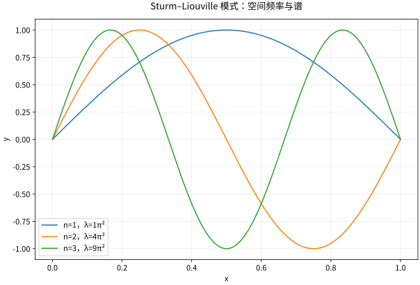

# Fourier方法与Sturm-Liouville谱

## 分离变量的实质是找空间算子的特征向量

同一根有限长杆，双端保持零温度偏差和双端绝热，会留下相同的空间模式吗？先在 $0<x<L$、$L>0$ 上求无源热方程 $u_t=\kappa u_{xx}$，$\kappa>0$ 为常数，初值 $u(x,0)=g(x)$。本页先从一个可跟算的模式完成边界选择与时间演化，再进入一般系数的谱框架。

设非平凡分离解 $u(x,t)=X(x)T(t)$。在 $XT\ne0$ 的区域代入得

$$\frac{T'}{\kappa T}=\frac{X''}{X}=-\lambda,
\qquad -X''=\lambda X,\qquad T'+\kappa\lambda T=0.$$

两边分别只依赖 $t,x$，所以只能等于同一常数。这里把**空间算子 $-d^2/dx^2$ 的特征值记为 $\lambda$**，分离常数为 $-\lambda$；这样正的 $\lambda$ 对应热模式衰减。得到两条 ODE 后直接在整个区间求解，不在 $X$ 的零点继续做除法。边界条件决定允许哪些非零 $X$，时间方程决定每个模式怎样演化；零函数虽对任意 $\lambda$ 都满足方程，却不算特征函数。

下面空间 ODE 的指数、双曲或三角解来自 [[数学/46-数理方程/02-高阶线性常微分方程与方程组#常系数与特征多项式|常系数特征方程]]：只需把 $X''+\lambda X=0$ 的三类根对应到解，再回到本页代入端点。时间 ODE 用 [[数学/46-数理方程/01-一阶常微分方程与初值问题#一阶线性方程的积分因子|积分因子的初值解]]，取 $p=\kappa\lambda,q=0$ 即可，不需先学完整 PDE 理论。

若 $x,L$ 有长度单位，当 $\lambda>0$ 时，空间角频率 $k=\sqrt\lambda$ 的单位是长度的倒数（相位 $kx$ 无量纲），$\lambda$ 是长度的倒数平方；$\kappa$ 的单位是长度平方/时间，故 $\kappa\lambda$ 是时间的倒数。它是热模式的衰减率，不是时间振荡角频率。

## 三种边界，三种频率

### 双端 Dirichlet：两个零值端点怎样筛出整数频率

先要求 $X(0)=X(L)=0$，对 $-X''=\lambda X$ 完整检查三类实 $\lambda$。

- $\lambda=-a^2<0$，$a>0$：$X=A\cosh(ax)+B\sinh(ax)$。左端给 $A=0$，右端给 $B\sinh(aL)=0$；因 $aL>0$、$\sinh(aL)>0$，只能 $B=0$，没有非零特征函数。
- $\lambda=0$：$X=A+Bx$。左端给 $A=0$，右端给 $BL=0$，所以仍只有零函数。
- $\lambda=k^2>0$，$k>0$：$X=A\cos(kx)+B\sin(kx)$。左端给 $A=0$；要保留非零解必须 $B\ne0$，故右端要求 $\sin(kL)=0$，即 $kL=n\pi$、$n=1,2,\ldots$。

因此正模式及其特征值是

$$X_n(x)=\sin\frac{n\pi x}{L},\qquad
\lambda_n=\left(\frac{n\pi}{L}\right)^2,\qquad n\ge1.$$

$n=0$ 给出零函数，已在零特征值情形被排除；负的整数只改变同一正弦函数的符号，不产生新的方向。以普通内积 $\langle X,Y\rangle=\int_0^L X\overline Y\,dx$ 衡量这些模式，

$$\int_0^L\sin^2\frac{n\pi x}{L}\,dx=\frac L2,
\qquad \phi_n(x)=\sqrt{\frac2L}\sin\frac{n\pi x}{L}$$

使 $\|\phi_n\|_2=1$。整体符号仍可任选，归一化只固定长度，不是另一个边界条件。对同一种边界的两个模式，分部积分给

$$(\lambda_n-\lambda_m)\int_0^L X_nX_m\,dx
=[X_nX_m'-X_n'X_m]_0^L=0.$$

所以不同特征值的模式正交；这里的权重是 $w=1$。下一段的 Neumann 和混合条件也分别使这个边界项为零，但不同边界的函数不必互相正交，不能混用三套基底。

*图：区间 $(0,1)$ 双端零值边界的前三个正弦特征函数；频率越高，空间曲率与特征值越大。*

### 双端 Neumann：导数为零为什么留下常数

把同一个空间 ODE 的边界改成 $X'(0)=X'(L)=0$。

$\lambda=-a^2<0$ 时，$X'=aA\sinh(ax)+aB\cosh(ax)$，左端先给 $B=0$，右端再给 $A\sinh(aL)=0$，仍无非零解。$\lambda=0$ 时 $X=A+Bx$，两端导数只要求 $B=0$，所以任意非零常数被保留：这是**零特征值的非零模式**，归一化可取 $\phi_0=1/\sqrt L$。

$\lambda=k^2>0$ 时，$X'=-kA\sin(kx)+kB\cos(kx)$；左端给 $B=0$，非零 $A$ 使右端要求 $\sin(kL)=0$。于是正模式为

$$\lambda_n=\left(\frac{n\pi}{L}\right)^2,\qquad
\phi_n(x)=\sqrt{\frac2L}\cos\frac{n\pi x}{L},\qquad n\ge1,$$

加上单独列出的 $\lambda_0=0,\phi_0=1/\sqrt L$。正余弦模式的平方积分同样为 $L/2$；常数模式的平方积分为 $L$，不能给它套正模式的 $\sqrt{2/L}$。

### 左 Dirichlet、右 Neumann：半整数来自哪个端点

改成 $X(0)=0,X'(L)=0$。$\lambda=-a^2<0$ 时，左端给 $A=0$，右端是 $aB\cosh(aL)=0$，故 $B=0$。$\lambda=0$ 时左端给 $A=0$、右端给 $B=0$，所以没有常数零模式。

$\lambda=k^2>0$ 时左端仍给 $A=0$，右端则要求 $kB\cos(kL)=0$。非零解取 $B\ne0$，因此 $\cos(kL)=0$、$kL=(n+1/2)\pi$，得到

$$\lambda_n=\left(\frac{(n+1/2)\pi}{L}\right)^2,\qquad
\phi_n(x)=\sqrt{\frac2L}\sin\frac{(n+1/2)\pi x}{L},\qquad n=0,1,\ldots.$$

这里 $n=0$ 对应非零的最低模式，特征值为 $(\pi/(2L))^2>0$；不要把“编号从0开始”误认成“特征值为0”。归一化来自同样的 $\int_0^L\sin^2(kx)dx=L/2$，因为 $\sin(2kL)=0$。

### 把空间模式交给时间方程，完成第一次热求解

固定任一已经由边界筛出的 $X_n$，时间方程是 $T_n'+\kappa\lambda_nT_n=0$。积分因子 $e^{\kappa\lambda_nt}$ 给

$$T_n(t)=T_n(0)e^{-\kappa\lambda_nt}.$$

沿用下一课的同一完整例：$L=\pi,\kappa=1,g(x)=\sin x+\tfrac13\sin3x$、双端 Dirichlet。空间谱给 $\lambda_1=1,\lambda_3=9$，初值固定两项振幅，因此

$$u(x,t)=e^{-t}\sin x+\frac13e^{-9t}\sin3x.$$

两个空间模式的二阶导数分别是 $-X_1,-9X_3$，时间导数也恰好乘 $-1,-9$，逐项核对 $u_t=u_{xx}$；两端都为零，$t=0$ 恢复同一 $g$。在 $t=1$，第三项与第一项的振幅比是 $e^{-8}/3$，由较大的 $\lambda_3$ 决定。这个有限两项解不需要交换无穷和与求导；去 [[数学/46-数理方程/07-热方程分离变量与扩散机制#完整算例与可检验衰减|同例的热衰减图]] 后，返回指出图中哪一部分先消失及对应的特征值。

Neumann 的 $\lambda_0=0$ 给 $T_0'=0$，常数部分不衰减。对足够光滑的无源热解，

$$\frac d{dt}\int_0^Lu(x,t)\,dx
=\kappa[u_x]_0^L=0.$$

因此平均值守恒；沿用下一课 $g(x)=2+\cos(\pi x/L)$，得到 $u=2+e^{-\kappa(\pi/L)^2t}\cos(\pi x/L)$，趋向初始平均值2。Dirichlet 和本页混合边界没有零模式，全部模式衰减；对 $L^2$ 初值其 $L^2$ 范数趋于0。Dirichlet 的固定零温边界可以与外界交换热量，不能把 Neumann 的平均守恒公式照搬过去；$\tfrac12\int u^2$ 的耗散又是另一种量，不是总温度积分。

对任意 $g\in L^2(0,L)$，令 $c_n=\langle g,\phi_n\rangle$，采用所选边界的完整基底，$u=\sum_n c_ne^{-\kappa\lambda_nt}\phi_n$ 在 $t\downarrow0$ 以 $L^2$ 意义恢复初值。常系数热方程在 $t\ge\tau>0$ 的指数衰减可控制逐项求导；这不保证初始端点的逐点相容性，也不由正交性独自证明完备性。需要连续到初始边角时另核 $g$ 与边界的相容条件；下面保留一般完备性理论的入口。

## 正则 Sturm–Liouville 问题

在有限区间 $[a,b]$ 上考虑
$$-(pX')'+qX=\lambda wX,$$
其中 $p\in C^1$ 且正，$q,w$ 实连续、$w>0$，配以实的分离齐次边界条件，使边界型 $[p(X'\overline Y-X\overline{Y'})]_a^b$ 为零。相应内积为 $\langle X,Y\rangle_w=\int_a^b wX\overline Y$。

将两个特征方程相乘、相减再积分得
$$(\lambda-\overline\mu)\int_a^b wX\overline Y=0,$$
先取 $Y=X$、$\mu=\lambda$，由于 $\int_a^b w|X|^2>0$，得 $\lambda=\overline\lambda$，即特征值实数。再对不同实特征值使用同一等式，得到加权正交。这些结论依赖**实系数、自伴边界和正权重**；对非自伴问题不能直接照搬。

## 能量商与谱性质

在 Dirichlet 条件下，分部积分得到
$$\lambda=\frac{\int_a^b(p|X'|^2+q|X|^2)dx}{\int_a^b w|X|^2dx}.$$
若 $q\ge0$，特征值正。一般 Robin 条件会贡献边界项，不能遗漏后还宣称同样非负。正则自伴问题的特征值离散趋于正无穷，特征函数在加权 $L^2$ 中完备；证明可经适当平移后的 Green 算子紧自伴谱定理实现。正交性上面已直接证明，完备性则是更深的存在理论，不是正交自动推出。

## 非齐次项如何投影

对本页 $p=w=1,q=0$ 的常系数问题，特征函数归一后写 $u=\sum a_n(t)X_n$、$f=\sum f_n(t)X_n$，则 $u_t=\kappa u_{xx}+f$ 给 $a_n'+\kappa\lambda_na_n=f_n$，$u_{tt}=c^2u_{xx}+f$ 给 $a_n''+c^2\lambda_na_n=f_n$；初值也必须投影，波动方程还需要初始速度。对于 $\lambda_n>0$，无源热模态衰减、无源波模态振荡，空间模态完全相同；$\lambda_n=0$ 时热幅度为常数，波幅度一般为时间的仿射函数，不属于振荡模式。热幅度的非齐次初值解直接消费积分因子公式：

$$a_n(t)=a_n(0)e^{-\kappa\lambda_nt}
+\int_0^t e^{-\kappa\lambda_n(t-s)}f_n(s)\,ds.$$

数学分析的 Fourier 级数在这里成为求解器，正交投影的权重必须与算子一致。一般 Sturm–Liouville 系数下，要先指定相应演化方程；例如 $w u_t=\kappa[(p u_x)'-qu]+wf$ 才给上面的热幅度方程，$f_n=\langle f,X_n\rangle_w$。不能把任意非均匀杆都写成原来的 $u_t=\kappa u_{xx}$ 后仍使用加权谱。若一般 $q$ 或 Robin 边界使特征值为负，对应无源热幅度会增长，不能沿用本页三种 $-X''$ 边界的衰减结论。

## 自测与解答

在 $(0,\pi)$ 上展开常数 $g(x)=1$ 为正弦级数，并解释端点发生什么。

> [!question]- 解答
> $b_n=(2/\pi)\int_0^\pi\sin nx\,dx=2(1-(-1)^n)/(\pi n)$，仅奇数项非零。在内部级数为 1，端点每项都为零，所以级数端点值为零。这对应奇延拓的跳跃中点，说明 $L^2$ 展开不强制原函数与基函数在边界点一致。

保持 $L=\pi,\kappa=1$，只把原来的右端 $X(\pi)=0$ 改成 $X'(\pi)=0$，左端仍为零值。原第一模式 $\sin x$ 还能使用吗？新的最低模式及其热时间因子是什么？

> [!question]- 改边界的核对
> $X=\sin x$ 在右端的导数为 $\cos\pi=-1$，不满足新边界。一般正特征值解先由 $X(0)=0$ 得 $X=B\sin(kx)$，再由 $X'(\pi)=kB\cos(k\pi)=0$ 得 $k=n+1/2$；最低 $k=1/2$，故 $X=\sin(x/2)$、$\lambda=1/4$，热时间因子为 $e^{-t/4}$。$\lambda=0$ 的线性解被左端零值与右端零导数一起排除，所以没有不衰减的常数项。改边界也会改变用于投影同一初始函数的基底，不能只修改旧时间指数。

## 继续学习

前一节：[[数学/46-数理方程/05-一阶偏微分方程与特征线|一阶偏微分方程与特征线]]。 下一节：[[数学/46-数理方程/07-热方程分离变量与扩散机制|热方程分离变量与扩散机制]]。

课程地图：[[数学/46-数理方程/00-数理方程-MOC|数理方程课程地图]]；[[数学/90-资源/06-统一符号约定与定理条件索引|符号与条件索引]]。

## 跨学科连接

[[数学/16-数学分析/13-Fourier级数正交展开与收敛|Fourier级数正交展开与收敛]]：先用该页区分 $L^2$、逐点和一致收敛，再按本页的实系数、自伴边界和正权重把投影换成加权内积；正交性不单独推出特征函数完备性。

## 核验与延伸阅读

本页为独立编写的讲解、推导与算例；以下一手教材用于对照标准定义与课程范围，不是逐段译写。更具体的主题定位见 [[数学/90-资源/04-六科学术来源与阅读对照|学术来源对照]]。

- [Victor Ivrii：Partial Differential Equations，作者课程教材](https://www.math.utoronto.ca/courses/apm346h1/20181/PDE-textbook/contents.html)

## 同一空间谱返回量子能量与相位

携带 $\lambda_n$[m⁻²]、归一基 $\phi_n$[m⁻ᐟ²]、端点条件进入 [[物理/40-量子力学/03-连续波包概率流与算子边界#相同微分表达式，边界给不同算子|量子阱与环]]。在零势、质量 $m>0$ 的对应算子中 $E_n=\hbar^2\lambda_n/(2m)$[J]，量子时间因子为 $e^{-iE_nt/\hbar}$；回本页对比热 $e^{-\kappa\lambda_nt}$ 的衰减。空间特征函数可以复用，但热幅度不是概率幅，$\kappa\lambda_n$ 不是量子角频率。

本页“能量商与谱性质”的证明进入 [[物理/40-量子力学/09-近简并微扰与变分能量界#变分给上界时先检查下界与试探域|量子变分上界]]，携带归一化、边界项、二次型域与下界回来。把 $p,q,w$ 换成具体物理 Hamiltonian 需恢复J单位；Robin项和试探域不能略去。无下界的完整恒定Stark势不满足最低能量上界的同一合同，不能因某个有限矩阵有最小本征值就移植本页结论。
