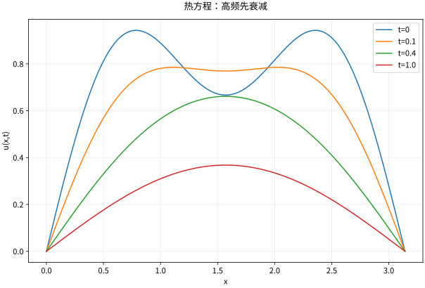

# 热方程分离变量与扩散机制

## 热方程为何迅速抹掉细节

在 $(0,L)$ 上取 $u_t=\kappa u_{xx}$、$\kappa>0$，边界 $u(0,t)=u(L,t)=0$，初值 $g$。由空间特征函数展开
$$u(x,t)=\sum_{n=1}^\infty b_ne^{-\kappa(n\pi/L)^2t}\sin\frac{n\pi x}L,\quad b_n=\frac2L\int_0^Lg(x)\sin\frac{n\pi x}Ldx.$$
高频的衰减率按 $n^2$ 增大，因此精细振荡比大尺度轮廓更早消失。热方程不是各频率同速缩小。

若 $g\in L^2$，该式在 $t=0$ 以 $L^2$ 意义恢复初值，对每个 $t>0$ 在内部光滑。对 $t\ge\tau>0$，指数压过任意 $n$ 的幂，可控制逐项空间和时间求导。若还要求在初始边角连续，必须有相容边界数据。

## 完整算例与可检验衰减

令 $L=\pi,\kappa=1,g(x)=\sin x+\tfrac13\sin3x$，则
$$u(x,t)=e^{-t}\sin x+\frac13e^{-9t}\sin3x.$$
在 $t=1$，第三模态相对第一模态的系数比为 $e^{-8}/3$，比初始的 $1/3$ 又小了约 $e^{-8}$ 倍。没有需要估计的无穷尾项，这个例子能直接验证 PDE、边界、初值与频率衰减。

*图：上述两模态初值在不同时刻的解。高频波纹先消失，整体随后逐渐衰减。*

## 能量证明唯一性

对足够光滑解，令 $E(t)=\tfrac12\int_0^L u^2dx$，则
$$E'=\kappa\int u u_{xx}dx=-\kappa\int u_x^2dx,$$
边界项因零值边界消失。若两个解同初边值，对差使用此式，初始能量零且不能增大，差恒零。Poincaré 不等式还给出 $E'\le-2\kappa(\pi/L)^2E$，所以 $\|u(t)\|_2\le e^{-\kappa(\pi/L)^2t}\|g\|_2$。

最大值原理则控制峰值：在有限时间柱内，最大值受初始面和侧边界控制，而不是由终止时刻边界预先指定。正解不应在无源、零边界条件下自行产生更大正峰值。

## 非零边界用抬升，而非硬套正弦

若 $u(0,t)=a(t),u(L,t)=b(t)$，取 $\ell(x,t)=a(t)(1-x/L)+b(t)x/L$，令 $v=u-\ell$。则 $v$ 零边界，并满足 $v_t-\kappa v_{xx}=f-\ell_t$，因为 $\ell_{xx}=0$。初值也要改成 $g-\ell(\cdot,0)$。遗漏源项 $-\ell_t$ 是时间依赖边界问题的常见错误。

Neumann 零通量边界则保留常数模式，总质量守恒，长期一般趋向初始平均值，而不是零。边界条件会改变长期结论。

## 自测与解答

若 $u_x(0,t)=u_x(L,t)=0$，证明平均温度不变，并写出 $g(x)=2+\cos(\pi x/L)$ 的解。

> [!question]- 解答
> $\frac d{dt}\int_0^L u=\kappa[u_x]_0^L=0$。解为 $u=2+e^{-\kappa(\pi/L)^2t}\cos(\pi x/L)$，长期趋向 2。不能使用只有正弦、没有常数的 Dirichlet 谱来解此题。

## 继续学习

前一节：[[数学/46-数理方程/06-Fourier方法与Sturm-Liouville谱|Fourier方法与Sturm-Liouville谱]]。 下一节：[[数学/46-数理方程/08-热核全空间问题与Duhamel原理|热核全空间问题与Duhamel原理]]。

课程地图：[[数学/46-数理方程/00-数理方程-MOC|数理方程课程地图]]；[[数学/90-资源/06-统一符号约定与定理条件索引|符号与条件索引]]。

## 跨学科连接

[[数学/20-线性代数与几何/12-特征结构对角化与动力系统|特征结构对角化与动力系统]]。建议比较定义、适用条件与所用范数，再迁移方法。

## 核验与延伸阅读

本页为独立编写的讲解、推导与算例；以下一手教材用于对照标准定义与课程范围，不是逐段译写。更具体的主题定位见 [[数学/90-资源/04-六科学术来源与阅读对照|学术来源对照]]。

- [Victor Ivrii：Partial Differential Equations，作者课程教材](https://www.math.utoronto.ca/courses/apm346h1/20181/PDE-textbook/contents.html)
