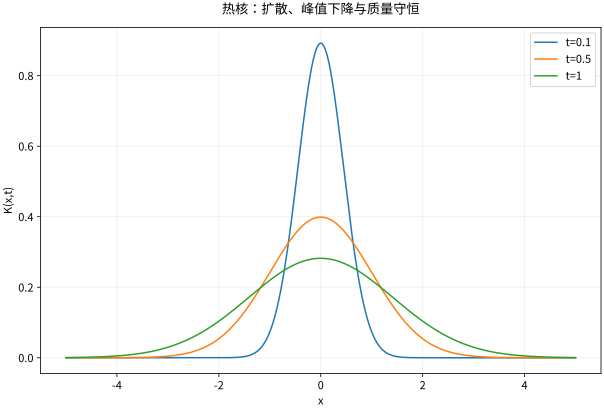

# 热核全空间问题与Duhamel原理

## 热核是一单位瞬时点热源的响应

在 $\mathbb R^d$ 上，热核为
$$K_t(x)=(4\pi\kappa t)^{-d/2}\exp\left(-\frac{|x|^2}{4\kappa t}\right),\qquad t>0.$$
它满足 $\partial_tK=\kappa\Delta K$、$K>0$、$\int K_t=1$，每个坐标方差为 $2\kappa t$。初始时它不趋向普通有限值函数，而是在分布意义趋向 Dirac 质量 $\delta_0$。

归一化可以由 Gaussian 积分核验；对数求导后代入 PDE，可逐项检查系数。若漏掉 $(4\pi\kappa t)^{-d/2}$，总质量会随时间改变，便不是单位点源的响应。

## 卷积与近似恒等

初值 $g$ 的解是 $u(x,t)=K_t*g(x)$。对 $1\le p<\infty$，$g\in L^p$ 时有 $\|K_t*g-g\|_p\to0$；连续有界函数在每个连续点也恢复点值，一致连续时可得到一致恢复。一般 $L^\infty$ 函数不能不加条件声称范数强收敛。

证明思路是把卷积误差写成 $\int K_t(y)(g(x-y)-g(x))dy$，近处用平移连续性，远处用 Gaussian 尾质量趋零。Gaussian 配方还给出 $K_t*K_s=K_{t+s}$，说明演化一段再演化另一段等于总时长演化，即半群性质。

*图：一维热核随时间扩散变宽、峰值下降，总面积始终为 1；横轴范围有限，因此图外仍有小尾部。*

## 完整算例：Gaussian 初值

在一维、$g(x)=e^{-x^2}$ 时，卷积配方得到
$$u(x,t)=\frac1{\sqrt{1+4\kappa t}}\exp\left(-\frac{x^2}{1+4\kappa t}\right).$$
令 $s=1+4\kappa t$ 直接计算导数，也可验证 $u_t=\kappa u_{xx}$；积分始终为 $\sqrt\pi$。峰值下降不表示热量消失，而是同样质量摊到更宽区域。

若初值改为归一化的 $N(0,v_0)$ 密度，卷积后方差变为 $v_0+2\kappa t$。去 [[数学/70-信号处理与多模态数学/03-高斯噪声扩散Score与ODE-SDE直觉#深入：用同一条热流算清密度、轨迹与信息量|同一热流的概率主例]]，可逐项验证其 PDE，再算 Brownian 加噪与确定性概率流的跨时协方差为何分别为 $v_s$ 与 $\sqrt{v_sv_t}$；返回时保留本页 $g=e^{-x^2}$ 总质量 $\sqrt\pi$ 的原对象，不把一般热场自动当概率。

## Duhamel 将持续热源拆成瞬时注入

对 $u_t-\kappa\Delta u=f$，零时刻初值为 $g$，形式为
$$u(t)=K_t*g+\int_0^tK_{t-s}*f(s)\,ds.$$
在光滑且充分衰减数据下可直接微分核验；在 $L^p$ 中需要时间可积性等条件，积分可按 Banach 空间积分理解。每个时刻 $s$ 注入的源先传播 $t-s$，所以核是 $K_{t-s}$，不是 $K_s$ 随便替换。

半直线零值边界用奇延拓得到核 $K_t(x-y)-K_t(x+y)$，$x,y>0$；零通量边界用偶延拓得到加号。代入 $x=0$ 检查函数值或导数，便能确定镜像符号。

## 有限与无限传播的区别

非负、非零、紧支撑初值经热核后，在每个 $t>0$ 的所有空间点都正。这是经典热方程的无限传播速度性质；波动方程则有有限影响锥。它反映理想化扩散模型的数学结构，不意味着微观热信号真的违反物理传播限制。

## 自测与解答

在全空间常数初值 $g=3$、空间常数源 $f(t)=2t$ 下，解为何不需要计算 Gaussian 卷积？

> [!question]- 解答
> 热核总质量为 1，卷积保持常数，Duhamel 给出 $u(t)=3+\int_0^t2sds=3+t^2$。它不在全空间 $L^1$，但作为有界光滑解完全成立，说明不同解空间的前提应分开陈述。

## 继续学习

前一节：[[数学/46-数理方程/07-热方程分离变量与扩散机制|热方程分离变量与扩散机制]]。 下一节：[[数学/46-数理方程/09-一维波动方程特征锥与能量|一维波动方程特征锥与能量]]。

课程地图：[[数学/46-数理方程/00-数理方程-MOC|数理方程课程地图]]；[[数学/90-资源/06-统一符号约定与定理条件索引|符号与条件索引]]。

## 跨学科连接

[[数学/16-数学分析/15-收敛定理与Fubini-Tonelli|收敛定理与Fubini-Tonelli]]：Duhamel 的时空卷积若要交换时间、空间积分或极限，须给出非负性以用 Tonelli，或给出绝对可积/共同支配以用 Fubini 或支配收敛；这与热核对 $L^p$ 初值的近似恒等收敛是不同的前提和结论。

## 核验与延伸阅读

本页为独立编写的讲解、推导与算例；以下一手教材用于对照标准定义与课程范围，不是逐段译写。更具体的主题定位见 [[数学/90-资源/04-六科学术来源与阅读对照|学术来源对照]]。

- [Victor Ivrii：Partial Differential Equations，作者课程教材](https://www.math.utoronto.ca/courses/apm346h1/20181/PDE-textbook/contents.html)
