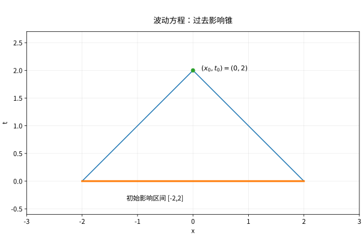

# 一维波动方程特征锥与能量

## 两族特征线把振动拆成左右行波

对 $u_{tt}-c^2u_{xx}=0$，$c>0$，令 $\xi=x-ct,\eta=x+ct$，链式法则得到 $u_{\xi\eta}=0$，所以 $u=F(x-ct)+G(x+ct)$。给定 $u(x,0)=g(x),u_t(x,0)=h(x)$，联立求导与积分得 d’Alembert 公式
$$u(x,t)=\frac{g(x-ct)+g(x+ct)}2+\frac1{2c}\int_{x-ct}^{x+ct}h(s)ds.$$
第一项把初位移分成两股，第二项积累初速度。$1/(2c)$ 是由特征坐标尺度带来的，不能随意省略。

*图：事件 $(x_0,t_0)$ 只受初始区间 $[x_0-ct_0,x_0+ct_0]$ 及其过去锥内源项影响。锥外变化不能立即影响该点。*

## 完整算例

若 $g(x)=e^{-x^2},h=0$，则 $u=\tfrac12e^{-(x-ct)^2}+\tfrac12e^{-(x+ct)^2}$，两个半幅波向相反方向传播。对 $g=0,h(x)=\cos kx$，积分得
$$u(x,t)=\frac{\sin(ckt)}{ck}\cos kx\quad(k\ne0).$$
当 $k\to0$，极限为 $t$，恰对应初速度恒为 1 的零频解。公式出现 $1/k$ 时要通过极限处理零频，不可直接判为无解。

## 能量为什么不衰减

在全线快速衰减或有限区间齐次固定端条件下，
$$E(t)=\frac12\int(u_t^2+c^2u_x^2)dx.$$
求导并分部积分得 $E'=\int u_t(u_{tt}-c^2u_{xx})dx$ 加边界通量，所以无源且无边界功时守恒。对两个同初边值解的差得到唯一性。局部能量在时空锥内的估计则可证明有限传播，即使没有显式公式也适用。

若存在外力，$E'=\int f u_t$；阻尼方程 $u_{tt}+\gamma u_t-c^2u_{xx}=0$ 则有 $E'=-\gamma\int u_t^2$。热方程能量耗散与波动方程能量守恒应明确区分。

## 固定端与强迫项

有限区间双端零值边界下，正弦模态满足
$$a_n''+c^2(n\pi/L)^2a_n=f_n(t).$$
齐次解由正弦余弦时间函数组成；初位移和初速度分别决定两个系数。全线源项的零初值响应为
$$\frac1{2c}\int_0^t\int_{x-c(t-s)}^{x+c(t-s)}f(y,s)\,dy\,ds.$$
积分区域正是过去影响锥。半线固定端可对初值和源作奇延拓，自由端则用偶延拓。

## 自测与解答

$0<x<\pi,c=1$，双端固定，$g=\sin2x,h=3\sin2x$，求解并核验能量。

> [!question]- 解答
> $u=(\cos2t+\tfrac32\sin2t)\sin2x$。令时间系数为 $a$，则 $E=(\pi/4)(a'^2+4a^2)$，初值给 $E=(\pi/4)(9+4)=13\pi/4$，且 $a''+4a=0$ 保证恒定。

## 继续学习

前一节：[[数学/46-数理方程/08-热核全空间问题与Duhamel原理|热核全空间问题与Duhamel原理]]。 下一节：[[数学/46-数理方程/10-多维波动方程球面平均与传播|多维波动方程球面平均与传播]]。

课程地图：[[数学/46-数理方程/00-数理方程-MOC|数理方程课程地图]]；[[数学/90-资源/06-统一符号约定与定理条件索引|符号与条件索引]]。

## 跨学科连接

[[数学/15-微积分/16-Green-Gauss-Stokes内部变化与边界累积|Green-Gauss-Stokes内部变化与边界累积]]：对波动能量求导后的分部积分边界项就是边界通量；在足够光滑且固定端或衰减使该项为零时才得守恒，外力、阻尼或边界功须保留相应项。

## 核验与延伸阅读

本页为独立编写的讲解、推导与算例；以下一手教材用于对照标准定义与课程范围，不是逐段译写。更具体的主题定位见 [[数学/90-资源/04-六科学术来源与阅读对照|学术来源对照]]。

- [Victor Ivrii：Partial Differential Equations，作者课程教材](https://www.math.utoronto.ca/courses/apm346h1/20181/PDE-textbook/contents.html)

## 电子电路往返：行波必须携带电流与阻抗边界

去 [[电子电路/46-电磁射频与高速/02-传输线反射与终端#从增量电路到电报方程|每米电路得到PDE]]，令本页u=v（V）、x（m）、t（s）、c=v_p（m/s）；均匀无损L′（H/m）、C′（F/m）给 $v_p=1/\sqrt{L'C'}$、$Z_0=\sqrt{L'/C'}$（Ω）。本页行波与影响锥确定何时能够影响，返回 [[电子电路/46-电磁射频与高速/02-传输线反射与终端#边界消元与格图|电压电流共同消元]] 决定到达后的幅度：$v=F+B$、$i=(F-B)/Z_0$，负载 $v=Z_L i$ 才推出 $\Gamma_L=(Z_L-Z_0)/(Z_L+Z_0)$。总v/i不等于单行波阻抗。

u=0固定端对应短路电压；开路i=0在无损电报方程中给v_x=0，是另一边界。有损或频散不能把本页恒速双行波当完整解。电子每米能量 $u_e=(C'v^2+L'i^2)/2$（J/m）及通量vi（W）满足 $\partial_tu_e+\partial_x(vi)=0$；对有限线积分得 $\dot E=vi(0)-vi(\ell)$。本页数学归一能量并未自动有J单位，且无损线被边界供能时内部E可增加，不违守恒。

**迁移1。** Z0=50 Ω，负载100 Ω，入射F=.3 V。求反射B、负载v/i与耗散。**答案：** Γ=1/3、B=.1 V、v=.4 V、i=.004 A，若这些为共同同频RMS则P=.0016 W；若为阶跃瞬时平台，则vi是瞬时功率。保留幅度约定可接受，不把电压反射负号解释成负电阻。

**迁移2。** 线长.2 m、vp=2×10⁸ m/s，负载切换在首波到达时才产生反射，源何时首次看见？**答案：** T=1 ns，初始源激励后负载首达1 ns，反射回源2 ns。若负载在已稳态时刻t*=3 ns本地切换，则其影响最早4 ns到源；不能混用“源发射往返2T”和“负载本地事件传播T”。有限传播只定最早影响，源阻抗还决定后续再反射。
