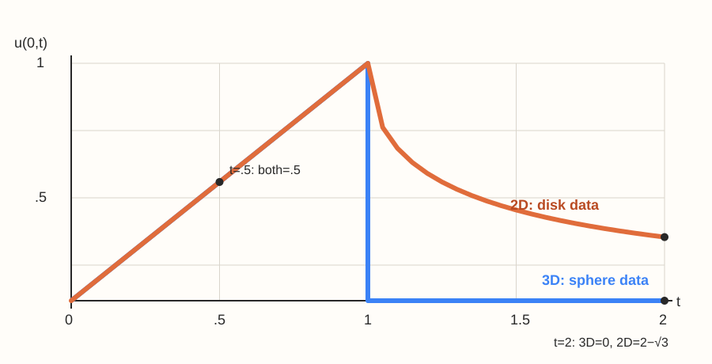

# 多维波动方程球面平均与传播

## 高维波动不仅是把下标改成向量

空间维数改变基本解的支撑结构。三维无源波动的**基本解、以及固定点依赖的初始数据**落在相应球面上；二维则依赖整个圆盘内的数据并通常留下尾部。任意三维初值解并不因此在波前过后自动为零：是否归零还取决于球面所扫到的初值。二者都有有限传播，但只有前者具有这里所说的无尾 Huygens 性质。不能把三维球面公式直接替换成二维圆周积分。

## 三维 Kirchhoff 公式及常数核验

设 $u_{tt}-c^2\Delta u=0$，初位移 $g$、初速度 $h$ 足够光滑。定义球面平均
$$M_rf(x)=\frac1{4\pi r^2}\int_{|y-x|=r}f(y)dS_y.$$
则对 $t>0$，
$$u(x,t)=\partial_t\bigl[tM_{ct}g(x)\bigr]+tM_{ct}h(x).$$
等价地，速度项为 $(4\pi c^2t)^{-1}\int_{|y-x|=ct}h(y)dS_y$。取 $h\equiv1,g=0$，必须得到 $u=t$；球面积 $4\pi c^2t^2$ 正好核验系数。

推导核心是球面平均恒等式 $\partial_r^2(rM_rf)=rM_r\Delta f$。它把三维径向平均化为一维波动，再由 $t\downarrow0$ 的平均极限恢复初值。球面对称时也可令 $v=ru$，得到 $v_{tt}=c^2v_{rr}$，并用原点正则性选择奇延拓。

## 二维 Poisson 波动公式

定义
$$W_t f(x)=\frac1{2\pi c}\int_{|y-x|<ct}\frac{f(y)}{\sqrt{c^2t^2-|y-x|^2}}\,dy.$$
则 $u=\partial_t W_tg+W_th$。它可由三维数据不依赖第三坐标、把球面上下两半投影到圆盘得到，投影 Jacobian 恰产生平方根分母。圆盘边缘核虽无界，却可积；不能因局部发散就宣布积分不存在。

对 $f\equiv1$，极坐标积分给 $W_t1=(1/c)\int_0^{ct}r/\sqrt{c^2t^2-r^2}\,dr=t$，再次核验常数。位移项的时间导数应作用于整个随时间变化的积分，不只作用于分母。

## 有限传播与尾部不是同一概念

三维公式只依赖距离 $ct$ 的初始球面数据，二维公式依赖距离小于 $ct$ 的整个圆盘。若初始扰动紧支撑，固定观察点在波前通过后，二维可能仍有衰减尾部。这里的严格无尾结论针对常系数自由波方程，加入低阶项或改变几何一般会破坏它。

### 同一初速度在原点的可算对照

令 $c=1,g=0$，初速度 $h$ 在单位球（二维为单位圆盘）内为 $1$、外为 $0$。这是分段常值数据；在前沿 $t=1$ 不主张未声明的逐点经典值，可把它看作平滑近似的极限。对原点，三维球面只在 $0<t<1$ 扫到 $h=1$，二维圆盘则给
$$
u_{3\mathrm D}(0,t)=\begin{cases}t,&0<t<1,\\0,&t>1,\end{cases}\qquad
u_{2\mathrm D}(0,t)=\begin{cases}t,&0<t<1,\\t-\sqrt{t^2-1},&t>1.\end{cases}
$$

*先预测：在 $t=.5$ 两条曲线都应为 $.5$；在 $t=2$，三维为 $0$，二维为 $2-\sqrt3\approx.267949$。图只绘制这组数据的解析曲线，不能把三维的零尾部移植到下一节的 $g(x)=|x|^2$。*

有源问题再按 Duhamel 对每个源时刻叠加对应速度响应。在三维，空间点源形成延迟势，源只在满足传播时差的时间产生影响。

## 自测与解答

三维初值 $g(x)=|x|^2,h=0$ 时，求解并用 PDE 直接核验。虽然不衰减，局部光滑公式仍能使用。

> [!question]- 解答
> 球面平均 $M_r|y|^2=|x|^2+r^2$，所以 $u=\partial_t[t(|x|^2+c^2t^2)]=|x|^2+3c^2t^2$。直接有 $u_{tt}=6c^2$、$\Delta u=6$，方程成立，初始速度为零。该例不属于有限总能量类，因此不能用全空间有限能量结论讨论它的积分能量。

## 继续学习

前一节：[[数学/46-数理方程/09-一维波动方程特征锥与能量|一维波动方程特征锥与能量]]。 下一节：[[数学/46-数理方程/11-Laplace-Poisson方程与最大值原理|Laplace-Poisson方程与最大值原理]]。

课程地图：[[数学/46-数理方程/00-数理方程-MOC|数理方程课程地图]]；[[数学/90-资源/06-统一符号约定与定理条件索引|符号与条件索引]]。

## 跨学科连接

[[数学/15-微积分/15-曲面积分与通量法向和面积元|曲面积分与通量法向和面积元]]：Kirchhoff 公式的球面平均要用 $dS$ 除以 $4\pi r^2$；把速度项化为球面积分时还需随 $r=ct$ 正确换算，常数可由 $h\equiv1$ 得 $u=t$ 复算。

## 核验与延伸阅读

本页为独立编写的讲解、推导与算例；以下一手教材用于对照标准定义与课程范围，不是逐段译写。更具体的主题定位见 [[数学/90-资源/04-六科学术来源与阅读对照|学术来源对照]]。

- [Victor Ivrii：Partial Differential Equations，作者课程教材](https://www.math.utoronto.ca/courses/apm346h1/20181/PDE-textbook/contents.html)
