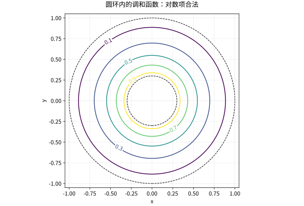

# 分离变量在矩形圆盘与球域

## 坐标应适应边界，而不是为了换公式

分离变量成功的关键是几何边界能由坐标面描述。矩形适合直角坐标，圆盘适合极坐标，球适合球坐标。换坐标后 Jacobian、Laplacian 与正交权重会一起改变，不能只改变量名字。

## 矩形的边界激励

在 $0<x<a,0<y<b$ 上，$\Delta u=0$，左、右、下边为零，上边为 $f(x)$。先以 $X_n=\sin(n\pi x/a)$ 满足左右边，纵向解 $Y_n''-(n\pi/a)^2Y_n=0$，下边零选双曲正弦，于是
$$u(x,y)=\sum_{n\ge1}b_n\frac{\sinh(n\pi y/a)}{\sinh(n\pi b/a)}\sin\frac{n\pi x}a,\quad b_n=\frac2a\int_0^af(x)\sin\frac{n\pi x}adx.$$
若 $f(x)=\sin(\pi x/a)$，只剩一个模式。越靠近下边，高频越受抑制，表现为椭圆方程的内部平滑。要在顶端角点连续匹配，$f(0)=f(a)=0$ 是相容条件；否则需以适当边界极限理解。

## 圆盘与圆环的差别在中心

极坐标中 $\Delta u=u_{rr}+u_r/r+u_{\theta\theta}/r^2$。角向周期性选择 $\cos n\theta,\sin n\theta$；径向给 $r^n,r^{-n}$，零频给常数与 $\log r$。

圆盘含中心，正则解排除负幂和对数，半径 $R$ 的边界 Fourier 系数向内乘 $(r/R)^n$。圆环不含中心，这些项都可能合法，需要内外两条边界共同确定系数。单位外圆与半径 $a<1$ 内圆分别取值 0、1 的径向调和解是 $u(r)=\log r/\log a$。

*图：圆环内径向调和函数的同心等值线；中心被排除，所以对数项在这里合法。*

## 球域与球谐函数

三维球坐标中 $\Delta=\partial_r^2+(2/r)\partial_r+r^{-2}\Delta_{\mathbb S^2}$。球面特征函数 $Y_{\ell m}$ 满足 $-\Delta_{\mathbb S^2}Y_{\ell m}=\ell(\ell+1)Y_{\ell m}$，径向对应 $r^\ell,r^{-\ell-1}$。球内正则解保留前者，外部衰减解保留后者。

若单位球边界给 $g=z^2=\cos^2\theta=1/3+(2/3)P_2(\cos\theta)$，内解为
$$u=\frac13+\frac23r^2P_2(\cos\theta)=z^2+\frac{1-r^2}{3}.$$
直接计算 $\Delta u=2-6/3=0$，边界 $r=1$ 恢复 $z^2$。不能把边界函数 $z^2$ 原样当作内部调和延拓，因为它的 Laplacian 非零。

## 非齐次方程的处理

Poisson 问题可先找到满足体源的特解 $u_p$，再求调和函数修正边界；也可投影到满足齐次边界的特征函数。两种方法都必须同时处理体方程和边界，只有“分离变量满足 PDE”不足以完成问题。

## 自测与解答

单位圆盘边界 $u(1,\theta)=\cos2\theta$，求解并改写为笛卡尔多项式。

> [!question]- 解答
> 中心正则的解为 $u=r^2\cos2\theta=x^2-y^2$。负幂 $r^{-2}\cos2\theta$ 虽在去心圆盘调和，但在中心发散，不属于本题的规则解类。

## 继续学习

前一节：[[数学/46-数理方程/11-Laplace-Poisson方程与最大值原理|Laplace-Poisson方程与最大值原理]]。 下一节：[[数学/46-数理方程/13-Bessel-Legendre函数与正交展开|Bessel-Legendre函数与正交展开]]。

课程地图：[[数学/46-数理方程/00-数理方程-MOC|数理方程课程地图]]；[[数学/90-资源/06-统一符号约定与定理条件索引|符号与条件索引]]。

## 跨学科连接

[[数学/45-复变函数/11-共形映射Mobius变换与边值问题|共形映射Mobius变换与边值问题]]。建议比较定义、适用条件与所用范数，再迁移方法。

## 核验与延伸阅读

本页为独立编写的讲解、推导与算例；以下一手教材用于对照标准定义与课程范围，不是逐段译写。更具体的主题定位见 [[数学/90-资源/04-六科学术来源与阅读对照|学术来源对照]]。

- [Victor Ivrii：Partial Differential Equations，作者课程教材](https://www.math.utoronto.ca/courses/apm346h1/20181/PDE-textbook/contents.html)
