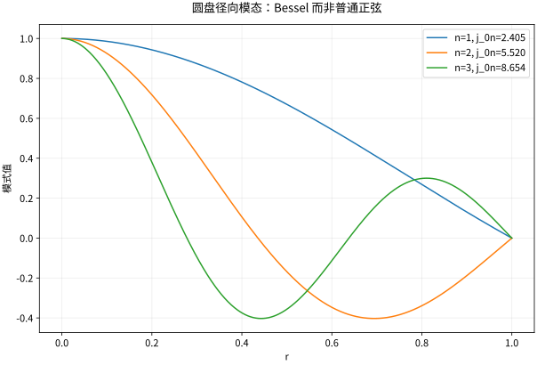

# Bessel-Legendre函数与正交展开

## 特殊函数不是额外加入的障碍

它们是几何改变后，普通正弦余弦的替代物。圆形区域分离后的径向方程不是常系数 ODE，于是出现 Bessel；球面的角向方程出现 Legendre。理解来源、边界选择与正交权重，比先背几十条恒等式有效。

## 圆盘的 Bessel 模式

对圆盘内 $-\Delta u=\lambda u$，取角模式 $e^{im\theta}$，$m$ 为整数，径向方程为
$$r^2R''+rR'+(\lambda r^2-m^2)R=0.$$
当 $\lambda=k^2>0$，规则解为 $J_{|m|}(kr)$，另一解 $Y_{|m|}$ 在中心奇异而排除。若半径为 $R_0$、边界值为零，则 $kR_0=j_{|m|,n}$，即 Bessel 的第 $n$ 个正零点，特征值 $j_{|m|,n}^2/R_0^2$。

将径向方程改写为 $-(rR')'+m^2R/r=\lambda rR$，可看出权重是 $r$。因此不同径向特征函数满足
$$\int_0^{R_0}rJ_m(j_{m,n}r/R_0)J_m(j_{m,k}r/R_0)dr=0\quad(n\ne k).$$
标准归一因子为 $\int_0^{R_0}rJ_m(j_{m,n}r/R_0)^2dr=(R_0^2/2)J_{m+1}(j_{m,n})^2$。忽略权重会算错投影系数。

*图：单位圆盘轴对称 Dirichlet 问题的前三个 $J_0(j_{0,n}r)$ 模式，均在外边界为零，中心有限。*

## Legendre 多项式的正交来源

在 $[-1,1]$，$-[(1-x^2)P_\ell']'=\ell(\ell+1)P_\ell$，两端系数退化，但要求端点规则可选出多项式。Rodrigues 公式
$$P_\ell(x)=\frac1{2^\ell\ell!}\frac{d^\ell}{dx^\ell}(x^2-1)^\ell$$
使其与所有低于 $\ell$ 次的多项式正交：分部积分 $\ell$ 次，端点项因零点阶数消失，低次多项式的高阶导数为零。归一化为 $P_\ell(1)=1$，范数平方 $2/(2\ell+1)$。

前三个是 $P_0=1,P_1=x,P_2=(3x^2-1)/2$。递推 $(\ell+1)P_{\ell+1}=(2\ell+1)xP_\ell-\ell P_{\ell-1}$ 提供计算方式，但高阶数值稳定性仍需另行研究。

## 球谐与圆膜振动的应用

球面上的 $Y_{\ell m}$ 可由连带 Legendre 函数乘 $e^{im\phi}$ 构成，$-\ell\le m\le\ell$，同一特征值具有 $2\ell+1$ 个独立角模式。不同相位、归一化约定会改变常数，不改变空间；使用库函数时应检查约定。

圆膜波动中同样的 Bessel 空间模式按频率 $\omega_{mn}=cj_{m,n}/R_0$ 振荡。圆形边界的固有频率不再是整数倍关系，这来自径向谱，而不是弦公式算得不够精确。

## 自测与解答

将 $x^2$ 按 $P_0,P_2$ 展开，并用正交积分求出两个系数。

> [!question]- 解答
> $x^2=1/3+(2/3)P_2$。投影到 $P_0$ 的系数为 $(\int_{-1}^1x^2dx)/(\int1dx)=1/3$；到 $P_2$ 的系数为 $[\tfrac12(3\cdot2/5-2/3)]/(2/5)=2/3$。这是球面二次边界数据的分离基础。

## 继续学习

前一节：[[数学/46-数理方程/12-分离变量在矩形圆盘与球域|分离变量在矩形圆盘与球域]]。 下一节：[[数学/46-数理方程/14-Fourier-Laplace变换解数理方程|Fourier-Laplace变换解数理方程]]。

课程地图：[[数学/46-数理方程/00-数理方程-MOC|数理方程课程地图]]；[[数学/90-资源/06-统一符号约定与定理条件索引|符号与条件索引]]。

## 跨学科连接

[[数学/16-数学分析/13-Fourier级数正交展开与收敛|Fourier级数正交展开与收敛]]。建议比较定义、适用条件与所用范数，再迁移方法。

## 核验与延伸阅读

本页为独立编写的讲解、推导与算例；以下一手教材用于对照标准定义与课程范围，不是逐段译写。更具体的主题定位见 [[数学/90-资源/04-六科学术来源与阅读对照|学术来源对照]]。

- [Victor Ivrii：Partial Differential Equations，作者课程教材](https://www.math.utoronto.ca/courses/apm346h1/20181/PDE-textbook/contents.html)
