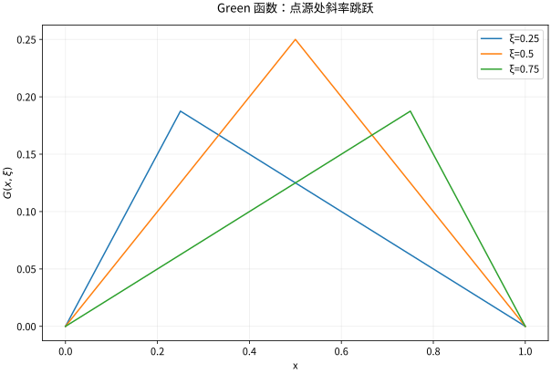

# Green函数基本解与边界响应

## Green 函数是满足边界的点源响应

基本解只满足全空间中的 $L\Phi=\delta$；Green 函数还必须满足题目的边界条件。对 $L=-\Delta$ 的零 Dirichlet 问题，$G(x,y)$ 关于 $y$ 满足 $-\Delta_yG(x,y)=\delta_x(y)$、$G=0$ 于边界。于是
$$u(x)=\int_\Omega G(x,y)f(y)dy-\int_{\partial\Omega}g(y)\partial_{n_y}G(x,y)dS_y.$$
第二项负号与本库的 $-\Delta$ 约定配套。证明从 Green 第二恒等式在挖去点源的小球域上应用，最后让小球收缩；不是直接把奇点当普通光滑函数积分。

## 一维完整构造

求 $-u''=f$ 于 $(0,1)$、$u(0)=u(1)=0$。对固定 $0<\xi<1$，点外 Green 函数分段线性；端点零、在 $\xi$ 连续以及下述导数跳跃条件共同确定
$$G(x,\xi)=\begin{cases}x(1-\xi),&x\le\xi,\\\xi(1-x),&x\ge\xi.\end{cases}$$
固定 $\xi$ 并对 $x$ 求导。记源点两侧极限为 $G'_-$ 和 $G'_+$，则
$$
\begin{aligned}
G'_-&=1-\xi,\\
G'_+&=-\xi,\\
G'_+-G'_-&=-\xi-(1-\xi)=-1.
\end{aligned}
$$
这正是点源归一化所需的跳跃。取 $0<\varepsilon<\min(\xi,1-\xi)$，把 $-G''=\delta_\xi$ 在穿过源点的小区间上积分，得到
$$
G'(\xi-\varepsilon)-G'(\xi+\varepsilon)=1.
$$
函数在 $\xi$ 连续，但斜率跳跃使分布二阶导数含 $-\delta_\xi$，从而 $-G''=\delta_\xi$；不能把这条折线当成普通 $C^2$ 函数。[[数学/46-数理方程/16-分布导数弱解与Sobolev空间#两个完整的非光滑例子|分布导数中的尖角例子]]说明同一机制。

这个 $G$ 对称、非负。对 $f=1$，积分得 $u=x(1-x)/2$，满足方程与边界。若漏掉导数跳跃条件，只靠两边齐次解会留下未定常数。

*图：不同源位置的零边界 Green 函数。源点处函数连续，但斜率跳跃为 $-1$；这正是 Dirac 点源。*

## 镜像法是构造边界抵消

三维上半空间 $x_3>0$ 的 Dirichlet Green 函数为
$$G(x,y)=\frac1{4\pi|x-y|}-\frac1{4\pi|x-y^*|},$$
其中 $y^*$ 是源点关于边界平面的镜像。边界上的观察点到两源距离相同，故相消；镜像源在域外，不破坏域内方程。Neumann 边界对应加号，但在有界域还会遇到相容性与常数模式问题，不能把半空间镜像直接当作任意域公式。

## 谱表示连接点源与模式

若零边界自伴算子有正的离散特征值 $\lambda_n$ 与正交归一特征函数 $\phi_n$，形式上
$$G(x,y)=\sum_n\frac{\phi_n(x)\overline{\phi_n(y)}}{\lambda_n}.$$
代入积分得到每个源系数除以特征值，正是空间算子的逆。高维时该级数的点态、对角奇性及收敛方式需单独处理，不能因每项光滑就说 Green 函数处处光滑。

对 $-\Delta-\lambda$，若 $\lambda$ 撞到特征值，普通逆不存在；源必须正交于对应核，解还可加核向量。这是 Fredholm 可解性与共振。Neumann 零模类似，通常定义去掉常数模式的 Green 函数，满足 $-\Delta G=\delta-1/|\Omega|$ 并固定均值。

## 自测与解答

对 $-u''=\delta_{1/2}$、零端点，写出解与最大值；为何它不是经典 $C^2$ 解？

> [!question]- 解答
> $u(x)=G(x,1/2)=x/2$（$x\le1/2$）及 $(1-x)/2$（$x\ge1/2$），最大值 $1/4$。它连续且分段线性，导数在中点由 $1/2$ 跳到 $-1/2$，所以不为 $C^1$，更不是 $C^2$；但它准确满足分布方程与弱形式。

## 继续学习

前一节：[[数学/46-数理方程/14-Fourier-Laplace变换解数理方程|Fourier-Laplace变换解数理方程]]。 下一节：[[数学/46-数理方程/16-分布导数弱解与Sobolev空间|分布导数弱解与Sobolev空间]]。

课程地图：[[数学/46-数理方程/00-数理方程-MOC|数理方程课程地图]]；[[数学/90-资源/06-统一符号约定与定理条件索引|符号与条件索引]]。

## 核验与延伸阅读

本页为独立编写的讲解、推导与算例；以下一手教材用于对照标准定义与课程范围，不是逐段译写。更具体的主题定位见 [[数学/90-资源/04-六科学术来源与阅读对照|学术来源对照]]。

- [Victor Ivrii：Partial Differential Equations，作者课程教材](https://www.math.utoronto.ca/courses/apm346h1/20181/PDE-textbook/contents.html)

## 电磁学往返：镜像源的物理职责

去 [[物理/20-电磁学/02-静电边值与电介质#不靠球面对称的完整例：点电荷靠近接地平面|接地平面的点电荷例]]，带走上半空间 Dirichlet Green 函数与域外镜像，令 $\phi=(q/\epsilon_0)G$ 恢复 SI 势。返回时核边界相消和真实源的通量归一化；物理页继续求感应面电荷和排除自场后的力。镜像不是域内独立真实电荷，边界诱导能量需扣自能并有 $\tfrac12q\phi_{\rm induced}$，不能直接将两个独立点源的相互能套在这道边值问题。
