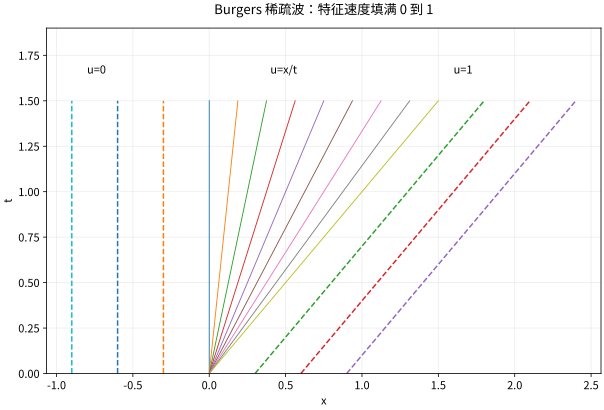

# 守恒律Burgers方程激波与熵条件

## 守恒形式决定间断解怎样移动

标量守恒律写成 $u_t+f(u)_x=0$。若解光滑，可写 $u_t+f'(u)u_x=0$；若出现间断，后者的乘积解释不再直接适用，应以积分守恒形式为基础。对测试函数 $\varphi$ 在 $t\ge0$ 紧支，弱解满足
$$\int_0^\infty\int_{\mathbb R}(u\varphi_t+f(u)\varphi_x)dxdt+\int_{\mathbb R}u_0(x)\varphi(x,0)dx=0.$$
它记录任意时空区域中的质量平衡，不要求点态导数存在。

## 跳跃速度从薄控制体推导

设间断线 $x=st$ 两侧常值 $u_L,u_R$。对穿过该线的薄控制体积守恒，得到
$$s(u_R-u_L)=f(u_R)-f(u_L).$$
这就是 Rankine–Hugoniot 条件。对 Burgers 通量 $f(u)=u^2/2$，$s=(u_L+u_R)/2$。它只保证弱守恒，不保证物理唯一性，因为向外扩张的间断也能满足同一代数关系。

## 熵条件排除错误的扩张激波

对凸熵 $\eta$，定义熵通量 $q'$ 为 $\eta'f'$，要求分布意义
$$\eta(u)_t+q(u)_x\le0.$$
它对应粘性近似极限的耗散方向。对严格凸通量的压缩激波，特征线应从两侧进入，$f'(u_L)>s>f'(u_R)$；Burgers 中就是 $u_L>u_R$。若 $u_L<u_R$，应出现稀疏波扇，而不是特征线向两边离开的跳跃。

## 两个完整 Riemann 问题

对 $u_0=u_L$（$x<0$）、$u_R$（$x>0$）：若 $u_L=1,u_R=0$，熵解为以速度 $1/2$ 向右走的激波。若 $u_L=0,u_R=1$，熵解为
$$u(x,t)=\begin{cases}0,&x\le0,\\x/t,&0<x<t,\\1,&x\ge t,\end{cases}\qquad t>0.$$
扇内代入 $u_t+uu_x=-x/t^2+(x/t)(1/t)=0$，边界连续，初值按局部积分极限恢复。

若错误地在第二题仍取速度 $1/2$ 的跳跃，它满足弱守恒，但对 $\eta=u^2/2,q=u^3/3$，跳跃处熵产生系数为 $[q]-s[\eta]=1/3-1/4=1/12>0$，违反要求的非正号。这是可以算出的排除证据。

*图：Burgers 初值从 0 跳到 1 时的稀疏波扇。中间特征斜率连续填满 0 到 1，而不是留一个向外分离的非熵跳跃。*

## 粘性、唯一性与边界

粘性方程 $u_t+f(u)_x=\varepsilon u_{xx}$ 将间断平滑为薄层。在适当有界初值等条件下，$\varepsilon\downarrow0$ 选择标量熵解。一般唯一性与 $L^1$ 收缩需要对全部合适的熵对建立不等式，不是仅检查一个平方熵就完成所有理论；本页用它做明确反例，完整 Kružkov 理论列为进阶依赖。

数值格式也要保守并具备相应单调或熵稳定性质。仅在间断两侧点态残差很小，可能仍以错误速度传播，必须检查通量平衡。

## 自测与解答

Burgers 左态 3、右态 1 的激波速度是什么？哪一侧特征更快？

> [!question]- 解答
> $s=(3+1)/2=2$。左侧特征速度 3，右侧速度 1，满足 $3>2>1$，特征从两侧进入激波，符合压缩熵条件。跳跃大小不是传播速度，必须由通量差除以状态差计算。

## 继续学习

前一节：[[数学/46-数理方程/17-变分原理Lax-Milgram与能量估计|变分原理Lax-Milgram与能量估计]]。 下一节：[[数学/46-数理方程/19-差分格式稳定性CFL与收敛|差分格式稳定性CFL与收敛]]。

课程地图：[[数学/46-数理方程/00-数理方程-MOC|数理方程课程地图]]；[[数学/90-资源/06-统一符号约定与定理条件索引|符号与条件索引]]。

## 跨学科连接

[[数学/15-微积分/16-Green-Gauss-Stokes内部变化与边界累积|Green-Gauss-Stokes内部变化与边界累积]]：把守恒律在时空控制体上的通量平衡用于跨越跳跃，便得到 Rankine–Hugoniot 条件；激波处不能把经典点态散度公式直接代入，熵不等式还要另行选择弱解。

## 核验与延伸阅读

本页为独立编写的讲解、推导与算例；以下一手教材用于对照标准定义与课程范围，不是逐段译写。更具体的主题定位见 [[数学/90-资源/04-六科学术来源与阅读对照|学术来源对照]]。

- [Victor Ivrii：Partial Differential Equations，作者课程教材](https://www.math.utoronto.ca/courses/apm346h1/20181/PDE-textbook/contents.html)
- [Christian Clason：Introduction to Finite Element Methods，作者讲义记录](https://arxiv.org/abs/1709.08618)
