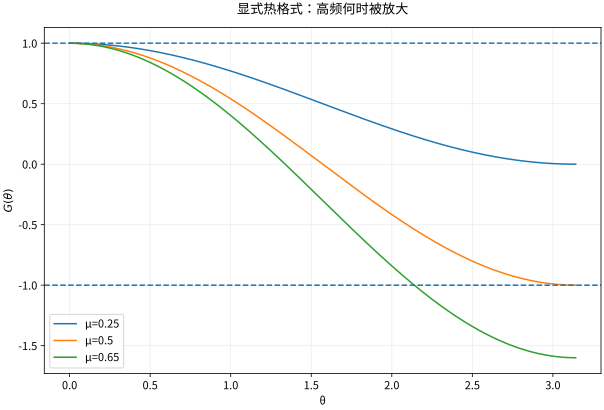

# 差分格式稳定性CFL与收敛

## 离散方程正确模仿导数，还不够

一致性描述网格变细时截断误差趋零；稳定性描述离散演化不会无控制放大扰动；收敛性才是数值解逼近真实解。对适定线性初值问题，在相应范数和离散框架中，Lax–Richtmyer 等价定理连接一致性加稳定性与收敛。它不是任意非线性、任意网格方案的无条件保证。

## 热方程显式差分的完整稳定分析

设 $x_j=jh,t_n=n\tau$，前向时间、中心空间格式为
$$U_j^{n+1}=U_j^n+\mu(U_{j+1}^n-2U_j^n+U_{j-1}^n),\qquad\mu=\kappa\tau/h^2.$$
对光滑解，局部导数近似误差 $O(\tau+h^2)$。令误差模式为 $G^ne^{ij\theta}$，得到
$$G(\theta)=1-4\mu\sin^2(\theta/2).$$
在全线或周期网格的 $\ell^2$ Fourier 分析中，要求所有频率 $|G|\le1$，所以 $0\le\mu\le1/2$。同范围内更新还是相邻值的凸组合，给出最大值稳定。$\mu>1/2$ 时最高频放大，即使初值看起来平滑，舍入噪声也可能激发失稳。

*图：不同 $\mu$ 的 $G(\theta)$。越过 $\mu=1/2$ 后，高频部分跌到 $-1$ 以下，导致交替增长。*

## 隐式稳定不等于可以任意粗

后向 Euler 格式的因子为 $G=(1+4\mu\sin^2(\theta/2))^{-1}$，对任意 $\mu\ge0$ 稳定，但每步要解线性系统，时间精度仍是一阶。Crank–Nicolson 为
$$G=\frac{1-2\mu\sin^2(\theta/2)}{1+2\mu\sin^2(\theta/2)},$$
二阶时间精度且模不超过 1，但大步长时高频因子接近 $-1$，可能出现不衰减得足够快的交替振荡。稳定、正性与高频阻尼是不同性质。

## 波与输运的 CFL 机制

中心差分波格式 $U_j^{n+1}-2U_j^n+U_j^{n-1}=\nu^2(U_{j+1}^n-2U_j^n+U_{j-1}^n)$，$\nu=c\tau/h$，在标准规则网格分析下需 $\nu\le1$。离散传播锥至少要覆盖真实传播锥，是 CFL 的几何直觉；仅满足 CFL 必要条件不保证任意格式稳定。

对正速输运，迎风格式 $U_j^{n+1}=(1-\nu)U_j^n+\nu U_{j-1}^n$ 在 $0\le\nu\le1$ 为凸组合。迎风方向必须随速度符号变化，逆风使用会把物理耗散改成放大误差。

## 自测与解答

热方程 $\kappa=1$，原空间步长 $h=0.1$、时间步长 $\tau=0.004$ 稳定；将 $h$ 减半而保持时间步长，是否仍稳定？怎样调整？

> [!question]- 解答
> 原 $\mu=0.4$；新 $\mu=0.004/0.05^2=1.6$，显式格式失稳。应至少降到 $\tau\le h^2/2=0.00125$；保持原 $\mu=0.4$ 则取 $\tau=0.001$。扩散的限制是 $\tau\propto h^2$，不是与波动一样的 $\tau\propto h$。

## 继续学习

前一节：[[数学/46-数理方程/18-守恒律Burgers方程激波与熵条件|守恒律Burgers方程激波与熵条件]]。 下一节：[[数学/46-数理方程/20-有限元谱方法与数理方程综合|有限元谱方法与数理方程综合]]。

课程地图：[[数学/46-数理方程/00-数理方程-MOC|数理方程课程地图]]；[[数学/90-资源/06-统一符号约定与定理条件索引|符号与条件索引]]。

## 跨学科连接

[[数学/20-线性代数与几何/17-矩阵范数条件数与数值稳定性|矩阵范数条件数与数值稳定性]]。建议比较定义、适用条件与所用范数，再迁移方法。

## 核验与延伸阅读

本页为独立编写的讲解、推导与算例；以下一手教材用于对照标准定义与课程范围，不是逐段译写。更具体的主题定位见 [[数学/90-资源/04-六科学术来源与阅读对照|学术来源对照]]。

- [Victor Ivrii：Partial Differential Equations，作者课程教材](https://www.math.utoronto.ca/courses/apm346h1/20181/PDE-textbook/contents.html)
- [Christian Clason：Introduction to Finite Element Methods，作者讲义记录](https://arxiv.org/abs/1709.08618)
