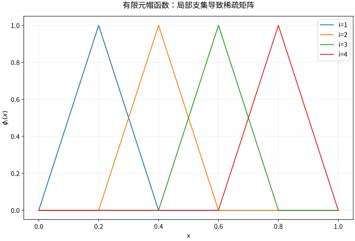

# 有限元谱方法与数理方程综合

## 有限元把局部形状拼成可控子空间

对 $-u''=f$ 于 $(0,1)$、零边界，弱式 $\int u'v'=\int fv$。划分节点 $0=x_0<\cdots<x_N=1$，用连续分段线性帽函数 $\phi_i$ 作为基，令 $u_h=\sum U_i\phi_i$。取每个 $v_h=\phi_j$，得到
$$KU=F,\qquad K_{ij}=\int_0^1\phi_i'\phi_j',\quad F_j=\int_0^1f\phi_j.$$
只相邻帽函数支集相交，矩阵天然稀疏。边界值通过空间直接满足，不是计算结束后再随意改两个端点。

## 一个完整组装算例

均匀网格 $h=1/3$，两个内部未知量，$f=2$。有
$$K=\frac1h\begin{pmatrix}2&-1\\-1&2\end{pmatrix}=\begin{pmatrix}6&-3\\-3&6\end{pmatrix},\qquad F=\binom{2h}{2h}=\binom{2/3}{2/3}.$$
解得 $U_1=U_2=2/9$，恰等于精确解 $u=x(1-x)$ 的节点值。连续曲线仍不同：有限元是折线，真实解是抛物线。节点恰好精确不意味着全函数误差为零。

*图：零边界分段线性有限元的帽函数。每个未知系数对应一个内部节点，局部支集产生稀疏耦合。*

## 误差率从逼近与正交相接

对形状规则网格、充分正则的解，插值可给 $\|u-I_hu\|_{H^1}\le Ch|u|_{H^2}$，再由 Céa 得相同阶的能量误差。$L^2$ 的二阶误差还需对偶问题的额外正则性，非凸域、角点或系数不规则可能降低阶数，不能把 $O(h^2)$ 当所有 PDE 的无条件规律。

上述一维常源例中，$u_h=I_hu$。每段误差为 $(x-x_i)(x_{i+1}-x)$，因此可精确算出
$$\|u-u_h\|_2=\frac{h^2}{\sqrt{30}},\qquad\|u'-u_h'\|_2=\frac h{\sqrt3}.$$
这里给出的常数和阶数可用程序直接核验，比只画越来越接近的两条线更有说服力。

## 谱方法何时更合适

谱 Galerkin 使用正弦、Fourier、Chebyshev 或算子特征函数等全局基。规则几何、周期边界和光滑解时，系数衰减很快；解析函数常可取得几何级数式收敛，有限光滑或间断会降低速度并出现 Gibbs 现象。有限元更适合复杂几何、局部网格加密与局部奇性，但低阶基通常代数收敛。

时间演化的有限元离散为 $M\dot U+KU=F$，质量矩阵 $M_{ij}=\int\phi_i\phi_j$ 不能凭空删掉。再选时间方法并检查广义特征值 $Kv=\lambda Mv$ 对稳定步长的约束。非线性谱乘积还要考虑混叠，不能把离散乘法当成自动精确投影。

## 选择方法的完整流程

先确定方程、区域、数据、解空间与适定性；再按几何和结构选择特征线、分离变量、变换、Green、变分或数值方法；最后逐一检查 PDE 残差、初边值、量纲、能量或质量，以及网格或截断收敛。不同验证回答不同问题，不能用一个漂亮曲线替代全部。

## 自测与解答

若 FEM 计算得到极小线性残差 $\|KU-F\|$，是否已经证明 PDE 误差小？

> [!question]- 解答
> 没有。它首先说明离散代数系统被解得准确，仍可能有大网格误差、错误弱形式、错误边界或病态放大。应分别检查组装一致性、代数求解误差与离散误差，并通过网格加密、制造解、能量恒等或残差型后验估计交叉验证。

## 继续学习

前一节：[[数学/46-数理方程/19-差分格式稳定性CFL与收敛|差分格式稳定性CFL与收敛]]。

课程地图：[[数学/46-数理方程/00-数理方程-MOC|数理方程课程地图]]；[[数学/90-资源/06-统一符号约定与定理条件索引|符号与条件索引]]。

## 跨学科连接

[[数学/20-线性代数与几何/14-最小二乘伪逆与正则化|最小二乘伪逆与正则化]]：有限元的 $KU=F$ 通常来自 Galerkin 弱式，不等同于把同一系统改为最小二乘正规方程；小代数残差、病态放大与 PDE 离散误差须分开检查，伪逆或岭正则化也不是每个有限元系统的默认步骤。

## 核验与延伸阅读

本页为独立编写的讲解、推导与算例；以下一手教材用于对照标准定义与课程范围，不是逐段译写。更具体的主题定位见 [[数学/90-资源/04-六科学术来源与阅读对照|学术来源对照]]。

- [Victor Ivrii：Partial Differential Equations，作者课程教材](https://www.math.utoronto.ca/courses/apm346h1/20181/PDE-textbook/contents.html)
- [Christian Clason：Introduction to Finite Element Methods，作者讲义记录](https://arxiv.org/abs/1709.08618)
