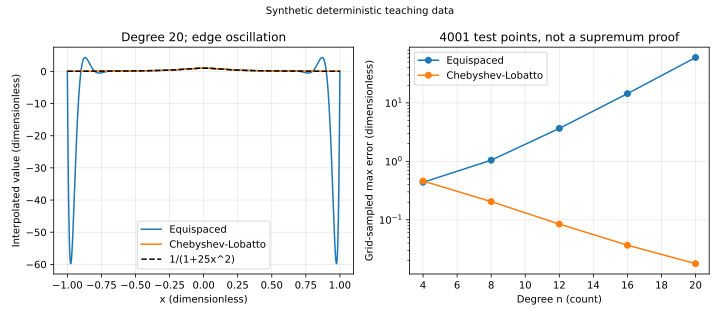

# 插值逼近：节点选择与误差

“每个节点都答对”，不等于整段区间就能免检。给定 $n+1$ 个互异实节点 $t_0,\ldots,t_n$ 和值 $y_j$，插值要求 $p(t_j)=y_j$；逼近更关心区间其他位置的误差。两者并不等同。[[数学/25-高等代数/02-多项式的根重数不可约性与插值#插值为何存在且唯一|高代的主解释]]已证明次数不超过 $n$ 的插值多项式存在唯一，本课保留必需公式，研究怎样计算、何时逼近好和怎样检验。若自变量单位为 $U_x$、值单位为 $U_y$，插值基无量纲，$p$ 与误差单位均为 $U_y$。

## 从Lagrange表示走到重心计算

Lagrange基满足 $\ell_j(t_i)=\delta_{ij}$，写成

$$\ell_j(x)=\prod_{i\ne j}\frac{x-t_i}{t_j-t_i},\qquad p_n(x)=\sum_{j=0}^n y_j\ell_j(x).$$

直接对每个新 $x$ 展开全部乘积重复了很多工作。令 $\omega(x)=\prod_{i=0}^n(x-t_i)$，$w_j=1/\prod_{i\ne j}(t_j-t_i)$，便有 $\ell_j(x)=\omega(x)w_j/(x-t_j)$。常函数1的插值仍是1，故 $1=\omega(x)\sum_j w_j/(x-t_j)$。除去公共因子得到第二重心公式

$$p_n(x)=\frac{\sum_{j=0}^n w_jy_j/(x-t_j)}{\sum_{j=0}^n w_j/(x-t_j)},\qquad x\ne t_j.$$

在节点处直接返回 $y_j$，避免 $0/0$；所有权重同乘非零常数会抵消，适度缩放可避免过大或过小的中间数。权重预计算需 $O(n^2)$，每个查询需 $O(n)$，这是一种相同多项式的求值方法，不能改变节点本身造成的病态性。[FNC §9.2.1–9.2.2](https://fncbook.com/barycentric/)给公式及缩放实现的对照。高次、非常密集或巨大尺度节点仍需更可靠的专用权重构造，本课实现只用于中等次数教学。

用已有高代算例 $t=(0,1,2)$，$y=(1,2,5)$，权重为 $(1/2,-1,1/2)$。在 $x=1/2$，三项 $w_j/(x-t_j)$ 为 $(1,2,-1/3)$；分母 $8/3$，分子 $1+4-5/3=10/3$，所以 $p(1/2)=5/4$。第二次取 $x=3/2$，三项为 $(1/3,-2,-1)$；分母 $-8/3$，分子 $1/3-4-5=-26/3$，所以 $p(3/2)=13/4$。独立知道 $p(x)=x^2+1$，可逐点核对两次计算。无需用单项式系数求解Vandermonde系统。

## 误差余项为何带着节点乘积

设 $f\in C^{n+1}(I)$，$I$ 是包含全部节点与查询 $x$ 的闭区间，且 $y_j=f(t_j)$。若 $x$ 不是节点，构造

$$g(s)=f(s)-p_n(s)-c\omega(s),\qquad c=\frac{f(x)-p_n(x)}{\omega(x)}.$$

$g$ 在 $n+1$ 个节点和 $x$ 共 $n+2$ 个互异点为零。按从小到大排列，反复用Rolle定理，$g^{(n+1)}$ 在它们的凸包内某 $\xi$ 为零。由于 $p_n^{(n+1)}=0$、$\omega^{(n+1)}=(n+1)!$，有 $c=f^{(n+1)}(\xi)/(n+1)!$，即

$$f(x)-p_n(x)=\frac{f^{(n+1)}(\xi)}{(n+1)!}\prod_{j=0}^n(x-t_j).$$

节点处误差为零，直接处理即可。[FNC §9.1](https://fncbook.com/polynomial/)提供Lagrange和余项的标准定位。这里 $\xi$ 随查询改变；只有掌握全区间的高阶导数界，才能把它变成一致误差界。因子的单位为 $U_x^{n+1}$，导数单位为 $U_y/U_x^{n+1}$，合成误差的单位正确。

例如 $f=x^3$、节点 $(0,1,2)$，插值为 $p=3x^2-2x$。在 $x=1/2$，$p=-1/4$，$f=1/8$，误差 $3/8$。独立用恒等式 $x^3-(3x^2-2x)=x(x-1)(x-2)$ 得到同一结果；$f'''/3!=1$，余项中的节点乘积完整兑现。

## 提高次数为何可能更坏

看无量纲合成函数 $f(x)=1/(1+25x^2)$，$[-1,1]$ 上等距节点的高次插值会在端部大幅振荡，称Runge现象。实验取 $n=4,8,12,16,20$，在4001个固定查询点上的最大绝对误差约为 $0.438,1.045,3.663,14.394,59.822$。这些是网格采样最大值，不是解析上确界，也不能证明所有 $n$ 的渐近趋势。曲线展示了“本组次数提高使误差增加”的反例。

改用Chebyshev–Lobatto节点 $t_j=\cos(j\pi/n)$，含两端点且向端部聚集，同样测试得到 $0.460,0.205,0.0844,0.0367,0.0177$。低次数并非每次都优于等距节点，这组 $n=4$ 就稍差；收益在抑制随次数增加的边缘放大。[FNC §9.3](https://fncbook.com/stability-1/)讨论节点分布、敏感度与Chebyshev节点。

为何端部聚点有理由？如果只关注余项的节点乘积，在 $[-1,1]$ 上取Chebyshev多项式 $T_{n+1}$ 的 $n+1$ 个零点，可令首一节点积等于 $2^{-n}T_{n+1}(x)$，最大绝对值 $2^{-n}$；它是同次数首一多项式的最小最大范数选择。其极值点正负交替：若另一个首一多项式范数更小，两者之差在相邻极值点间须有至少 $n+1$ 个根，但差次数至多 $n$，矛盾。这是节点积的最优性，不是任意函数总误差的最优性；高阶导数也在变。实验使用的是含端点的Lobatto节点，与这个零点构造不同，不能混称同一节点表。

误差还来自数据。若各 $y_j$ 扰动不超过 $\varepsilon$，固定查询的输出扰动满足 $|\delta p(x)|\le\varepsilon\sum_j|\ell_j(x)|$。Lebesgue常数 $\Lambda_n=\max_{x\in[-1,1]}\sum_j|\ell_j(x)|$ 衡量最坏放大；换重心表示不等于让 $\Lambda_n$ 变小。原始数据有噪声时，强行穿过每点未必合适，可读[[数学/20-线性代数与几何/14-最小二乘伪逆与正则化|最小二乘与正则化主解释]]比较拟合目标。

## 分段方法与本课边界

降低局部次数也是选择：在每个宽度不超过 $h$ 的小区间上做线性插值，若 $f\in C^2$ 且 $|f''|\le M$，余项为 $f''(\xi)(x-a)(x-b)/2$。因为 $|(x-a)(x-b)|\le h^2/4$，各段误差不超过 $Mh^2/8$。增加段数与增加一个全局多项式次数是不同策略。分段线性通常不在节点处导数连续，三次样条还需连接与边界条件；本首组没有实现完整样条课。区间外外推也不继承区间内误差界。

复算入口在[[数学/60-数值计算与量化/81-数值分析复算与误差图|实验页]]的 `barycentric`；可改节点、值和查询，但重复节点会被拒绝，因为普通插值条件失效。若要导数数据，需要Hermite插值的新条件，不能把两个相同节点当作两个独立值输入。

## 练习与完整解答

节点 $0,1$ 上用直线插值 $f(x)=x^2$。算 $x=1/4,3/4$ 的误差；若把区间均分两段，给一致误差上界。能把该界用于 $x=2$ 吗？

> [!question]- 解答
> 两端值为0、1，插值为 $p=x$。在 $1/4$、$3/4$，$f-p$ 都是 $-3/16$。$M=2$，原区间 $h=1$ 的界为 $1/4$，在中点达到；两段的 $h=1/2$ 给界 $1/16$。不能用该分段区间内界认证 $x=2$ 的外推。若仍延长第一条直线，则误差是 $4-2=2$，直接说明定义域限制为何必要。

前课[[数学/60-数值计算与量化/10-非线性方程求根括区间与收敛|求根]]讨论局部模型；下一课[[数学/60-数值计算与量化/12-数值常微分方程局部全局误差与稳定|数值ODE]]把局部误差带入反复推进的轨道。
