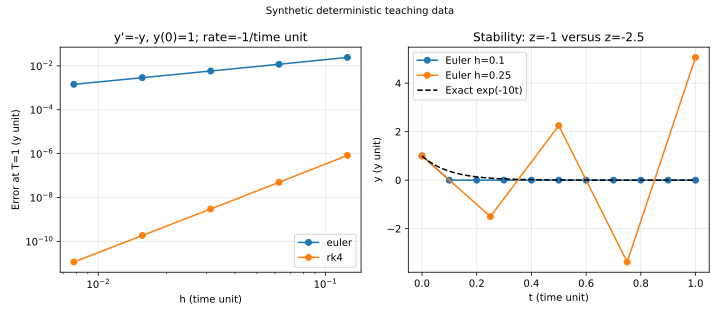

# 数值常微分方程：局部全局误差与稳定

对初值问题 $y'=f(t,y),y(0)=y_0$，精确解是一条连续轨道，计算机通常只存 $t_k=kh$ 上的 $y_k$。[[数学/46-数理方程/01-一阶常微分方程与初值问题|ODE主解释]]说明解的存在、唯一和爆破边界；本课在解于固定 $[0,T]$ 存在、右端关于 $y$ 有所需Lipschitz界、导数足够光滑的前提下讨论近似。标量实方程为手算范围，向量推广要把绝对值改为范数，并核对相应界。

若 $t$ 单位是时间 $U_t$，$y$ 单位是 $U_y$，那么 $f$ 和斜率单位为 $U_y/U_t$，$h f$ 属于 $U_y$。收敛阶比较固定 $T$、初值和方程，改变 $h=T/N$；改变终点会把“更小步长”与“更长积分”混在一起。

## Euler的一个局部缺陷如何积成全局误差

从当前斜率推进一小步给显式Euler

$$y_{k+1}=y_k+h f(t_k,y_k).$$

把真解起点送入一步，Taylor展开给未除以 $h$ 的一步缺陷

$$d_{k+1}=y(t_{k+1})-y(t_k)-h f(t_k,y(t_k))=\tfrac12h^2 y''(\xi_k).$$

本页称 $d$ 为“一步缺陷”，单位为 $U_y$；许多教材把 $d/h$ 称局部截断误差，便是 $O(h)$，单位 $U_y/U_t$。两种阶数叙述并不矛盾。[FNC §6.2](https://fncbook.com/euler/)明确区分一步方法和单位步长的截断误差。

令 $e_k=y_k-y(t_k)$，设 $|f(t,u)-f(t,v)|\le L|u-v|$、$|d_{k+1}|\le C h^2$。减去真解公式便有

$$|e_{k+1}|\le (1+hL)|e_k|+Ch^2.$$

精确初值使 $e_0=0$，反复代入几何和得到 $L>0$ 时

$$|e_k|\le Ch^2\frac{(1+hL)^k-1}{hL}\le \frac{Ch}{L}(e^{LT}-1),\qquad kh\le T.$$

$L=0$ 时直接求和得 $CTh$。由此全局误差是 $O(h)$：每步 $O(h^2)$ 的缺陷，经过约 $1/h$ 步并被传播放大。$L$ 有 $1/U_t$ 单位，因此 $hL$ 无量纲。这个界需要同一解邻域中的统一常数；接近爆破、不可微右端或算法跳出邻域时，不沿用结论。

手算 $y'=-y,y(0)=1$，以时间单位使衰减率为 $-1/U_t$，取 $h=1/2$。第一步 $y_1=1-(1/2)1=1/2$；第二步 $y_2=1/2-(1/2)(1/2)=1/4$。对应真值 $e^{-1/2}\approx0.606531$、$e^{-1}\approx0.367879$，两个误差约为 $-0.106531,-0.117879$。独立对递推求解 $y_k=(1-h)^k$ 核对，并注意每步误差不会简单等于同一个局部缺陷。

## RK4更准确，但并非任意大步长都有效

经典四阶Runge–Kutta在每步取四个斜率。本页 $k_i$ 不包含 $h$：

$$\begin{aligned}
k_1&=f(t_k,y_k),\\
k_2&=f(t_k+h/2,y_k+h k_1/2),\\
k_3&=f(t_k+h/2,y_k+h k_2/2),\\
k_4&=f(t_k+h,y_k+h k_3),\\
y_{k+1}&=y_k+\frac h6(k_1+2k_2+2k_3+k_4).
\end{aligned}$$

在足够光滑并有统一界的固定有限区间，RK4的一步缺陷 $O(h^5)$、全局误差 $O(h^4)$。一般非线性方程的四阶结论需完整的阶条件，不能只检验一个指数函数就视为证明；标准算法与一般阶结论对照[FNC §6.4.3](https://fncbook.com/rk/)。下面从线性测试方程独立展开，验证本实验具体案例。

对 $y'=-y$、$h=1/2$，从 $y_0=1$ 出发，$k_1=-1$，$k_2=-3/4$，$k_3=-13/16$，$k_4=-19/32$。加权斜率为 $-151/32$，所以 $y_1=1-151/384=233/384\approx0.606771$。下一步的四个斜率恰是前一步分别乘 $233/384$，因此 $y_2=(233/384)^2=54289/147456\approx0.368171$。与 $e^{-1}$ 比较误差约 $0.0002914$。这两步有同一个因子，因为方程线性自治；一般 $f(t,y)$ 不能复用该因子。

## 稳定函数处理的是误差放大

对测试方程 $y'=\lambda y$，$\lambda$ 可为复数，令无量纲 $z=h\lambda$。一步法写为 $y_{k+1}=R(z)y_k$；相邻轨道的差也被 $R$ 乘一次。Euler给 $R_E(z)=1+z$；代入RK4四斜率并收集同次幂得到

$$R_4(z)=1+z+\frac{z^2}{2}+\frac{z^3}{6}+\frac{z^4}{24}.$$

绝对稳定域定义为 $\{z:|R(z)|\le1\}$。若 $\operatorname{Re}\lambda<0$，精确解衰减；数值法至少应让扰动不随步数增长。Euler稳定域是以 $-1$ 为心、半径1的圆盘。实负 $\lambda$ 时要求 $-2\le h\lambda\le0$，严格内部才衰减；在 $z=-2$ 时因子 $-1$ 会永远振荡，虽有界却不模仿长期衰减。RK4负实轴稳定区约到 $-2.785$，边界可由 $R_4(z)=1$ 的非零负根计算。这仍是有限区间。[FNC §11.3](https://fncbook.com/absstab-diffusion/)对照稳定函数和稳定域。

反例 $y'=-10y,y(0)=1$：$h=0.1$ 时Euler因子0，两步值均为0，稳定却非常不准确；$h=0.25$ 时因子 $-1.5$，两步值为 $-1.5,2.25$，真实解在对应时间为 $e^{-2.5},e^{-5}$，衰减而数值轨道放大。稳定和精度需要分别检查。RK4在同样 $h=0.25$ 时 $R_4(-2.5)=0.6484375$，仍衰减但远离 $e^{-2.5}\approx0.082085$，不能把“在稳定域内”当成精度目标。

左图为合成 $y'=-y$，$T=1$、$N=8,16,32,64,128$；纵轴是实际末端误差 $|y_N-e^{-1}|$，有 $U_y$ 单位。最后两次误差比给观测阶 $\log_2(E_h/E_{h/2})$，Euler约1.005，RK4约4.009。观测阶只是这组实验结果；舍入占主导后不应继续要求相同比例。右图展示前述 $-10y$ 反例，初值、率和单位已注明；不是实测物理数据。对应 `ode` 与全部数值在[[数学/60-数值计算与量化/81-数值分析复算与误差图|复算页]]。

当不同衰减时间尺度并存，精度允许的步长可能仍大于显式稳定性允许的步长，这就是常见刚性情境。后向Euler的 $R(z)=1/(1-z)$ 可覆盖左半平面，但每步须解隐式方程，稳定仍不意味着无需误差控制。[FNC §11.4](https://fncbook.com/stiffness/)提供刚性背景；PDE网格导致的特征值与CFL另读[[数学/46-数理方程/19-差分格式稳定性CFL与收敛|差分稳定性主解释]]，本课不复制其空间离散推导。

## 练习与完整解答

对 $y'=-4y,y(0)=1$，用Euler比较 $h=1/4,3/4$ 的前两步，并判断绝对稳定性。若准确度目标是 $10^{-4}$，稳定性条件够吗？

> [!question]- 解答
> 第一种 $z=-1$，两步为0、0，绝对稳定；真实第一步 $e^{-1}\approx0.367879$，已经误差很大。第二种 $z=-3$，两步为 $-2,4$，$|R|=2>1$，失稳。真实值分别为 $e^{-3},e^{-6}$。稳定条件不足以保证 $10^{-4}$；还需在同一固定终点做误差估计或有真值的收敛验证，不可只数步数。

上一课[[数学/60-数值计算与量化/11-插值逼近节点选择与误差|插值逼近]]提供局部多项式思路；下一课[[数学/60-数值计算与量化/13-迭代线性求解残差误差与条件数|迭代线性求解]]处理隐式步与大系统中常见的线性代数任务。
