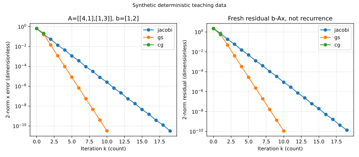

# 迭代线性求解：残差、误差与条件数

对于很大的稀疏系统 $Ax=b$，直接因子分解可能产生大量填充；反复做矩阵乘向量可以保留稀疏结构。本课把迭代对象限定为实方阵 $A\in\mathbb R^{n\times n}$、列向量 $b,x\in\mathbb R^n$，固定系统有唯一解。手算与教学代码使用小型稠密矩阵，不能据此声称验证了大规模稀疏性能。[[数学/20-线性代数与几何/07-线性方程组消元LU与解的结构|消元与LU]]仍是理解解结构与直接法的主解释。

## 矩阵分裂把每步变成便宜求解

取 $A=M-N$，$M$ 可逆，迭代 $Mx^{(k+1)}=Nx^{(k)}+b$，即

$$x^{(k+1)}=Bx^{(k)}+c,\qquad B=M^{-1}N,\quad c=M^{-1}b.$$

令 $e^{(k)}=x^{(k)}-x_*$，真解也满足固定点，所以 $e^{(k+1)}=Be^{(k)}$，$e^{(k)}=B^ke^{(0)}$。对所有初值收敛当且仅当谱半径 $\rho(B)<1$：必要性由某个模不小于1的特征方向无法衰减；充分性可将复Jordan块写成 $\lambda I+J$，$B^k$ 各块的有限项是关于 $k$ 的多项式乘 $\lambda^{k-j}$，当 $|\lambda|<1$ 时都趋零。条件关心的是迭代矩阵 $B$，不能直接检查 $\rho(A)<1$。$\|B\|<1$ 是易检验的充分条件，某个所选范数大于1则不直接证明发散。

写 $A=D+L+U$，其中 $L,U$ 是原矩阵的严格下、上三角部分，符号不额外取负。Jacobi取 $M=D,N=-(L+U)$，要求每个 $a_{ii}\ne0$：

$$x_i^{(k+1)}=\frac{b_i-\sum_{j\ne i}a_{ij}x_j^{(k)}}{a_{ii}}.$$

所有分量读旧值，适合并行。若严格按行对角占优 $|a_{ii}|>\sum_{j\ne i}|a_{ij}|$，则 $\|B_J\|_\infty=\max_i\sum_{j\ne i}|a_{ij}/a_{ii}|<1$，故收敛。这里严格占优是充分条件，不是必要条件。

Gauss–Seidel取 $M=D+L,N=-U$，逐行读取已更新的低编号分量：

$$x_i^{(k+1)}=\frac{b_i-\sum_{j<i}a_{ij}x_j^{(k+1)}-\sum_{j>i}a_{ij}x_j^{(k)}}{a_{ii}}.$$

每步相当于三角求解，不应显式求 $(D+L)^{-1}$。严格行对角占优也保证GS收敛：设一次扫描误差的最大值出现在第 $i$ 行，记 $E_{k+1}=\|e^{(k+1)}\|_\infty,E_k=\|e^{(k)}\|_\infty$，则

$$\left(|a_{ii}|-\sum_{j<i}|a_{ij}|\right)E_{k+1}\le \sum_{j>i}|a_{ij}|E_k.$$

各行右左系数比均小于1，取最大得到统一压缩系数，归纳得收敛。GS更新顺序影响轨道；并行同时更新会变回另一种算法。[Saad第2版 §4.1、§4.2](https://www-users.cse.umn.edu/~saad/IterMethBook_2ndEd.pdf)是分裂与一般收敛判据的原书定位。

## 用同一系统手算两轮

取 $A=\begin{pmatrix}4&1\\1&3\end{pmatrix}$、$b=(1,2)^T$、$x^{(0)}=(0,0)^T$。直接消元给 $x_*=(1/11,7/11)^T$，独立代回得到 $Ax_*=b$。

Jacobi第一轮 $x^{(1)}=(1/4,2/3)^T$；第二轮分别只读第一轮，得 $x_1^{(2)}=(1-2/3)/4=1/12$，$x_2^{(2)}=(2-1/4)/3=7/12$。其迭代矩阵为 $\begin{pmatrix}0&-1/4\\-1/3&0\end{pmatrix}$，特征值 $\pm1/\sqrt{12}$，所以可预测收敛。

GS第一轮先得 $1/4$，再用这个新值算 $(2-1/4)/3=7/12$；第二轮先得 $(1-7/12)/4=5/48$，再得 $(2-5/48)/3=91/144$。其迭代矩阵 $\begin{pmatrix}0&-1/4\\0&1/12\end{pmatrix}$ 谱半径为 $1/12$。这一案例GS衰减更快；不能从一个矩阵推出GS对所有问题都按相同比例更快。

仅可逆不够：$A=\begin{pmatrix}1&2\\2&1\end{pmatrix}$ 可逆，但Jacobi的 $B$ 有特征值 $2,-2$，用 $b=(1,1)^T,x^{(0)}=0$ 得两轮 $(1,1)^T,(-1,-1)^T$，之后放大。对称正定也不足以保证普通Jacobi：三阶矩阵对角为1、非对角为 $3/4$，$A$ 的特征值为 $5/2,1/4,1/4$，全正；Jacobi在全1向量方向的因子为 $-3/2$，仍发散。

实对称正定则保证GS收敛。理由来自严格凸二次能量 $F(x)=x^TAx/2-b^Tx$，一次GS更新恰沿单个坐标取最小值；该更新令能量减少 $a_{ii}(\Delta x_i)^2/2$。一整轮若能量没有严格减少，则每个坐标都未变，所有残差分量为零，已是真解。在 $\|e\|_A=1$ 的紧致球面上，线性GS扫描的能量缩减比连续且处处小于1，故有统一 $q<1$，从而迭代收敛。条件是SPD及完整顺序坐标扫描，不能对非正定矩阵沿用。

## CG为何换成共轭方向

共轭梯度（CG）本课只用于实对称正定 $A$。定义 $\langle u,v\rangle_A=u^TAv$、$\|u\|_A=\sqrt{u^TAu}$。SPD使它成为内积，并使 $F$ 有唯一极小值 $x_*=A^{-1}b$。若沿方向 $p_k$ 移动，令 $r_k=b-Ax_k$，对 $F(x_k+\alpha p_k)$ 求导得到最优 $\alpha=p_k^Tr_k/(p_k^TAp_k)$。

CG选择互相 $A$ 共轭的方向，即 $p_i^TAp_j=0$（$i\ne j$），使新的方向最小化不会破坏旧方向的一阶条件。利用正交残差的短递推，从 $p_0=r_0$ 开始：

$$\begin{aligned}
\alpha_k&=\frac{r_k^Tr_k}{p_k^TAp_k},&x_{k+1}&=x_k+\alpha_kp_k,\\
r_{k+1}&=r_k-\alpha_kAp_k,&\beta_k&=\frac{r_{k+1}^Tr_{k+1}}{r_k^Tr_k},\\
p_{k+1}&=r_{k+1}+\beta_kp_k.
\end{aligned}$$

在精确算术下，$x_k$ 最小化 $x_0+\mathcal K_k(A,r_0)$ 上的 $F$，其中 $\mathcal K_k=\operatorname{span}\{r_0,Ar_0,\ldots,A^{k-1}r_0\}$；维数最多 $n$，因此最多 $n$ 步终止。这一一般结论的完整共轭与正交归纳证明作为[Saad §6.7.1](https://www-users.cse.umn.edu/~saad/IterMethBook_2ndEd.pdf)的明确阅读依赖，本课不拿两阶手算代替全维证明。浮点会破坏精确正交，$n$ 步结论不能当作实际硬上限。

沿用上面系统，$r_0=p_0=(1,2)^T$，$Ap_0=(6,7)^T$，$\alpha_0=5/20=1/4$，所以 $x_1=(1/4,1/2)^T$，$r_1=(-1/2,1/4)^T$。$r_0^Tr_1=0$ 是第一条独立核对。随后 $\beta_0=(5/16)/5=1/16$，$p_1=(-7/16,3/8)^T$；$Ap_1=(-11/8,11/16)^T$，$p_0^TAp_1=0$ 是共轭核对。$p_1^TAp_1=55/64$，$\alpha_1=(5/16)/(55/64)=4/11$，于是 $x_2=(1/11,7/11)^T$，$r_2=0$，恰与消元结果一致。

SPD还允许以条件数给典型最坏界：

$$\|e_k\|_A\le2\left(\frac{\sqrt{\kappa_2(A)}-1}{\sqrt{\kappa_2(A)}+1}\right)^k\|e_0\|_A.$$

完整谱多项式与Chebyshev论证见[Saad §6.11.3](https://www-users.cse.umn.edu/~saad/IterMethBook_2ndEd.pdf)；这是上界，特征值聚集时实际可更快。非对称或不定系统不能直接套CG；例如 $A=\operatorname{diag}(1,-1),p=(1,1)^T$ 时 $p^TAp=0$，步长分母失效。预条件要保持恰当的SPD内积结构，本课不展开GMRES、预条件或多重网格。

## 残差小与解误差小之间隔着条件数

残差 $r=b-A\hat x$ 可计算，解误差 $e=\hat x-x_*$ 通常不可直接计算。由 $Ae=-r$ 得 $\|e\|\le\|A^{-1}\|\|r\|$；若 $b\ne0$，相容诱导范数给

$$\frac{\|e\|}{\|x_*\|}\le\kappa(A)\frac{\|r\|}{\|b\|}.$$

推导与矩阵也受扰动的情况复用[[数学/20-线性代数与几何/17-矩阵范数条件数与数值稳定性|条件数主解释]]。取 $A=\operatorname{diag}(1,10^{-8})$、$x_*=(1,1)^T$、$b=(1,10^{-8})^T$，候选 $\hat x=(1,0)^T$ 的残差范数为 $10^{-8}$，解误差为1，相对误差 $1/\sqrt2$。这是一组尺度明确的无量纲反例，不是迭代算法必然产出的结果。

当矩阵来自函数空间截断时，先接 [[数学/16-数学分析/20-泛函分析/02-开映射与有界逆定理#先看一个能完全手算的例子|紧对角算子的逆与有限截断]]：每个 $N$ 维逆存在，却可能随 $N$ 放大而没有共同界；无限算子上的逆还可能仅定义于真子空间 $\operatorname{ran}T$。再用 [[数学/16-数学分析/20-泛函分析/02-开映射与有界逆定理#双射时：逆不仅存在，而且有统一误差界|一般有界逆定理]] 核对两端 Banach、有界及双射。[[数学/16-数学分析/20-泛函分析/12-移位算子的谱与有限截断#有限截断：全是零特征值，为什么仍不能认证稳定|移位的有限截断]] 进一步给出漏边界残差和指数增长的逆界；回到本页停止准则时，须同时控制截断误差与逆的放大。若另用截断阶数或惩罚参数作正则化，应另证噪声、逼近误差与参数的平衡，不能把小残差当作这些条件已经成立。

可用停止规则 $\|b-Ax_k\|\le\varepsilon_{\rm abs}+\varepsilon_{\rm rel}\|b\|$，其中绝对容差有右端的单位，相对容差无量纲。代码用无量纲实验中的单参数版本 $\mathrm{tol}\max(1,\|b\|_2)$；“1”固定的是示例尺度，不是有物理单位的通用规则。还可记录归一化后向误差 $\eta=\|r\|/(\|A\|\|x\|+\|b\|)$，但它衡量数据扰动，仍不直接认证前向误差。遇到零右端、极小分母、停滞和达到上限要分别处理，不用单一布尔值掩盖失败。

图为上述合成二维系统，误差和残差都用二范数，但属于不同对象。源码在[[数学/60-数值计算与量化/81-数值分析复算与误差图|实验页]]，每次记录都重算 $b-Ax$，CG停止也核对真实残差。源码的Cholesky检查只适合小矩阵教学，实际大型稀疏求解不能用额外稠密分解来假装保持低成本。

## 练习与完整解答

对 $A=\operatorname{diag}(2,5)$、$b=(2,5)^T$ 从0做一轮Jacobi与两步CG。若将 $A$ 改为 $\operatorname{diag}(2,-5)$，哪条保证失效？

> [!question]- 解答
> Jacobi没有非对角项，一轮即得 $(1,1)^T$。CG开始 $p_0=r_0=(2,5)^T$，$\alpha_0=29/133$，$x_1=(58/133,145/133)^T$，$r_1=(150/133,-60/133)^T$，$r_0^Tr_1=0$。$\beta_0=900/17689$，故 $p_1=(21750/17689,-3480/17689)^T$；$p_0^TAp_1=0$。第二个步长 $\alpha_1=133/290$，更新量为 $(75/133,-12/133)^T$，所以 $x_2=(1,1)^T$。独立代回验证。修改后的矩阵仍可逆，Jacobi仍一轮求出相应解，但不再SPD，CG的能量极小与正曲率保证失效，教学实现会拒绝输入。

前课[[数学/60-数值计算与量化/12-数值常微分方程局部全局误差与稳定|数值ODE]]说明隐式推进为何可能需要线性求解；返回[[数学/60-数值计算与量化/00-数值计算与量化-MOC|课程地图]]可继续浮点、量化或已有数值积分路线。
