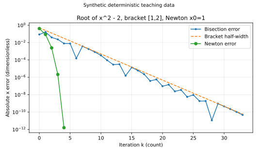

# 数值分析复算与误差图

四堂课用同一份可运行源码回答“误差有没有缩小、停止依据是什么、条件失效会发生什么”。数据全部由明确的数学函数和小矩阵合成，无随机抽样、没有物理实测数据。代码只能核对具体输入与推导，不能证明一般定理或人的掌握度。

## 从库根运行

源码是同目录 [numerical_analysis_lab.py](numerical_analysis_lab.py)，使用本库已有NumPy；绘图另用已有Matplotlib。无需安装新依赖。默认仅向标准输出写JSON，不写图或改正文：

```bash
.venv/bin/python -B 数学/60-数值计算与量化/numerical_analysis_lab.py
```

要重新生成四张图，显式给库外目录；修改源码后同时更新本页镜像和相关图，原图不能拿来证明新版本：

```bash
MPLCONFIGDIR=/private/tmp/wwl-numerical-mpl .venv/bin/python -B 数学/60-数值计算与量化/numerical_analysis_lab.py --plots /private/tmp/wwl-numerical-figures
```

函数接口采用标量实求根、标量实ODE、实小型稠密线性系统。`bisect`返回浮点中点、向外舍入的位置上界与迭代记录；已由非零异号端点建立括根条件后，中点的浮点零保留位置上界，该残差停止可能未达到位置容差。任一端点的计算值为浮点零则抛出 `ArithmeticError`，要求单独认证端点根或符号；严格端点根也由调用者用精确依据另行确认。接受容差前检查用于选点的半宽非零、中点严格位于两端点之间，再以 `nextafter(max(m-a,b-m),+inf)` 向外覆盖两端距离；返回界非有限也抛出 `ArithmeticError`。位置停止条件直接比较该上界与容差。连续性和符号准确性由调用者核对，程序不是严格区间算术。`newton`按残差容差停，返回值没有自动位置证书。`stationary`和`cg`返回解、轨道、是否达到真实残差阈值，达到上限可能是 `False`；输入或计算失效会抛出明确异常。

## 四组问题、真值与本次实际输出

| 组 | 固定输入与独立对照 | 本次具体输出；不外推一般结论 |
| --- | --- | --- |
| 求根 | $x^2-2$，二分区间[1,2]，Newton初值1；二分返回位置上界用60位Decimal的平方根独立核对 | 二分位置上界不超过 $10^{-10}$，Newton前两步是 $3/2,17/12$；循环反例 $x^3-2x+2$ 从0触发上限异常 |
| 插值 | $1/(1+25x^2)$，[-1,1]，次数4/8/12/16/20，4001个固定测试点；另用 $x^2+1$ 核对精确再现与节点值 | 次数20时等距节点网格最大误差约59.8223，Chebyshev–Lobatto约0.0177378；采样最大值不是连续上确界 |
| ODE | $y'=-y,y(0)=1,T=1$，$N=8,16,32,64,128$；真值 $e^{-1}$；另以Euler闭递推与RK4稳定多项式独立核对 | $N=128$时末端误差Euler约 $1.44173\times10^{-3}$，RK4约 $1.14950\times10^{-11}$；最后一次观测阶约1.005和4.009 |
| 线性 | $A=[[4,1],[1,3]],b=[1,2]$，初值0；直接代回真解 $(1/11,7/11)^T$；每步重算残差 | 默认阈值 $10^{-10}\max(1,\|b\|_2)$ 下Jacobi19轮、GS10轮、CG2步满足阈值；性能不代表大型稀疏矩阵 |

求根、插值、线性数据均无量纲。ODE的时间按所选 $U_t$，$y$ 按 $U_y$；$-1$ 与 $-10$ 两个衰减率单位均是 $1/U_t$，误差属于 $U_y$。观测阶 $p=\log_2(E_h/E_{h/2})$ 需要两次误差都大于零；程序没有把对数轴中的零强制改成一个人造误差。图中线连接的是离散计算点，不能冒充连续误差曲线的解析证明。



求根图对应[[数学/60-数值计算与量化/10-非线性方程求根括区间与收敛|求根课]]的误差界与局部收敛；虚线是数学半宽基准，机器位置证书另以向外舍入的端点最远距离覆盖实际返回点。


插值图对应[[数学/60-数值计算与量化/11-插值逼近节点选择与误差|插值课]]的节点选择；左图必须看端部，右图必须看其网格采样口径。


ODE图对应[[数学/60-数值计算与量化/12-数值常微分方程局部全局误差与稳定|数值ODE课]]。右图 $h=0.1$ 稳定但早早归零，提醒稳定并不保证精度；$h=0.25$ 振荡放大。


线性图对应[[数学/60-数值计算与量化/13-迭代线性求解残差误差与条件数|迭代线代课]]，比较同一系统的两个对象；另在课内用病态对角矩阵展示“小残差、大解误差”。

## 检查覆盖和可以自己改的迁移实验

`selfcheck`的39项检查覆盖：二分位置界对照高精度真值、中点下溢保留上界、可表示与奇数宽度次正规区间的正向控制、左右端点附近根的Decimal精确误差与端点距离对照、用上界而非数学半宽停止的检查、Newton两步有理结果及最后允许更新的收敛边界、二次插值含外推点再现和节点值、Euler/RK4闭递推及观测阶、三种线性迭代对照有理解，以及Jacobi可逆却发散。拒绝检查包括最小次正规半宽下溢、正常尺度相邻浮点的中点停滞，以及左右端点小值下溢及左右严格端点根需另认证、无括根、非有限函数值、Newton零导数与循环、重复插值节点、无效ODE步数、非SPD的CG、零对角与矩阵形状不匹配。对照未调用同一求解器生成“真值”；高精度平方根、解析指数、闭递推和代回矩阵各承担不同检查。

可在库外复制源码，依次做三次单变量实验：将Newton初值改成0以触发零导数；将ODE方程改为 $y'=-10y$ 并固定终点比较稳定性界内外；将插值节点保持不变但值加入已知小扰动，观察节点基的放大。预期结果和解答分别在四课内；没有记录自己的运行就不填写“已完成”。样条、一般刚性求解器、真实大型稀疏性能、Obsidian客户端和人的阅读体验不由本脚本验收。

## 源码镜像

下面代码与伴随文件逐字一致；伴随Python是规范来源。镜像服务阅读和恢复，不能另立一份实现。

<!-- code-sync: ./numerical_analysis_lab.py -->
```python
"""Synthetic numerical-analysis teaching lab. No writes unless --plots is supplied.

Scalar real roots/ODEs; small dense real matrices. NumPy required; plotting
requires the existing Matplotlib installation. This is not a production solver.
"""
import argparse
import json
import math
from decimal import Decimal, localcontext
from pathlib import Path
import numpy as np


def controls(tol, maxiter):
    if not math.isfinite(tol) or tol <= 0:
        raise ValueError('tol must be finite and positive')
    if isinstance(maxiter, bool) or not isinstance(maxiter, int) or maxiter < 1:
        raise ValueError('maxiter must be a positive integer')


def finite(value):
    value = float(value)
    if not math.isfinite(value):
        raise ValueError('nonfinite scalar or function value')
    return value


def bisect(f, a, b, tol=1e-10, maxiter=200):
    """Return a floating midpoint, outward position bound, and [point,bound] history.

    Caller must establish continuity and correct signs of computed f values.
    Computed endpoint zeros are rejected: this black-box interface cannot
    distinguish exact roots from underflow/cancellation. Verify any endpoint
    root separately. A midpoint zero retains the existing position bound.
    Reject a zero half-width or an endpoint-rounded midpoint before tolerance.
    The returned point may be rounded away from the exact center. Its bound is
    nextafter(max(point-a, b-point), +inf), which rounds the two endpoint
    distances outward under IEEE-754 round-to-nearest subtraction. This bounds
    position within an established bracket; f is not evaluated by interval arithmetic.
    """
    controls(tol, maxiter)
    a, b = finite(a), finite(b)
    if not a < b or not math.isfinite(b-a):
        raise ValueError('finite representable interval with a < b required')
    fa, fb = finite(f(a)), finite(f(b))
    if fa == 0 or fb == 0:
        raise ArithmeticError('computed endpoint zero; root or sign needs separate certification')
    if (fa > 0) == (fb > 0):
        raise ValueError('endpoint signs do not bracket a root')
    history = []
    for _ in range(maxiter):
        width = b-a
        half = width/2
        m = a+half
        if half == 0:
            raise ArithmeticError('interval half-width underflowed')
        if m == a or m == b:
            raise ArithmeticError('floating-point midpoint stagnated')
        bound = math.nextafter(max(m-a, b-m), math.inf)
        if not math.isfinite(bound):
            raise ArithmeticError('finite outward position bound unavailable')
        fm = finite(f(m))
        history.append([m, bound])
        if bound <= tol:
            return m, bound, history
        if fm == 0:
            # This residual stop retains the bound, which may exceed tol.
            return m, bound, history
        if (fa > 0) != (fm > 0):
            b, fb = m, fm
        else:
            a, fa = m, fm
    raise ArithmeticError('bisection iteration limit')


def newton(f, df, x, tol=1e-12, maxiter=50):
    """Residual-based stopping; no global convergence/error guarantee."""
    controls(tol, maxiter)
    x = finite(x)
    history = [x]
    for _ in range(maxiter):
        fx = finite(f(x))
        if abs(fx) <= tol:
            return x, history
        d = finite(df(x))
        if d == 0:
            raise ArithmeticError('zero derivative')
        y = finite(x-fx/d)
        if y == x:
            raise ArithmeticError('Newton stagnated with nonzero residual')
        history.append(y)
        x = y
    if abs(finite(f(x))) <= tol:
        return x, history
    raise ArithmeticError('Newton iteration limit; possible cycle or divergence')


def barycentric(nodes, values, query):
    """Moderate-degree teaching implementation; returns 1D query values."""
    t, y, x = (np.asarray(v, dtype=float) for v in (nodes, values, query))
    if t.ndim != 1 or len(t) == 0 or y.shape != t.shape or x.ndim != 1:
        raise ValueError('nodes/values/query must be compatible 1D arrays')
    if not all(np.all(np.isfinite(v)) for v in (t, y, x)):
        raise ValueError('finite data required')
    if len(np.unique(t)) != len(t):
        raise ValueError('nodes must be distinct')
    if len(t) == 1:
        return np.full_like(x, y[0])
    scale = np.max(np.abs(t))
    if scale == 0:
        raise ValueError('invalid node scale')
    ts, xs = t/scale, x/scale
    diff = ts[:, None]-ts[None, :]
    np.fill_diagonal(diff, 1.0)
    with np.errstate(over='raise', divide='raise', invalid='raise', under='ignore'):
        w = 1/np.prod(diff, axis=1)
        w /= np.max(np.abs(w))
        if not np.all(np.isfinite(w)) or np.any(w == 0):
            raise ArithmeticError('weight range exceeds teaching implementation')
        out = np.empty_like(x)
        for i, q in enumerate(xs):
            hit = np.flatnonzero(x[i] == t)
            if len(hit):
                out[i] = y[hit[0]]
            else:
                terms = w/(q-ts)
                out[i] = np.dot(terms, y)/np.sum(terms)
    if not np.all(np.isfinite(out)):
        raise ArithmeticError('nonfinite interpolant')
    return out


def ode(f, y0, T, n, method='euler'):
    """Uniform steps on [0,T], scalar real IVP."""
    if isinstance(n, bool) or not isinstance(n, int) or n < 1:
        raise ValueError('n must be a positive integer')
    T, y0 = finite(T), finite(y0)
    if T <= 0 or method not in ('euler', 'rk4'):
        raise ValueError('T > 0 and euler/rk4 required')
    h = T/n
    t = np.linspace(0, T, n+1)
    y = np.empty(n+1)
    y[0] = y0
    for i in range(n):
        if method == 'euler':
            y[i+1] = finite(y[i]+h*finite(f(t[i], y[i])))
        else:
            k1 = finite(f(t[i], y[i]))
            k2 = finite(f(t[i]+h/2, y[i]+h*k1/2))
            k3 = finite(f(t[i]+h/2, y[i]+h*k2/2))
            k4 = finite(f(t[i]+h, y[i]+h*k3))
            y[i+1] = finite(y[i]+h*(k1+2*k2+2*k3+k4)/6)
    return t, y


def system(A, b):
    A, b = np.asarray(A, dtype=float), np.asarray(b, dtype=float)
    if A.ndim != 2 or A.shape[0] == 0 or A.shape[0] != A.shape[1] or b.shape != (len(A),):
        raise ValueError('nonempty square A and matching vector b required')
    if not np.all(np.isfinite(A)) or not np.all(np.isfinite(b)):
        raise ValueError('finite system required')
    return A, b


def stationary(A, b, method='jacobi', tol=1e-10, maxiter=200):
    controls(tol, maxiter)
    A, b = system(A, b)
    d = np.diag(A)
    if np.any(d == 0) or method not in ('jacobi', 'gs'):
        raise ValueError('nonzero diagonal and jacobi/gs required')
    x = np.zeros_like(b)
    hist = [x.copy()]
    threshold = tol*max(1.0, np.linalg.norm(b))
    for _ in range(maxiter):
        if np.linalg.norm(b-A@x) <= threshold:
            return x, hist, True
        if method == 'jacobi':
            x = (b-(A-np.diag(d))@x)/d
        else:
            old = x.copy()
            for i in range(len(x)):
                x[i] = (b[i]-A[i, :i]@x[:i]-A[i, i+1:]@old[i+1:])/d[i]
        if not np.all(np.isfinite(x)):
            raise ArithmeticError('iteration overflow')
        hist.append(x.copy())
    return x, hist, bool(np.linalg.norm(b-A@x) <= threshold)


def cg(A, b, tol=1e-10, maxiter=200):
    controls(tol, maxiter)
    A, b = system(A, b)
    # Require the supplied matrix itself to be symmetric; do not silently symmetrize.
    if not np.array_equal(A, A.T):
        raise ValueError('CG requires a symmetric matrix')
    try:
        np.linalg.cholesky(A)
    except np.linalg.LinAlgError as exc:
        raise ValueError('CG requires a positive definite matrix') from exc
    x = np.zeros_like(b)
    r, p = b.copy(), b.copy()
    hist = [x.copy()]
    threshold = tol*max(1.0, np.linalg.norm(b))
    for _ in range(maxiter):
        if np.linalg.norm(b-A@x) <= threshold:
            return x, hist, True
        rr = float(r@r)
        Ap = A@p
        curvature = float(p@Ap)
        if curvature <= 0 or rr == 0:
            raise ArithmeticError('CG breakdown before true residual tolerance')
        alpha = rr/curvature
        x = x+alpha*p
        rnew = r-alpha*Ap
        p = rnew+float(rnew@rnew)/rr*p
        r = rnew
        if not np.all(np.isfinite(x)) or not np.all(np.isfinite(r)):
            raise ArithmeticError('CG overflow')
        hist.append(x.copy())
    return x, hist, bool(np.linalg.norm(b-A@x) <= threshold)


def selfcheck():
    checks = []
    def check(name, ok):
        if not ok:
            raise AssertionError(name)
        checks.append(name)
    f = lambda x: x*x-2
    root, bound, bh = bisect(f, 1., 2.)
    with localcontext() as ctx:
        ctx.prec = 60
        true_error = abs(Decimal(root)-Decimal(2).sqrt())
        check('bisection bound vs 60-digit Decimal sqrt', true_error <= Decimal(bound))
    check('bisection requested width', bound <= 1e-10)
    midpoint, midpoint_bound, _ = bisect(lambda x:1e-300*(x-1e-100),-1.,1.)
    check('midpoint underflow retains outward bracket bound', midpoint == 0. and midpoint_bound >= 1.)
    tiny = math.ulp(0.)
    tiny_mid, tiny_bound, _ = bisect(lambda x:x-tiny,0.,2*tiny,tol=tiny)
    check('representable subnormal midpoint keeps outward positive bound', tiny_mid == tiny and tiny_bound >= tiny)
    odd_mid, odd_bound, _ = bisect(lambda x:2*x-5*tiny,0.,5*tiny,tol=5*tiny)
    check('odd subnormal width gets conservative endpoint-distance bound', odd_mid == 2*tiny and odd_bound >= 3*tiny)
    with localcontext() as ctx:
        ctx.prec = 100
        left, right = Decimal(.1), Decimal(.2)
        for side, target in [('left',left+Decimal(2)**-60), ('right',right-Decimal(2)**-60)]:
            point, radius, _ = bisect(lambda x:float(Decimal(x)-target),.1,.2,tol=.1)
            check(side+' near-endpoint root vs exact Decimal position error', abs(Decimal(point)-target) <= Decimal(radius))
            check(side+' outward bound covers exact distances to both endpoints', max(Decimal(point)-left,right-Decimal(point)) <= Decimal(radius))
        point, radius, trace = bisect(lambda x:float(Decimal(x)-(left+Decimal(2)**-60)),.1,.2,tol=.05)
        check('stop uses outward bound instead of nominal half-width', len(trace) > 1 and radius <= .05)
        check('refined returned point vs near-endpoint Decimal root', abs(Decimal(point)-(left+Decimal(2)**-60)) <= Decimal(radius))
    nr, nh = newton(f, lambda x: 2*x, 1.)
    check('Newton rational first two steps', nh[1] == 1.5 and abs(nh[2]-17/12) < 1e-15)
    check('Newton independent sqrt residual', abs(nr-math.sqrt(2)) < 1e-12)
    check('Newton convergence on final allowed update', newton(lambda x:x, lambda x:1.,1.,maxiter=1)[0] == 0.)
    q = np.linspace(-.5, 2.5, 31)
    check('barycentric exact quadratic including extrapolation', np.max(abs(barycentric([0,1,2],[1,2,5],q)-(q*q+1))) < 1e-13)
    check('barycentric node values', np.array_equal(barycentric([0,1,2],[1,2,5],[0,1,2]), [1,2,5]))
    R = lambda z: 1+z+z*z/2+z**3/6+z**4/24
    for method in ('euler','rk4'):
        _, y = ode(lambda t,y: -y, 1., 1., 8, method)
        expected = (1-1/8)**8 if method == 'euler' else R(-1/8)**8
        check(method+' vs independent closed recurrence', abs(y[-1]-expected) < 1e-14)
        errors = [abs(ode(lambda t,y:-y,1.,1.,n,method)[1][-1]-math.exp(-1)) for n in (16,32,64)]
        p = math.log2(errors[1]/errors[2])
        check(method+' observed order range', .9 < p < 1.1 if method == 'euler' else 3.9 < p < 4.1)
    A = np.array([[4.,1.],[1.,3.]])
    b = np.array([1.,2.])
    exact = np.array([1/11,7/11])
    for method in ('jacobi','gs','cg'):
        x,hist,ok = cg(A,b) if method=='cg' else stationary(A,b,method)
        check(method+' vs rational solution', ok and np.linalg.norm(x-exact) < 1e-9)
    _, hist, ok = stationary([[1.,2.],[2.,1.]],[1.,1.], maxiter=8)
    check('Jacobi invertible counterexample diverges', not ok and np.linalg.norm(hist[-1]) > np.linalg.norm(hist[1]))
    rejects = [
        ('minimum subnormal half-width underflow', lambda: bisect(lambda x:2*x-tiny,0.,tiny,tol=tiny), ArithmeticError),
        ('adjacent normal floats midpoint stagnation before tolerance', lambda: bisect(lambda x:(x-1.)-math.ulp(1.)/2,1.,math.nextafter(1.,math.inf),tol=1.), ArithmeticError),
        ('left endpoint underflow', lambda: bisect(lambda x:1e-300*(x-1e-100),0.,1.), ArithmeticError),
        ('right endpoint underflow', lambda: bisect(lambda x:1e-300*(x+1e-100),-1.,0.), ArithmeticError),
        ('exact left endpoint root needs separate certification', lambda: bisect(lambda x:x,0.,1.), ArithmeticError),
        ('exact right endpoint root needs separate certification', lambda: bisect(lambda x:x-1.,0.,1.), ArithmeticError),
        ('no sign bracket', lambda: bisect(lambda x:x*x+1,-1,1), ValueError),
        ('nonfinite f', lambda: bisect(lambda x:float('nan'),-1,1), ValueError),
        ('Newton zero derivative', lambda: newton(lambda x:x*x+1,lambda x:2*x,0), ArithmeticError),
        ('Newton cycle', lambda: newton(lambda x:x**3-2*x+2,lambda x:3*x*x-2,0,maxiter=6), ArithmeticError),
        ('repeated interpolation nodes', lambda: barycentric([0,0],[1,2],[.5]), ValueError),
        ('invalid ODE steps', lambda: ode(lambda t,y:y,1,1,0), ValueError),
        ('CG non-SPD', lambda: cg([[1.,2.],[2.,1.]],[1.,1.]), ValueError),
        ('zero Jacobi diagonal', lambda: stationary([[0.,1.],[1.,2.]],[1.,1.]), ValueError),
        ('system shape', lambda: cg([[1.,0.],[0.,1.]],[1.]), ValueError),
    ]
    for name, call, error in rejects:
        try:
            call()
        except error:
            check(name+' rejected', True)
        else:
            check(name+' rejected', False)
    return checks


def experiment():
    _, _, bh = bisect(lambda x:x*x-2,1.,2.)
    _, nh = newton(lambda x:x*x-2,lambda x:2*x,1.)
    degrees = [4,8,12,16,20]
    grid = np.linspace(-1,1,4001)
    fun = lambda x: 1/(1+25*x*x)
    interpolation = {}
    for kind in ('equispaced','chebyshev_lobatto'):
        interpolation[kind] = []
        for n in degrees:
            t = np.linspace(-1,1,n+1) if kind=='equispaced' else np.cos(np.pi*np.arange(n+1)/n)
            interpolation[kind].append(float(np.max(abs(barycentric(t,fun(t),grid)-fun(grid)))))
    steps = [8,16,32,64,128]
    errors = {method:[abs(ode(lambda t,y:-y,1.,1.,n,method)[1][-1]-math.exp(-1)) for n in steps] for method in ('euler','rk4')}
    orders = {m:[math.log2(v[i]/v[i+1]) for i in range(len(v)-1)] for m,v in errors.items()}
    A = np.array([[4.,1.],[1.,3.]])
    b, exact = np.array([1.,2.]), np.array([1/11,7/11])
    linear = {}
    for m in ('jacobi','gs','cg'):
        x,hist,ok = cg(A,b) if m=='cg' else stationary(A,b,m)
        linear[m] = {'converged':ok, 'error':[float(np.linalg.norm(z-exact)) for z in hist], 'residual':[float(np.linalg.norm(b-A@z)) for z in hist]}
    return {'data':'synthetic deterministic, dimensionless unless time specified', 'checks':selfcheck(),
            'root':{'bisection':bh,'bisection_halfwidth':[math.ldexp(1.,-k-1) for k in range(len(bh))],'newton':nh}, 'interpolation':{'degrees':degrees,'grid_points':4001,'grid_sample_max':interpolation},
            'ode':{'T':1.,'steps':steps,'h':[1/n for n in steps],'endpoint_error':errors,'observed_orders':orders}, 'linear':linear}


def plot(report, output):
    import matplotlib
    matplotlib.use('Agg')
    import matplotlib.pyplot as plt
    matplotlib.rcParams.update({'svg.fonttype':'none','svg.hashsalt':'wwl-numerical-analysis','font.family':'DejaVu Sans','font.size':10})
    output = Path(output)
    output.mkdir(parents=True, exist_ok=True)
    def save(fig, name):
        fig.suptitle('Synthetic deterministic teaching data', fontsize=10)
        fig.tight_layout()
        fig.savefig(output/name, metadata={'Date':None, 'Creator':'WWL numerical_analysis_lab.py'})
        plt.close(fig)
    fig, ax = plt.subplots(figsize=(7.4,4.4))
    bh = np.array(report['root']['bisection'])
    ax.semilogy(np.arange(len(bh)),abs(bh[:,0]-math.sqrt(2)),'.-',label='Bisection error')
    ax.semilogy(np.arange(len(bh)),report['root']['bisection_halfwidth'],'--',label='Bracket half-width')
    nh = report['root']['newton']
    ne = abs(np.array(nh)-math.sqrt(2))
    keep = ne>0
    ax.semilogy(np.arange(len(nh))[keep],ne[keep],'o-',label='Newton error')
    ax.set(xlabel='Iteration k (count)',ylabel='Absolute x error (dimensionless)',title='Root of x^2 - 2, bracket [1,2], Newton x0=1')
    ax.legend(); ax.grid(alpha=.3)
    save(fig,'root-convergence.svg')
    fig, axes = plt.subplots(1,2,figsize=(10,4.4))
    g = np.linspace(-1,1,4001)
    f = lambda x:1/(1+25*x*x)
    for kind,label in [('equispaced','Equispaced'),('chebyshev_lobatto','Chebyshev-Lobatto')]:
        n=20
        t = np.linspace(-1,1,n+1) if kind=='equispaced' else np.cos(np.pi*np.arange(n+1)/n)
        axes[0].plot(g,barycentric(t,f(t),g),label=label)
        axes[1].semilogy(report['interpolation']['degrees'],report['interpolation']['grid_sample_max'][kind],'o-',label=label)
    axes[0].plot(g,f(g),'k--',label='1/(1+25x^2)')
    axes[0].set(xlabel='x (dimensionless)',ylabel='Interpolated value (dimensionless)',title='Degree 20; edge oscillation')
    axes[1].set(xlabel='Degree n (count)',ylabel='Grid-sampled max error (dimensionless)',title='4001 test points, not a supremum proof')
    for ax in axes: ax.legend(); ax.grid(alpha=.3)
    save(fig,'interpolation-runge.svg')
    fig, axes = plt.subplots(1,2,figsize=(10,4.4))
    for m in ('euler','rk4'):
        axes[0].loglog(report['ode']['h'],report['ode']['endpoint_error'][m],'o-',label=m)
    axes[0].set(xlabel='h (time unit)',ylabel='Error at T=1 (y unit)',title="y'=-y, y(0)=1; rate=-1/time unit")
    for h in (.1,.25):
        n=round(1/h)
        t,y=ode(lambda t,y:-10*y,1.,1.,n)
        axes[1].plot(t,y,'o-',label=f'Euler h={h}')
    t=np.linspace(0,1,301)
    axes[1].plot(t,np.exp(-10*t),'k--',label='Exact exp(-10t)')
    axes[1].set(xlabel='t (time unit)',ylabel='y (y unit)',title='Stability: z=-1 versus z=-2.5')
    for ax in axes: ax.legend(); ax.grid(alpha=.3)
    save(fig,'ode-order-stability.svg')
    fig, axes = plt.subplots(1,2,figsize=(10,4.4))
    for m in ('jacobi','gs','cg'):
        v=report['linear'][m]
        # Zero points are omitted on log axes; no artificial replacement floor.
        for ax,key in zip(axes,('error','residual')):
            data=np.array(v[key]); keep=data>0
            ax.semilogy(np.arange(len(data))[keep],data[keep],'o-',label=m)
    axes[0].set(xlabel='Iteration k (count)',ylabel='2-norm x error (dimensionless)',title='A=[[4,1],[1,3]], b=[1,2]')
    axes[1].set(xlabel='Iteration k (count)',ylabel='2-norm residual (dimensionless)',title='Fresh residual b-Ax, not recurrence')
    for ax in axes: ax.legend(); ax.grid(alpha=.3)
    save(fig,'linear-convergence.svg')


if __name__ == '__main__':
    parser=argparse.ArgumentParser(description=__doc__)
    parser.add_argument('--plots',help='explicit output directory for four original SVG figures')
    args=parser.parse_args()
    report=experiment()
    if args.plots:
        plot(report,args.plots)
    print(json.dumps(report,ensure_ascii=False,indent=2,allow_nan=False))
```

课程返回[[数学/60-数值计算与量化/00-数值计算与量化-MOC|数值课程地图]]；浮点舍入另读[[数学/60-数值计算与量化/81-浮点舍入与稳定公式实验|已有浮点实验]]。
