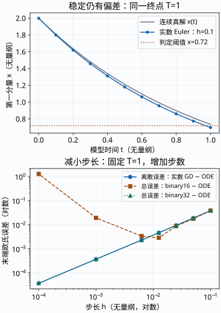
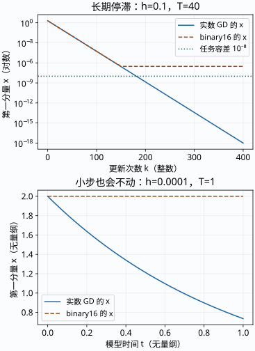

# 同一个碗，为什么稳定、小步和没有 NaN 都不够？

你在 [[数学/40-微积分与优化/81-二维参数与三维目标图像|二维/三维目标图]] 看到了收敛和发散。现在追问：**同一个稳定更新，跟连续过程差多远，计算机又是否真的在更新？** 本页沿用同一个无量纲教学目标，不引入新的训练数据：

$$f(x,y)=\tfrac12(x^2+10y^2),\qquad \theta_0=(2,3/5)^\mathsf T,\qquad H=\operatorname{diag}(1,10).$$

$x,y$ 是两个独立实数参数，$H\in\mathbb R^{2\times2}$，梯度 $H\theta\in\mathbb R^2$，目标 $f\in\mathbb R$。模型时间 $t$、步长 $h$、曲率和目标均已无量纲化；$k$ 是整数更新次数，$N$ 次更新产生 $N+1$ 个状态。这里的连续“时间”是梯度流的模型坐标，不是 CPU 墙钟或训练 epoch。采用精确梯度、固定标量步长和欧氏度量，没有动量或随机噪声。

## 基础入口：先预测，再看三种答案

不运行代码，取 $h=0.1$，手算一次：

$$\theta_1=\theta_0-hH\theta_0=(1.8,0)^\mathsf T,\qquad f(\theta_1)=1.62.$$

连续梯度流满足 $\dot\theta=-H\theta$，因此在相同模型时间 $t=0.1$，真解是

$$\theta(0.1)=(2e^{-0.1},(3/5)e^{-1})^\mathsf T\approx(1.809675,0.220728)^\mathsf T.$$

第一步更新完全消去了 $y$；连续过程却还保留约 $0.220728$。两个更新因子是 $0.9$ 和 $0$，都在稳定区间内，但该步没有准确跟随连续轨道。若目标只是最小化二次函数，消掉 $y$ 可以有用；若目标是模拟连续过程，它造成误差。误差要先说明相对于哪个对象。

先预测第二件事：把步长减到 $h=10^{-4}$，用 binary16 保存每一步，初始 $x=2$ 的第一步一定会改变吗？写下预测，再展开。

核对这个预测

本次主机 NumPy 过程把 $h$ 存成 $0.00010001659393310547$，把更新量存成 $0.00020003318786621094$。binary16 在 2 下方的相邻数为 $1.9990234375$；减去这个更新量后仍更靠近 2，写回又得到 2。更新量非零，$x$ 却从第一步起不动。$x=2$ 是正规数；这次停滞发生在次正规区之前。

**可停点：** 能手算一次 GD，并分别说出“稳定”“连续轨道误差”“写回后是否变化”三个问题。若梯度或两个自由度不清楚，回到 [[数学/40-微积分与优化/81-二维参数与三维目标图像#基础入口：先预测一次更新|同例基础入口]]；不必先读所有浮点格式。

## 机制入口：同一对象的四层账本

已有地形图帮助定位对象，不需要再画一个碗。其黑色箭头代表负梯度，蓝色线代表 $h=0.1$ 更新；显示向量缩放的含义见原页。

三维高度仍由 $(x,y)$ 决定，去 [[数学/40-微积分与优化/81-二维参数与三维目标图像#三维图：同一对参数增加一个高度坐标|原三维图]] 可核对两个自由度。本页新增图专门回答时间离散与精度改变后的误差。

| 层 | 同一个状态怎样得到 | 本页比较的对象 |
| --- | --- | --- |
| 连续实数模型 | $\theta(t)=e^{-Ht}\theta_0$ | 在预先固定的 $T$ 读真解 |
| 离散实数 GD / 显式 Euler | $\theta_k^{\rm E}=(I-hH)^k\theta_0$，$t_k=kh$ | 同一 $t_k$ 的连续真解；不是“第 $k$ 秒” |
| 低精度表示与运算 | $\widehat\theta_k$；输入转换，两个乘法及减法分别写回 binary16/32 | 同一初值、预定步长下的实数 GD |
| 任务决策 | 给定状态与明确阈值输出真/假 | 指定参照的决策；不能从一个连续误差范数自动推出 |

实数 GD 用 `Fraction` 的有理闭式计算，初值 $3/5$ 和步长 $1/N$ 不先转成 binary64。图、欧氏范数和目标值随后用 binary64 作诊断；ODE 数值参照用主机 binary64 `exp`，不是无限精度指数求值。特别在 $T=160$，数学上非零的 $(3/5)e^{-1600}$ 在该诊断中变成 0；这低于 binary64 范围，不能据此说连续第二方向在有限时间严格归零。

### 先分清误差向量，再取范数

记在同一 $t_k$ 上

$$d_k=\theta_k^{\rm E}-\theta(t_k),\quad r_k=\widehat\theta_k-\theta_k^{\rm E},\quad e_k=\widehat\theta_k-\theta(t_k)=d_k+r_k.$$

本页的离散误差 $E_D=\|d_k\|_2$、浮点过程误差 $E_R=\|r_k\|_2$、总轨道误差 $E_T=\|e_k\|_2$ 都是二维欧氏范数。只有向量相加是等式；范数满足 $E_T\le E_D+E_R$，一般不等于两范数相加，方向相反时会抵消。

另外报告到最小点的距离 $E_{\min}=\|\widehat\theta_k-(0,0)\|_2$ 和目标值 $f(\widehat\theta_k)$。它们不是相对于连续轨道的误差。若精确到最小点，本例有

$$\tfrac12E_{\min}^2\le f(\widehat\theta_k)\le5E_{\min}^2.$$

本例条件数 $\kappa_2(H)=10$；它不等于舍入误差，也不单独给出指数范围安全保证。矩阵误差与残差的区别见 [[数学/20-线性代数与几何/17-矩阵范数条件数与数值稳定性|矩阵范数与条件数]]，带回“范数、相对于谁、是否逐分量”三个检查。

## 从精确解推到稳定而有偏差的 Euler

本科读者可从这里直接进入，随后回看上述账本。$\dot\theta=-H\theta$ 的两个分量分别是 $\dot x=-x$、$\dot y=-10y$。解标量方程后拼成

$$\theta(t)=(2e^{-t},(3/5)e^{-10t})^\mathsf T.$$

显式 Euler 使用当前斜率，$\theta_{k+1}^{\rm E}=\theta_k^{\rm E}-hH\theta_k^{\rm E}$，恰好与这里的实数 GD 相同。于是

$$x_k^{\rm E}=2(1-h)^k,\qquad y_k^{\rm E}=(3/5)(1-10h)^k.$$

对所有初值严格衰减要求两个因子的模都小于一，得到 $0<h<0.2$。$h=0.2$ 的第二方向因子是 $-1$，有界但不衰减；“绝对稳定含边界”与“收敛到零的严格区间”要分开。一般非线性模型、动量或 Adam 不享有这里的同一递推。Euler 一步定义及局部截断误差的约定可对照 [FNC 的作者教材 §6.2](https://fncbook.com/euler/)；一般误差传播主解释在 [[数学/60-数值计算与量化/12-数值常微分方程局部全局误差与稳定|数值 ODE 页]]。

把精确起点推进一步，未除以步长的局部缺陷为

$$\delta_{k+1}=\theta(t_{k+1})-(I-hH)\theta(t_k)
=\bigl(e^{-hH}-I+hH\bigr)\theta(t_k)
=\tfrac12h^2H^2\theta(t_k)+O(h^3).$$

这是向量，$\|\delta_{k+1}\|_2=O(h^2)$；除以 $h$ 的另一种截断误差约定为 $O(h)$。令 $B=I-hH$，误差递推是 $d_{k+1}=Bd_k-\delta_{k+1}$。对固定 $T$、同一方程和初值、$N=T/h$ 增加，累积得到一阶全局误差。单独把 $N$ 增大而不改变 $h$ 会延长终点，不能据此观察收敛阶。

在 $0<h\lambda<1$ 的分量内还可直接展开

$$N\log(1-h\lambda)=-\lambda T-\tfrac12\lambda^2Th+O(h^2),\qquad N=T/h.$$

因此 $(1-h\lambda)^N$ 与 $e^{-\lambda T}$ 的差通常是 $O(h)$。这段展开只用于足够小的正因子；$h=0.1,\lambda=10$ 时因子为 0，不能取它的对数，仍可用上面的精确闭式比较。

### 固定 $T=1$，稳定却改变阈值判断

$h=0.1,N=10$ 时，实数 GD 为 $(0.6973568802,0)$，连续真解约为 $(0.7357588823,0.00002723995786)$。相同终点上的二维误差和任务距离如下：

| 状态来源 | $E_D$ | $E_R$ | $E_T$ | $E_{\min}$ |
| --- | ---: | ---: | ---: | ---: |
| 实数 GD | 0.0384020 | 0 | 0.0384020 | 0.6973569 |
| binary16 过程 | 同一实数离散误差 | 0.000397026 | 0.0380050 | 0.6977539 |
| binary32 过程 | 同一实数离散误差 | $4.88849\times10^{-10}$ | 0.0384020 | 0.6973569 |

binary16 的总误差略小于实数离散误差，是这次误差向量抵消；不能从一个终点推出低精度普遍更准确。

若构造一项教学决策“在 $T=1$，连续过程是否已满足 $x\le0.72$”，连续真解回答否，实数 Euler 和两种浮点过程回答是。定义决策误差为 $|D(\widehat\theta)-D(\theta(T))|\in\{0,1\}$，本次为 1；它与 $E_T$ 的数值和单位不同。只有误差界小于状态到阈值的距离时，才能保证不翻转。若任务改成“GD 本身的状态是否达到该阈值”，参照对象也要换成 GD。该阈值为教学构造，没有证明任何真实 AI 任务得分。

[PNG 备用](assets/gradient-flow/flow-error.png)。上图只画第一分量 $x$ 便于读出阈值；下图画完整二维欧氏误差，横纵轴均取对数。由右向左减小 $h$，始终保持 $T=1$，步数从 10 增至 10000。实数离散误差继续下降，binary16 总误差先降后升；binary32 在这一范围仍接近一阶行为。这是已跑的指定步长序列，不是任意精度或所有步长的误差最优性证明。

## 表示误差与每次运算怎样进入更新？

binary16 初始存储 $y=0.60009765625$，表示误差恰为 $1/10240$；binary32 存储 $y=0.6000000238418579$，误差为 $1/41943040$。$x=2$ 和两个曲率 $1,10$ 可精确表示；$h=0.1$ 不能，分别存为 $0.0999755859375$ 与 $0.10000000149011612$。

本次计算明示三次运算，各步输出都存到目标格式：

$$\widehat g_k=\operatorname{fl}_p(\widehat H\widehat\theta_k),\quad
\widehat\Delta_k=\operatorname{fl}_p(\widehat h\widehat g_k),\quad
\widehat\theta_{k+1}=\operatorname{fl}_p(\widehat\theta_k-\widehat\Delta_k).$$

这定义的是实际调用 NumPy `multiply`、`multiply`、`subtract` 并明确 `dtype` 的主机过程，不请求 FMA。每个状态数组形状为 $(N+1,2)$，元素为 `float16` 或 `float32`。NumPy 可以用更宽的内部指令实现低精度运算，源码存在不能认证 CPU 原生 FP16 指令、硬件舍入模式或 GPU 内核。类型与格式说明见 [NumPy 标量文档](https://numpy.org/doc/stable/reference/arrays.scalars.html)，范围诊断见 [NumPy finfo 文档](https://numpy.org/doc/stable/reference/generated/numpy.finfo.html)；本次实际版本和过程在复算结果中记录。

为了不把输入表示与运算混同，源码还计算理想参照 $\theta_k^{\rm S}=(I-\widehat h\widehat H)^k\widehat\theta_0$：将已存浮点数转回精确有理数，然后作实数闭式。于是 $r_k=(\theta_k^{\rm S}-\theta_k^{\rm E})+(\widehat\theta_k-\theta_k^{\rm S})$，前项来自输入表示，后项来自运算写回；JSON 分别给出它们的二范数，仍不把两范数相加称为等式。

相对 $B=I-hH$，把全部浮点影响写成一步残差 $\rho_k=\widehat\theta_{k+1}-B\widehat\theta_k$，便有 $r_{k+1}=Br_k+\rho_k$。若稳定区内 $q=\|B\|_2<1$ 且有统一的 $\|\rho_k\|_2\le\varepsilon$，则

$$\|r_N\|_2\le q^N\|r_0\|_2+\varepsilon\frac{1-q^N}{1-q}.$$

这是**条件性的界**，没有从格式名称自动获得 $\varepsilon$。在正规、无溢出、舍入到最近等条件下可用 unit roundoff 分析；次正规区必须考虑绝对间隔，不能继续套统一相对误差界。$h$ 很小时，$q$ 接近 1，又做更多次舍入；只说“减小步长”没有控制全部误差来源。

### 两种实际停滞：不能只把不动状态当作最优点

[PNG 备用](assets/gradient-flow/flow-stagnation.png)。上图固定 $h=0.1$，更新 400 次，$T=40$；纵轴为第一分量对数。binary16 第 150 次转移首次得到与上一步完全相同的二维状态，之后恒为 $(2.980232238769531\times10^{-7},0)$。梯度第一分量仍非零，$h\widehat g$ 却舍入为 0。该值是 binary16 最小正次正规数 $2^{-24}$ 的 5 倍；已存 $h<0.1$，乘积略小于半个最小间隔，所以写成零。这次没有 NaN 或上溢。

若任务是 $E_{\min}\le10^{-8}$，实数 GD 在 $T=40$ 达到约 $9.95\times10^{-19}$，binary16 停滞距离约 $2.98\times10^{-7}$，任务未达标。若容差改为 $10^{-6}$，同一个停滞状态可以满足该任务；不能把“浮点停滞”自动等同于“所有任务失败”。同源数据中 binary32 到第 972 次转移才首次完全不动，$x=5.605193857299268\times10^{-45}$，任务距离早已小于 $10^{-8}$；更高精度也有范围极限。

下图固定 $T=1$，$h=10^{-4},N=10000$。binary16 的 $x$ 因前述正规区写回从头保持 2，$y$ 仍在变化，**不是整条二维状态从第一步起不动**。此时实数离散误差只有 $3.67897\times10^{-5}$，binary16 总误差却约为 $1.26424$。两个反例的原因分别是更新量低于当前状态的可分辨写回间隔，及长期进入次正规区后更新量消失；无需虚构一个没有观察到的 FP16 overflow。

## 另一种隐藏失败：只改变初值的一个方向

保持同一 $H$，取 $h=0.25$，两个实数因子为 $0.75,-1.5$。若专门从 $(2,0)$ 出发，第二方向始终为零，第一方向收敛；十二步下降不能推出对所有初值稳定。

只把 $y_0$ 改为 $10^{-6}$，有 $y_{12}=10^{-6}(-1.5)^{12}\approx0.0001297463$；以后振荡并放大。有限的十二步即便总目标仍可能下降，也不取消该方向的渐近不稳定。论证来自闭式因子，而不是看到一次总目标上升才成立。若极小初值在低精度输入时已舍入为 0，还会再次隐藏这一方向；必须核对**存入的初值**，不能只读十进制输入文本。

## 迁移：现在改变曲率、精度与终点

不看答案。改为 $f_c(x,y)=\tfrac12(x^2+100y^2)$，仍从 $(2,0.6)$ 出发，处理流程与上述三个逐运算写回步骤相同，每次运行最多 4000 次更新。团队在 binary16、$h=0.01,N=100,T=1$ 看到所有值有限，提出两个请求：

1. 用它模拟连续过程在 $T=1$ 的状态，要求二维欧氏误差不超过 $10^{-4}$。
2. 把同一步长延长到 $T=40$，要求到最小点的欧氏距离不超过 $10^{-8}$；如果不够，愿意改成 binary32，并允许在每次运行预算内另选步长。

给每个请求写出接受、拒绝或当前无法判断及依据；给出你能验证的替代方案，说明它兑现哪个请求。不得只交“稳定”或“没有 NaN”。这是一道联合迁移题，没有预先指定求解步骤。

核对答案、等价方案与未知出口

$H_c=\operatorname{diag}(1,100)$，对所有初值严格衰减需 $0<h<0.02$。原方案在稳定区内，但这本身不足以签收两个精度要求。实际复算的 binary16 原方案在 $T=1$ 的轨道误差约为 $0.00333701$，超过 $10^{-4}$；binary32 保持 $h=0.01,N=100$ 时也有约 $0.00369434$ 的误差，单换格式没有消除离散误差。

第一个请求的一种已跑替代为 binary32、$h=1/4000,N=4000,T=1$，欧氏误差约 $9.26073\times10^{-5}$，满足预算与要求。相同步长、步数的 binary16 误差约 $1.21737$，表明不能把实数一阶精度证明直接迁到低精度写回。

第二个请求在 binary16、$h=0.01,N=4000,T=40$ 的距离约 $2.92063\times10^{-6}$，未达到 $10^{-8}$；换为 binary32、相同 $h,N,T$，距离约 $6.94719\times10^{-18}$，本次达到要求。它不等于对所有长期运行或硬件的保证。前一项比较连续真解，后一项比较最小点，不能交换两种误差来签收。

任何满足相同初值、终点、逐运算语义、预算与误差要求的等价步长/格式方案都可接受；也可以给出更强的解析界、明确申请改变预算或任务容差。如果不能确定实际内核、FMA、FTZ 或输入转换，说明待查条件并保留“当前无法判断”是合法答案。没有必要把解法迁移到 GPU 才算完成。

## 复算与带回的问题

[[数学/60-数值计算与量化/84-梯度流离散与精度复算|复算页]] 提供真源、逐字镜像、测试、CSV/JSON 与库外输出命令；数据列明步长、步数、终点、类型及所比较的误差。图为原创教学计算，浅底中文标签；已有地形图保持原样。源文核对、相关主机执行与离线 425px 图检查只支持这些证据层，Obsidian 实际主题/链接点击及真人试读尚待验证。

带回三个判断：稳定是在控制什么放大因子；小误差相对于哪个对象；任务阈值是否真的满足。继续到 [[数学/60-数值计算与量化/12-数值常微分方程局部全局误差与稳定|数值 ODE]] 可把本例的缺陷推到一般光滑右端；去 [[数学/60-数值计算与量化/01-二进制浮点精度与数值稳定性|浮点表示]] 可解释不同精度、subnormal 与累加器的边界。本页没有验证真实 GPU、混合精度训练、Adam/随机 SGD 或控制系统。
