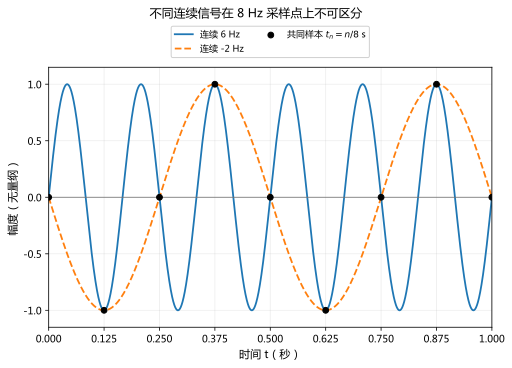
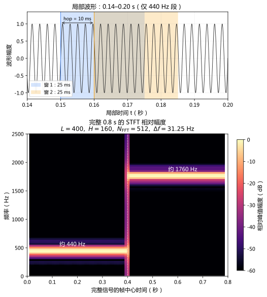

# 采样定理、波形、STFT 与 Mel 频谱

> [!info] 历史证据已补入
> 原有证据字段保持其历史记录；所指 [[Logs/2026-09-05_改造证据/内容审阅记录|内容审阅记录]] 已从 WorkWithLLM 按原字节补入。其范围见 [[Logs/来源材料/WorkWithLLM/README|来源说明]]；本批未重新认证本页内容或提升证据等级。

## 本课目标

读完后，你应能：

1. 区分连续声音、离散波形、采样率与最高可表示频率；
2. 说明混叠发生的条件，而不是把“采样率除以二”当成无条件真理；
3. 读懂 STFT 的时间帧、频率 bin、窗口和 hop；
4. 解释 Mel 频谱如何从 STFT 得到，以及它压缩或丢弃了哪些信息。

> [!important] 第一阶段最低先修
> 学语音与音频模型时，最低要求是能从采样率计算 Nyquist 频率，能读时频图的两条轴，理解窗口长度带来的时间—频率分辨率权衡，并知道常见 Mel 频谱通常不保留完整相位。

## 1. 从空气振动到数字波形

把空气压力随时间的变化记为连续函数 $x(t)$。采样率为 $f_s$ 时，每隔 $T_s=1/f_s$ 秒记录一次：

$$
x[n]=x(nT_s)=x\left(\frac{n}{f_s}\right).
$$

得到的数组就是离散波形。$f_s=16\,000\ \text{Hz}$ 表示每秒 16,000 个样本，而不是“声音频率为 16 kHz”。样本值描述瞬时幅度；位深或数值格式决定幅度量化的精细程度，采样率决定时间轴的精细程度，二者不要混淆。

## 2. 采样定理与混叠

理想条件下，若连续信号严格带限于 $B$ Hz，即高于 $B$ Hz 没有频率成分，并且

$$
f_s>2B,
$$

就能从无限长、无噪声的样本精确重建原信号。$f_s/2$ 称为 Nyquist 频率。

这条结论有重要前提：严格带限、理想采样和理想重建。现实录音会在采样前使用抗混叠低通滤波器，并留出过渡带，所以工程上不会简单把所有能量一直保留到精确的 $f_s/2$。

### 可观察例子：6 Hz 伪装成 2 Hz

以 $f_s=8$ Hz 采样 6 Hz 正弦波：

$$
\sin\left(2\pi\frac{6n}{8}\right)
=\sin\left(2\pi\frac{-2n}{8}\right).
$$

离散样本无法区分 6 Hz 与一个相位方向相反的 2 Hz 成分。因为 6 Hz 超过 Nyquist 频率 4 Hz，它折叠到低频，这叫**混叠**。混叠一旦写进样本，不能仅靠之后“提高保存采样率”恢复原频率。



*图：实线和虚线是不同的连续函数，黑点是 $t_n=n/8$ 秒处的共同采样值。相同采样点只说明这组离散数据无法区分二者，不表示两条连续曲线相同。*

## 3. 完整复数 DFT 与全局频谱显示

长度为 $N$ 的离散片段，其 DFT 为：

$$
X[k]=\sum_{n=0}^{N-1}x[n]e^{-2\pi \mathrm{i}kn/N}.
$$

第 $k$ 个 bin 的离散频率按 $f_s$ 取模：$0\le k\le\lfloor N/2\rfloor$ 时通常标作 $k f_s/N$；$k>N/2$ 时等价地标作 $(k-N)f_s/N$，表示负频率。对实值信号，正负频率共轭对称，因此常只保存 $0$ 到 $\lfloor N/2\rfloor$ 的单侧频谱；当 $N$ 为偶数时，$k=N/2$ 是 Nyquist bin。DFT 假设所观察片段在边界处周期重复；若片段没有包含整数个周期，边界会突然跳变，能量扩散到相邻 bin，称为**频谱泄漏**。

加窗可以减弱边界突变，但会改变主瓣宽度和旁瓣高度。因此窗口不是“把错误消掉”，而是在不同误差之间做选择。

## 4. STFT：局部时间片上的 DFT

完整复数 DFT 可逆，保留时间位置信息；全局频谱不直接展示局部时频演化。只保存幅度或功率才丢掉相位。例如 $x=[1,0,0,0]$ 与 $y=[0,1,0,0]$ 的 DFT 分别为 $X=[1,1,1,1]$ 与 $Y=[1,-i,-1,i]$，幅度相同，相位不同；逆 DFT 恢复各自脉冲位置。[DFT 与逆变换约定](https://numpy.org/doc/stable/reference/routines.fft.html)。

自检：仅给你四个幅度 1，能否区分这两个脉冲？不能；给出完整复数谱则可以。短时傅里叶变换是在每个时间位置截取一小段、乘窗口、再做 DFT。若一帧实际使用 $L$ 个样本，相邻帧起点相隔 $H$ 个样本，并将加窗后的帧末尾补零到 $N_{\mathrm{FFT}}\ge L$ 点，一种按帧起点取样的约定写成：

$$
X[m,k]=\sum_{r=0}^{L-1}
x[mH+r]w[r]e^{-2\pi \mathrm{i}kr/N_{\mathrm{FFT}}}.
$$

- $m$：第几个时间帧；
- $k$：第几个频率 bin；
- $w$：窗口函数；
- $L$：一帧实际使用的样本数，决定观察时长；
- $N_{\mathrm{FFT}}$：DFT 点数；本例要求它不小于 $L$，大于 $L$ 的部分只补零；
- $H$：hop length，相邻帧起点相隔的样本数。

`STFT → 复数矩阵`，横轴通常是时间帧，纵轴通常是频率 bin。显示时常使用幅度 $|X|$ 或功率 $|X|^2$，并转成对数尺度：

$$
20\log_{10}\frac{|X|}{A_{\mathrm{ref}}}
\quad\text{或}\quad
10\log_{10}\frac{|X|^2}{P_{\mathrm{ref}}}.
$$

两式在 $P_{\mathrm{ref}}=A_{\mathrm{ref}}^2$ 时一致。直接对 0 取对数没有定义，实际实现会加下限或很小的正数。

本库 `one_sided_power_spectrum` 保留兼容函数名，实际输出**原始单边平方幅度特征**，未按采样率或窗归一化，也不加倍正频率。取 $N=8$、矩形窗、单位正弦 $x_n=\sin(2\pi n/8)$：时域平方和为 4，双边 $\sum_k|X_k|^2=32$，原始单边和为 16。Parseval 在当前 DFT 约定下要求除以 $N$；单边还需将成对的内部正频率乘 2，DC 与偶数 $N$ 的 Nyquist 项不加倍。PSD 则需要采样率及窗平方和归一化，单位含每 Hz。不能把这几种量都标成同一个“能量”，也不因此修改原 Mel 特征值。

自检：为什么 $32/8=4$，而 $16/8=2$？指出丢掉的共轭半边，再判断含 DC 信号能否把单边每项都乘二。检查点：DC 不成正负配对。

### 时间—频率分辨率权衡

- 窗口更长：更容易分开接近的稳定频率，但时间定位更模糊。
- 窗口更短：时间变化定位更准，但频率 bin 更粗。
- 减小 hop 会让帧更密、更平滑，却不会凭空突破窗口决定的分辨率。
- 增加零填充可以让频谱曲线采样更密，但不会增加原片段中真实的信息。

下面的教学信号前 0.4 秒为 440 Hz，后 0.4 秒为 1760 Hz。采样率 $f_s=16\,000$ Hz，使用 Hann 窗 $L=400$、hop $H=160$、$N_{\mathrm{FFT}}=512$。因此窗覆盖 $400/16000=25$ ms，相邻帧起点相隔 $160/16000=10$ ms；这些是本例的选择，换采样率或任务时需重新换算。本图只取完整窗，不在信号两端补帧，因此共有 78 帧。



*图：上图放大 0.14–0.20 秒的 440 Hz 局部波形，阴影表示两个 Hann 窗的覆盖区间；每窗宽 25 ms，起点相隔 10 ms。下图单独显示完整 0.8 秒范围，颜色为相对峰值的**幅度** dB：$20\log_{10}(\lvert X\rvert/\max\lvert X\rvert)$，不是功率或 PSD。0.4 秒前后的谱脊分别接近 440 Hz 和 1760 Hz；跨过切换点的窗同时看到两段信号，转折因而不会无限尖锐。512 点 FFT 把显示网格加密到 31.25 Hz，实际频率分辨仍受 400 点窗限制。[[数学/70-信号处理与多模态数学/assets/generate_sampling_stft_figures.py|重绘这两张图的源码]]。*

## 5. Mel 频谱：按听觉尺度汇总频率

一种常见 Mel 标度近似为：

$$
m=2595\log_{10}\left(1+\frac{f}{700}\right).
$$

低频区域被分得相对细，高频区域被压缩。常见 Mel 频谱计算流程是：

```text
波形 → STFT → 幅度或功率 → Mel 三角滤波器组加权求和 → 可选对数
```

若 $S[m,k]=|X[m,k]|^2$，第 $r$ 个 Mel 带可写成：

$$
M[m,r]=\sum_k B[r,k]S[m,k],
$$

其中 $B[r,k]$ 是第 $r$ 个三角滤波器对频率 bin $k$ 的权重。

Mel 频谱是有目的的压缩，不是原波形的等价副本：

- 多个 FFT bin 被汇总，细频率结构被压缩；
- 若只保留幅度/功率，复数相位被丢弃；
- 取对数后，动态范围被压缩；对严格正的精确输入，单独的对数变换有指数逆变换，并不自动造成信息丢失，但实际的零值下限、裁剪、量化和有限精度会使这一步不可逆；
- 窗口、hop、FFT 长度、Mel 带数、频率范围和归一化约定都会影响数值。

因此，不给参数的“Mel 频谱”并不是唯一对象；比较实验时必须记录这些配置。

## 练习

1. 采样率为 16 kHz 时，Nyquist 频率是多少？一个 10 kHz 纯音直接采样后是否可被唯一表示？
2. 16 kHz 音频使用 25 ms 窗口和 10 ms hop，各是多少个样本？
3. 为什么把 FFT 长度从 400 零填充到 512，不等于录到了更多声音？
4. 列出从波形到对数 Mel 功率谱的步骤，并指出至少两种不可逆信息损失；同时说明为什么“理想对数变换”本身不能直接算作其中一项。

## 成功标准

- [ ] 得到 Nyquist 频率 8 kHz，并指出 10 kHz 超出范围，会与较低频率混叠。
- [ ] 得到窗口 400 个样本、hop 160 个样本。
- [ ] 能区分“更密的频率网格插值”与“由更长观测提供的真实分辨能力”。
- [ ] 能指出滤波器组汇总细频率、丢弃相位，以及实际实现中的下限、裁剪、量化或有限精度等至少两项；不会把严格正精确数上的理想对数变换误称为天然不可逆。

## 边界与下一步

本课没有展开声学模型、tokenizer、ASR、TTS、神经声码器或音频生成架构。这些属于 [[AI/40-语音与音频模型/00-语音与音频模型-MOC|语音与音频模型 MOC]]。

- 上一课：[[数学/70-信号处理与多模态数学/01-空间几何Patch卷积与频域|空间几何、Patch、卷积与频域]]
- 返回：[[数学/70-信号处理与多模态数学/00-信号处理与多模态数学-MOC|信号处理与多模态数学 MOC]]
- 下一课：[[数学/70-信号处理与多模态数学/03-高斯噪声扩散Score与ODE-SDE直觉|高斯噪声、扩散、Score 与 ODE-SDE 直觉]]
- 动手验证：[[数学/70-信号处理与多模态数学/80-多模态数学最小实验|多模态数学最小实验]]


## 系统理论对照

本页保留应用问题与最小实验；更完整的定义、推导条件和反例见 [[数学/16-数学分析/13-Fourier级数正交展开与收敛|Fourier级数正交展开与收敛]]；[[数学/46-数理方程/14-Fourier-Laplace变换解数理方程|Fourier-Laplace变换解数理方程]]；[[数学/20-线性代数与几何/16-SVD的推导最优低秩与PCA|SVD的推导最优低秩与PCA]]。
