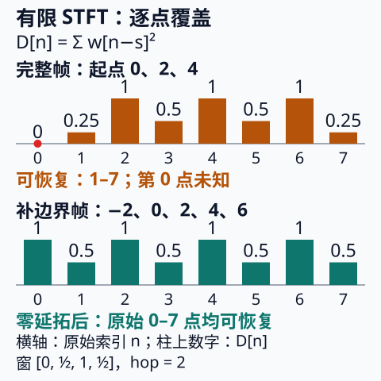

# STFT 窗覆盖与可逆重建

读时频图的人会问：“保留复数谱就能还原录音吗？”解数理方程的人会问：“Fourier 可逆为什么还需要边界条件？”两条入口汇到同一个问题：**变换的是哪个对象，哪些原始样本实际进入了变换？** 从 [[数学/70-信号处理与多模态数学/02-采样定理波形STFT与Mel频谱#4. STFT：局部时间片上的 DFT|音频入口]] 带着窗长、hop、FFT 长度进入；从 [[数学/46-数理方程/14-Fourier-Laplace变换解数理方程#变换把常系数微分变成乘法|连续变换入口]] 带着“对象和适用条件”进入。本文统一讲离散有限记录；连续 Sobolev 条件仍由后者负责。

## 1. 三个长度与两个可逆问题

原记录 $x[n]\in\mathbb C$，$0\le n<T$，实窗 $w[r]$ 长 $L$，DFT 长 $N\ge L$。选定有限帧起点集合 $S$，常见 $s=mH$；$H$ 是 hop。记录外使用明确约定的零延拓 $\widetilde x[n]=0$。这里不用居中帧，也不做去均值或幅度归一化：

$$X_s[k]=\sum_{r=0}^{L-1}\widetilde x[s+r]w[r]e^{-2\pi i kr/N},\qquad 0\le k<N.$$

于是矩阵 shape 是 $|S|\times N$，各行保留完整复数谱。对实记录也可保存带相位的单边复数谱再由共轭对称补齐；DC、偶数 $N$ 的 Nyquist 项须正确保留。只保存幅度的单边图不满足这个条件。

完整 $N$ 点复数 DFT 的逆给

$$z_s[r]=\frac1N\sum_{k=0}^{N-1}X_s[k]e^{2\pi i kr/N}
=\begin{cases}\widetilde x[s+r]w[r],&0\le r<L,\\0,&L\le r<N.\end{cases}$$

等号来自 $N^{-1}\sum_k e^{2\pi i k(r-q)/N}$ 在 $r=q$ 时为 1，其他整数索引差时为 0。**帧逆变换恢复的是加窗帧 $z_s$**。窗的零点已经把相应样本乘成零，单帧可逆不保证整条 $x$ 可恢复。

固定 $f_s=16000$ Hz、$N=512$，bin 间隔始终是 $f_s/N=31.25$ Hz。把 $L=400$ 改成 $200$，观测从 25 ms 缩到 12.5 ms，显示网格不变；同一窗族的主瓣变宽，分开近频的能力下降。零填充使频谱采样更密；窗观察时长与窗形才控制主瓣、泄漏和时间定位。两纯音能否分开还与幅度比、噪声及判据有关，不能把 $f_s/L$ 当作无条件分辨阈值。

## 2. 从帧回到记录：逐点分母的推导

把各逆帧放回起点，再乘一次同一窗并相加。窗外把 $w$ 记作零。对每个原始索引 $n$，令

$$D_S[n]=\sum_{s\in S}w[n-s]^2,\qquad
A_S[n]=\sum_{s\in S}z_s[n-s]w[n-s].$$

完整未修改的谱给 $A_S[n]=x[n]D_S[n]$，因此

$$\boxed{x[n]=A_S[n]/D_S[n]\quad\text{仅当 }D_S[n]>0.}$$

这是同一分析窗、同一合成窗的归一化 overlap-add（重叠相加）。它不要求 $D_S$ 为常数。双窗形式会换成 $\sum_s w_a[n-s]w_b[n-s]$，不能继续机械使用平方分母。

在无限平移网格上，NOLA 检查周期覆盖的分母非零；实际有限集合 $S$ 还要逐点检查记录两端与删帧后的 $D_S$。COLA 描述常数重叠相加约束，具体是窗还是分析/合成窗的乘积须看约定；它不是上式逐点除法的必要条件。[SciPy `stft` 的 Notes 给出平方窗分母与 NOLA；`boundary`、`padded` 参数说明有限端点覆盖](https://docs.scipy.org/doc/scipy/reference/generated/scipy.signal.stft.html)。本课实验自行实现该代数约定，不调用 SciPy，也不声称数值与其默认缩放相同。

如果 $D_S[n]=0$，该位置没有任何非零观测权重。改变 $x[n]$ 而保持其他位置不变，所有 $X_s$ 都不变，所以无法唯一恢复。实践中极小正分母还会放大舍入或谱修改误差。实验用 $10^{-12}$ 的阈值将这类点标成 `None`；阈值只服务短序列演示，不是通用音频误差预算。

## 3. 可以逐项手算的八样本例

取 $x=[1,2,3,4,5,6,7,8]$，周期 Hann 窗 $L=4$：$w=[0,1/2,1,1/2]$，$H=2$、$N=8$。仅取完整窗，$S=\{0,2,4\}$。所有帧完整复数逆变换后：

$$z_0=[0,1,3,2],\quad z_2=[0,2,5,3],\quad z_4=[0,3,7,4].$$

在 $n=3$，来自两帧的分子为 $2\cdot\tfrac12+2\cdot\tfrac12=2$，分母为 $\tfrac14+\tfrac14=\tfrac12$，故恢复 $2/(1/2)=4$。整个有限分母是

$$D_S=[0,1/4,1,1/2,1,1/2,1,1/4].$$

**恢复区间是原始索引 $1\le n\le7$，即半开数组区间 `[1:8]`；$n=0$ 不可恢复。** 无限网格内部没有缺口，并不补上有限首帧的窗零点。若记录长度再多一项而仍只取完整窗，末端还可能完全未覆盖。

改用零延拓并取 $S=\{-2,0,2,4,6\}$，负起点帧和最后一帧均明确存在，原始区间上的分母为

$$D_S=[1,1/2,1,1/2,1,1/2,1,1/2].$$

这时可恢复 **$0\le n\le7$，即 `[0:8]`**，裁掉延拓区域后得到原记录。补零本身没有创造新的声音；新增边界帧让端点以非零权重进入观测。使用其他边界延拓时必须保存延拓、帧起点和裁剪约定，不能只保存一张谱图。

图中柱子表示实际 $D_S[n]$；上行首点为零，下行全部正。窗族在无限网格上的结论没有替代这八个有限分母。可编辑图和 [[数学/70-信号处理与多模态数学/assets/generate_stft_reconstruction.py|生成源]] 共同保留，生成必须显式指定库外输出。

## 4. 三种失败不应混成一种

- **零覆盖：** 上例第一点无权重。$x_0=1$ 和 $x_0=99$ 产生相同的三个谱，恢复器应标未知，不能用零冒充测得值。
- **丢帧：** 从完整窗例中删去 $s=2$ 帧，仅留 $0,4$。$n=4$ 在两帧中分别落到窗外和窗首零点，$D_S[4]=0$；恢复区间分裂为 $[1,3]$ 与 $[5,7]$。丢帧不必总失败：若其余帧仍覆盖某点，该点仍可由实际新分母恢复；必须重算。
- **丢相位：** 四点脉冲 $[1,0,0,0]$ 与 $[0,1,0,0]$ 的幅度都是 $[1,1,1,1]$。覆盖即使正也无法从幅度唯一判断位置；把复数谱替换成 $|X_s|$ 后再作逆变换改变了问题。Griffin–Lim 等估计方法需要额外选择，不能保证取回原记录。

修改谱还可能破坏重叠帧间的一致性。归一化相加此时给一个合成结果，上述 $A_S=xD_S$ 证明只用于来自同一原记录的未修改帧。

## 5. 带答案的迁移题

1. $f_s=16000,N=512$ 固定，$L:400\to200$，bin、窗时长分别如何变化？
2. 给出手算例 $n=5$ 的分子、分母与恢复值；为什么不能只把逆帧相加？
3. 保留 $S=\{0,2,4\}$，改变第一点，是否有办法仅靠更多 FFT 零填充识别变化？
4. 删掉中帧后，哪些点不能恢复？若改为 $S=\{-2,0,4,6\}$ 呢？
5. 若只存单边复数谱，实信号和一般复信号的结论相同吗？
6. 谱经过掩膜后，分母仍正，能否声称准确恢复原录音？

> [!question]- 解答与检查路径
> 1. bin 均为 31.25 Hz；窗时长 25→12.5 ms；同窗族主瓣变宽，不能说 bin 变粗。
> 2. $A[5]=3/2+3/2=3$，$D[5]=1/2$，$x[5]=6$；不除分母得到的是覆盖加权值。
> 3. 不能；第一点乘零，任意 $N\ge L$ 都保留同一零观测。
> 4. 原例 $n=0,4$ 不可恢复。加边界帧仍缺 $n=4$，因为 $s=4$ 的窗首为零、$s=0$ 的窗已结束，边界两帧也没覆盖它。
> 5. 实信号有共轭对称可补齐，一般复信号没有；单边复数谱通常也不够。
> 6. 不能；覆盖是原未修改谱可逆的条件之一，掩膜已改变信息。须说明合成的是修改结果。

## 复算与后续边界

[[数学/70-信号处理与多模态数学/81-STFT重建与边界实验|标准库实验]] 用闭式脉冲谱与手算覆盖作为独立预期值，验证边界、丢帧、丢相位和输入拒绝；它不验证真实音频软件的默认参数或人的听感。回到 [[数学/70-信号处理与多模态数学/02-采样定理波形STFT与Mel频谱#5. Mel 频谱：按听觉尺度汇总频率|Mel 压缩]]，可以分别追踪相位损失、频带汇总与数值下限。本课不修改既有 80 实验的原始单边平方幅度特征。
