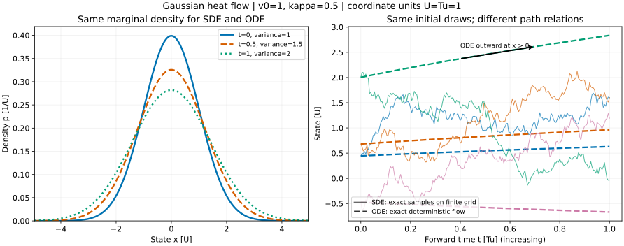

# 高斯噪声、扩散、Score 与 ODE-SDE 直觉

## 本课目标

读完后，你应能：

1. 读懂“信号加高斯噪声”的重参数化公式；
2. 区分条件分布的 score 与混合后的边缘分布 score；
3. 用向量场理解 score 指向高概率区域的局部方向；
4. 区分 SDE 的随机路径与 probability flow ODE 的确定性路径。

> [!important] 第一阶段最低先修
> 学扩散模型时，最低要求是会读 $x_t=\alpha_t x_0+\sigma_t\epsilon$，知道 score 是对“当前状态”求对数密度梯度，并理解反向 SDE 与 probability flow ODE 可以在适当条件下共享边缘分布，但单条轨迹并不相同。随机微积分证明不是第一阶段要求。

## 1. 高斯噪声不是“随便抖一下”

一维标准高斯变量写作 $\epsilon\sim\mathcal N(0,1)$。在 $d$ 维中，常用

$$
\epsilon\sim\mathcal N(0,I),
$$

表示各坐标均值为 0、方差为 1，且在这个坐标系中彼此独立。给干净数据 $x_0$ 加噪的一种通用写法是：

$$
x_t=\alpha_t x_0+\sigma_t\epsilon.
$$

- $t$ 是噪声时间，不一定等于物理时间；
- $\alpha_t$ 控制保留多少原信号；
- $\sigma_t$ 控制加入多少噪声；
- $\epsilon$ 是本次随机抽到的噪声。

当 $\sigma_t>0$ 时，在给定 $x_0$ 后有普通高斯密度：

$$
q(x_t\mid x_0)=\mathcal N(\alpha_t x_0,\sigma_t^2I).
$$

某些 variance-preserving 设计满足 $\alpha_t^2+\sigma_t^2=1$，但这不是所有扩散过程的普遍定义。具体调度必须单独说明。

### 数字例子

若 $x_0=3$、$\alpha_t=0.8$、$\sigma_t=0.6$，本次抽到 $\epsilon=-0.5$，则

$$
x_t=0.8\times3+0.6\times(-0.5)=2.1.
$$

同一个 $x_0$ 在同一时刻可以得到不同 $x_t$；扩散描述的是分布与随机过程，不是一条固定直线。

## 2. 前向扩散：逐步忘掉数据细节

离散时间过程可以写成 Markov 链：

$$
q(x_t\mid x_{t-1}).
$$

Markov 性表示：给定当前状态后，下一步不再需要更早历史。合理设计每一步的均值与方差后，多步结果可合并成上一节的闭式 $q(x_t\mid x_0)$，从而能直接抽取任意噪声时刻训练样本。

连续时间的前向过程常写为随机微分方程：

$$
\mathrm d x=f(x,t)\,\mathrm dt+g(t)\,\mathrm dW_t.
$$

- $f$ 是 drift，描述确定性漂移；
- $g$ 控制随机扰动强度；
- $W_t$ 是 Wiener 过程，$\mathrm dW_t$ 的尺度约为 $\sqrt{\mathrm dt}$，不能当成普通的 $\mathrm dt$。

直觉上，ODE 是“站在同一点、规则唯一地告诉你往哪里走”；SDE 则在规则之外，每个小步还抽一次随机扰动。

## 3. Score：对数密度的上坡方向

在 $p_t(x)>0$ 且可微的区域，时刻 $t$ 的边缘密度 score 定义为：

$$
s_t(x)=\nabla_x\log p_t(x).
$$

score 是一个与 $x$ 同形状的向量。它指向对数密度局部增长最快的方向；在密度峰顶附近，score 可能接近 0。使用 $\log p$ 不会改变上坡方向，并把概率密度的乘法结构转成加法结构。

对 $\sigma_t>0$ 的给定 $x_0$ 高斯条件分布，精确 score 是：

$$
\nabla_{x_t}\log q(x_t\mid x_0)
=-\frac{x_t-\alpha_t x_0}{\sigma_t^2}
=-\frac{\epsilon}{\sigma_t}.
$$

这解释了为何预测噪声 $\epsilon$ 与预测条件 score 可以互相换算。

当 $\sigma_t=0$ 时重参数化式仍可退化，但 $x_0=3,\alpha_t=1$ 的条件分布是点质量 $\delta_3$，不是上述普通密度；$-(x-3)/0$ 不能当作 score。实际算法若从正 $\epsilon$ 截断开始，截断值是所选调度的计算条件，不是普适常数。

> [!warning] 条件 score 不等于直接知道真实边缘 score
> $-\epsilon/\sigma_t$ 使用了本次训练样本的 $x_0$ 与噪声。真正反向过程需要 $\nabla_x\log p_t(x)$，其中 $p_t$ 混合了所有可能的 $x_0$。在平方误差训练的理想最优点，模型学习的是与条件目标相关的条件期望，从而恢复边缘 score；不能把单个样本的噪声标签直接说成全局密度场。

## 4. 一维 score 的方向例子

若 $p(x)=\mathcal N(2,4)$，即均值 $\mu=2$、方差 $\sigma^2=4$，则

$$
\frac{\mathrm d}{\mathrm dx}\log p(x)
=-\frac{x-2}{4}.
$$

- $x=6$ 时 score 为 $-1$，指向左边的高密度区域；
- $x=0$ 时 score 为 $0.5$，指向右边；
- $x=2$ 时 score 为 0，位于密度峰顶。

score 只给局部方向与尺度，不直接给归一化常数，也不保证一步跳到最终样本。

## 5. 反向 SDE：逆着噪声时间恢复结构

在常见正则条件下，若把时间从 $T$ 向 0 积分，前向 SDE 的反向时间形式可写成：

$$
\mathrm d x=
\left[f(x,t)-g(t)^2\nabla_x\log p_t(x)\right]\mathrm dt
+g(t)\,\mathrm d\bar W_t,
$$

其中积分方向是从大 $t$ 到小 $t$，$\bar W_t$ 表示反向时间噪声。若把时间重新参数化成始终向前增加的变量，符号会相应改变；因此不能脱离积分方向死记正负号。

模型近似 score 后，就能把“纯噪声附近的样本”逐步推向数据的高密度区域，同时保留随机采样能力。

这里的 $dW$ 不能按光滑轨迹求导。[[数学/30-概率与统计/20-随机过程/04-Brownian二次变差与Ito公式#先完整算出平方：链式法则丢掉了什么|二次变差与Itô公式]]从确定分割的平方增量和推导 $d(W^2)=2W\,dW+dt$，并用OU共同噪声区分强误差和弱误差。它提供随机积分与链式法则的前提；本节的反向时间漂移仍额外需要密度、score和时间反演定理，不能单凭Itô公式或一幅逆向采样图推出。

## 6. Probability flow ODE：相同边缘分布，不同路径

与上述前向 SDE 相关的 probability flow ODE 为：

$$
\mathrm d x=
\left[f(x,t)-\frac{1}{2}g(t)^2\nabla_x\log p_t(x)\right]\mathrm dt.
$$

它没有随机微分项。若 score 精确、正则条件成立并正确求解，ODE 与相应 SDE 在每个时刻可以具有相同的**边缘概率分布**。

这不表示两者逐样本轨迹相同：

- SDE 从同一点出发仍可因随机增量走出不同路径；
- ODE 给定初值后路径由向量场唯一决定（满足常见唯一性条件时）；
- 数值步长、近似 score 和求解器误差会让实际结果偏离理想结论。

### 深入：用同一条热流算清密度、轨迹与信息量

以下深入段需要一元微积分、Gaussian 的二阶与四阶矩及独立增量；随机路径的依据可回到 [[数学/30-概率与统计/20-随机过程/04-Brownian二次变差与Ito公式#Brownian模型和本课的证明边界|Brownian 模型]]。它不改变本页入门最低先修。

“密度峰变矮”“不确定性增大”“score 指向峰顶”能否同时成立？先把三个对象分开：随机变量 $X_t$ 是时刻 $t$ 的读数，随机过程 $(X_t)_{t\ge0}$ 还包含不同时刻怎样关联，密度 $p_t(x)$ 则只描述该时刻总体怎样分布。本段也可将 $p_t$ 记为 $\rho_t$；它们是同一个密度，不是温度。

固定全实线 $x\in\mathbb R$、前向时间 $t\ge0$、$\kappa>0$、$v_0>0$，令 $X_0\sim N(0,v_0)$ 独立于标准 Brownian 过程 $W$。取

$$
dX_t=\sqrt{2\kappa}\,dW_t,\qquad X_t=X_0+\sqrt{2\kappa}W_t,
\qquad v_t=v_0+2\kappa t.
$$

若状态单位为 $U$、时间单位为 $T_u$，则 $[v_t]=U^2$、$[\kappa]=U^2/T_u$、$[p_t]=U^{-1}$。标准 Brownian 增量方差为 $\Delta t$，所以这里 SDE 的噪声系数是 $\sqrt{2\kappa}$，PDE 的扩散系数是 $\kappa$；把它写成 $\sqrt\kappa$ 会使方差增长率少一半。以下用自然对数，在固定坐标单位下报告微分熵，熵差单位为 nat。

独立 Gaussian 相加给出同一边缘密度

$$
p_t(x)=\frac1{\sqrt{2\pi v_t}}\exp\!\left(-\frac{x^2}{2v_t}\right),\qquad \int_{\mathbb R}p_t(x)dx=1.
$$

它与 [[数学/46-数理方程/08-热核全空间问题与Duhamel原理#热核是一单位瞬时点热源的响应|热核]] 使用同一方差约定。Gaussian 积分保证归一化；直接求导给

$$
\partial_t p_t=\kappa p_t\left(\frac{x^2}{v_t^2}-\frac1{v_t}\right),\qquad
\partial_{xx}p_t=p_t\left(\frac{x^2}{v_t^2}-\frac1{v_t}\right).
$$

故 $\partial_t p=\kappa\partial_{xx}p$。这就是本 SDE 的 Fokker–Planck 方程，在当前模型里已经由显式密度核实。作为一般框架，一维且噪声系数仅依赖时间时，$dX=f\,dt+g\,dW$ 的密度方程为 $\partial_t p=-\partial_x(fp)+\tfrac12g^2\partial_{xx}p$；本例 $f=0,g^2=2\kappa$。该框架的密度与正则条件不能用符号代换省掉。[Song 等附录 D.1](https://arxiv.org/html/2011.13456v2#A4.SS1)从密度方程说明这一连接；下文的 Gaussian 解与数值均自行计算。

[[数学/46-数理方程/30-正则性与非线性演化/03-抛物平滑能量与非线性爆破#能量、唯一性与前向稳定来自同一个负号|周期温度场的能量证明]]处理的是圆周上的一般场 $u$，可有负值、不同单位，也没有概率质量为 1 的要求。这里是全实线上的正概率密度 $p$；共同 PDE 结构允许比较耗散机制，不允许把原温度场偷偷归一化后换成新对象。

### 从质量通量得到向外的确定流

热方程的通量为 $j=-\kappa\partial_xp$，因此

$$
\partial_t p=-\partial_xj=-\partial_x(v_{\rm flow}p),\qquad
v_{\rm flow}=\frac jp=-\kappa\partial_x\log p=\frac{\kappa x}{v_t}.
$$

$p_t>0$ 使除法合法。$v_{\rm flow}$ 是速度，$v_t$ 是方差，不要因同用字母 $v$ 而混淆。本例通量在无穷远趋零；这还排除了向通量另加空间常数的选择。状态 score $s_x=-x/v_t$ 在 $x>0$ 指向峰顶，但前向概率流速度是它的 **$-\kappa$ 倍**，所以向外。峰高降低、宽度增大，正是把同一质量向外搬运的结果。

用 $Z_t$ 命名对应 ODE 过程，避免和 SDE 路径混写：

$$
\frac{dZ_t}{dt}=\frac{\kappa}{v_t}Z_t,\qquad Z_0=X_0,
\qquad Z_t=X_0\exp\!\left(\int_0^t\frac{\kappa}{v_0+2\kappa r}dr\right)
=X_0\sqrt{\frac{v_t}{v_0}}.
$$

$v_0>0$ 时系数在任意有限时间段连续且有界，对状态全局 Lipschitz，因此本线性 ODE 有唯一解。若 $a_t=\sqrt{v_t/v_0}$，变量替换给 $p^Z_t(z)=p_0(z/a_t)/a_t=p_t(z)$，所以每个固定时刻两者都是 $N(0,v_t)$。这是密度相同的直接证明，不依赖“两个形式 PDE 一样就必有唯一过程”的跳步；一般 SDE 或粗糙 score 的存在唯一性仍需别的定理。

### 同边缘为什么不保证同路径关系

对 $0\le s<t$，独立增量给

$$
X_t=X_s+\sqrt{2\kappa}(W_t-W_s),\qquad
\operatorname{Cov}(X_s,X_t)=v_s.
$$

而 ODE 每时刻只乘同一个初值，所以

$$
\operatorname{Cov}(Z_s,Z_t)=\frac{\sqrt{v_sv_t}}{v_0}\operatorname{Var}(X_0)
=\sqrt{v_sv_t}.
$$

两个二时刻向量都是联合 Gaussian，但协方差矩阵分别为

$$
\Sigma_{\rm SDE}=\begin{pmatrix}v_s&v_s\\v_s&v_t\end{pmatrix},\qquad
\Sigma_{\rm ODE}=\begin{pmatrix}v_s&\sqrt{v_sv_t}\\\sqrt{v_sv_t}&v_t\end{pmatrix}.
$$

前者行列式 $v_s(v_t-v_s)>0$，后者行列式为 0：ODE 的二时刻读数落在直线 $Z_t=\sqrt{v_t/v_s}Z_s$ 上，而 SDE 给定 $X_s$ 后仍有方差 $2\kappa(t-s)$。这已经是不同的联合分布，不能靠相似直方图消除。

固定 $v_0=1,\kappa=1/2,s=0,t=1$，两者方差同为 $(1,2)$，跨时协方差却分别为 $1$ 与 $\sqrt2\approx1.414214$，相关系数分别为 $1/\sqrt2$ 与 $1$。ODE 的随机性完全来自初值；这不妨碍它运输随机初值的分布，却不会给每条路径补出 Brownian 独立增量。



*左：上述 Gaussian 密度在 $t=0,0.5,1$ 的宽度/高度变化，面积均为 1，图外尾部未画。右：同四个随机初值的 SDE 网格读数（实线）与精确 ODE 流（虚线）；线段连接只是显示有限网格，不代表 Brownian 路径可微。横轴向右为前向时间，箭头标明 $x>0$ 的 ODE 向外移动。图中 $U=T_u=1$ 是选定坐标单位；左纵轴单位为 $U^{-1}$，右纵轴单位为 $U$。固定种子、输入和图源见本节末；四条样本路径不承担分布证明。*

若只反向积分这条 ODE，固定终时 $T$，令 $Y_\tau=Z_{T-\tau}$、$0\le\tau\le T$，则

$$
\frac{dY_\tau}{d\tau}=-\frac{\kappa}{v_{T-\tau}}Y_\tau,\qquad
Y_\tau=Y_0\sqrt{\frac{v_{T-\tau}}{v_T}}.
$$

$Y_0\sim p_T$ 时恢复对应的边缘密度；给定单个终点只恢复一条 ODE 轨迹。这里没有随机项。第 5 节反向 SDE 换成递增的 $\tau$ 后，本模型漂移为 $2\kappa\partial_x\log p_{T-\tau}=-2\kappa x/v_{T-\tau}$，并且仍有 $\sqrt{2\kappa}\,dB_\tau$；它不能用上面的 ODE 漂移替代。一般时间反演的条件仍由第 5 节所指理论承担。

### 同一热流的熵增加与凸耗散

定义状态 Fisher 量 $J_x$，下标强调它对状态而非任意统计参数求导：

$$
h(p_t)=-\int p_t\log p_t\,dx
=\frac12\log(2\pi e v_t),\qquad
J_x(p_t)=\int p_t(\partial_x\log p_t)^2dx
=\frac{E[X_t^2]}{v_t^2}=\frac1{v_t}.
$$

第一式把 $-\log p_t=\tfrac12\log(2\pi v_t)+x^2/(2v_t)$ 取期望即可得到。在有限时间段 $[0,T]$，$v_t$ 被正的 $v_0$ 和有限的 $v_T$ 夹住，所用导数与对数乘积受“多项式乘 Gaussian 尾”统一可积支配，可以交换时间求导与积分。截到 $[-R,R]$ 后分部积分再令 $R\to\infty$：

$$
\begin{aligned}
\frac d{dt}h(p_t)
&=-\kappa\int_{\mathbb R}(1+\log p_t)\,\partial_{xx}p_t\,dx\\
&=-\kappa\lim_{R\to\infty}[(1+\log p_t)\partial_xp_t]_{-R}^{R}
+\kappa\int_{\mathbb R}\frac{(\partial_xp_t)^2}{p_t}dx\\
&=\kappa J_x(p_t)=\frac{\kappa}{v_t}\ge0.
\end{aligned}
$$

Gaussian 尾使边界项为 0，也保证 $p\log p$、$(\partial_t p)(1+\log p)$ 及 Fisher 被积函数绝对可积。推广时至少需核正密度、相关空间/时间可微性、积分交换的支配条件、上述边界项消失与积分有限；这一页没有证明所有粗糙密度的推广。若改成有边界或有质量注入的系统，边界通量不能原样删掉。

这是当前扩散约定下的 de Bruijn 恒等式。若用加噪方差 $a=2\kappa t$ 作为时间，取 $G\sim N(0,1)$ 且独立于 $X_0$，$X_0+\sqrt a\,G$ 只描述每个固定时刻的分布，满足 $dh/da=J_x/2$；若以 $t$ 为时间才是 $dh/dt=\kappa J_x$。常数差来自变量选择，不是两条定理矛盾。

同一计算为什么又常叫“熵耗散”？回到 [[数学/46-数理方程/30-正则性与非线性演化/01-熵选择黏性极限与激波形成#薄黏性层把方向选择变成一个可解 ODE|黏性层的凸函数链式耗散]]，保留其链式结构，在本热方程中取光滑凸函数 $\eta$：

$$
\partial_t\eta(p)=\kappa\partial_{xx}\eta(p)-\kappa\eta''(p)(\partial_xp)^2.
$$

在边界项消失、积分和交换合法时，$d\int\eta(p)dx/dt=-\kappa\int\eta''(p)(p_x)^2dx\le0$。正密度允许取 $\eta(p)=p\log p$，$\eta''=1/p$，所以 $\int p\log p$ 下降，$h=-\int p\log p$ 上升。取 $\eta(p)=p^2/2$ 则得到平方能量下降；本例 $\tfrac12\int p_t^2dx=1/(4\sqrt{\pi v_t})$。三者方向由定义决定：密度更平坦、平方幅度更小、概率不确定性更大可以同时成立。守恒律的凸熵函数不自动是 Shannon 熵；本段也没有断言 Gaussian 热密度满足 Burgers 方程。

相对熵还需要指定参照分布。对固定 $q=N(0,w)$、$w>0$，两密度都正且 Gaussian 积分有限，直接积分得到

$$
D(p_t\Vert q)=\frac12\left(\frac{v_t}{w}-1-\log\frac{v_t}{w}\right),\qquad
\frac d{dt}D(p_t\Vert q)=\kappa\left(\frac1w-\frac1{v_t}\right).
$$

若 $v_0=w$，此后 $v_t>w$，相对熵反而增加；“$h$ 增加”不等于“相对任意固定目标的 KL 下降”。固定 Gaussian 并非自由热流的平衡密度，全实线上的常数也无法归一化为概率。这里没有调用 KL 收缩定理；若让两份初始密度同时接受同一热半群，则是另一组参照随时间变化的问题。

### 参数 score、状态 score 与单位改变

统计课的 [[数学/30-概率与统计/13-Fisher信息正则条件与渐近效率#Score 是数据对参数微小改变的读数|参数 score]] 固定观测 $x$ 而改变参数。对本例的位置族 $f_\mu(x)=p_t(x-\mu)$，固定 $t$，有

$$
\partial_\mu\log f_\mu(x)=\frac{x-\mu}{v_t},\qquad
\partial_x\log f_\mu(x)=-\frac{x-\mu}{v_t},\qquad I_\mu=J_x=\frac1{v_t}.
$$

它们符号相反，平方期望恰好相同，原因是位置参数通过 $x-\mu$ 进入。若固定均值 0、把方差 $v$ 当参数，则

$$
\partial_v\log f_v(x)=\frac{x^2-v}{2v^2},\qquad
I_v=\frac{E[(X^2-v)^2]}{4v^4}
=\frac{3v^2-2v^2+v^2}{4v^4}=\frac1{2v^2}.
$$

因此不能仅凭同名 score 就把任意参数 Fisher 换成 $J_x$。位置与方差的单位不同，相应信息单位也不同。

沿用 [[数学/50-信息论/01-熵交叉熵KL散度与互信息#与连续分布的边界：微分熵不是离散熵的直接复制|微分熵换单位规则]]，令 $x'=cx$、$c\ne0$，时间不变，$p'_t(x')=p_t(x'/c)/|c|$。于是

$$
s'_{x'}=s_x/c,\quad J'_{x'}=J_x/c^2,\quad
v'_t=c^2v_t,\quad\kappa'=c^2\kappa,\quad h(p'_t)=h(p_t)+\log|c|.
$$

所以 $\kappa'J'_{x'}=\kappa J_x$，熵增量 $h_t-h_s$ 不变；两密度同时变换时 KL 也不变。换米为厘米只改变坐标读数，不凭空增加观测信息。

### 改条件后独立求解

不沿前面步骤提示求解：保持相同边缘初值的要求，取 $v_0=4,\kappa=3/2$，比较 $s=1,t=3$。给出密度、确定流、两种跨时协方差、$h_3-h_1$。再把 $v_0$ 改成 0：零时刻的 score 能直接代入吗？给定确定点初值是否仍唯一确定一个产生非退化 Gaussian 密度的流？

> [!question]- 可核答案与零时刻边界
> 正方差题中 $v_r=4+3r$，$p_r(x)=\exp[-x^2/(2(4+3r))]/\sqrt{2\pi(4+3r)}$；$\dot Z_r=3Z_r/[2(4+3r)]$，$Z_r=X_0\sqrt{(4+3r)/4}$。$v_1=7,v_3=13$；协方差分别为 $7$ 与 $\sqrt{91}\approx9.539392$，熵增量为 $\tfrac12\log(13/7)\approx0.309520$ nat。
>
> $v_0=0$ 时初始分布是 $\delta_0$，没有零时刻 Lebesgue 密度与普通 score；但每个 $r>0$ 的 SDE 仍有 $N(0,2\kappa r)$ 密度。正时间上概率流方程变为 $\dot Z_r=Z_r/(2r)$，在 0 奇异；所有 $Z_r=C\sqrt r$ 都可连续延到 $Z_0=0$，所以零时刻点初值不选出唯一解。若另外随机选 $C\sim N(0,2\kappa)$，确可匹配正时间边缘，但这添加了点初值以外的随机选择，不能称为由该初值唯一确定的流。若从 $\varepsilon>0$ 开始，则 $Z_r=Z_\varepsilon\sqrt{r/\varepsilon}$，须同时给正确的随机初值 $Z_\varepsilon\sim N(0,2\kappa\varepsilon)$。零时刻的微分熵无此密度定义，不能把负无穷端点代进前述有限熵差。

### 复算与观察：同一个输入返回不同证据

固定输入 [input.json](assets/heat-flow/input.json) 默认 $v_0=1,\kappa=1/2,T=1$，Monte Carlo 样本数 40000，密度求积截到 $\pm10\sqrt{v_T}$，使用 4000 个等长小区间；四条绘图轨迹使用 200 个时间步。读者可先预测协方差和熵增量，再运行 [heat_flow.py](assets/heat-flow/heat_flow.py)：

```bash
python3 -B 数学/70-信号处理与多模态数学/assets/heat-flow/heat_flow.py \
  --input 数学/70-信号处理与多模态数学/assets/heat-flow/input.json \
  --output-dir /tmp/wwl-heat-flow-replay
```

脚本需 Python 3 与 matplotlib；输出目录可自选以保留原始产物。它由相同输入生成 `density.csv`、`paths.csv`、`metrics.json`、`heat-flow.svg` 和供显示核对的 `heat-flow.png`。SDE 网格增量按精确 Gaussian 转移抽样；ODE 使用精确解，不把高分辨率 Euler 当真值。以已知零均值的 $E[X_sX_t]$ 估计协方差，报告乘积均值的标准误；这仍是有限样本观察，解析协方差的证明在前文。

本页随附 [metrics.json](assets/heat-flow/metrics.json) 是该固定输入的实际输出：分别对密度做数值积分、中心差分核 PDE、用积分近似 $h,J_x$，并报告 Monte Carlo 跨时乘积的抽样误差。默认输入预期质量约为 1、$h_1-h_0=\tfrac12\log2\approx0.346574$、$J_x(p_1)=1/2$，两种协方差围绕 1 与 $\sqrt2$ 波动。求积和差分有截断/离散误差，采样有随机误差；这些数值检查不代替独立推导核查、真实模型训练、生成质量评估或人的理解验证。


## 7. 数值求解只看“小步近似”

ODE 的 Euler 小步为：

$$
x_{n+1}=x_n+h\,v(x_n,t_n).
$$

SDE 的 Euler–Maruyama 小步为：

$$
x_{n+1}=x_n+f(x_n,t_n)h+g(t_n)\sqrt{h}\,z_n,
\qquad z_n\sim\mathcal N(0,I).
$$

随机项随 $\sqrt h$ 缩放，是它与普通 ODE Euler 法的关键区别之一。第一阶段只需会读公式；稳定性、强/弱收敛阶和高阶采样器属于后续数值分析与模型课程。

## 练习

1. 令 $x_0=4$、$\alpha_t=0.5$、$\sigma_t=1$、$\epsilon=-2$，计算 $x_t$ 与条件 score。
2. 对 $p(x)=\mathcal N(-1,9)$，分别判断 $x=2$ 与 $x=-4$ 处 score 的方向。
3. 用自己的话解释“ODE 与 SDE 共享边缘分布”为什么不等于“每条轨迹相同”。
4. Euler–Maruyama 中若步长从 $h$ 变为 $h/4$，单步随机项的典型尺度变成原来的多少？

## 成功标准

- [ ] 得到 $x_t=0$，条件 score 为 $-\epsilon/\sigma_t=2$。
- [ ] 能算出 $x=2$ 处 score 为 $-1/3$、指向左，$x=-4$ 处为 $1/3$、指向右。
- [ ] 能明确区分“同一时刻的样本总体分布”与“某个初值对应的单条运动路径”。
- [ ] 得到随机项尺度变为原来的 $1/2$，而不是 $1/4$。

## 边界与下一步

本课没有展开 U-Net/Transformer 去噪网络、条件引导、训练权重、离散采样器或潜空间扩散。这些属于 [[AI/50-扩散模型/00-扩散模型-MOC|扩散模型 MOC（planned）]]。

- 上一课：[[数学/70-信号处理与多模态数学/02-采样定理波形STFT与Mel频谱|采样定理、波形、STFT 与 Mel 频谱]]
- 返回：[[数学/70-信号处理与多模态数学/00-信号处理与多模态数学-MOC|信号处理与多模态数学 MOC]]
- 动手验证：[[数学/70-信号处理与多模态数学/80-多模态数学最小实验|多模态数学最小实验]]
- 相关基础：[[数学/30-概率与统计/00-概率与统计-MOC|概率与统计 MOC]]、[[数学/40-微积分与优化/00-微积分与优化-MOC|微积分与优化 MOC]]


## 系统理论对照

本页保留应用问题与最小实验；更完整的定义、推导条件和反例见 [[数学/16-数学分析/13-Fourier级数正交展开与收敛|Fourier级数正交展开与收敛]]；[[数学/46-数理方程/14-Fourier-Laplace变换解数理方程|Fourier-Laplace变换解数理方程]]；[[数学/20-线性代数与几何/16-SVD的推导最优低秩与PCA|SVD的推导最优低秩与PCA]]。
