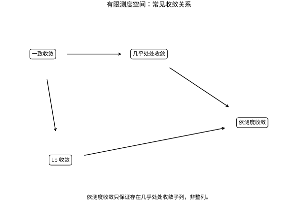

# 收敛关系与反例实验室

## 先说清“什么意义下接近”

在有限测度空间 $(X,\mu)$ 上，点态或几乎处处收敛控制每个固定位置，一致收敛控制最大误差，$L^p$ 收敛控制平均的 $p$ 次误差，依测度收敛控制大误差区域的测度。它们回答不同问题。下图假设 $1\le p<\infty$、底空间测度有限；换成整个实线时不能照搬所有箭头。

*图：实线是成立的蕴含；依测度收敛到几乎处处收敛只能在抽取子列后保证。*

由 $\|f_n-f\|_p^p\le\mu(X)\|f_n-f\|_\infty^p$，一致收敛推出 $L^p$ 收敛。由
$$\mu\{|f_n-f|>\varepsilon\}\le\varepsilon^{-p}\|f_n-f\|_p^p,$$
$L^p$ 收敛推出依测度收敛。几乎处处收敛也在有限测度下推出依测度收敛，可对异常集合的尾部并集用测度上连续性证明。整个实线上的移动指示函数 $1_{(n,n+1)}$ 则处处趋于0，却不依测度趋于0，展示有限性条件的位置。

## 三个反例覆盖主要误区

尖峰 $f_n=n1_{(0,1/n)}$ 几乎处处趋于0，但 $\|f_n\|_1=1$，不能交换极限与积分。把高度改成 $n^{1/p}$，则 $L^p$ 范数恒为1，同样构成反例。

打字机序列逐层枚举 $[0,1)$ 的二进制小区间：第 $k$ 层为 $1_{[j2^{-k},(j+1)2^{-k})}$，$j=0,\ldots,2^k-1$。随着层数增加，每个函数的支集长度趋零，所以在任意有限 $p$ 下 $L^p$ 趋零。但每个 $x\in[0,1)$ 每层被命中一次，又有大量未命中的项，因此整列不逐点收敛。它反驳了“$L^p$ 收敛就有整列点态收敛”。

在 $L^2(0,2\pi)$ 中，$\sin nx$ 的范数恒为 $\sqrt\pi$，所以不强收敛到0；但对任意 $g\in L^2$，内积是 $g$ 的 Fourier 系数，Bessel 不等式使该系数趋零，因此弱收敛到0。“所有固定线性探针读数趋零”并不等于“能量趋零”。

## 为什么依测度收敛总能抽出好子列

若 $f_n\to f$ 依测度，逐次选择 $n_k$ 使
$$\mu\{|f_{n_k}-f|>2^{-k}\}<2^{-k}.$$
令异常集合为 $E_k$。无限次落入异常集合的点集测度至多
$$\mu\left(\bigcap_N\bigcup_{k\ge N}E_k\right)\le\inf_N\sum_{k\ge N}2^{-k}=0.$$
因此几乎每个点最终满足 $|f_{n_k}-f|\le2^{-k}$，获得几乎处处收敛。这是直接的可和异常集论证，无需假设概率独立性。

## Egorov：删去很小一块后获得一致收敛

若 $\mu(X)<\infty$ 且 $f_n\to f$ 几乎处处，则对任意 $\eta>0$ 可删去测度小于 $\eta$ 的集合，使剩余部分上一致收敛。证明按误差等级组织：令
$$E_{N,k}=\bigcup_{n\ge N}\{|f_n-f|\ge1/k\}.$$
对固定 $k$，这些集合随 $N$ 递减，交集几乎为空；有限测度给 $\mu(E_{N,k})\to0$。选择 $N_k$ 使 $\mu(E_{N_k,k})<\eta2^{-k}$，删除它们的并集 $E$。在 $X\setminus E$ 上，对每个误差 $1/k$ 都有一个统一的 $N_k$，即一致收敛。关键是“小集合可以依容许测度而定”，不是声称原区域上一致。

## 从收敛到积分交换还差什么

支配收敛用一个固定可积包络控制全部函数，能同时排除过高尖峰和质量逃向无穷远。有限测度空间上，依测度收敛加一致可积性可升级为 $L^1$ 收敛，这一 Vitali 型结论是更一般的桥梁。此处一致可积性可用 $\sup_n\int_{|f_n|>M}|f_n|\to0$ 定义；有限测度条件下它控制尾部质量。尖峰例子不满足，因为无论阈值多高，都有更高且总质量1的尖峰。

应用时先写希望交换的操作，再选择足够的控制条件；不要先交换，再用“图像看起来稳定”补理由。更强的结论会要求更强的控制，但过强假设也可能掩盖真正机制。

参考定位：测度与积分主线；Terence Tao 的作者讲义 *245A, Notes 4: Modes of convergence*（准确入口见学术来源页）。

## 先修、交叉链接与来源

[[数学/16-数学分析/08-函数列函数项级数与一致收敛|函数列函数项级数与一致收敛]]；[[数学/16-数学分析/14-测度可测函数与Lebesgue积分|测度可测函数与Lebesgue积分]]；[[数学/16-数学分析/15-收敛定理与Fubini-Tonelli|收敛定理与Fubini-Tonelli]]；[[数学/16-数学分析/17-函数空间范数完备性与紧性|函数空间范数完备性与紧性]]。

[[数学/80-跨学科专题与综合练习/00-跨学科专题与综合练习-MOC|专题总入口]]；[[数学/90-资源/04-六科学术来源与阅读对照|一手教材和主题定位]]。本专题为独立推导，长的进阶结论已标明依赖与适用范围。
