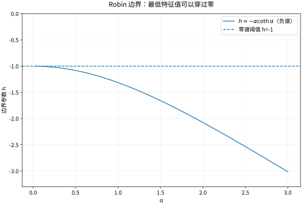

# 边值问题共振与混合边界工作坊

## 边界条件决定谱，不能只看微分表达式

研究
$$-X''=\lambda X,\qquad X(0)=0,\quad X'(L)+hX(L)=0,$$
其中 $h$ 为实数。右端 Robin 条件同时包含导数与函数值。分部积分给出
$$\lambda\int_0^L|X|^2dx=\int_0^L|X'|^2dx+h|X(L)|^2.$$
因此 $h\ge0$ 时特征值为正；若 $h<0$，边界项可能降低能量，需要分别检查正谱、零谱与负谱。仅把通解写成正弦会漏掉后两者。

## 三种谱参数分别求解

若 $\lambda=k^2>0$，由左端条件 $X=C\sin kx$，所以
$$k\cos(kL)+h\sin(kL)=0.$$
这是根方程，不一定有简单的整数倍频率。$h=0$ 时得到 $kL=(n+1/2)\pi$，对应一端固定一端自由。让 $h\to+\infty$，有限频率根趋向右端 Dirichlet 的模式。

若 $\lambda=0$，$X=Cx$，非零解需要 $1+hL=0$，即 $h=-1/L$。若 $\lambda=-\alpha^2<0$，$X=C\sinh\alpha x$，条件为
$$h=-\alpha\coth(\alpha L).$$
函数 $\alpha\coth(\alpha L)$ 从 $1/L$ 严格增长到无穷，因此负特征值恰在 $h<-1/L$ 时存在且唯一。严格增长可对 $s\coth s$ 求导，用 $\sinh(2s)>2s$ 证明。这也显示 $-1/L<h<0$ 虽有负边界项，但仍无负谱。

*图：$L=1$ 时负特征值与 $h=-\alpha\coth\alpha$ 的关系。参数跨过 $h=-1$ 才出现负模式。*

## Helmholtz 共振：不唯一和无解是同一谱障碍的两面

设 $A$ 是具有离散正交谱的自伴边值算子，求 $(A-\mu I)u=f$。展开得到 $(\lambda_n-\mu)u_n=f_n$。若 $\mu$ 不在谱中，可逐模求解，并以到谱的距离控制逆算子。若 $\mu=\lambda_k$，必须有 $f$ 与整个对应特征子空间正交，否则无解；满足正交条件时，可任意添加该空间中的齐次解，所以不唯一。这是此自伴离散谱情形的 Fredholm 选择，不是所有算子的无条件公式。

例：$-u''-u=f$ 于 $(0,\pi)$，双端零值。$f=\sin x$ 时与共振模式内积非零，无解。$f=\sin2x$ 时，$u=(1/3)\sin2x+C\sin x$，有无穷多个解。把 $\lambda_n-1$ 分母直接代入 $n=1$ 会掩盖真正相容条件。

## 非齐次边界要先提升

求 $-u''=f$、$u(0)=a,u(L)=b$，先取 $\ell(x)=a+(b-a)x/L$，写 $u=w+\ell$，$w$ 便有零边界。更一般算子中右端应改为 $f-A\ell$，不能只减边界而保持右端不变。对时间依赖边界，变换还会产生 $\ell_t$ 或 $\ell_{tt}$ 源项。

Neumann 条件则需要积分相容性。例如 $-\Delta u=f$、$\partial_nu=g$，Gauss 定理给 $\int_\Omega f=-\int_{\partial\Omega}g$。齐次通量时右端积分必须为0，解仍可以加常数。固定均值不是物理边界条件的新内容，而是选定一个代表。

## 为什么同一个 Robin 参数会改变热稳定性

热方程 $u_t+Au=0$ 中，负特征值产生 $e^{|\lambda|t}$ 增长。这不一定是数值程序不稳定，而可能来自边界输入或能量产生的真实模型。排错时先检查连续模型的能量符号，再检查离散放大因子；把所有增长都归咎于步长会错过边界符号错误。

> [!question]- 自测：找到零模并检验守恒
> 取 $L=1,h=-1$，零模为 $X=x$。对应齐次热问题中，$\int_0^1u(x,t)x\,dx$ 对时间的导数为0，因为 $A$ 自伴且 $Ax=0$。这保持的是与零模的内积，不是一般的总质量；总质量守恒对应的是常数零模及相应 Neumann 边界。

## 先修、交叉链接与来源

[[数学/46-数理方程/06-Fourier方法与Sturm-Liouville谱|Fourier方法与Sturm-Liouville谱]]；[[数学/46-数理方程/11-Laplace-Poisson方程与最大值原理|Laplace-Poisson方程与最大值原理]]；[[数学/46-数理方程/15-Green函数基本解与边界响应|Green函数基本解与边界响应]]；[[数学/46-数理方程/17-变分原理Lax-Milgram与能量估计|变分原理Lax-Milgram与能量估计]]。

[[数学/80-跨学科专题与综合练习/00-跨学科专题与综合练习-MOC|专题总入口]]；[[数学/90-资源/04-六科学术来源与阅读对照|一手教材和主题定位]]。本专题为独立推导，长的进阶结论已标明依赖与适用范围。
