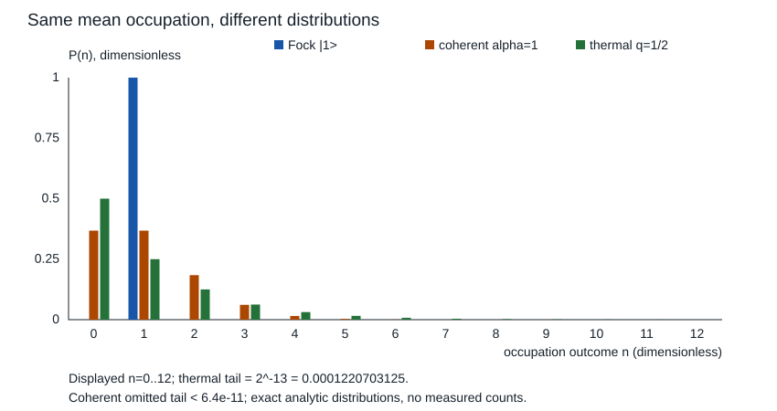

# 谐振子能谱与幅度占据

谐振模的平均场幅为零，是否说明没有能量？电子读出已经提醒答案是否定的。本节从可检查的谐振子算符出发，独立算出零均值却有占据的 Fock 态与热态，再说明何种相干制备允许从平均幅推能量。

## 二次势给可解的局域模型

一维全直线、$m>0$、$\omega>0$，无环境耦合，取

$$H=\frac{p^2}{2m}+\frac12m\omega^2x^2,\qquad p=-i\hbar\partial_x.$$

$x$ 为 m，$p$ 为 kg·m/s，$\omega=2\pi f$ 为 rad/s，$H$ 为 J。这可作为平衡位置附近光滑势的二阶近似；精确谐振子本身有无限二次势，实际非谐性、强驱动、阻尼或更多自由度不在此模型内。局域展开是否有效需比较波函数覆盖范围与真实势偏离量，不能因出现一个振荡频率就认作完整振子。

令长度 $\ell=\sqrt{\hbar/(m\omega)}$，先在 Gaussian 乘多项式的有限线性组合这一稠密不变核上定义无量纲升降算符

$$a=\frac1{\sqrt2}\left(\frac x\ell+\ell\partial_x\right),\qquad
a^\dagger=\frac1{\sqrt2}\left(\frac x\ell-\ell\partial_x\right).$$

快速衰减使分部积分合法，$[x,p]=i\hbar I$ 在该核上成立，直接乘得

$$[a,a^\dagger]=I,\quad N=a^\dagger a,\quad
H=\hbar\omega(N+1/2),\quad [N,a]=-a,\quad[N,a^\dagger]=a^\dagger.$$

这些是共同核上的无界算子恒等式，不能省去作用域后用于任意 $L^2$ 态。$a$ 不是自伴可观测量；$x,p,N,H$ 才分别对应实结果。代数分解可对照 [MIT 8.04 Lecture 14–15，§1–2](https://ocw.mit.edu/courses/8-04-quantum-physics-i-spring-2016/3b4ee73bda5abd93cbb2a89ae9b6765b_MIT8_04S16_LecNotes14_15.pdf)。

## 降到真空，再升到全谱

$\langle\psi|N|\psi\rangle=\|a\psi\|^2\ge0$。在上述不变核内，若 $N|\nu\rangle=\nu|\nu\rangle$，$a$ 降低本征值一且范数平方为 $\nu$；反复下降若不停会产生负本征值，因此本征态必须降到 $a|0\rangle=0$，允许 $\nu=n\in\mathbb N_0$。核外的全谱与完备性不能只靠这段代数，下面单独交代。

解一阶方程 $a\phi_0=0$ 并归一，得到

$$\phi_0(x)=\frac{e^{-x^2/(2\ell^2)}}{\pi^{1/4}\sqrt\ell},\qquad
|n\rangle=\frac{(a^\dagger)^n}{\sqrt{n!}}|0\rangle,$$

$$a|n\rangle=\sqrt n|n-1\rangle,\quad
a^\dagger|n\rangle=\sqrt{n+1}|n+1\rangle,\quad
E_n=\hbar\omega(n+1/2).$$

前两函数为 $\phi_0$ 与 $\phi_1=\sqrt2(x/\ell)\phi_0$，可直接代回微分方程。一般 Hermite 形式
$\phi_n=H_n(x/\ell)\phi_0/\sqrt{2^nn!}$，由递推与分部积分核正交归一。下降论证约束本征值，却不单独排除其他谱或证明完备；需要 Hermite 系在 $L^2(\mathbb R)$ 完备、核上的算子本质自伴。对应标准依据见 [Teschl 第二版，§8.3，Theorem 8.5 及其一维推导](https://www.mat.univie.ac.at/~gerald/ftp/book-schroe/schroe2.pdf)。本节将其 SI 尺度显式恢复。

选唯一自伴闭包后，定义域可精确写为

$$D(H)=\left\{\sum_{n=0}^\infty c_n|n\rangle:
\sum_n E_n^2|c_n|^2<\infty\right\},\qquad
P_H(B)=\sum_{E_n\in B}|n\rangle\langle n|.$$

因此这里是无限维的纯离散谱，能量概率为 $|c_n|^2$，时间演化为 $c_ne^{-iE_nt/\hbar}$。与上一节全直线自由粒子的连续谱形成具体比较，不能仅按“空间连续”判断能量是否连续。

**完整含时例。** 初态 $(|0\rangle+|1\rangle)/\sqrt2$，有平均能量 $\hbar\omega$，能量测量各半落在 $\hbar\omega/2$ 与 $3\hbar\omega/2$。演化后

$$\langle a\rangle(t)=\tfrac12e^{-i\omega t},\qquad
\langle x\rangle(t)=\frac\ell{\sqrt2}\cos\omega t.$$

能量概率不变，位置均值振荡。相对能量相位产生动态，整体真空相位不改变观测。单独 $|1\rangle$ 的密度不随时间变且 $\langle x\rangle=0$，仍有 $3\hbar\omega/2$ 能量。

## 平均幅与占据分别问了什么

任意有相应有限矩的态，$\langle a\rangle$ 问相邻能级的相位关系，$\langle N\rangle=\langle a^\dagger a\rangle$ 问占据。两者满足

$$\langle N\rangle-|\langle a\rangle|^2
=\operatorname{Tr}\!\left[\rho(a-\langle a\rangle)^\dagger
(a-\langle a\rangle)\right]\ge0.$$

缺的是态的涨落，并非一个代数漏项。对 Fock 态 $|n\rangle$，降一阶后与原态正交，所以 $\langle a\rangle=0$、$\langle N\rangle=n$。由
$x=\ell(a+a^\dagger)/\sqrt2$，得到 $\Delta x^2=\ell^2(n+1/2)$；零均值不意味着零涨落。

相干态定义为 $a|\alpha\rangle=\alpha|\alpha\rangle$，$\alpha$ 无量纲。若 $|\alpha\rangle=\sum c_n|n\rangle$，系数递推 $c_{n+1}=\alpha c_n/\sqrt{n+1}$；归一化指数级数给

$$|\alpha\rangle=e^{-|\alpha|^2/2}\sum_{n=0}^\infty
\frac{\alpha^n}{\sqrt{n!}}|n\rangle.$$

因而占据概率是 Poisson 分布，$\langle a\rangle=\alpha$、$\langle N\rangle=|\alpha|^2$、$\operatorname{Var}N=|\alpha|^2$，总能量为 $\hbar\omega(|\alpha|^2+1/2)$。封闭演化保持相干态形式，$\alpha(t)=\alpha e^{-i\omega t}$，另有整体相位 $e^{-i\omega t/2}$。相干态展开和平均占据可对照 [Preskill Chapter 3，式3.147及其正文](https://www.preskill.caltech.edu/ph219/chap3_15.pdf)；这里未引入该来源的阻尼模型。

## 热态能量来自概率权重

对于一个给定频率的理想独立振子，温度 $T>0$ 的 Gibbs 态为

$$\rho_T=(1-q)\sum_{n=0}^\infty q^n|n\rangle\langle n|,
\qquad q=e^{-\hbar\omega/(k_BT)}\in(0,1).$$

真空能量在归一化配分函数中抵消，几何级数给

$$\langle a\rangle_T=0,\quad
\bar n=\langle N\rangle_T=\frac q{1-q},\quad
\operatorname{Var}_T N=\bar n(\bar n+1),\quad
\langle H\rangle_T=\hbar\omega(\bar n+1/2).$$

$T\to0$ 时趋于真空，$\bar n=0$；零点半个能量单位仍在，并不成为可从零温浴持续提取的热功率。电子专题的 [[电子电路/72-量子读出与低温电子学/02-低温放大与噪声预算#温频尺度与谱对象|热权重和谱次序]] 已解释实际预算，本课从谱和矩补出其算子基础；真实模式是否处于该 Gibbs 态要由实验与环境条件判断。

## 6 GHz 同例：同能量，不同幅和涨落

沿用电子页 $f=6\,\mathrm{GHz}$，$\hbar\omega=hf=3.97564209\times10^{-24}$ J。比较三种平均占据同为一的态：

| 态 | $\langle a\rangle$ | $\langle N\rangle$ | $\operatorname{Var}N$ | $\langle H\rangle$ |
| --- | --- | --- | --- | --- |
| Fock $|1\rangle$ | $0$ | $1$ | $0$ | $3hf/2$ |
| 相干 $|\alpha=1\rangle$ | $1$ | $1$ | $1$ | $3hf/2$ |
| 热态 $q=1/2$ | $0$ | $1$ | $2$ | $3hf/2$ |

共同能量 $5.963463135\times10^{-24}$ J；该热态温度为 $T=hf/(k_B\ln2)\approx0.415431\,$K，与电子页的 20 mK 是不同条件。20 mK 热占据约 $5.58658\times10^{-7}$，不能为了对比同占据而偷换温度。

*横轴无量纲占据结果 $n$，纵轴为无量纲概率。Fock、相干和热态按同一表中模型生成；图显示 $n=0\ldots12$，热态未显示尾部总概率为 $2^{-13}$，相干尾部更小，代码保留尾部检查。此图是教学分布，不是实验光子计数。*

电子 [[电子电路/72-量子读出与低温电子学/01-谐振读出与微波链#一条链，几种不同对象|经典储能幅度]] 采用 $a_{经典}=-\sqrt{hf}\langle\hat a\rangle$（√J），所以 $|a_{经典}|^2=hf|\langle\hat a\rangle|^2$。对于 $|1\rangle$ 这个代理为零，总能量却为 $3hf/2$；对于相干态代理为 $hf|\alpha|^2$，仍未包含零点。我们在本节用 $a$ 表示量子无量纲算符，回到电子页必须恢复它的帽号与经典幅度区别。本模型没有真实读出 Hamiltonian、测量反作用或放大链，不能据此认证低温器件。

## 有限截断的反例与迁移

在 $|0\rangle,\ldots,|N-1\rangle$ 的有限基中截断 $a_N$，顶态被 $a_N^\dagger$ 截掉。实际矩阵满足

$$[a_N,a_N^\dagger]=I_N-N|N-1\rangle\langle N-1|,$$

不是 $I_N$。任何有限矩阵对易子的迹为零，而 $\operatorname{Tr}I_N=N$，所以有限矩阵不可能精确实现无限振子的完整正则对易关系。低占据态若顶态权重很小可有良好近似，仍要核截断尾和所问矩，不能用编译成功或有限范数保持替代这一条件。

**半引导。** 把相干态改成 $\alpha=i$。预测平均能量、占据分布与位置均值在零时和四分之一周期的值。

> [!question]- 解释性答案
> 能量与 Poisson 分布仍由 $|\alpha|^2=1$ 决定；$\langle x\rangle=\sqrt2\ell\operatorname{Re}(ie^{-i\omega t})$，零时为零，四分之一周期为 $\sqrt2\ell$。相同能量分布不确定相位，需象限或位置观察区分。

**撤提示。** 有人只给 $\langle a\rangle=0$、$\langle N\rangle=1$，就认定是真实单光子态。提出本页另一个满足条件的态，指出哪项理想观测可区分，并写清实验尚需要什么。

> [!question]- 解释性答案
> $q=1/2$ 的热态也满足两条件，但 Fock 态 $P(N=1)=1$、占据方差零，热态 $P(N=1)=1/4$、方差二。也可构造其他混合态。理想占据分布或二阶矩可区分；真实器件还需制备、探测效率、背景、模式定义与足够统计，平均场和能量两个数不足以层析或认证单光子制备。

到这里可以停下：你已能比较连续自由谱与离散振子谱，给出 Fock、相干、热态的平均幅、占据和涨落，并解释同一平均能量为何不确定态。[[物理/40-量子力学/实践/02-谱与谐振子/README|本段复算]] 检查有限截断、三态统计、含时矩和连续谱概率；按这些问题选做后返回对应推导。

顺读下一页 [[物理/40-量子力学/06-旋转对称与角动量表示|旋转对称与角动量表示]]：升降算符刚才改变了能级，旋转生成元又怎样改变方向测量，并判断哪些量在动力学中守恒？后续已建中心势、有限近似、两体态与一维散射各有代表模型；更广角动量计算、实际氢的精细结构、一般近似、多体统计与三维散射仍保留在 [[物理/40-量子力学/00-量子力学-MOC#全课仍要完成的六阶段|课程地图的完整能力范围]] 中。

将一个占据梯子迁移到多个完整单粒子模式时，读 [[物理/40-量子力学/19-自由多模Fock占据与量子统计#固定 N：每个占据态一次，模式会相关|自由多模 Fock 与固定数统计]]：严格固定总粒子数会造成跨模相关；与储库只匹配平均数时才可在自由能量模式中独立求 BE/FD。携带本页有限截断不能满足精确 CCR 的边界，并区分振子激发数与数守恒粒子。
