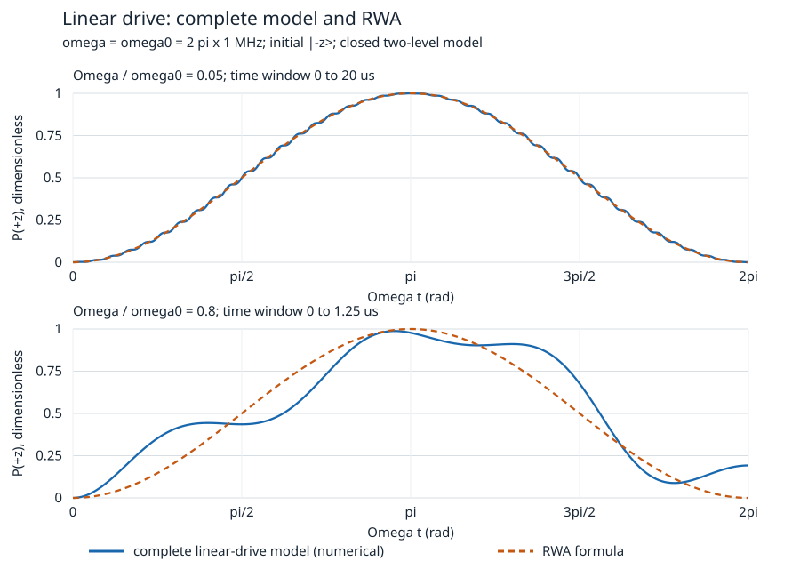

# 旋转框架、Rabi 与近似失效

一个很弱的周期驱动，能否把全部人口从低能态转到高能态？可以，但要等待合适时间，并选对频率与偏振。弱驱动不等于任何时间都能只保留微扰的一阶项；旋转框架也不等于旋转波近似。本页先解一个准确模型，再用它选择和检验近似。

## 先定义封闭受驱模型和观测

沿用有序基 $(|+z\rangle,|-z\rangle)$，$\sigma_z=\operatorname{diag}(1,-1)$。未受驱 $H_0=\hbar\omega_0\sigma_z/2$，$\omega_0>0$ 单位 rad/s，$|-z\rangle$ 是这里的低能态。外源指定的圆偏振有效 Hamiltonian 为

$$H_c(t)=\frac\hbar2\left[\omega_0\sigma_z+
\Omega(\cos\omega t\,\sigma_x+\sin\omega t\,\sigma_y)\right],\qquad
\omega>0,\ \Omega\ge0.$$

$\omega$ 是驱动角频率，$\Omega$ 是横向耦合角频率，两者均为 rad/s。磁偶极模型可由 $H=-\gamma\mathbf B\cdot\mathbf S$ 取得相应系数，符号取决于 $\gamma$ 和场旋向；本页直接声明 $H_c$，不混用磁场 T 与频率。驱动作为给定经典源；这里没有量子场模的占据、源耗尽或真实设备标定。二态封闭近似还要求别的能级泄漏和退相干在所用时间窗内可忽略，真实系统需另给能级、耦合与衰减证据。

制备 $|\psi(0)\rangle=|-z\rangle$，演化后关断驱动，测 $H_0$ 的高能出口：$P_+(t)=|\langle+z|\psi(t)\rangle|^2$。模型在 $\mathbb C^2$ 上处处定义，$H_c(t)$ 自伴且连续，所以演化酉。不同时间的 $H_c$ 一般不对易，不能把解直接写成 $\exp[-i\int H_cdt/\hbar]$。

## 旋转框架是准确换变量

令 $R(t)=e^{-i\omega t\sigma_z/2}$，把实验室态写为 $\psi(t)=R(t)\chi(t)$。代入 Schrödinger 方程得到

$$i\hbar\dot\chi=H_R\chi,\qquad
H_R=R^\dagger H_cR-i\hbar R^\dagger\dot R.$$

$R\sigma_xR^\dagger=\cos\omega t\,\sigma_x+\sin\omega t\,\sigma_y$，而 $-i\hbar R^\dagger\dot R=-\hbar\omega\sigma_z/2$。于是

$$H_R=\frac\hbar2(\Delta\sigma_z+\Omega\sigma_x),\qquad \Delta=\omega_0-\omega.$$

这两步都没有丢掉项，任何 $\Omega/\omega$ 下都是所给圆偏振二态模型的精确变换。$\sigma_z$ 测量与 $R$ 对易，所以 $P_+$ 可在旋转框架直接算；测 $\sigma_x$ 则须同时变换可观测量，不能把两个框架的横向分量直接相等。旋向约定与某些教材不同，本页由上面乘积固定；物理方法可对照 [MIT 8.05 Two State Systems，§6](https://ocw.mit.edu/courses/8-05-quantum-physics-ii-fall-2013/7c376a3b5b27e5ea586a7e37b85a05d3_MIT8_05F13_Chap_07.pdf)。

令 $\Omega_R=\sqrt{\Delta^2+\Omega^2}$。由 $(\Delta\sigma_z+\Omega\sigma_x)^2=\Omega_R^2 I$，

$$U_R(t)=\cos\frac{\Omega_Rt}{2}I
-i\sin\frac{\Omega_Rt}{2}\frac{\Delta\sigma_z+\Omega\sigma_x}{\Omega_R},\qquad
U_c(t)=R(t)U_R(t).$$

若 $\Omega_R=0$ 取连续极限 $U_R=I$。作用于低能态给

$$P_+^{(c)}(t)=\frac{\Omega^2}{\Omega_R^2}\sin^2\frac{\Omega_Rt}{2}.$$

在 $\Delta=0$ 时，$\pi$ 脉冲时间 $t_\pi=\pi/\Omega$ 给 $P_+=1$；$\pi/2$ 脉冲 $t=\pi/(2\Omega)$ 在旋转框架制备 $(-i,1)^T/\sqrt2$。它的 $z$ 标签各半而有相干项，不能与 $I_2/2$ 混同。任意酉驱动保持 $I_2/2$ 不变，所以完全混态的高出口恒为 $1/2$；若实验真的把热混态变为纯态，还涉及制备/耗散，不是这项封闭驱动自动做的。

失谐使最大转移率降为 $\Omega^2/(\Omega^2+\Delta^2)$。例如 $\Delta=\Omega$，最大为 $1/2$，按共振计时 $t=\pi/\Omega$ 得 $P_+=\frac12\sin^2(\pi/\sqrt2)\approx0.3165638355$。频率匹配既影响振荡周期也影响振幅。

教学参数 $\omega_0=2\pi\times1$ MHz、$\Omega=2\pi\times50$ kHz、共振 $\omega=\omega_0$，给 $\hbar\omega_0=h\times1\,\mathrm{MHz}=6.62607015\times10^{-28}$ J，$t_\pi=10$ μs，$t_{\pi/2}=5$ μs。这里用角频率计算脉冲，不能把 $\Omega/(2\pi)$ 的 Hz 数值直接放进 $\sin(\Omega t/2)$。

## 线偏振才产生要舍弃的反向旋转项

现在换一个明确不同的模型：

$$H_l(t)=\frac\hbar2[\omega_0\sigma_z+2\Omega\cos\omega t\,\sigma_x].$$

系数 $2\Omega$ 使线偏振的同旋向分量与前例的 $\Omega$ 一致；若忘这个二倍因子，会给错误的脉冲时间。用完全相同 $R$ 变换，准确得到

$$H_{l,R}(t)=\frac\hbar2\left[
\Delta\sigma_z+\Omega\sigma_x+
\Omega(\cos2\omega t\,\sigma_x-\sin2\omega t\,\sigma_y)\right].$$

旋转波近似（RWA）才舍弃最后这个快项。所得 $H_{\rm RWA}=H_R$，所以前例的概率公式成为线偏振的近似公式。机制是快项在慢演化时间内大多相消，而不是每个时刻振幅很小。近共振时，典型尺度条件是 $\Omega/\omega\ll1$、$|\Delta|/\omega\ll1$，并明确比较时间窗。有限的 $\Omega t=O(1)$ 脉冲窗内可用它作领先近似；高阶频移/相位积累可到 $\Omega^2t/\omega$ 的量级，不能由小比例直接担保任意长时间。非平滑开关、远离共振、强驱动或其他能级参与都需重新核查。本页未推一般误差上界，也未实现高阶频移补偿。快/慢频率项的教材说明见 [MIT 5.61 Lecture 36，第 4–6 页](https://www.ocw.mit.edu/courses/5-61-physical-chemistry-fall-2017/23f23a23487b97c09aaf468f478987c9_MIT5_61F17_lec36.pdf)。

图固定 $\omega=\omega_0=2\pi\times1$ MHz、初态 $|-z\rangle$，横轴 $\Omega t$（rad），纵轴高能出口概率。上窗 $\Omega/\omega_0=0.05$（0–20 μs），下窗 $0.8$（0–1.25 μs）；蓝线是同一线偏振 $H_l$ 的数值演化，橙虚线为 $\sin^2(\Omega t/2)$。这是封闭数学模型比较，没有硬件数据。强驱动的可见差异是反向旋转项在此窗口不可忽略的反例；弱驱动曲线接近不能推出所有波形和所有时间的近似保证。源码对步长连续减半，报告各窗口的收敛差和最大概率差。

## 一阶含时微扰还有另一条边界

回到精确圆偏振、共振的模型，在交互/旋转框架把 $\Omega\sigma_x/2$ 看作弱项。一阶展开给 $\chi(t)\approx(1-i\Omega t\sigma_x/2)|-z\rangle$，从而

$$P_+^{(1)}(t)=\Omega^2t^2/4.$$

它只在 $\Omega t\ll1$ 的短窗内与 $\sin^2(\Omega t/2)$ 相符。到 $t_\pi$ 会给 $\pi^2/4>1$，而精确概率为一。波函数截断未精确归一，概率越界正是失效信号；强行归一并不能恢复漏掉的振荡。这是共振项随时间累积，说明小驱动比率与小累积转角分别控制不同近似。含时展开的结构和共振旋转例见 [MIT 8.06 Chapter 4，§4.2](https://ocw.mit.edu/courses/8-06-quantum-physics-iii-spring-2018/89ef6d5958ee59bae9a91345c3d8c8e4_MIT8_06S18ch4.pdf)。

同样，实验室 $\langle H_0\rangle$ 在脉冲中可变，外源向二态系统供能；旋转框架的时间不变 $H_R$ 守恒不等于实验室未受驱能量守恒。框架变量不是免费消除能量交换的物理过程。

从准确框架项继续看 [[物理/40-量子力学/16-绝热演化与二能级非绝热跃迁#一个局部小比率为何还不够|16的共振小比率反例]]：带入此处 $H_R$，但把初态明确改为实验室 $H(0)$ 的瞬时基态，核到 $t_\pi$ 的瞬时激发投影；再返回这里区分小驱动、长时积累和近似条件。固定路径绝热需要另一组全区间假设，不能由 RWA 比率直接担保。

## 半引导与撤提示迁移

**半引导。** 将共振圆偏振驱动的横向幅提高一倍，如何选择仍给各半 $z$ 概率的第一次脉冲？初态 $I_2/2$ 也会因此产生同样相干吗？

> [!question]- 解释性答案
> 新 $t_{\pi/2}=\pi/(4\Omega)$，为原时间的一半。初始纯态得到相干叠加；完全混态在任何该酉下仍为 $I_2/2$。用 $z$ 出口无法单独确认相干，需另选匹配旋转相位的横向测量。

**撤提示。** 有人把线偏振在 $\Omega=0.8\omega_0$、共振时的 $\pi$ 脉冲保证写成 $P_+=1$，又说 $\Omega=0.05\omega_0$ 时一阶微扰在同样的 $\pi$ 计时也必然可靠。分别检查用了哪一项近似，给一个可复算观测指出失败。

> [!question]- 解释性答案
> 第一项把强驱动线偏振直接套圆偏振精确式，实际用了缺少小尺度条件的 RWA；用完整 $H_l$ 计算给定脉冲的 $P_+$，并与步长收敛结果比较即可检验。第二项虽然驱动比率小，但 $\Omega t_\pi=\pi$，一阶给 $P=\pi^2/4>1$；圆偏振精确式给一。模型误差、时间展开误差与数值步长误差必须分别比较。

[[物理/40-量子力学/实践/03-旋转与受驱/README|复算入口]] 先列手算答案，再实测矩阵和完整含时方程。静态方法已由 [[物理/40-量子力学/08-中心势径向方程与氢样谱|中心势与氢样谱]] 接到 [[物理/40-量子力学/09-近简并微扰与变分能量界|简并 Stark 投影、非简并两态误差与 Coulomb 基态变分界]]。[[物理/40-量子力学/13-WKB局部尺度转折点与量子化|13的WKB局部尺度、简单转折连接与束缚量子化]] 和 [[物理/40-量子力学/16-绝热演化与二能级非绝热跃迁|16的固定有限有隙绝热与二态非绝热]] 已分别扩展近似方法；一般含时微扰与跃迁率、简并多态/无隙绝热、高阶/多转折WKB与更广的迁移仍是 [[物理/40-量子力学/00-量子力学-MOC#全课仍要完成的六阶段|后续课程范围]]，已有代表模型尚未完成整套方法。
