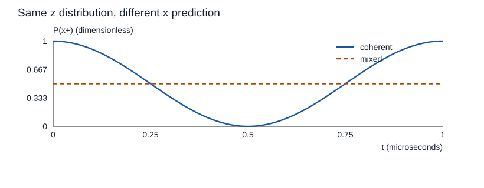
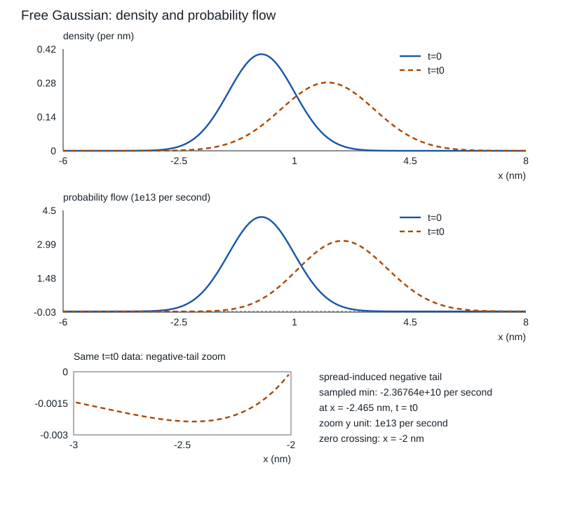

# 首段复算与迁移

先在正文手算，再运行小程序核对：二维矩阵说明哪些测量能区分相干态与混态，连续 Gaussian 说明密度相同仍可能有不同流。程序只使用 Python 标准库，不安装依赖；语言操作是可选复算工具，不是量子课的零基础先修。

## 手算答案在运行之前

以下结果来自正文的矩阵乘法与精确波函数；程序把它们当成待核对的预测。

| 对象与问题 | 手算预测 |
| --- | --- |
| $\psi=(1,i)^T/\sqrt2$，$\phi=(1,1)^T/\sqrt2$ | $\langle\psi|\phi\rangle=(1-i)/2$；取正文 $A$，$\langle\psi|A\phi\rangle=\langle A^\dagger\psi|\phi\rangle=-i/2$ |
| $z\to x$ 基矩阵 $Q$ | $Q^\dagger Q=I$、$Q^\dagger\sigma_xQ=\sigma_z$；共轭转置不能任意改为转置 |
| $\rho_c=P_{x+}$ 与 $\rho_m=I/2$ | $z+$ 概率均 $1/2$，$x+$ 为 $1$ 与 $1/2$；纯度为 $1$ 与 $1/2$ |
| $H=\hbar\Omega\sigma_z/2$，$\Omega=2\pi\times10^6\,\mathrm{rad/s}$ | 在 $0,0.25,0.5,0.75,1\,\mu\mathrm s$，相干态的 $x+$ 概率为 $1,1/2,0,1/2,1$，混态恒为 $1/2$ |
| 初态 $|+z\rangle$ 先测 $x$ 并丢弃结果 | 后态 $I/2$；再测 $z+$ 概率为 $1/2$ |
| 自由 Gaussian，$m=10^{-30}\,\mathrm{kg}$、$s=1\,\mathrm{nm}$、$k_0=1\,\mathrm{nm}^{-1}$ | $t_0=2ms^2/\hbar\approx18.9650431\,\mathrm{fs}$；$t=t_0$ 时均值 $2\,\mathrm{nm}$、方差 $2\,\mathrm{nm}^2$ |
| 同一 Gaussian 在 $t=0$ 的 $k_0=0$ 与非零 $k_0$ | 位置密度相同，初始流为零与 $v_0\varrho$ |
| 固定窗 $[-s,s]$ | 初始概率 $\operatorname{erf}(1/\sqrt2)\approx0.6826894921$；之后 $dP/dt=j(-s,t)-j(s,t)$ |

## 运行与有限合同

从本目录运行：

```bash
python3 -B qm_first_segment.py
```

[qm_first_segment.py](qm_first_segment.py) 是源码真源。它把 `assets/checks.json` 和两张 SVG 写入同目录 `assets/`，再次运行将重新生成这三项。若要改变教学参数，先保留自己的运行记录，再改源码顶部的常量；矩阵基顺序和共轭约定保持与正文一致。

有限矩阵用嵌套列表：ket shape 为 $2\times1$，算子/密度矩阵为 $2\times2$，基顺序 $(+z,-z)$。所有乘法显式调用复共轭伴随；使用 $10^{-12}$ 绝对容差核矩阵等式、归一化和概率。演化时间在 $[0,1]\,\mu\mathrm s$ 取 401 点，但每点用精确矩阵指数，没有数值积分时间步。

连续部分也使用精确自由解。定义无量纲坐标 $\xi=x/s$ 与 $\tau=t/t_0$：归一积分在 $\xi\in[-20,20]$ 以 4000 段梯形法近似，$\Delta\xi=0.01$。归一、均值与方差比较的绝对容差是 $10^{-11}$，只适用本参数与 $\tau=0,0.5,1$；改变包宽或中心时须相应扩大窗口并核截断尾部。精确态位于全直线，有限积分窗口只是数值检查范围，不把它当物理硬墙。

概率连续性用 $\delta\tau=10^{-5}$、$\delta\xi=10^{-4}$ 中心差分，核

$$\partial_\tau(s\varrho)+\partial_\xi(t_0j)=0.$$

直接 Schrödinger 残差用 $\Psi=\sqrt{s}\psi$ 核
$i\partial_\tau\Psi=-\partial_\xi^2\Psi$；本页 $t_0=2ms^2/\hbar$ 决定这里系数为一。差分残差受截断误差和浮点相减影响，连续性阈值 $10^{-8}$、Schrödinger 阈值 $10^{-7}$ 均为无量纲绝对值。它们是精确解在指定采样点的复算，不能宣称已经验证通用 PDE 数值求解器的稳定性或一般连续谱。

## 本次实际执行结果

作者在隔离候选中执行了上述标准库程序，输出 `PASS`。完整参数与实际值见 [checks.json](assets/checks.json)：

- $t_0=18.96504312493458\,\mathrm{fs}$，$\langle H\rangle=6.950760741084489\times10^{-21}\,\mathrm J$。
- 指定五点的最大概率连续性无量纲残差 $4.85722573273506\times10^{-10}$。
- 指定四点的最大 Schrödinger 无量纲差分残差 $2.1328550716917808\times10^{-8}$。
- 二态基变换、Born 概率、纯度、酉性、非选择性测量、相位迁移、有限 POVM 示例与 Gaussian 归一/矩均通过上述阈值。

这是一组教学模型复算。独立语义核验由非作者另行给出；硬件、量子态层析、QND、开放系统模型、Obsidian 实际显示与真人理解没有由此获得证明。

## 图与模型是同一组输入



*封闭二态，$\Omega=2\pi\times1\,\mathrm{MHz}$；纵轴是无量纲概率，横轴为 μs。实线是 $\rho_c$，虚线是 $\rho_m$；两者的 $z$ 概率一直各半。*



*全直线、$V=0$，质量与宽度同手算表。上图概率密度为 nm⁻¹，下图流以 $10^{13}\,\mathrm{s}^{-1}$ 为尺度，横轴为 nm；实线 $t=0$、虚线 $t=t_0$。下方局部放大来自同一组 $t=t_0$ 数据；$x<-2\,\mathrm{nm}$ 的展宽负尾在主轴负域完整保留，401点采样最小值约 $-2.36764\times10^{10}\,\mathrm{s}^{-1}$，位于 $x=-2.465\,\mathrm{nm}$。这两个纵轴有不同单位，图来自精确解而非硬件。SVG 的 title/desc 与线型保留模型和无颜色提示。*

## 撤提示之后检查哪一个理由

回到 [[物理/40-量子力学/02-态算子测量与二态相干#迁移：换基、改相位、插入测量|二态迁移]]，先为 $\theta=-\pi/2$ 预测 $y+$ 概率再运行；答案是零，错误的共轭或 $\sigma_y$ 符号会让它变成一。再把中间 $z$ 测量插入相干态演化，判断最终 $x$ 概率为何成为常量。

回到 [[物理/40-量子力学/03-连续波包概率流与算子边界#迁移：撤掉相位或改掉边界|波包与边界迁移]]，分别改变 $k_0$ 与物理边界。前者改变初始相位和漂移，后者改变算子定义域与允许谱，不能只改图标签而保留旧预测。程序没有实现势垒散射或新的边界求解器，选择新模型需补相应推导和误差检查。

返回 [[物理/40-量子力学/00-量子力学-MOC|量子力学课程地图]] 查看后续谱、对称性、角动量、近似、多粒子与散射范围。
