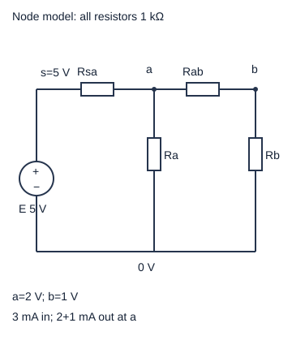
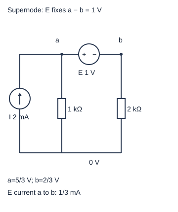

# 节点与超节点：怎样从图写出可检查的方程

电路多一条支路后，分压公式往往不再能直接用。节点法问的是：每个导线连通区域相对于参考点有多高的电势，怎样才能让每个区域流入和流出的电流相等？先求电势，再求每条支路的电流，比一开始同时猜所有电流更省未知量。

高中入口：先读图中的s/a/b/0，把电阻的两个端点抄到表中，再按下一节逐行算。不需要先会矩阵。快入口：直接读双节点的两行KCL及超节点三未知MNA，最后做功率与秩检查。本篇是读图到回代的入门主线；已有[[电子电路/10-电路基础/02-节点分析等效源与负载#多个节点仍是同一规则|多个节点仍是同一规则]]保留更一般的导纳矩阵解释。

## 先把拓扑变成端点表

理想源E正端s、负端0，固定v_s=5 V；四只电阻均1 kΩ，分别连接s–a、a–0、a–b、b–0。0是本模型电压参考，不额外表示真实保护地。图中连续导线归同一节点；元件的两端在本图没有旁路短接。未知只有v_a、v_b，电阻电流都能用它们表达。

约定写“流出节点”为正。对于a→b电阻，i_ab=(v_a−v_b)/R；如果结果负，实际流向b→a，不能为了得到正数自行改KCL符号。理想电流源则按箭头给定电流，不用电阻公式去求它。

## 完整算例：两行守恒，四条电流

在a有三条支路、在b有两条，逐项写：

\[
\frac{v_a-5}{1000}+\frac{v_a}{1000}+\frac{v_a-v_b}{1000}=0,
\qquad
\frac{v_b-v_a}{1000}+\frac{v_b}{1000}=0.
\]

每项单位A。整行乘1000 Ω才变成电压式：3v_a−v_b=5 V，−v_a+2v_b=0。第二行给v_a=2v_b；代第一行得5v_b=5 V，因此v_b=1 V、v_a=2 V。这里“3”和“2”是乘了共同电阻尺度后的无量纲系数，不是导纳的SI值。

回代得到s→a为3 mA、a→0为2 mA、a→b为1 mA、b→0为1 mA。a处3=2+1，b处1=1，两个节点均守恒。源从正端送出3 mA，按电流流入正端的吸收功率定义p_E=−5×3 mA=−15 mW。四电阻耗散依次9、4、1、1 mW，和为15 mW；全网吸收功率和为0。KCL和功率是不同检查，少写一条支路有时会让一套错误方程内部自洽，所以仍须核对端点表。

矩阵写成Gv=b时，G=[[3,−1],[−1,2]] mS，v列单位V，b=[5,0] mA。不要把右边5 mA与SI导纳0.003 S混算。可在[[数学/20-线性代数与几何/07-线性方程组消元LU与解的结构#消元不是背算法，而是保持解集|消元保持解集]]读为什么“用第二行代第一行”不改变答案，再回本例做消元。此处并不要求事先掌握LU。

## 浮置电压源：电压已知，电流尚未知

新网络是0→a的2 mA理想电流源、a→0的1 kΩ、b→0的2 kΩ，以及正端a/负端b的1 V理想电压源。电压源没有电阻值；写“(v_a−v_b)/0”没有意义。设该源a→b的电流为j，两节点分别守恒：

\[
\frac{v_a}{1000}+j=0.002,
\quad\frac{v_b}{2000}-j=0,
\quad v_a-v_b=1.
\]

前两式相加时内部j抵消，得到超节点{a,b}的外部KCL：v_a/1000+v_b/2000=0.002 A；再保留电压约束v_a−v_b=1 V。代入v_a=v_b+1，得1.5v_b+1=2，以V为单位，故v_b=2/3 V、v_a=5/3 V。回到b式，j=1/3000 A=1/3 mA。

超节点只是写整体守恒的辅助边界，a和b仍然是两个不同节点，电压相差1 V。源电流j不会凭“电压已知”而变为0。抵消内部支路不意味着那条支路没有功率：1 V源吸收1/3 mW；两电阻吸收25/9和2/9 mW，共3 mW；2 mA电流源吸收−(5/3)×2=−10/3 mW。账本仍为0。若a和b之间再并联一只电阻，它的电流也在整体KCL中相消，但须回代计算源电流和内部功率。

保留j的三行形式就是小型修正节点分析MNA。前两行是A，第三行是V；比较条件数必须先定义电压/电流和方程尺度，裸混单位数字的κ不能直接叫物理病态。[[数学/20-线性代数与几何/17-矩阵范数条件数与数值稳定性#小残差为何可能对应大错误|小残差与误差]]说明为什么回代残差只是检查的一部分；本例CPU求解另外核功率，不把脚本PASS当实测。

## 哪些网络没有唯一的电压答案

本篇限于有限参数、集总、稳态线性网络。普通正电阻网络若每个未知连通分量都有到已知电势的电阻路径，其导纳矩阵具有唯一解：对任意非零节点增量x，xᵀGx是各电阻(端点增量差)²/R之和；若和为0，所有相连节点增量相等，连接参考处迫使它们都为0。存在浮置分量时这一论证不成立。

反例是孤立的a/b之间一只电阻，无其他连接；所有v_a=v_b=任意常数都满足零电流，KCL不能确定相对0的电位。另一反例是两只理想电压源并联却分别强制a=1 V和a=2 V：约束矛盾，不能取平均1.5 V。受控源也可能使矩阵失去唯一性，需检验实际方程；无受控正电阻矩阵的对称/符号规律不能套到所有MNA。

## 四题：迁移及理由

1. 完整双节点例把E改为−5 V，其他参数不变，电压与耗散怎样变？答案v_a=−2 V、v_b=−1 V，所有电流反号，电阻耗散仍15 mW。方程对激励线性，功率平方不反号。
2. 把参考点改为原b，但保留原网络，原a与s电压是多少？答案a=1 V、s=4 V、原0=−1 V；所有端点差和电流不变。不能把原0再次强制为0而称只是换参考。
3. 超节点例将1 V源反向，其余不变。答案约束v_a−v_b=−1 V，v_b=2 V、v_a=1 V、j=1 mA（仍定义a→b）；反向源的吸收功率−1 mW。电流源给−2 mW，电阻给1+2 mW，和为0。
4. 一个只有电流源0→a的网络可有有限稳态吗？答案非零源没有返回支路，a的KCL要求0=I而矛盾；加电容能产生随时间爬升电压，但那已是动态问题，不是本篇DC解。

[MIT 6.071节点与网孔讲义](https://ocw.mit.edu/courses/6-071j-introduction-to-electronics-signals-and-measurement-spring-2006/9d19116cbabeada1c98004a4367a0ee0_nodal_mesh_methd.pdf)页1–8给节点回代与浮置源约束，短引“the Supernode”。以上数值网络与唯一性推导由本稿独立构建。实践[[电子电路/80-实践/10-线性网络与传感/README|CPU网络复算]]提供原网表、MNA回代与功率检查；没有SPICE或硬件读数。
