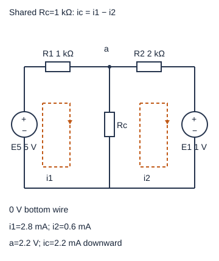
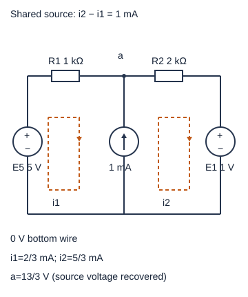

# 网孔与超网孔：回路电流怎样拼成支路电流

节点法追踪电势，网孔法追踪平面图中每个小“窗口”绕行的电流变量。它们都来自相同的KCL、KVL和元件关系，最后得到同一组物理电压/电流。网孔变量是计算工具，一条共享支路的实际电流通常是两个变量的差，不能把其中一个变量直接当仪器读数。

高中入口：跟图上的两条顺时针虚线走，先算共享支路i_c=i_1−i_2。快入口：从两行带Ω系数的KVL算出i_1/i_2，读电流源约束与外周KVL如何形成超网孔。需要另一种核验时，[[电子电路/10-电路基础/10-节点与超节点从图到方程#完整算例：两行守恒，四条电流|节点到支路回代]]提供本组节点路线，不把网孔法当唯一算法。

## 平面上的网孔与任意回路不同

本图有s–a–0–s的左窗口、a–b–0–a的右窗口。外周s–a–b–0–s也是闭合回路，却包含两个窗口，不能把三条KVL都当三个独立未知方程。取两窗口电流i_1/i_2都顺时针，左上电阻s→a电流=i_1，右上a→b电流=i_2，共享a→0支路电流=i_1−i_2。在共享支路，两变量绕行方向相反。

网孔法需要网络能在平面重画为导线不交叉（除真实节点连接）的嵌入图；一张图有交叉并不自动非平面，重画可能去掉交叉。真正非平面的网络不能按图面“窗口”选普通网孔；仍可用节点法或独立回路基。举例，K3,3把三节点集合每一点连到另三点，V=6、E=9；若平面、简单、二分且每面至少4边，有2E≥4F和Euler V−E+F=2，所以E≤2V−4=8，与9矛盾。这是拓扑条件，与元件是否线性不同。受控关系作为测量/控制关系不能随意画成一条导电支路。

## 完整算例：源可以同时供能和吸能

E5正端s/负端0给5 V，E1正端b/负端0给1 V。R1在s–a为1 kΩ、R2在a–b为2 kΩ、共享Rc在a–0为1 kΩ。从每个网孔按顺时针把压降相加：

\[
1000i_1+1000(i_1-i_2)-5=0,
\quad 2000i_2+1+1000(i_2-i_1)=0.
\]

右网孔经过E1从正到负，故是+1 V压降；左网孔经过E5从负到正，故是−5 V。整理成
\[
\begin{pmatrix}2000&-1000\\-1000&3000\end{pmatrix}
\binom{i_1}{i_2}=\binom{5}{-1}.
\]
矩阵单位Ω，电流A，右端V。第一式给2i_1−i_2=5 mA，第二式−i_1+3i_2=−1 mA；消元得i_2=0.6 mA、i_1=2.8 mA，共享支路向下2.2 mA。

因此v_a=2.2 V，s→a的压降2.8 V，a→b的压降1.2 V，满足5−2.8=2.2、2.2−1.2=1。节点a的KCL是2.8=2.2+0.6 mA。R1/R2/Rc分别耗散7.84、0.72、4.84 mW；E5吸收−14 mW，E1吸收+0.6 mW，总和0。E1的电流流入正端，因而吸能；实际器件是否能接受反向充电另需模型，本篇只分析理想网络。

如果某电流解为负，保留符号回代。例如E1改10 V，方程第二行右端−10 V，解i_1=1 mA、i_2=−3 mA，共享向下4 mA，v_a=4 V。右源实际上向外供流；“顺时针”是变量约定，不是答案必须满足的方向。

## 共享电流源：绕外周，另保留约束

保持两电压源与R1/R2，把共享Rc换成0→a的1 mA理想电流源。它的电压未知；KVL里不能把它删掉并假设压降0。顺时针变量在共享支路产生向下i_1−i_2，而源箭头向上，所以约束i_2−i_1=1 mA。

设共享源的a→0电压为u，左右KVL分别1000i_1+u−5=0与2000i_2+1−u=0。相加消去u，得到外周KVL：1000i_1+2000i_2=4 V。外周就是超网孔辅助边界，必须与电流约束一起求解；不能合并成“一个网孔一个未知”。代入i_2=i_1+0.001，得i_1=2/3 mA，i_2=5/3 mA；回代u=5−1000i_1=13/3 V。

节点a验证：左来2/3 mA加源向上1 mA，等于右去5/3 mA。R1/R2耗散4/9和50/9 mW，合计6 mW；E5吸收−10/3 mW，E1吸收5/3 mW，共享源吸收−13/3 mW，和仍0。共享源电压必须回代，才能得到它的功率。

本例的超网孔是两条KVL加和消掉内部未知压降，推导不依赖背规则。若电流源只属于一个网孔，其箭头直接规定该网孔变量（依方向取±I），并用其他网孔的KVL求余量；多个共享电流源则要保留足够独立约束，避免重复外周或漏掉内部变量。

## 适用范围与检查路线

模型仍是有限、线性、集总稳态，KVL假设所取支路电压可用节点电势差表示；明显的时变磁通耦合需要引入相应感应电压/互感模型，不能把未建模磁通说成KVL失效。正电阻无受控网络可给对称网孔电阻矩阵；受控源加入后系数可不对称，不能据此自动判错。

[[数学/20-线性代数与几何/07-线性方程组消元LU与解的结构#如何检验结果|如何检验线性解]]对应本例回代两个KVL。独立检查还要把变量转回支路电流、检查节点与总功率。数值例来自独立网表，CPU实践分别解网孔2×2与MNA节点/源电流，两路线一致；并非重复用同一解析式制造PASS。

## 四题：迁移及理由

1. 完整算例改取右网孔逆时针j_2，方程如何变？答案j_2=−i_2，左式2000i_1+1000j_2=5，右逆向式1000i_1+3000j_2=1；解j_2=−0.6 mA，共享i_1+j_2=2.2 mA。变约定不变物理量。
2. 超网孔源改为a→0的1 mA。答案i_1−i_2=1 mA，1000i_1+2000i_2=4 V，解i_1=2 mA、i_2=1 mA、u=3 V；方向约束改变，外周KVL仍相同。
3. 只写外周1000i_1+2000i_2=4可确定两电流吗？答案不可，有一参数族。电流源约束提供缺少的独立信息；图上有源不等于已经把它的模型写进方程。
4. 含交叉的图应该立刻弃用网孔法吗？答案先确认交叉有没有连接，再检验是否可重画为平面；K3,3不能，普通四电阻图的偶然画交叉可能可以。不得在非连接交叉增加节点改变原网络。

[MIT 6.071讲义](https://ocw.mit.edu/courses/6-071j-introduction-to-electronics-signals-and-measurement-spring-2006/9d19116cbabeada1c98004a4367a0ee0_nodal_mesh_methd.pdf)页11–15讨论网孔变量、共享电流差和电流源；短引“the difference of the two mesh currents”。共享源超网孔及非平面边界是本文自行展开的KVL/拓扑推导。[[电子电路/80-实践/10-线性网络与传感/README|CPU复算]]提供两路线、原网表及功率账本。
