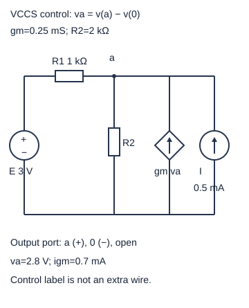
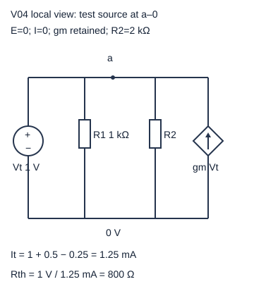
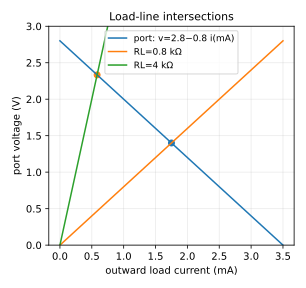

# 受控源、叠加与端口测试：哪些源可以关掉

把电路缩成一个端口，能迅速算负载影响；但“关源求电阻”中的源必须分清身份。独立源是外部给定激励，受控源是元件关系的一部分。关掉受控源会换掉电路本身，得到另一个端口斜率。

高中入口：把下一图的每条支路抄成KCL，先算2.8 V，再分成2.4+0.4 V。快入口：读gm项为何留在方程左端，以及独立源置零后1 V测试给出800 Ω。旧[[电子电路/10-电路基础/02-节点分析等效源与负载#端口等效究竟等价什么|端口等效究竟等价什么]]保留一般外端口定义，本页用一个含受控源的完整网络兑现测试步骤。

## 独立、受控与线性是三个不同问题

独立电压源规定v=E，独立电流源规定i=I；它们不根据本网络某测量值改变设定。受控源输出由控制量决定：VCVS的v_o=µv_c（µ无量纲）；VCCS的i_o=g_mv_c（g_m单位S）；CCCS的i_o=βi_c（β无量纲）；CCVS的v_o=r_mi_c（r_m单位Ω）。控制电压必须写明两个节点，控制电流必须写明支路和参考方向。理想电压控制端可不加载电路；电流控制通常需明确感测支路，不能把控制虚线当导电线。

上述常数倍关系是线性的；若输出Kv_c²或有阈值、饱和，仍是受控源却不再线性，不能直接叠加。理想源可供能或吸能；受控源供能来自真实器件电源，但理想控制模型可能没有画出电源端。因此端口等效无法告诉你原装置的总供电功耗。

## 完整算例：受控反馈留在每次叠加中

E正端s/负端0给3 V；R1在s–a为1 kΩ，R2在a–0为2 kΩ；独立源I从0→a给0.5 mA；菱形VCCS从0→a给g_mv_a，g_m=0.25 mS，控制量v_a=v(a)−v(0)。暂时a–0输出端开路，没有外负载。节点a流出守恒：

\[
\frac{v_a-E}{1000}+\frac{v_a}{2000}-g_mv_a-I=0,
\qquad(1.5-0.25)\text{ mS}\,v_a=E/1000+I.
\]

因此v_a=(3+0.5)mA/1.25mS=2.8 V。R1中s→a电流0.2 mA、R2向下1.4 mA、受控源向上0.7 mA、独立源向上0.5 mA，0.2+0.7+0.5=1.4。

只留E时，设独立I=0意味着该源支路开路，但g_mv_a仍存在，得v_a^E=3mA/1.25mS=2.4 V，受控源此时给0.6 mA。只留I时，设E=0意味着s与0理想短接，受控源仍给g_mv_a，得v_a^I=0.5mA/1.25mS=0.4 V，受控源给0.1 mA。两电压和2.8 V、两受控电流和0.7 mA恢复完整解。所谓“受控源保留”，不是把其输出冻结为原先0.7 mA，而是每次依当前控制量重新求。

形式上同一线性关系A x=b_E+b_I，若A可逆，x=A⁻¹b_E+A⁻¹b_I。受控系数属于A，所以保持A才是分析同一网络。[[数学/20-线性代数与几何/07-线性方程组消元LU与解的结构#消元不是背算法，而是保持解集|线性方程解集]]解释可逆、秩与一致性的条件。本篇稳态无储能初值；动态叠加还要将初值响应作为独立贡献，不可把含初值轨道统称零状态线性映射。

R2功率完整为2.8²/2000=3.92 mW；两个单源功率2.4²/2000=2.88 mW和0.4²/2000=0.08 mW，和2.96 mW，少了2×2.4×0.4/2000=0.96 mW交叉项。电压/电流可叠加，功率不能照搬。完整网络功率：R1 0.04、R2 3.92、E −0.6、I −1.4、VCCS −1.96 mW，和0；源功率也必须用完整状态计算。

## 端口斜率：独立源关，受控源不关

输出端a–0的开路电压V_th=2.8 V。求等效电阻时设E=0（R1左端s并入0）、I=0（开路），保留VCCS。外加测试电压V_t=1 V，正端a/负端0；定义测试电流I_t从测试源送入网络a端。R1+R2取走1.5 mA，受控源返回0.25 mA，所以I_t=1.25 mA，R_th=V_t/I_t=800 Ω。MNA若定义测试源电流流入其正端，会得到−1.25 mA，取负才是本处I_t。

把g_m也关掉会得到1k∥2k=666.7 Ω，错误不在并联运算，而在分析了不同元件模型。测试源只用于求线性端口斜率；求V_th时用原独立源。一般固定激励线性一端口的向外供流i_L满足v=V_th−R_th i_L。正R_th使曲线下斜；外接R_L的负载线v=R_Li_L，与它相交才是加载工作点。

R_L=4 kΩ时，i_L=2.8/(800+4000)=7/12 mA，v=7/3 V。回原网络检验：R1进2/3 mA，受控源进7/12 mA，独立源进1/2 mA；R2出7/6 mA，负载出7/12 mA，两边均7/4 mA。Norton形式是从0→a的I_N=V_th/R_th=3.5 mA与800 Ω并联；短路a–0时v_a=0，受控输出0，短路向外3.5 mA，也符合原网络。等效保证外端口i-v，不保证内部每条电流或源功率相同。

## 等效可能有负阻，也可能不存在有限斜率

以上g_m小于1.5 mS，端口R_th为正。若g_m=1.5 mS，开路方程变0×v_a=3.5 mA，无有限解；不能报告“V_th无穷、正常分压”。若g_m=2 mS，R_th=−2 kΩ、V_th=−7 V；外接正2 kΩ时总导纳为0仍与非零激励矛盾。负阻意味着该线性模型可向端口供能，并不保证实际闭环稳定、器件不会饱和。求解存在性、动态稳定性和硬件功率限制是不同检查。

只有独立源的正电阻网络可通过关源后电阻合并求R_th；含受控源默认用测试。非线性器件不能由一个固定V_th/R_th在所有负载下精确替代，局部小信号等效须声明偏置和有效范围。

## 四题：迁移及理由

1. 将独立I箭头反向，仍0.5 mA，其他不变，v_a多少？答案(3−0.5)mA/1.25mS=2 V；受控源仍向上0.5 mA。方向进入KCL右端符号。
2. 原网络只留I时把受控源错误固定0.7 mA，会算出什么？答案(0.5+0.7)/1.5=0.8 V，与正确0.4 V不同；它已不再满足i_G=g_mv_a，故不能用于原电路叠加。
3. R_L=800 Ω时，端口v/i是多少？答案v=1.4 V、i=1.75 mA，Thevenin与Norton给同一交点；800 Ω端口模型的耗散不能当原网络真实内部损耗。
4. 不同单源电压贡献一正一负，功率交叉项是否仍正？答案不一定；若v₁=2 V、v₂=−1 V，1 kΩ功率完整1 mW，分开和5 mW，交叉−4 mW。所有耗散非负并不使交叉项必非负。

[MIT 6.002 L3](https://ocw.mit.edu/courses/6-002-circuits-and-electronics-spring-2007/5ec9a8524891d6940e4572e1c97b0cf1_6002_l3.pdf)页3–13讨论叠加，短引“independent sources only”；页15–21讨论外端口。[L8受控源](https://ocw.mit.edu/courses/6-002-circuits-and-electronics-spring-2007/05fef0ad87134781c8f285e47973023b_6002_l8.pdf)页3–10区分控制/输出端及线性、非线性实例。以上gm网络及测试值由本文独立推导，CPU实践另以MNA和多负载回代检查。
