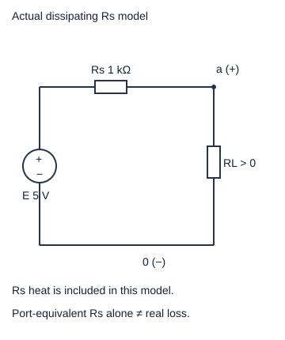
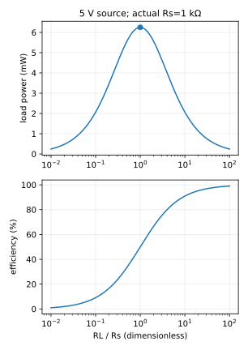

# 负载功率、效率与匹配：最大的是哪一个量

希望负载得到最多瓦特，与希望给出的能量尽量少变成内阻热，是两个不同优化问题。固定源电压、固定正内阻、可调正负载的模型中，最大负载功率发生在两电阻相等，此时恰有一半供能变成内阻热。这个50%结论需要真实串联耗能电阻的账本，不能从任意端口等效自动推断整机效率。

高中入口：先算5 V、1 kΩ串联源与三个负载，再比较瓦特和百分比。快入口：读导数的正负、两端极限与复负载的两个可调变量。[[数学/15-微积分/03-中值定理与导数应用单调凸性和优化#最值问题怎样完整做完|最值问题怎样完整做完]]对应本页“写可行域→候选点→端点/极限”三步，不要求先学完整微积分。

## 完整算例：把内阻画成真实耗能元件

模型E=5 V理想源与R_s=1 kΩ串联，负载R_L>0。R_s在本例确是耗散电阻，不只是有反馈装置的外端口斜率；没有其他辅助电源。参数是低功率解析教学条件，不是对电池/供电器实际接负载的建议。

\[
I=\frac{E}{R_s+R_L},\quad P_L=I^2R_L,
\quad P_s=I^2R_s,\quad P_\text{delivered}=EI=P_L+P_s.
\]
E的吸收功率为−EI。E≠0时定义本模型供能效率η=P_L/(EI)=R_L/(R_s+R_L)。若E=0，两功率都0，η比值0/0无定义；不能因为代数简化式有值就把无供能状态叫效率通过。

| R_L | I | P_L | 内阻热P_s | 理想源供能EI | η |
|---|---|---|---|---|---|
| 250 Ω | 4 mA | 4 mW | 16 mW | 20 mW | 20% |
| 1 kΩ | 2.5 mA | 6.25 mW | 6.25 mW | 12.5 mW | 50% |
| 4 kΩ | 1 mA | 4 mW | 1 mW | 5 mW | 80% |

负载从1 k变4 k，效率提高而得到的瓦特降低。若R_L=99 kΩ，η=99%，P_L=0.2475 mW；99%没有让小功率变大。每一行都能用电流与功率账本回代。

## 不会微分也能证明最大点

对固定E和R_s>0，由(R_L−R_s)²≥0有(R_s+R_L)²≥4R_sR_L，因此
\[
P_L=\frac{E^2R_L}{(R_s+R_L)^2}\le\frac{E^2}{4R_s}.
\]
E≠0时等号仅在R_L=R_s，给最大值6.25 mW。这是整个正负载域的证明，不只是找到一个驻点。

形式轨求导得到
\[
\frac{dP_L}{dR_L}=\frac{E^2(R_s-R_L)}{(R_s+R_L)^3}.
\]
分母在可行域正，R_L<R_s时递增，R_L>R_s时递减；R_L→0⁺和R_L→∞时P_L→0。上述数学链接讲为何一个区间内的导数符号能决定单调性，以及为什么局部驻点还要查全域。效率的导数dη/dR_L=R_s/(R_s+R_L)²>0，却没有有限R_L取到η=1；其上确界1在开路极限趋近，输出功率同时趋零。严格开路I=0，η原比值无定义，不能说“开路是100%效率输出”。

## 端口等效只保证负载功率

[[电子电路/10-电路基础/02-节点分析等效源与负载#等效的推导与误差预算|等效的推导与误差预算]]保证相同端口v/i和负载功率。但一个有内部多电源、反馈、受控源的网络，端口R_th可能为正、负或很小；它不等于原内部真实发热电阻。Thevenin/Norton两模型内部电阻耗散也一般不相同，所以由它们随意估原装置输入效率会矛盾。本例的50%只针对画明的真实R_s与唯一理想源，不外推到所有放大器或开关电源。

若真实源有最大电流/压降/温升约束，可行负载域会变，最优可能在约束边界。若R_s=0理想电压源，P_L=E²/R_L随R_L→0无界，本模型没有有限最大功率点；它忽略了现实限制。若端口为负阻，前面的正分母/耗能证明失效，不能照用R_L=R_s。

## 单频复负载：必须先说明可调什么

在单一固定频率、正弦稳态中，以RMS相量表示固定源V_s，Z_s=R_s+jX_s（R_s>0），负载Z_L=R_L+jX_L（R_L>0）。电流I=V_s/(Z_s+Z_L)，平均负载功率
\[
P_L=|I|^2R_L=
\frac{|V_s|^2R_L}{(R_s+R_L)^2+(X_s+X_L)^2}.
\]
RMS说明已经吸收正弦平均的1/2因子；若用峰值相量，公式前需1/2。两个电抗只影响电流相位/幅度，不吸收平均实功率。若R_L和X_L都能独立调整，先选X_L=−X_s使固定R_L下分母最小，再用前节证明选R_L=R_s，即Z_L=Z_s*。单频最大P=|V_s|²/(4R_s)，不是全频段自动最优。

例如V_s=1 V RMS，Z_s=100+j50 Ω。可调复负载取100−j50 Ω，I=5 mA RMS、P_L=2.5 mW。若只允许纯电阻，X_L=0固定，导数分子变R_s²+X_s²−R_L²，所以最佳R_L=|Z_s|=√12500≈111.803 Ω，P_L≈2.36068 mW；盲选100 Ω只有2.35294 mW。不能把“共轭匹配”当所有硬件都有自由调电抗的默认条件。

复负载讨论不要求依赖未建页面：相量只是在这里用RMS复数打包同频幅相，Z实部耗能、虚部存取能。需复习时可读已接受[[电子电路/12-交流与变换域/02-阻抗导纳源与负载|阻抗导纳与接口]]的具体解释；发布前绑定该已接受版本。

## 四题：迁移及理由

1. E从5 V变2.5 V，最大负载及功率怎样变？答案R_L仍1 kΩ，最大功率1.5625 mW，为原1/4；最佳位置取决固定电阻，功率随E²。
2. 要η≥90%，正负载范围为何？答案R_L≥9R_s。最接近最大功率的位置是9R_s，之后负载功率继续降；效率约束迫使离开R_L=R_s。
3. Z_s=100+j50 Ω，若负载X_L固定+50 Ω，最佳实部是什么？答案√(100²+(50+50)²)=141.421 Ω；将一般固定总电抗放入求导式。因为负载同号电抗没有抵消源电抗。
4. 看到R_th=1 Ω、负载1 Ω，就能说原装置效率50%吗？答案不能；端口模型可算负载功率，原输入功率还要查实际电源与内部耗散。只有明确的真实串联耗能内阻模型才有此效率账本。

[MIT 6.071 Power Transfer](https://ocw.mit.edu/courses/6-071j-introduction-to-electronics-signals-and-measurement-spring-2006/004de24dd40e3938b0393a6a2bd91788_linear_crct_ana.pdf)页20–22给正电阻负载优化，短引“maximum which occurs”；[Harvey Mudd E84](https://pages.hmc.edu/ruye/e84/lectures/ch3/node21.html)式411–415给RMS复负载功率。本文数字、可行域与效率边界单独推导；实践核守恒、端点趋势和两种可调域，没有实测/器件效率认证。
