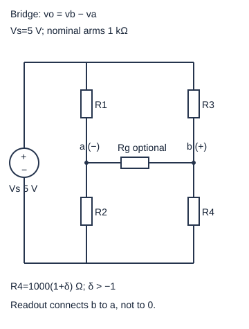
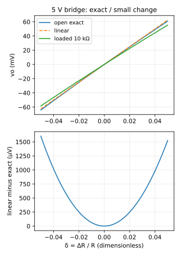

# 电桥失配与电阻传感：毫伏怎样从两条分压支路出现

传感电阻的变化可能只有原值的千分之一。电桥把两条支路中点的差作为输出，平衡时消掉共同的大电压，让微小比例变化变成可测电压；它仍然会有初始失配、引线电阻、温漂和读出加载，不能凭“平衡”就把它们忽略。

高中入口：从图中的两条分压支路算v_a/v_b，再减v_b−v_a，得到12.4378 mV。快入口：直接读精确δ式、一阶余项及四电阻失配的符号。[[数学/15-微积分/02-导数与微分局部线性模型#一阶模型，而不只是切线斜率|一阶模型]]对应本页“斜率×小变化”，本篇同时给显式余项，所以不必先学Taylor定理才能判断误差。

## 真实四臂拓扑与读出端点

理想激励V_s正端s、负端0。左上R1连接s–a，左下R2连接a–0；右上R3连接s–b，右下R4连接b–0。输出定义v_o=v_b−v_a，正端b、负端a。两中点不是地；一个跨a/b的读出电阻R_g会同时加载两边，而不是单独跨某一电阻。图中的差分正负标签是测量定义，不表示接真实示波器地夹到a。

先取开路读出（R_g不存在）。两条分压独立：
\[
v_a=V_s\frac{R_2}{R_1+R_2},\qquad
v_b=V_s\frac{R_4}{R_3+R_4}.
\]
平衡v_o=0等价R_1R_4=R_2R_3，即R1/R2=R3/R4。不同教材编号位置可能不同，按端点重推，不能只抄编号公式。本稿所有电阻正、激励非零时该等价成立；V_s=0会使任何桥输出0，却不代表电阻比例已平衡。

## 完整算例：1%变化的精确值与近似值

取V_s=5 V，R1=R2=R3=R=1 kΩ，R4=R(1+δ)，δ>−1。δ是相对名义R的无量纲变化，ΔR=Rδ。δ=0时v_a=v_b=2.5 V；δ=0.01时R4=1010 Ω，
\[
v_o=5\left(\frac{1.01}{2.01}-\frac12\right)
=\frac{5\delta}{2(2+\delta)}
=0.0124378109\text{ V}.
\]
电阻变大使右中点变高，按v_b−v_a定义为正。这一方向判断应在运算前完成。左支路电流2.5 mA，右支路5/2010≈2.487562 mA；激励供能5×(两电流和)≈24.937811 mW，四电阻耗散和同值。桥的毫伏输出不是能量凭空出现，它由激励供能。

把分母写成2(2+δ)，靠近0时v_o≈V_sδ/4=12.5 mV。精确的一阶余项是
\[
v_o-\frac{V_s\delta}{4}
=-\frac{V_s\delta^2}{4(2+\delta)}.
\]
本例近似高估62.1891 µV，约为精确输出的0.5%。对δ≠0、δ>−1，有(近似−精确)/精确=δ/2；因此要求相对输出误差不超过1%时可取|δ|≤0.02。δ=0相对误差0/0不定义，但绝对余项为0。这里的误差只指非线性线性化误差，不包括器件容差或测量噪声。

对精确式求导得∂v_o/∂δ=V_s/(2+δ)²，平衡处为V_s/4=1.25 V/单位δ；除以R得∂v_o/∂R4=1.25 mV/Ω。1 V/δ与V/Ω不是同一个灵敏度单位。小量模型说Δv≈灵敏度×ΔR，不能把它当整个δ域的精确直线。

## 初始失配也会长得像信号

设R_k=R(1+ε_k)，并在R4上再加传感变化Rδ，即R4=R(1+ε4+δ)。在零附近，对两条比值分别一阶展开：
\[
\frac{1+\epsilon_2}{2+\epsilon_1+\epsilon_2}
\approx\frac12+\frac{\epsilon_2-\epsilon_1}{4},
\quad
v_o\approx\frac{V_s}{4}(\epsilon_1-\epsilon_2-\epsilon_3+\epsilon_4+\delta).
\]
左上/右下失配给正输出，左下/右上给负输出。所有臂相同倍数改变时，两分压比保持相同，零输出精确保留；只有传感臂温漂则可能被误当信号。比如只有R1高0.1%，δ=0，v_o=5(1/2−1/2.001)≈1.249375 mV，等效δ约0.001，是1%传感输出的十分之一量级。校零可处理当前偏置，却不证明后续温漂、灵敏度或负载误差被消除。

读[[数学/15-微积分/02-导数与微分局部线性模型#一阶模型，而不只是切线斜率|一阶模型]]时关注“基点与小变化”而不是只看切线图；回本例分别扰动四只电阻，实践用独立MNA中心差分核对四个偏导的符号/单位。有限差分只能验证所取数值和步长，本稿仍提供解析展开。

## 读出加载：桥也是一个差分端口

独立激励置零后s与0合并，a到参考为R1∥R2，b到参考为R3∥R4；从b–a端看，这两个等效电阻串联：
\[
R_\text{th}=R_1\parallel R_2+R_3\parallel R_4.
\]
δ=0.01时R_th=500+1000×1010/2010≈1002.487562 Ω。若差分读出电阻R_g=10 kΩ，加载输出是
\[
v_{o,g}=v_{o,\text{open}}\frac{R_g}{R_g+R_\text{th}}
\approx11.304544\text{ mV}.
\]
不能仍用独立分压给加载后的中点。直接节点核验需写
\[
\left(\frac1{R_1}+\frac1{R_2}+\frac1{R_g}\right)v_a-\frac{v_b}{R_g}=\frac{V_s}{R_1},
\quad -\frac{v_a}{R_g}+\left(\frac1{R_3}+\frac1{R_4}+\frac1{R_g}\right)v_b=\frac{V_s}{R_3}.
\]
每项A。MNA解这两行给同一差值，桥端口等效没有忽略加载。[[电子电路/10-电路基础/02-节点分析等效源与负载#等效的推导与误差预算|等效误差预算]]进一步说明为何应按允许误差选择输入阻抗，而不是只凭“10倍大概够”。

真实应变片还需电阻变化与应变的材料关系δ=GF·ε、安装方向/粘贴/温度模型。本页只把δ当给定输入，没有从CPU结果推断真实力或位移。激励提高会线性提高输出，却使电阻发热按V_s²增长；容差、温度、自热和读出噪声决定实际可用范围，5 V是本例假设而非器件额定推荐。

## 四题：迁移及理由

1. δ=−0.01，v_o是否严格是正变化结果的负值？答案−12.562814 mV，大小略大；精确分母2+δ改变。线性近似才给±12.5 mV对称。
2. 四臂同时高2%，无传感变化，输出为何？答案精确0，两边仍1:1；不是说任意温度变化都能取消，必须四臂比例按同样方式变化。
3. 只在R4下端引线增加1 Ω，理想模型会误认多大δ？答案等效R4增1 Ω，即δ=0.001，开路输出约1.249375 mV；这解释引线为何需要模型/补偿。
4. 平衡桥接10 kΩ差分读出，零输出是否不再为0？答案仍0，无差分电流；但对小传感变化的灵敏度约乘10/11，已降低。零点没变不代表增益没变。

[NI传感基础](https://www.ni.com/en/shop/data-acquisition/sensor-fundamentals/measuring-strain-with-strain-gages.html)的Measuring Strain和quarter-bridge章节把桥描述为“two parallel voltage divider circuits”，并讨论温度与引线误差；编号依它的图，与本图位置不同。[MIT线性电路讲义](https://ocw.mit.edu/courses/6-071j-introduction-to-electronics-signals-and-measurement-spring-2006/004de24dd40e3938b0393a6a2bd91788_linear_crct_ana.pdf)页10–11给桥的端口路线。本稿所有参数及余项独立推算；[[电子电路/80-实践/10-线性网络与传感/README|CPU实践]]保留原网表和灵敏度验证，没有传感器实测或校准完成声明。
