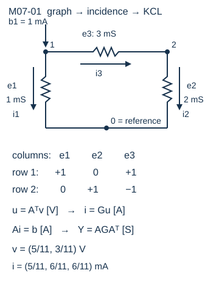
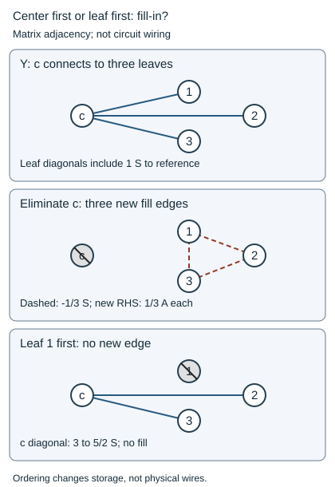

# 图论电路与关联矩阵：同一张图怎样变成方程

为什么三条电阻只需要两个电压未知量？因为电压是节点电势的差，而电流必须在节点守恒。矩阵只是把这两件事按同一个支路顺序收好。

**基础入口**：先读节点表、逐支路计算和两次KCL，再看矩阵乘法。**本科快进**：从“从三个映射得到节点导纳”读起，亲自证明接地条件与正定性。两个入口汇入同一个算例，参考箭头不代表真实电流必为正。

先从旧页[[电子电路/10-电路基础/02-节点分析等效源与负载#多个节点仍是同一规则|多个节点的KCL]]携带两个电压未知量进入本页；旧页已说明电压源需特殊处理，本章兑现它未展开的图—矩阵映射与浮置证明，下一章再兑现MNA。旧地址和全部正文保留。

## 先把图变成节点和支路表

本文模型为理想集总、线性电阻网络；导线内的传播延迟忽略。节点0是参考电势，不自动是保护地。未知节点1、2；三条支路e1为1→0、e2为2→0、e3为1→2；电流沿箭头为正，支路电压为箭头起点减终点。电导分别为1、2、3 mS，电阻分别为1 kΩ、500 Ω、333.333… Ω。外部电流向节点注入为正，b=(1,0) mA。

图上同色e标签对应矩阵的列；每列的+1在起点、−1在终点，删去参考行后与地相接的支路只剩一个+1。支路箭头只是符号坐标，换箭头时整列、支路电压、电流一起换号。

先按节点0、1、2与支路e1、e2、e3写完整矩阵，仍按本页起点+1、终点−1：

$$C=\begin{pmatrix}-1&-1&0\\1&0&1\\0&1&-1\end{pmatrix}\quad(3\times3).$$

每列元素和为0，行线性相关。完整节点电势为 $\bar v=(0,v_1,v_2)^T$（V），支路电压 $u=C^T\bar v$（V）。先选参考，再删节点0那一行，取约化矩阵

$$A=\begin{pmatrix}1&0&1\\0&1&-1\end{pmatrix}\quad(2\times3),\qquad G=\operatorname{diag}(1,2,3)\ \mathrm{mS}\quad(3\times3).$$

A无量纲；节点电压v的shape为2×1、单位V。A与一般图的邻接矩阵不同：A的列是支路，邻接矩阵的行列都是顶点。电路允许平行支路，列仍可分别保存元件。

## 从三个映射得到节点导纳

第一步电势差：u=Aᵀv，shape3×1，单位V。它给u1=v1、u2=v2、u3=v1−v2，并使任意闭合路径的有向电压和为零。

第二步本构：i=Gu，单位S·V=A。第三步KCL：Ai=b，单位A。合起来

$$Yv=b,\qquad Y=AGA^T=\begin{pmatrix}4&-3\\-3&5\end{pmatrix}\ \mathrm{mS}.$$

每个电阻g、约化列a_e的贡献是g a_ea_eᵀ。e3同时给两个对角+3和两个非对角−3；这就是stamp，局部元件贡献相加。大网络绝大多数元件只碰两个节点，因而矩阵通常稀疏；本文最小脚本先用稠密矩阵展示符号，不承诺大规模性能。

## 消元为什么让稀疏矩阵变密

先预测：三个叶节点之间没有直接电阻，消去中心电压后，剩下的方程还会彼此独立吗？考虑四个未知节点c、1、2、3和参考g。c到每个叶各接1 S电导，每个叶到g也各接1 S；没有叶间支路。按(c,1,2,3)排列，取中心注入1 A、叶注入零：

$$Y=\begin{pmatrix}3&-1&-1&-1\\-1&2&0&0\\-1&0&2&0\\-1&0&0&2\end{pmatrix}\ \mathrm S,\qquad
b=(1,0,0,0)^T\ \mathrm A.$$

这里用1 S是便于手算的教学参数；结构和推导可换成统一的mS/mA尺度。中心行给 $v_c=(1\,\mathrm A+(1\,\mathrm S)(v_1+v_2+v_3))/(3\,\mathrm S)$。将这行代进三条叶行，必须同时改矩阵与右端：

$$S=2I_3-\tfrac13\boldsymbol1\boldsymbol1^T
=\begin{pmatrix}5/3&-1/3&-1/3\\-1/3&5/3&-1/3\\-1/3&-1/3&5/3\end{pmatrix}\ \mathrm S,\qquad
b_{\rm new}=\tfrac13(1,1,1)^T\ \mathrm A.$$

式中 $2I_3-\boldsymbol1\boldsymbol1^T/3$ 是以S计的数值矩阵；并非给无量纲单位阵加了一种新物理量。原矩阵叶间的零变成非零，这叫**消元填充**。三条叶方程通过被消去的中心交换信息，即使实际电路板仍没有叶间三根导线。

图中center为中心、leaf为叶、fill为新非零项、RHS为右端。图是矩阵非零关系图，线表示非对角项、虚线表示新填充，不是元件或电流箭头。上图只显示未知节点间关系，叶到参考的电导已经在对角项中。中图消去c使三叶互相连接；下图先消叶1，只改变c的对角项与右端，不产生新的非对角项。

由对称性取三叶电压相等，在新方程每行 $(5/3-1/3-1/3)v=1/3$，得各叶 $v=1/3$ V，回代 $v_c=2/3$ V。另一条独立物理检查：c→叶每支流1/3 A，叶→g各1/3 A，中心总流出1 A。若只改Y而忘改b，便会把三叶算成0 V；回代中心1/3 V后，叶节点KCL不再成立。

若先消叶1，其pivot为2 S、只邻接c，中心对角由3变成5/2 S；继续消叶2、3，中心最终pivot为3/2 S，无叶间填充，中心仍为 $(1\,\mathrm A)/(3/2\,\mathrm S)=2/3$ V。**排序改变计算中要保存的非零项，不改变同一线性系统的物理解。** 本正定例所有顺序的pivot为正；一般含理想源、非对称或不定矩阵还须考虑数值选主元。减少填充的排序与避免不稳定pivot是两个问题，不能从这个四节点例推出任意稀疏LU都稳定或线性时间。

携带 $A=3\,\mathrm S$、$B=C^T=-(1,1,1)\,\mathrm S$、$D=2I_3\,\mathrm S$ 去[[数学/20-线性代数与几何/18-分块矩阵Schur补与矩阵指数#分块不是装饰，而是先消去一组未知量|Schur补及右端]]，先读该节的两条消元式，回来能独立重建S和新b；数学页给一般块维度与可逆条件，本页负责接线、单位和KCL。与[[数学/20-线性代数与几何/07-线性方程组消元LU与解的结构#消元不是背算法，而是保持解集|LU与解集]]比较时，区分保持解集的行操作与增添一个实际泄漏元件。

迁移自检：把中心注入改为0、只向叶1注入1 A。先消c，新b是(1,0,0) A；解为 $(v_1,v_2,v_3)=(2/3,1/6,1/6)$ V，回代中心1/3 V。源功率2/3 W等于六条电阻的功率和。若换序结果不同，先核对右端更新和回代。[[电子电路/80-实践/19-稀疏消元与RC映射/README|精确分数复算]]用两种消元顺序与独立星形KCL解比较；这是原始教学推导，不声称大规模求解器基准。

## 完整手算与功率复核

以mA、mS写数值，两行分别为4v1−3v2=1、−3v1+5v2=0。第二行给v2=3v1/5；代回第一行得到(11/5)v1=1，所以

$$v_1=5/11\ \mathrm V,\quad v_2=3/11\ \mathrm V.$$

支路电流i=(5/11,6/11,6/11) mA。节点1流出5/11+6/11=1 mA；节点2流出6/11−6/11=0。用另一物理量核对：源交付v1·1 mA=5/11 mW。三个电阻吸收功率g u²分别为25/121、18/121、12/121 mW，合计55/121=5/11 mW。仅残差小不能替代符号、单位和能量检查。

## 闭路电压与KCL环流为何不是一件事

与[[数学/36-拓扑学/20-同调与上同调/06-边读数势差与离散Hodge分解#先分清链、余链与读数方向|同调三角形的边对象]]比较时，应携带完整矩阵而非只看字母。那里边序是01、12、02、箭头0→1、1→2、0→2，边界 $B_1$ 为终点减起点。本页支路则是1→0、2→0、1→2，且C用起点减终点。先在原边序反转01与02的参考箭头，取 $S=\operatorname{diag}(-1,1,-1)$；再把列从01、12、02排成01、02、12，取

$$P=\begin{pmatrix}1&0&0\\0&0&1\\0&1&0\end{pmatrix},\qquad C=-B_1SP.$$

最后用 $R=\begin{pmatrix}0&1&0\\0&0&1\end{pmatrix}$ 选出节点1、2，才得到本页原矩阵 $A=RC$（2×3）。$S$ 处理参考方向、$P$ 处理列序、前面的负号处理两个关联矩阵的约定、$R$ 删参考行，不能省为 $A=-B_1$。支路读数与电流在相应换向/重排时也要一起变坐标；节点参考行的删除不删除物理支路。

本页齐次循环 $c=(1,-1,-1)^T$ 满足 $Ac=0$（完整C也杀掉c）。节点势差则给 $u^Tc=\bar v^TCc=0$。以原手算解核验，$u=(5/11,3/11,2/11)^T$ V，闭路和 $5/11-3/11-2/11=0$ V。它解释电压为何来自势；KCL齐次电流 $\alpha c$ 的系数 $\alpha$ 以A计，属于另一空间。原有源解 $i=(5/11,6/11,6/11)^T$ mA满足 $Ai=b\ne0$，并非整个i都是环流。

非均匀电导还须使用本构 $i=Gu$。原 $G=\operatorname{diag}(1,2,3)$ mS使 $u$ 与i坐标不成同一个比例；虽然 $u^Tc=0$，普通欧氏 $i^Tc=-7/11$ mA并不为零。严格正电导下，在电压空间取电导内积 $\langle u_1,u_2\rangle_G=u_1^TGu_2$、电流空间取电阻内积 $\langle i_1,i_2\rangle_{G^{-1}}=i_1^TG^{-1}i_2$，二者的量纲都是功率，并有 $i^TG^{-1}(\alpha c)=u^T(\alpha c)=0$。这给物理加权正交关系；仍须源、连接、严格正电导和理想集总模型条件。

电压闭路和为零依赖这里的节点势描述；有时变磁通感应电动势时要另建模型。测得边电压若不一致，可以先指定传感器残差权重做势差LS，但本构电导与测量逆方差不是天然同一权重。到[[数学/36-拓扑学/20-同调与上同调/06-边读数势差与离散Hodge分解#度量变了，最佳势也可能变|指定权重的投影]]带回 $B_1Wr=0$；回本页先恢复V/A单位和 $i=Gu,Ai=b$，不能把无量纲欧氏剩余读数直接叫作实际环流。

## 接地何时足以给唯一解

仅对严格正电导网络，任意实向量z都有

$$z^TYz=\sum_e g_e(a_e^Tz)^2\ge0.$$

若每个未知节点沿正电导支路与参考节点连接，等号要求每条支路两端电势差为零；沿路径传递到参考电势0，所有z节点都为0。故Y正定，可逆。这里是证明，不是只观察一个行列式。

完整关联矩阵若有n_total个节点、c个连通分量，其核A_fullᵀ由各分量的常数电势组成：差为零就沿边相等，反过来分量常数确实给零差。因此rank A_full=n_total−c。连通网络删去一个参考行后行满秩；多个互不相连分量只删一个参考行仍留下自由公共模。理想源、负电导、非线性器件或动态DC开短路模型不能直接套用上述正定证明。

## 浮置：相容、矛盾与改变模型

只留1→2电阻g=1 mS，则Y=g[[1,−1],[−1,1]]。注入(1,−1) mA时v1−v2=1 V，全部解(v1,v2)=(c+1,c) V；自由的是共同电势，而电阻电流仍确定。注入(1,0) mA时，两行相加给0=1 mA，**无解**。两者都奇异，但解集不同。

选择v2=0是给一个浮置分量选参考；新增从节点2到0的电阻则增加物理泄漏并改变电路。把数值gmin加入电路时必须报告它的值及结果对它的敏感性，不能称原理想网络已经获得唯一物理解。

## 带着对象往返

去[[数学/20-线性代数与几何/07-线性方程组消元LU与解的结构#消元不是背算法，而是保持解集|消元与解集]]，携带上面Y、b及公共模向量(1,1)，读“全部解是特解＋核”与矛盾行。回来能区分本例相容和无解，并用solve而非显式逆矩阵。数学页不负责电导的单位与功率约定。

去[[计算机知识/50-数据结构与算法/07-图的表示BFS-DFS与拓扑排序#1. 先建模：顶点、边与方向|图表示与BFS]]，携带节点表和正电导边集合，读第1–3节；从参考节点作无向BFS，可先检查每个未知节点是否可达。回来仍须检查注入兼容和本构条件。BFS查连通，不解电压；电路箭头是参考方向，不是只能单向通行；电路有环很正常，DAG拓扑排序不能判断电路是否合法。

## 四题与解答

1. 反转e3，写新列并计算Y变化。答：新列为(−1,+1)ᵀ，a aᵀ不变，Y不变；u3、i3同时变号，所以功率不变。
2. 将b翻倍，电压、电流、功率如何变？答：线性唯一解下v、i翻倍，电阻功率变四倍；源电流和电压都翻倍。
3. e1与e2都删除、b=(2,−2) mA，给全部解。答：v1−v2=2/3 V（e3仍为3 mS），v=(c+2/3,c) V。
4. 仅知道图连通，能证明含负电阻网络唯一吗？答：不能。例如节点对地+1 mS和−1 mS并联，Y=0；b=0任意电压，b≠0无解。严格正电导是证明条件。

来源范围：集总/方向参照[大学原讲义 Lecture1](https://zrojec.fe.uni-lj.si/cao/circuit-topology-constitutive-relations-and-nodal-analysis/)，关联矩阵建模参照[INRIA CirCE equations](https://carmen.gitlabpages.inria.fr/circe/md_docs_pages_03_equations.html)。本轮作者使用network1取证包中已读段落，未重新核整篇；本页矩阵、rank证明、功率和反例为独立推导。实验与验收状态见[[电子电路/80-实践/08-网络求解器/README|复算入口]]。
