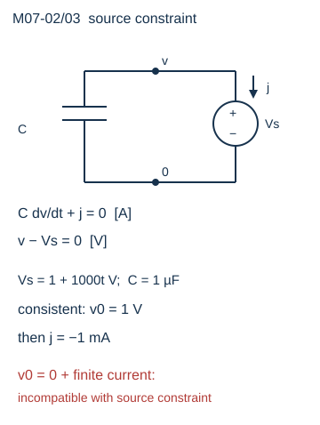

# 动态网络：代数约束不能当成另一个微分状态

一个电容旁边并联理想电压源，电容电压究竟听初始状态还是听电源？它必须同时满足储能本构和源约束。先检查二者相容，再积分；把所有未知量都机械写成普通微分方程，会漏掉这个步骤。

**基础入口**：先比较RC和“电容直接并源”，代入数值初值。**本科快进**：读矩阵铅笔与隐式步进，核对退化例。本文只完整推导两个模型；一般CV环/LI割集的指数判据不在已核范围。

## 普通RC中的真正状态

R=1 kΩ、C=1 μF，电源u(t)经R接电容节点v，电容到地。KCL给

$$C\dot v+\frac{v-u}{R}=0,\quad \dot v=\frac{u-v}{RC}.$$

v是状态；u是输入；C·V/s为A。输入1 V、v(0)=0时，τ=RC=1 ms，v(t)=1−e^(−t/τ) V，iC=(1/R)e^(−t/τ) A。初始斜率1000 V/s、初始电流1 mA。源、电阻和电容每时刻满足u i=R i²+d(Cv²/2)/dt。只需一个初值，后续导数由方程决定。

## 电容并理想电压源：可解的奇异质量矩阵

改成电容直接与源Vs(t)并联，没有串联R。源正端节点1，j流入源正端，x=(v,j)：

$$C\dot v+j=0,\qquad v=V_s(t),$$

$$E\dot x+Kx=f,\quad E=\begin{pmatrix}C&0\\0&0\end{pmatrix},\quad K=\begin{pmatrix}0&1\\1&0\end{pmatrix},\quad f=\binom0{V_s}.$$

E奇异：j没有自己的储能微分方程。不能写E⁻¹。可用另一判断：det(sE+K)=−1不是恒零，所以这个线性矩阵铅笔正规。E奇异不等于系统无解。

只要Vs可微，代数行直接给v=Vs，微分一次得j=−C V̇s。解源电流需要微分约束一次；这比普通RC多出一道约束处理。在常用微分指数约定下该明确模型为指数2，这个称呼仅描述此方程，不推广所有拓扑。本文的可复算结论不依赖引用未读通用定理。

取C=1 μF、Vs=1 V+(1000 V/s)t，则v(0)=1 V、j=−1 mA。电容在t=0吸收v·C V̇=1 mW、源吸收v j=−1 mW；到1 ms，v=2 V，两者功率为±2 mW。

## 一致初值比“保存一个数”更多

上述模型允许的初值必须满足v0=Vs(0)=1 V；若要可微解，j0还须等于−1 mA。给v0=0、同时坚持源从t=0提供1 V、所有电流有限、v连续，这四个条件不相容。给v0=1 V、j0=0也不能成为该可微解的完整初值。

若Vs在0从0跳到1 V，容许广义电流时j含−C·1 V·δ(t)，冲激面积为−1 μC；电容电压可以跳。若限定有限电流，则不能实现这个理想输入。真实源内阻、引线电感与器件带宽会改变尖峰与能量分配；加入很小R得到快速RC过渡，不等于原理想模型已经具有有限连续电流。

## 一个可复算的拓扑退化对照

再并第二个独立电压源：未知(v,j1,j2)，

$$C\dot v+j_1+j_2=0,\quad v=V_1(t),\quad v=V_2(t).$$

若V1=1 V、V2=2 V，即使E和C都正常，代数约束矛盾，无解。若V1=V2=1 V，v固定、j1+j2=0，但电流分配任意；这时3×3铅笔的两约束行相同，det恒零。此例把“E奇异但铅笔正规”“代数矛盾”“冗余约束造成非唯一”区分开。并联源属于明确CV结构，不能拿这个例推断任意C/V环的普遍指数或存在性。

## 隐式离散保留约束

后向Euler对线性DAE写

$$(E/h+K)x_{n+1}=f(t_{n+1})+(E/h)x_n.$$

电容并源例给v_(n+1)=Vs(t_(n+1))，j_(n+1)=−C[Vs(t_(n+1))−v_n]/h。对线性斜坡、一致v_n，它精确给−1 mA；对弯曲Vs，它是差商近似，不能声称源电流精确。若初值故意给0、Vs首点约1 V，第一步会有约−C/h的巨大电流；这不能把不一致连续初值“修成已通过”。应先拒绝初始化，或者明确模型允许的冲激与数值近似。

RC后向Euler为v_(n+1)=(v_n+h u/τ)/(1+h/τ)。h=0.25 ms，v0=0，u=1 V，第一步0.2 V；解析值1−e^(−0.25)=0.2211992 V，误差−0.0211992 V。稳定并不等于准确，缩步应检验误差。隐式求解是否可逆、残差小、离散稳定、连续模型正确是四层问题。

## 从信号与数学返回电路

先回顾[[电子电路/10-电路基础/06-储能与开关前后的初值#连续性的理由是面积趋零|初值连续的条件]]：携带C与冲激面积，返回后说明为什么“电容电压连续”需要有限积分面积条件。目标是已接受邻章，本文把它应用到约束模型而不复制整套变换推导。

去[[信号与系统/10-连续与离散系统/04-频率响应与采样重建#从卷积推出频率响应|频响的零状态条件]]，携带RC的τ与输入开始时间，读全线正弦/启动暂态的区别；回来给数值求解器写清初值。信号页讨论LTI输入输出，DAE还要保留内部约束；有限传递函数不能证明任意内部初值可取。

## 四题与解答

1. C=2 μF、Vs=3 V−500t V，给v0和j。答：v0=3 V；j=+1 mA，源吸收功率初值3 mW、电容交付3 mW。
2. E奇异能否推出没有唯一解？答：不能。并源例det(sE+K)=−1且对可微Vs与一致初值唯一；奇异的是质量矩阵。
3. Vs(t)=t² V（t以s计）、C=1 μF，后向Euler第n+1步电流与解析差多少？答：j_BE=−C(2t_(n+1)−h) V/s，解析−2C t_(n+1) V/s，差+C h V/s²。
4. 两个相同理想源的j1=j2=0是否唯一？答：不是。恒定源时任意j1=c(t)、j2=−c(t)都满足；选择零只是特解。

依据：[INRIA CirCE Equations](https://carmen.gitlabpages.inria.fr/circe/md_docs_pages_03_equations.html)的MNA与奇异质量矩阵，阅读由network1包记录，本轮未重读其时间算法表。这里的RC/并源/双源例、铅笔与步进全部逐式自证。通用DAE指数原论文、SPICE瞬态、硬件尖峰均未核验；实验状态见[[电子电路/80-实践/08-网络求解器/README|复算入口]]。
