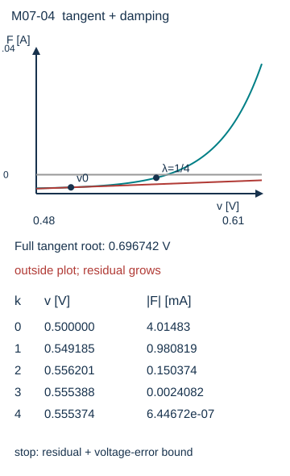

# 非线性工作点：Newton得到的是一根，怎样知道它可信

二极管不能用固定电阻覆盖所有电压。它在每个候选工作点有一条切线；Newton把切线与其余线性电路一起求解，再换一条切线。最终须核原本构残差，不能把最后一次线性电路的解当作自动正确。

**基础入口**：先画电阻负载线并检查二极管单调性，再算一次切线更新。**本科快进**：读多节点Jacobian、尺度和多根反例。两条路线共用指数理想二极管模型；不把教学参数当具体型号认证。

## 一个有唯一性依据的二极管Q点

5 V源经1 kΩ串联电阻接节点v，二极管阳极v、阴极地。取I_s=10^−12 A、nV_T=0.025 V，忽略击穿、串联电阻与结电容。KCL残差

$$F(v)=\frac{v-5\ \mathrm V}{1000\ \Omega}+I_s(e^{v/(nV_T)}-1)\quad[\mathrm A].$$

$$J(v)=F'(v)=1/R+\frac{I_s}{nV_T}e^{v/(nV_T)}\quad[\mathrm S]>0.$$

因此F严格递增；F(0)≈−5 mA，F(0.6 V)≈22.089 mA，连续性给区间内至少一根、严格单调给最多一根。这个唯一性来自明确方程，不是来自Newton停了。

以v0=0.5 V，iD≈0.485165 mA，F≈−4.014835 mA，J≈20.40661 mS；Δv=−F/J≈0.196742 V。全步v1≈0.696742 V指数电流大幅增加，残差变坏。取半步λ=1/2得到约0.598371 V仍太大，再取λ=1/4得到约0.549186 V，残差约−0.99 mA，改善。可见局部切线对远点不可靠。

脚本采用回溯阻尼：求JΔv=−F，依次λ=1,1/2,…，只接受残差绝对值严格下降的有限候选；到最小λ仍不降则报失败。最后得到v≈0.555374 V、iD≈4.444626 mA，小信号gD≈0.177785 S，rD≈5.62477 Ω（具体末位见results.json）。再把v代回完整指数和电阻方程核对，不用“0.7 V固定压降”作独立基准。独立对照用单调异号区间的二分法；这是不同更新机制的同一模型对照，仍不证明真实二极管精度。

## 多节点Jacobian从支路散布到节点

一个二极管跨a→b，约化关联列a_d，压差w=a_dᵀv。节点残差贡献a_d iD(w)，求导贡献gD a_d a_dᵀ。因此

$$F(v)=Yv+\sum_d a_d i_d(a_d^Tv)-b,\quad J(v)=Y+\sum_d g_d a_da_d^T.$$

n节点F为n×1（A）、J为n×n（S）。反向节点的两个负号自动抵消到Jacobian，不应仅在对角加入二极管导纳而漏非对角项。含MNA电压源电流时，F还含源约束行、J扩大到(n+m)²，源的单位问题与上一章一致。实现解JΔx=−F；不显式形成J⁻¹。本页源码的Newton只兑现标量二极管，向量公式为推导，未谎称具备通用SPICE器件库。

## 缩放、停止与失败

令v=V0 u、F=I0 f，f'(u)=(V0/I0)J，无量纲。对混合V/A未知量，用对角尺度D_x、D_F：x=D_x u、Fhat=D_F^−1F，Jhat=D_F^−1J D_x。阻尼用归一化残差范数，避免只因某行以mA存储就改变接受规则。

脚本分别检查KCL残差容差（A）和电压误差上界容差（V）：本例用F′≥1/R得到R|F|≤voltage_tol，不把更新步长当误差界。同时设最大迭代数、有限值检查、指数安全范围和回溯下限；不满足条件抛错。小步可能是阻尼缩得太小，小残差在小导数附近也未必小位置误差。二极管例因F'≥1/R=1 mS，若点和根间模型有效，有|v−v*|≤R|F(v)|；这是额外误差依据。

局部二次收敛通常需要根附近可微、Jacobian可逆与适当光滑性且起点足够近；阻尼只是帮助跨越局部范围的一种策略，不给任意主动网络全局保证。溢出保护不能偷偷把exp饱和后仍宣布原模型通过。源步进、gmin、限制电压等模拟器策略也须记录是否改变方程或迭代路径。

## 同一网络存在三个根

教学主动元件i(v)=I0[(v/V0)³−v/V0]，I0=1 mA、V0=1 V，节点并该元件到地，无注入。归一化u，f=u³−u，根−1、0、1；导数3u²−1在±1/√3为0且f≠0，Newton更新无定义。u0=2时下一步16/11；u0=0即停在根0，u0=1即停在根1。求解器找到一个根不排除其他根。

若另并C>0，则C v̇=−i(v)，在根处小扰动满足δv̇=−i'(v*)δv/C。±1 V处斜率+2 mS，极点负；0处斜率−1 mS，极点正。本明确一状态模型的局部稳定性可以推导，但“三个DC根”本身并不等于“三个稳定状态”。负微分电导区属于主动模型，不能声称无源电阻具有此反例。

## 数学往返

去[[数学/60-数值计算与量化/10-非线性方程求根括区间与收敛#Newton把切线的根作为下一步|一维Newton主解释]]，带F（A）、v（V）和导数S读切线、局部误差与“坏初值与停止条件”；回来实现二极管的残差与电压两项判据。该页只证明一维条件；多元Jacobian推导与电路stamp在本页。去[[数学/20-线性代数与几何/07-线性方程组消元LU与解的结构#LU 把消元过程保存下来|LU求更新]]，带Jhat和−Fhat，返回后用解线性系统替代求逆；LU可算不保证原非线性迭代收敛。

## 四题与解答

1. 二极管F为何至少一根且至多一根？答：端点异号＋连续性保证存在，F'>0保证唯一；两个理由缺一不可。
2. I_s增大，其他参数固定，根v如何移动？答：正向根处∂F/∂I_s=e^(v/a)−1>0，dv/dI_s=−(∂F/∂I_s)/J<0，电压下降。
3. cubic模型u0=1/√3怎么办？答：J=0而F≠0，拒绝除法并报告零导数；改变起点是新求解尝试，不宣称此初值收敛。
4. 将残差从A改为mA但不改容差，发生什么？答：数字残差乘1000，停止条件改变；必须同步换单位或采用归一化尺度。

本轮作者重新读取[FNC §4.5.1–2](https://fncbook.com/newtonsys/)的Jacobian与线性更新定义，正文主要是独立电路推导；未复制其多元例。二极管模型只为教学，不替代器件数据表；SPICE、硬件和真人学习效果未运行。
