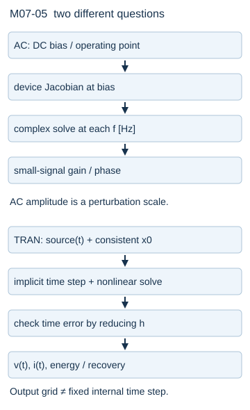

# SPICE分析：同一电路五种问题，五种结论

画出的电路相同，.op与.tran却不是在问同一件事。分析命令、源定义、初值和模型共同确定求解问题；一张曲线不能同时证明工作点唯一、小信号增益、大信号恢复和噪声预算。

**基础入口**：沿一个1 kΩ/1 μF RC分别问“现在多少伏”“怎样随时间变化”。**本科快进**：看分析合同表、AC线性化与noise单位。两路汇入同一网表；本轮没有SPICE执行结果，以下预测可用解析与Python核对。

## 五个输入合同

|分析|必须确定的输入|求什么|可报告的结论与边界|
|---|---|---|---|
|op|DC源值、器件静态模型、参考节点、收敛策略|DC代数工作点|模型的一个收敛根；不保证唯一或动态稳定|
|dc|扫哪个独立源/参数、起止步长、每点模型|一列工作点|扫描路径上的根与分支；不保证扫到所有根|
|ac|先建立DC偏置、AC源复幅、频率范围|偏置附近线性化频响|小扰动增益/相位；不是大信号逐周期仿真|
|tran|时域源、初始状态、终止时刻、数值积分与步长设置|时间轨迹|指定模型与初值的离散近似；需步长误差检查|
|noise|偏置、输出节点、输入参考源、噪声模型与频率|线性化噪声谱和积分|假设模型的谱/均方值；不自动代表实测噪声|

这是ngspice release47手册的分析语义定位，具体选项、默认值与可用模型应核对实际可执行版本；本轮仅消费network1已读§11.3相关条目的来源记录，没有运行该版本。

## 同一RC的可审查网表

```spice
* RC teaching model, R=1k ohm, C=1u F
V1 in 0 DC 1 AC 1 PULSE(0 1 0 1u 1u 10m 20m)
R1 in out 1k
C1 out 0 1u
.temp 26.85
.op
.dc V1 0 1 0.1
.ac dec 20 10 100k
.tran 10u 5m
.noise V(out) V1 dec 20 10 100k
.end
```

节点in/out/0与元件端口顺序明确；1k为Ω、1u为F。`.temp 26.85`显式设摄氏温度，对应噪声解析的300 K；不依赖工具默认温度。DC 1、AC 1与PULSE是同一源在不同分析使用的不同描述，不能以为每个分析同时叠加三者。未使用UIC；通常tran先求工作点，t=0时脉冲初始值为0，而op使用DC值1，分析初始化须按具体工具核对。这里的脉冲具有有限1 μs边沿，因此解析理想阶跃只是边沿趋零对照，不能把两者每个采样点宣称完全相等。若要零电压初值，应采用明确的源/初始化合同而非只假设.op的1 V状态也等于脉冲初值。

## 手算预测：每种输出量明确

op：电容DC开路，无负载，vout=1 V、电阻电流0。dc：每个DC源值a给vout=a，扫描表是一条直线。若另接1 kΩ负载，此结论改成a/2，电路加载必须进模型。

ac：DC附近RC本身线性，H(jω)=1/(1+jωRC)。f_c=1/(2πRC)=159.154943 Hz；输入AC 1 V时输出幅值0.70710678 V、相位−45°。若输入AC 2，输出电压幅值翻倍，但V(out)/V(in)仍同一个H。AC source幅值常为复分析幅值，不把它与具体时域峰值/RMS混用；报告比值避开不必要约定。

tran：理想单位阶跃、v(0)=0的基准是v(t)=1−exp(−t/1 ms) V。1 ms为0.63212056 V，5 ms为0.99326205 V；本页有限边沿网表有稍小偏差。输出间隔10 μs不是内部始终固定步长，改变容差或最大步长再比较才能评估离散误差。

noise：若仅电阻热噪声，温度T=300 K、经典白噪声区，理想电压源交流噪声为零，则

$$S_v(f)=\frac{4kTR}{1+(2\pi fRC)^2}\quad[\mathrm{V^2/Hz}].$$

幅度谱密度sqrt(S_v)单位V/√Hz；在f=0约4.07035 nV/√Hz。对f≥0单边谱，积分0到无穷得4kTR·[1/(4RC)]=kT/C，rms≈64.3580 nV。对指定有限频带[f1,f2]应积分到对应界，不把每个频点ASD直接求和。本公式只包含R热噪声，理想C无耗、线性且无限带宽积分是教学极限；具体半导体1/f、散粒噪声与源噪声需另模型。Python解析积分核对不是ngspice .noise已通过。

## 非线性器件让AC与tran分开

对二极管Q点vQ，iD(vQ+δv)≈iQ+gD δv，AC用gD；若考虑结电容还需偏压相关电容。tran把原指数本构和储能离散每一步，可能跨越不同工作区。上一章5 V/1 kΩ二极管例的rD≈5.62477 Ω；这个斜率是局部关系，不是把全程二极管永久换成5.6 Ω。



## 模型层级与失败诊断

理想RLC模型用于符号、守恒和误差基准；器件紧凑模型加入串联电阻、结电容、温度与非线性；宏模型表达端口特性；寄生提取模型加入互连RLC；场/器件求解再回答几何和材料。更复杂模型并不自动更可信，参数适用范围和校准数据必须匹配。

先检查节点/单位/极性，再检查浮置与矛盾约束，然后检查参数/模型范围、初值、残差和数值尺度。若加gmin或源步进获得根，记录最终辅助元件是否移除和根对策略的依赖。收敛失败可以是模型矛盾、数值迭代失败或尺度问题；收敛成功也不能代替器件模型真实性。

去[[信号与系统/10-连续与离散系统/04-频率响应与采样重建#从卷积推出频率响应|零状态频响]]，带RC、H和输入开始时间读全线指数特征函数，回来解释AC去掉启动暂态的理由；类比只在LTI/局部线性与有效频率截面成立。noise的PSD不是确定正弦幅值，不能直接套作AC source。

## 四题与解答

1. AC 1改AC 0.1，增益比是否改变？答：本线性化模型中电压输出数字缩小10倍，比值不变；实际大扰动失真不由ac分析认证。
2. .op的电容电流为0能否推出tran也为0？答：不能，tran有C dv/dt；1 ms阶跃基准电流约0.367879 mA。
3. 把V/√Hz曲线沿f直接积分，单位是什么，能否当rms？答：得到V√Hz，不是V；应积分ASD²再开方。
4. 多根主动电路dc每点都收敛能否证明只有一条分支？答：不能，续接初始化可能沿同一分支；需不同初值、解析反例或分支研究。

来源：[ngspice release47固定手册](https://ngspice.sourceforge.io/docs/ngspice-47-manual.pdf)§1.4与§11.3.1/2/4/5/10，精确已读范围见network1来源记录；本页没有软件日志。可执行网表是待工具对照输入，源码/解析复算、SPICE、硬件、UI分别记录于[[电子电路/80-实践/08-网络求解器/README|实验入口]]。
