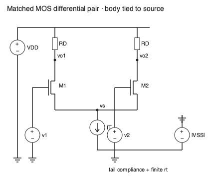

# 差分对与共模

两个输入一起上升，与一个上升、另一个下降，对电路提出的是不同问题。差分对把这两种动作分开：尾部电流限制总量，两个输入决定如何分配。它能抑制共同扰动，却仍必须满足每一只器件的工作区和电源余量。

从直观路线进入，先沿图中两条电流路径读到尾源，再看“电流如何转向”；从数学路线进入，先定义输入、输出坐标，再用同一组端口回到大信号公式。两条路线都要完成最后的共模范围检查。这里的 MOS 是长沟道教学模型，BJT 忽略基极电流；不是某个实际器件的保证。

图中两个漏极各经 $R_D$ 接 $V_{DD}$，两个源极汇于 $v_s$，尾电流源向负电源 $V_{SS}$ 吸流，电源返回参考节点 0。栅压由相对同一参考的两输入源给定。体端按图接源端；实际共衬底导致的体效应需要另加 $g_{mb}$。尾源不是地：它有顺从电压，也有有限输出电阻。

## 坐标先于增益

电压单位 V，电流 A，电阻 Ω，跨导 S。定义

$$v_d=v_1-v_2,\quad v_c=(v_1+v_2)/2,\qquad v_1=v_c+v_d/2,\ v_2=v_c-v_d/2,$$

$$v_{od}=v_{o1}-v_{o2},\qquad v_{oc}=(v_{o1}+v_{o2})/2.$$

以后写 $A_{dd}=\partial v_{od}/\partial v_d$、$A_{cd}=\partial v_{od}/\partial v_c$；第二个下标表示观察差分输出。单端输出则明确写 $A_{d1},A_{c1}$。共模到共模增益 $\partial v_{oc}/\partial v_c$ 与共模泄漏到差分输出是不同测量，不能混用分母。

## 大信号：总量一定，分配随输入变

设两管匹配，$I_D=\beta u^2/2$，$u=V_{GS}-V_T>0$，$\beta$ 的单位 A/V²；尾源理想固定 $I_T$。两管都导通且饱和时，令平均过驱动 $z=(u_1+u_2)/2$，有 $u_1=z+v_d/2,u_2=z-v_d/2$。把两电流相加得

$$I_T=\beta(z^2+v_d^2/4),\qquad z=\sqrt{I_T/\beta-v_d^2/4},$$

$$I_1-I_2=\beta z v_d,\qquad I_{1,2}=(I_T\pm\beta z v_d)/2.$$

这一步不只是根号实数条件：还须 $z>|v_d|/2$，故双管导通区是 $|v_d|<\sqrt{2I_T/\beta}$。越过这个边界，一管截止，理想模型的另一管承担 $I_T$。平方律转向不是全范围线性放大。输入差变大也会拉动共同源极，不能把两个源端电压固定后分别代平方律。

BJT 在共同发射极、匹配饱和电流、正向有源且忽略基极电流时，$I_1/I_2=e^{v_d/V_T}$，所以

$$I_1-I_2=I_T\tanh[v_d/(2V_T)],\qquad I_{1,2}=\frac{I_T}{2}\{1\pm\tanh[v_d/(2V_T)]\}.$$

这里热电压 $V_T=kT/q$ 与 MOS 阈值符号同形但物理对象不同，本段专指热电压。有限差分输入下 BJT 电流指数变小而不严格为零。以 300 K 的 25.85 mV 算，100:1 的比例需要 $v_d=V_T\ln100=119.05$ mV。MIT 6.012 的 [L26 第 1–7 页](https://web.mit.edu/6.012/SPR01/lecture26.pdf) 把两类转向放在同一个尾电流约束下；本页显式补出双管导通条件，便于检查公式适用区域。

取 $I_T=1$ mA，MOS $\beta=2$ mA/V²，零差分时每管 $u_0=\sqrt{I_T/\beta}=0.7071$ V，$g_m=\beta u_0=1.4142$ mS，完全转向边界为 1 V；同样尾电流的 BJT 每管 $g_m=I_T/(2V_T)=19.34$ mS。更大的局部斜率也意味着更窄的近线性输入区，而不意味着无限输入余量。

## 局部差模与有限尾源

局部模型把工作点冻结，先忽略 $r_o$。差模时两管增量电流相反，匹配使源节点的小信号为零，得到

$$A_{dd}=-g_mR_D,\qquad A_{d1}=-g_mR_D/2.$$

共模输入时两管电流同向。尾电阻 $r_t$ 的电压由两支电流共同产生：$v_s=2r_tg_m(v_c-v_s)$。于是

$$A_{c1}=\frac{-g_mR_D}{1+2g_mr_t},\qquad A_{cd}=0\quad\text{（完全对称、差分观察）}.$$

有限尾电阻让两个输出一起移动；完全匹配仍将这一移动相减消去。单端 CMRR 是 $|A_{d1}/A_{c1}|=(1+2g_mr_t)/2$，按电压比写 $20\log_{10}$ dB。差分观察的 CMRR 定义为 $|A_{dd}/A_{cd}|$，本理想对称模型为无穷大。$|A_{dd}/A_{cc}|=1+2g_mr_t$ 可作为两种模态增益的比较，却不能称为同一输出端的共模抑制率。

有限 $r_o$ 不应藏在“很大”里。令 $g_D=1/R_D,g_o=1/r_o$，对称半电路或完整三节点 KCL 给出

$$A_{dd}=-\frac{g_m}{g_D+g_o},\quad A_{c1}=-\frac{g_m}{g_D+g_o+2g_Dr_t(g_m+g_o)}.$$

完整来源是每支漏节点 $(g_D+g_o)v_{oi}-(g_m+g_o)v_s=-g_mv_i$，源节点为 $-g_o(v_{o1}+v_{o2})+[2(g_m+g_o)+1/r_t]v_s=g_m(v_1+v_2)$。这也给出独立数值解的入口，不靠半电路公式自证。

忽略 $r_o$ 时，取上述 MOS、$R_D=2$ kΩ、$r_t=100$ kΩ，$A_{d1}=-1.4142$，$A_{c1}=-0.009965$，单端 CMRR 141.92，即约 43.04 dB。若两负载为 $R_D(1\pm\delta)$，差分共模泄漏为 $A_{cd}=2\delta A_{c1}$；$\delta=0.01$ 给差分 CMRR 约 83.04 dB。它只描述这一负载失配，器件跨导、阈值、尾源与布线的失配仍需加入。

## 范围与实测问题

共模输入太低，尾源先失去顺从电压；太高，输入管漏源电压不足而离开饱和。以源节点 $V_S\approx V_C-V_T-u_0$ 为桥梁，下界需 $V_S-V_{SS}\ge V_{tail,min}$，上界需 $V_D-V_S\ge u_0$，即约 $V_C\le V_D+V_T$。差分输入存在时必须逐管检查，不能直接拿零差分共模区覆盖所有幅度。BJT 还需检查发射极尾源及集电极正向有源条件。实际 CMRR 的频率、温度、输入范围和输出观察方式缺一项，数值就不完整。MIT [L25 第 3–17 页](https://web.mit.edu/6.012/SPR01/lecture25.pdf) 的对称性分析和输入范围讨论，是这些假设的原始教学依据。

## 理由题与核对线索

1. 为什么不能用固定源极的两条平方律曲线求转向？答：共同源端会改变，两电流还必须满足总尾流约束；固定源端一般破坏这个约束。
2. 有限尾电阻为什么不必然使差分输出产生共模泄漏？答：对称模型两漏端同量移动，观察相减消去；单端测量则保留移动。
3. 为什么 49.06 dB 的模态增益比不能代替本例单端 43.04 dB？答：差分输入的单端输出振幅是双端的一半，定义改变了分子；两比值回答不同问题。
4. 迁移：把 $R_D$ 加倍能否同时加倍可用增益和摆幅？答：局部增益增大，但直流压降也增大、漏端余量减小；须重新检查两管饱和与尾源顺从，失配泄漏亦随负载变化。

实践入口：[[电子电路/80-实践/15-差分多级与周期稳态/README]] 中的 `mos_steering`、`bjt_steering` 和三节点独立测试用于复算上述模型。它们没有测量真实器件的匹配、噪声或 CMRR。
