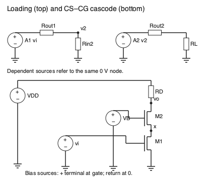
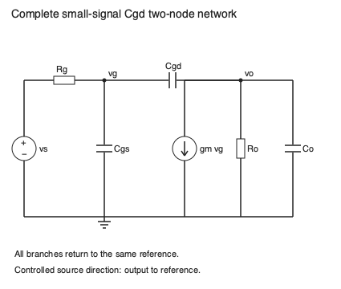

# 多级级联与Miller

把两个放大器串起来，第二级既接收信号也消耗第一级的驱动能力。把一个共源管叠上共栅管，输出电阻能提高，却会消耗电压余量。把栅漏电容放进增益回路，输入电流能增大，还能产生与主极点不同的零点。这三个问题都要求同时看端口电流和端口电压。

直观入口先从第一级的输出电阻追踪负载分压，再看 cascode 的中间节点；数学入口先读两端口乘积与两节点导纳矩阵，再回看图中的真实电流支路。两条入口汇于“增益、带宽、摆幅必须共同满足”。本页小信号模型围绕已成立的直流工作点，所有 $g_m$ 用 S、$r_o,R$ 用 Ω、$C$ 用 F、$s$ 用 s⁻¹。

## 级联乘积中的负载

一个单向电压两端口可用开路增益 $A_0$、输入电阻 $R_{in}$、输出电阻 $R_{out}$ 描述。这里“单向”要求输出对输入的反向作用可忽略。在低频线性范围，从理想信号源开始，两级接负载得到

$$A=A_{01}\frac{R_{in2}}{R_{out1}+R_{in2}}A_{02}\frac{R_L}{R_{out2}+R_L}.$$

若源还有 $R_s$，再乘 $R_{in1}/(R_s+R_{in1})$。这些是实际节点分压，不是增益额外损失的经验系数。以 $A_{01}=-20,R_{out1}=20$ kΩ，$R_{in2}=5$ kΩ，$A_{02}=-10,R_{out2}=1$ kΩ，$R_L=10$ kΩ 算，总增益是 $36.36$，不是裸开路乘积 200。引入输入电阻较高的跟随器可以减轻第一级负载，但跟随器的电流、输出电阻与余量仍须核对。若两个级通过反馈电容或偏置路径反向相连，应用完整两端口 $Y$ 或 $Z$ 参数联合解，不能把这个单向乘积当恒等式。MIT [L24 第 3–7 页](https://ocw.mit.edu/courses/6-012-microelectronic-devices-and-circuits-spring-2009/ae8671dac065308b639051497096a84a_MIT6_012S09_lec24.pdf) 展示了级间负载的物理后果。

## CS–CG cascode：中间节点为何有用

图右 M1 共源，M2 共栅：M1 源体接 0，M1 漏接 M2 源为 $x$，M2 栅固定偏置 $V_B$，漏端为 $v_o$；输出负载接电源。此处为便于推导令体端跟随各源端，忽略体效应。真实共衬底 M2 的 $g_{mb}$ 会修改结果。

把输入交流置零，在输出施加测试电压。以 $g_{oi}=1/r_{oi}$，中间节点 KCL 为

$$[g_{m2}+g_{o1}+g_{o2}]v_x=g_{o2}v_o.$$

输出测试电流等于流入 M1 的 $g_{o1}v_x$，所以

$$R_{out}=r_{o1}+r_{o2}+g_{m2}r_{o1}r_{o2}.$$

输出变动大部分落在 M2 上，中间节点变动小，M1 电流因沟道长度调制而变化得少。有限 $r_o$ 下，短路输出跨导也不是完全等于 $g_{m1}$：

$$G_m=g_{m1}\frac{g_{m2}+g_{o2}}{g_{m2}+g_{o1}+g_{o2}},\qquad A_v=-G_m(R_{out}\parallel R_D\parallel R_L).$$

教学参数 $g_{m1}=g_{m2}=1$ mS、$r_{o1}=r_{o2}=50$ kΩ，给 $R_{out}=2.6$ MΩ、$G_m=0.98077$ mS。若外部总负载为 20 kΩ，增益约 −19.47；高内部输出电阻没有让低外部负载消失。

直流还需 $V_x\ge V_{OV1}$、$V_o-V_x\ge V_{OV2}$，故最低输出电压至少为两管过驱动之和。$V_x\approx V_B-V_{T2}-V_{OV2}$ 需要选择偏置才能同时满足两管饱和。高端负载若是电流源，还会额外限制最高输出。高增益由较小输出电流变化得到，不是没有电压代价。本段 CS–CG 连接与有限 $r_o$ 公式由上述 KCL 自行推导，数值以独立节点解核对。MIT [L24 第 8–14 页](https://ocw.mit.edu/courses/6-012-microelectronic-devices-and-circuits-spring-2009/ae8671dac065308b639051497096a84a_MIT6_012S09_lec24.pdf) 讨论 CD/CC、CB–CB/CB–CG 电流缓冲及级间耦合；它没有提供本段所画的两 MOS CS–CG cascode，不能作为这个具体拓扑的出处。

## 栅漏电容的完整两节点问题

图以已偏置的共源小信号模型表示：信号源 $v_s$ 经 $R_g$ 接栅节点 $v_g$；$C_{gs}$ 接栅与参考，$C_{gd}$ 接栅与输出，输出有 $G_o$ 与 $C_o$ 接参考，受控电流源 $g_mv_g$ 从输出流向参考。定义 $G_i=1/R_g,G_o=1/R_o$，其中 $R_o=R_D\parallel R_L\parallel r_o$。电容电流必须由两个节点电压之差决定：

$$\begin{bmatrix}G_i+s(C_{gs}+C_{gd})&-sC_{gd}\\g_m-sC_{gd}&G_o+s(C_o+C_{gd})\end{bmatrix}\begin{bmatrix}v_g\\v_o\end{bmatrix}=\begin{bmatrix}G_iv_s\\0\end{bmatrix}.$$

解得

$$H(s)=\frac{v_o}{v_s}=-g_mR_o\frac{1-sC_{gd}/g_m}{1+b_1s+b_2s^2},$$

$$b_1=R_o(C_o+C_{gd})+R_g(C_{gs}+C_{gd})+g_mR_gR_oC_{gd},$$

$$b_2=R_gR_o[C_{gs}C_o+C_{gd}(C_{gs}+C_o)].$$

$b_1$ 单位 s，$b_2$ 单位 s²。分子零点 $s_z=+g_m/C_{gd}$ 位于右半平面，原因是栅漏电容提供与反相跨导通路竞争的前馈电流；它对幅值与相位的作用不能用一个低通主极点概括。只有当关注频率远低于 $s_z/(2\pi)$ 且误差允许时才可略去。

## Miller 和 OCT 各回答什么

若该频段 $v_o\approx A_vv_g$ 且 $A_v$ 可视为常数，栅漏电流是 $sC_{gd}(1-A_v)v_g$，所以输入等效电容为 $C_{gd}(1-A_v)$；输出侧为 $C_{gd}(1-1/A_v)$。这是端口电流等价，依赖这个增益关系。用直流增益替换整个频率相关增益，得到的是近似。电容回授电流已明显改变增益时必须回到矩阵。

开路时间常数 OCT 则依次让其他电容开路、独立源置零、保留受控源，在被测电容两端施加测试源。这里 $C_{gs}$ 看到 $R_g$，$C_o$ 看到 $R_o$，跨节点 $C_{gd}$ 看到 $R_g+R_o+g_mR_gR_o$。其和恰是上面的 $b_1$。这个系数的正确性不保证 $1/b_1$ 就是准确主极点；需要一个极点远低于其余极点，并检查零点是否远离工作带宽。MIT [L22 第 7–17 页](https://ocw.mit.edu/courses/6-012-microelectronic-devices-and-circuits-spring-2009/e6afee3d5cc0080ed7bf6f7fd9c2c223_MIT6_012S09_lec22.pdf) 用双节点与测试源建立了这两种近似，本页保留其原理而加入 $C_o$ 和未略去的分子。

取 $R_g=R_o=10$ kΩ、$g_m=1$ mS、$C_{gs}=20$ pF、$C_{gd}=2$ pF、$C_o=10$ pF，$b_1=540$ ns、$b_2=2.6\times10^{-14}$ s²。写分母为 $(1+s\tau_1)(1+s\tau_2)$，解得约 486.56 ns 和 53.44 ns，对应 327.10 kHz 与 2.98 MHz。OCT 给 294.73 kHz；仅输入 Miller 电容 $(20+22)$ pF 给 378.94 kHz。三数有区别：模型中的第二极点没有完全消失。零点约 79.58 MHz，在主极点附近可合理忽略，但若继续研究几十 MHz 的相位就要保留。

## 理由题与核对线索

1. 为什么两级开路增益相乘偏大？答：下一级输入有有限阻抗，先与上一级输出电阻分压；最终负载也分压。
2. 为什么 cascode 的高输出电阻不能保证大摆幅？答：两器件需同时饱和，堆叠的过驱动及负载顺从占用电源电压。
3. 为什么 OCT 中不能把受控电流源置零？答：受控源代表仍存在的器件响应，正是它使 $C_{gd}$ 两端测试电阻增大；删掉就改变网络。
4. 迁移：把 $R_g$ 降至原来的十分之一能否消除 RHP 零点？答：可提高输入相关极点，零点仍由 $g_m/C_{gd}$ 决定；要比较新的极点与零点相对位置。

实践 [[电子电路/80-实践/15-差分多级与周期稳态/README]] 用完整复数节点矩阵独立核对传递函数；目前不包含 SPICE、版图寄生或真实频响测量。
