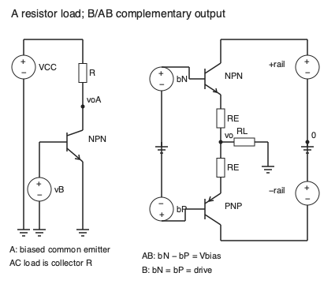

# 输出级效率失真与热边界

电压放大到末端还不算完成：负载每个时刻需要电流，输出管必须供得出电流、承受得住功率，驱动级也必须推动输出管。A、B、AB 描述的是导通安排；只有把供电、负载、摆幅和静态电流一同写明，效率才有可比较的含义。

直观入口沿图中正半周和负半周两条路径读输出级；数学入口先用正弦负载功率和电源平均电流积分。两条入口都回到交越附近，再用热模型检验偏置能否保持。所有参数是教学参数，不是实际器件额定值或安全工作区保证。

图 A 是电阻负载共射结构：集电极电阻接正电源，发射极接参考，负载等效为同一个电阻上的交流功率。图 B/AB 是互补发射极跟随器，NPN 集电极接正轨、PNP 集电极接负轨，两发射极经各自 $R_E$ 接输出，负载从输出接 0；驱动器给两基极提供相对同一参考的电压。AB 的两基极偏置差 $V_{bias}$ 使两管在过零附近同时略导通。实际偏置网络还要提供基极电流及温度跟踪。

## 理想效率必须指明拓扑

先计算电阻负载 A 类。单电源 $V_{CC}$，$R$ 同时是集电极直流负载和交流负载，静态点 $V_{CQ}=V_{CC}/2,I_Q=V_{CC}/(2R)$，理想管可到零电压、零电流。最大正弦峰值 $V_m=V_{CC}/2$，输出交流功率与电源直流功率分别为

$$P_o=\frac{V_m^2}{2R}\le\frac{V_{CC}^2}{8R},\qquad P_{dc}=V_{CC}I_Q=\frac{V_{CC}^2}{2R}.$$

因此这一拓扑的最大理想效率为 25%。变压器或理想扼流圈改变直流和交流负载关系，可产生另外的上限；不能从上述电阻负载推导出所有 A 类都只能 25%。A 类意味着整个周期保持导通，不意味着某个固定效率。

再计算图 B 理想互补推挽。两电源轨为 $\pm V_{CC}$，负载 $R_L$ 接参考，$v_o=V_m\sin\theta$、$0\le V_m\le V_{CC}$。正管只承担正半周，负管承担负半周，每个电源平均电流为

$$\bar I_+=\bar{|I_-|}=\frac{1}{2\pi}\int_0^\pi\frac{V_m}{R_L}\sin\theta\,d\theta=\frac{V_m}{\pi R_L}.$$

$$P_{dc}=\frac{2V_{CC}V_m}{\pi R_L},\quad P_o=\frac{V_m^2}{2R_L},\quad\eta=\frac{\pi}{4}\frac{V_m}{V_{CC}}\le78.54\%.$$

例如 $V_{CC}=5$ V、$R_L=8$ Ω、$V_m=4$ V，$P_o=1$ W、$P_{dc}=1.5915$ W，效率 62.83%，两输出管合计平均耗散约 0.5915 W。这里遗漏驱动功率、静态电流、饱和压降和电阻损耗，是明确的理想上界模型。在零幅度时两功率都零，效率比是未定义；程序为方便返回零并标记为约定。实际 AB 零输入仍消耗静态功率。

## 交越为何产生谐波

真实 BJT 需要基极—发射极电压。简单 B 类模型可写

$$v_o=\operatorname{sgn}(v_i)\max(|v_i|-V_b,0),$$

$V_b$ 单位 V。这是死区演示模型，省略反馈、$R_E$ 与电流相关的 $V_{BE}$。输入为 $A\sin\theta$，若 $A>V_b$，在每次过零附近 $|\sin\theta|\le V_b/A$ 时无输出。输出仍有半波反对称性，偶次谐波为零，但奇次谐波不再为零：

$$b_n=\frac1\pi\int_0^{2\pi}v_o(\theta)\sin(n\theta)\,d\theta.$$

以 $\theta_0=\arcsin(V_b/A)$，基波可独立解析核对：

$$b_1=\frac{A(\pi-2\theta_0+\sin2\theta_0)-4V_b\cos\theta_0}{\pi}.$$

当 $A=1$ V、$V_b=0.6$ V，导通角明显小于理想 B 的半周期；数值积分给出基波和三、五次谐波，见实践生成的 `results.json`。有限样本只近似这一教学波形的积分，不能直接预测实物 THD。反馈可以减轻但不自动消除开环死区，尤其在高频与限流附近。

AB 通过基极偏置使过零时有 $I_Q>0$。近似有

$$V_{bias}\approx V_{BE,N}+|V_{BE,P}|+2I_QR_E.$$

它缩小死区但增加静态功率，还可能有偏置不匹配、温漂与驱动限制。MIT 6.117 [L2 第 31–35、43 页](https://web.mit.edu/6.117/www/lec2.pdf) 提供导通类别及互补输出的原始教学示例；本页原创新图和效率积分，不复制该讲义的图像，也不把理想偏置称为真实失真已经消除。

## 驱动和热是同一个预算的一部分

峰值负载电流 $I_{pk}=V_m/R_L$；BJT 驱动端至少需要约 $I_{pk}/\beta$ 的基极电流。$\beta$ 随电流、温度变化，选典型值不能保证峰值输出。高频还需为结电容和储存电荷充放电，MOS 对应栅电荷与驱动电流，不能仅凭“栅极直流不耗流”忽略驱动功率。发射极电阻提供局部负反馈也占用 $I_{pk}R_E$ 的摆幅余量。

用一个可复算的热反馈模型看 AB 风险。假定两管共温，固定偏置电压、$V_{BE}(T)=V_{BE,0}-\kappa\Delta T$，每只 $\kappa>0$（V/K），同值发射极电阻 $R_E$；忽略漏电和其他热路径。由偏置式得

$$I_Q=I_{Q0}+\frac\kappa{R_E}\Delta T.$$

定义两管合计静态耗散 $P\approx2V_{CC}I_Q$，这个合并模型的热阻为 $\Theta$（K/W），$\Delta T=\Theta P$。代入得

$$L_T=\frac{2\Theta V_{CC}\kappa}{R_E},\qquad I_Q=\frac{I_{Q0}}{1-L_T}\quad(L_T<1).$$

$L_T$ 无量纲。若加入一个正热时间常数的一阶热状态，局部扰动的衰减项正比于 $1-L_T$，所以 $L_T<1$ 是本模型局部稳定条件。它不替代多温度节点、偏置补偿延迟、散热器接触、动态信号耗散与安全工作区检查。

取 $I_{Q0}=10$ mA、$V_{CC}=5$ V、$R_E=1$ Ω、$\kappa=2$ mV/K、$\Theta=10$ K/W，$L_T=0.2$，自洽 $I_Q=12.5$ mA、$P=0.125$ W、温升 1.25 K。若仅把 $R_E$ 改成 0.1 Ω，$L_T=2$，该线性模型没有稳定有限平衡。此时公式的负分母不是负静态电流的物理解，而是模型提出需要重新设计和更完整分析。偏置元件温度跟踪可减小净 $\kappa$，但需实际耦合与器件依据才能算有效补偿。

## 理由题与核对线索

1. 为什么 78.54% 不是实际 AB 的保证？答：推导使用无静态电流、无压降、无驱动耗能的理想 B 正弦，而且幅度到电源轨；实际条件破坏这些假设。
2. 为什么过零死区会产生奇次谐波？答：输出保持半波反对称却不再是纯正弦，傅里叶积分的高阶奇次系数非零。
3. 为什么增加 $R_E$ 常有助于偏置稳定却降低大信号余量？答：它降低温度到电流的增量增益，同时峰值负载电流在其上产生额外压降。
4. 迁移：负载 8 Ω 换为 4 Ω、保持同样电压波形，能否只把输出功率翻倍？答：负载与驱动电流、管耗散也改变；须重新检查峰值电流、SOA、热阻与电源跌落，原预算不再适用。

实践 [[电子电路/80-实践/15-差分多级与周期稳态/README]] 分别积分电源半波与负载功率，并解析核对死区基波。尚未进行硬件音频失真、散热、限流或驱动实验。
