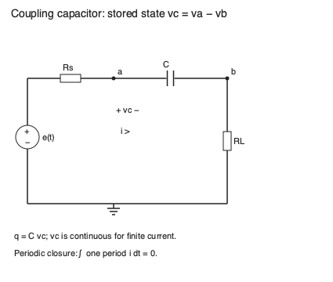

# 耦合电容与周期稳态

耦合电容隔开直流工作点，同时保存一个状态：两端电压。输入突然开始时，电容保留此前电压；经过许多周期后，它必须每周期回到同一状态。短窗口内近乎不变的电容电压，与长期周期稳态中重新调整的平均电压，是两个不同的解。

直观入口先沿图追踪电流和电荷，再看启动状态；数学入口先写一阶状态方程，再用周期积分判断平均值。两路都返回原高级章的非线性电流例，理解为什么“电容很大”仍不能让旧偏置在长期平均中永远不变。

## 电容端电压就是状态

图中理想戴维南源 $e(t)$ 相对参考 0，经 $R_s$ 接节点 $a$，电容 $C$ 从 $a$ 接 $b$，负载 $R_L$ 从 $b$ 回到参考。定义 $v_C=v_a-v_b,q=Cv_C$，电流正向从 $a$ 经电容到 $b$，所以 $i=C\dot v_C=v_b/R_L$。源环路给 $e=R_si+v_C+R_Li$，从而

$$C\dot v_C=\frac{e-v_C}{R_s+R_L},\qquad v_b=\frac{R_L}{R_s+R_L}(e-v_C).$$

电压单位 V，$q$ 为 C（库仑），电容 $C$ 为 F，两电阻 Ω，时间 s。$\tau=C(R_s+R_L)$ 单位 s。初始值 $v_C(0)$ 是题目的必要条件；有限电阻驱动下电容电压连续。切换后重新给输入函数，仍应沿用切换前状态，不应每段把电容清零。

对正弦的线性传递函数为

$$H(s)=\frac{v_b}{e}=\frac{sCR_L}{1+sC(R_s+R_L)}.$$

高频增益是 $R_L/(R_s+R_L)$，低频截止 $f_c=1/(2\pi\tau)$。源电阻不能因叫作“耦合”而被忽略。直流时电流最终为零，电容电压等于源的直流分量，负载电压为零。这一解释兑现了“隔直流”，没有把电容当成所有时刻的开路。

## 周期稳态与启动解

若 $e=E_0+A\sin\omega t$、$x=\omega\tau$，周期解为

$$v_{C,p}=E_0+\frac{A}{1+x^2}(\sin\omega t-x\cos\omega t),$$

$$v_{b,p}=\frac{R_L}{R_s+R_L}\frac{A}{1+x^2}(x^2\sin\omega t+x\cos\omega t).$$

代回状态方程即可核对导数和相位。数值计算需把初值、直流源与交流源贡献分别追踪：短时零初值的正弦响应以 $A\omega t^2/(2\tau)$ 起步，把相等的一阶项先相减会丢掉这个正的二阶量。实践用原 ODE 的增量级数处理该区域，周期负载则直接用交流坐标计算，避免从大直流总量相减求小交流输出；总电容电压与负载交流输出的浮点分辨率可以不同。数值 API 另限定 $10^{-150}\le\omega\tau\le10^{150}$、$|\omega t|\le10^{12}$、$t/\tau\le10^6$ 和两电阻比不超过 $10^{12}$；时间常数及正时间坐标必须可表示，域外前置 `ValueError`。这些是教学求值域，不是一般 ODE 的物理限制。谐波先归一为 $1/(1+x^2)$、$x/(1+x^2)$、$x^2/(1+x^2)$ 再乘幅度；大衰减以 $\ln|V|-t/\tau$ 合并缩放后取指数，避免中间量先下溢吞掉最终可表示状态。任意初值的完整解还包含

$$v_C(t)=v_{C,p}(t)+[v_C(0)-v_{C,p}(0)]e^{-t/\tau}.$$

取 $R_s=2$ kΩ、$R_L=10$ kΩ、$C=1$ μF、$f=100$ Hz、$E_0=2$ V、$A=1$ V，$\tau=12$ ms、$x=7.5398$，周期 $v_C(0)=1.8697$ V，负载幅值約 0.8261 V。若启动前电容为零，开始时负载电压约 1.6667 V；这不是周期正弦幅值，也不是永久直流泄漏，而是启动瞬态。五个时间常数后的初值差仍约保留 0.67%，要根据容许误差而不是口号决定等待多久。

周期条件是 $v_C(t+T)=v_C(t)$，于是

$$\int_t^{t+T}i\,dt=C[v_C(t+T)-v_C(t)]=0.$$

它保证负载平均电流零、$\bar v_b=0$，继而 $\bar v_C=\bar e$。不需要假设电容纹波恰好零。MIT [L24 第 11–14 页](https://ocw.mit.edu/courses/6-012-microelectronic-devices-and-circuits-spring-2009/ae8671dac065308b639051497096a84a_MIT6_012S09_lec24.pdf) 说明级间电容怎样隔开偏置；上面的状态、瞬态和周期解补出实际等待及平均约束。

## 回到原高级章：非线性电流改变平均偏置

完整进阶推导保留在 [[电子电路/20-器件与模拟/03-偏置增益与负载的连续设计#放大与摆幅需要同一条约束]]。按以下顺序回读：先确认平方律电流 $I_D=c(1+v_i)^2$ 的单位及持续饱和前提；再积分一周期看 $v_i^2$ 的非零平均；随后使用负载平均电流零求平均漏压；最后读有限 $C$ 状态方程与初值的齐次衰减，逐时核对 $V_D\ge V_{OV}$。该段给的是候选工作区解，越出饱和就必须改用分区器件模型。本页不把越界的曲线当成真实输出。

为在这里接上物理含义，原章教学条件是 5 V 供电、$R_D=2$ kΩ、$R_L=10$ kΩ、$c=1$ mA/V²、静态过驱动 1 V、$v_i=a\sin\omega t$。平方项增加平均漏电流；周期电荷闭合要求平均负载电流仍为零，所以平均漏压从 3 V 降到 $3-a^2$ V。若 $a=0.35$ V，平均漏电流 1.06125 mA、平均漏压 2.8775 V。这里 $a^2$ 旁的系数是由该组参数产生的 V⁻¹，不能把有单位的幅度平方直接加到任何电压上。

假设电容仍冻结为旧 3 V，会得到平均负载电流约 −10.208 μA。一个 10 ms 周期净电荷约 −102.08 nC，有限电容的电压必然继续变化。因此这一旧状态近似可以描述 $t\ll\tau$ 的观察窗口，却不能宣称长期周期闭合。若先进入长期周期，再让 $\omega\tau$ 很大，平均电容电压已重新调整；两个极限顺序不同。

原章高频长期极限在 $a=0.35$ V 的正输入峰值给漏压 1.60875 V，所需过驱动为 1.35 V，余量约 0.25875 V。冻结旧状态给 1.62917 V，差约 20.42 mV；差虽小，其长期平均电荷不闭合。原章还给高频持续饱和边界约 0.395396 V，不能把旧冻结窗口的 0.4 V 当成同一长期保证。

有限电容时，需回到原章 $C\dot V_C=(5-R_DI_D-V_C)/(R_D+R_L)$。本实践以 $C=1$ μF、100 Hz、$a=0.35$ V，用显式周期解与独立 RK4 逐周期收敛比较；采样检查仅提供数值余量，解析高频边界不直接套到有限 $C$。RK4 实践限定 $0\le a\le0.5$ V、$0.1\le\omega\tau\le10$、每圈 512…4096 步和 $10^{-9}$…$10^{-4}$ V 的误差容限；不支持的慢收敛或精度域在迭代前拒绝。停止判断逐个返回采样点与本线性状态方程的解析周期解比较，并加声明的浮点余量，返回的是采样误差估计，不是严格舍入上界或全连续周期证书。单圈变化小并不能证明接近周期固定点；固定步/圈预算耗尽或残差停滞仍报失败。

## 理由题与核对线索

1. 为什么同一个输入正弦可以有不同启动波形？答：电容保存初值，完整解包括由此前状态决定的指数衰减项。
2. 为什么周期平均电流零不要求每个瞬间电流零？答：一周期正负电荷相消即可，电容仍可充放电并有纹波。
3. 为什么电容很大仍可能有长期直流偏置修正？答：它减小短时变化速率，却不改变无限多周期的电荷闭合条件；非线性电流的平均值改变了平衡状态。
4. 迁移：更换 $R_L$ 后能否只改中频增益？答：它同时改变时间常数、输出分压、瞬态和实际漏压摆幅；须重新解状态并核对工作区。回读原章“迁移题与多解评分”的 3 kΩ/6 kΩ 案例可看到错误复用摆幅限制的反例。

实践 [[电子电路/80-实践/15-差分多级与周期稳态/README]] 的运行证据区分解析解、RK4 闭合和未做的真实电容漏电、介质吸收、器件分区、SPICE 与硬件层。正文旧章原稿没有改写。
