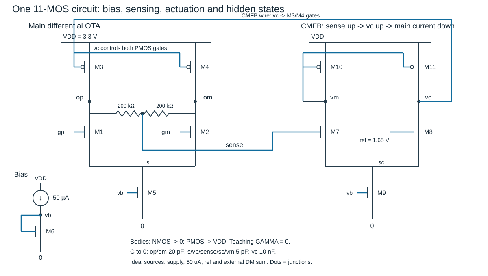
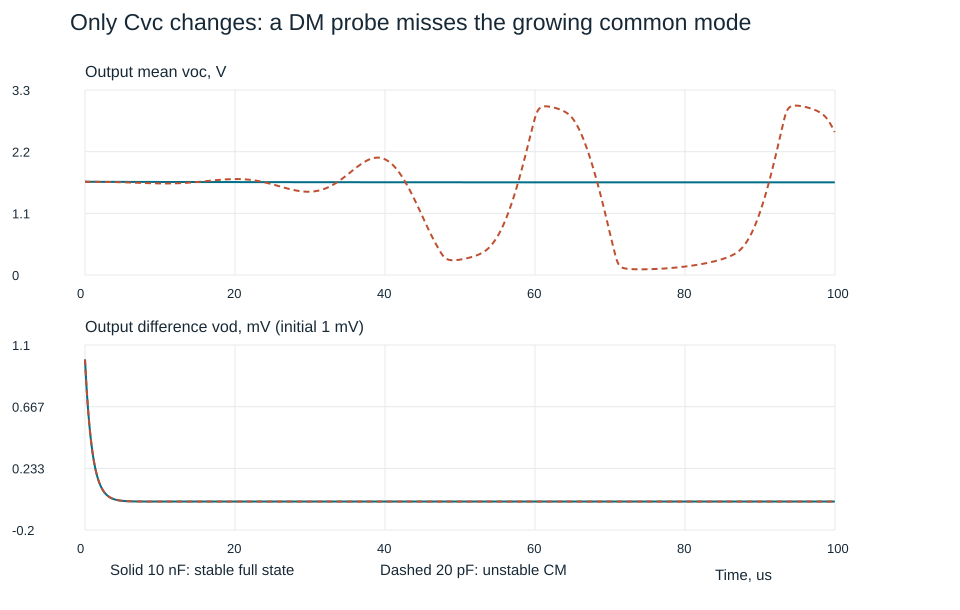

# 完整OTA：先让偏置和输出共模真的闭合

两个输出之差很漂亮，两个输出一起撞电源，能算放大器合格吗？差分探头会勤恳地把共同变化相减，它没有替电路保管被减掉的状态。本单元把差分对、电流镜和反馈接成同一张11管电路：先求每一条直流电流，再从该工作点求完整小信号，最后用同一网表的SPICE扰动检验。

首次读者先看电流路径和“开掉共模反馈会怎样”，再跟踪误差怎样改变负载电流；熟悉差分对的读者从八条KCL及坐标矩阵进入。两路的出口相同：能找出检测、执行、偏置、负载和隐藏模态，并复算改变一个条件的结果。

本页完成偏置—输出共模—完整互连这一单元。其后进入 [[电子电路/26-放大电路/10-OTA噪声摆幅与双环联合规格|同一OTA的联合规格]]：沿本11MOS加入明确栅RC/桥电容，核输入共模与输出网格、15源噪声、给定压摆/建立、两环补偿与有限参数角。一个正确Q点不能替代那里的联合预算，有限教学设计也不等于可流片签核。已有 [[电子电路/80-实践/48-两相开关电容积分器/README#有限OTA两状态复算|开关电容有限OTA端口模型]] 的参数也是另一个模型，不能用本例的单个极点替换它的全部参数。

## 一张图、一套参数、三个明确的理想边界

主级是NMOS输入对M1/M2、PMOS负载M3/M4、NMOS尾管M5。50 µA参考经二极管连接M6建立vb，M5复制它，M9以几何比给误差级较小尾流。两只200 kΩ从op、om接到sense；sense驱动NMOS M7，参考1.65 V驱动M8；M10/M11构成PMOS镜，vc为M11/M8的共同漏节点，直接控制M3/M4栅。

这套连接以 [UDel ECE614 Lecture 2，PDF第5–8页](https://www.eecis.udel.edu/~vsaxena/courses/ece614/f12/Lecture%20Notes/lec2_ece614.pdf) 的电阻检测、器件级误差放大器及CM环为拓扑依据；本页数值、几何和节点电容是另行明确选择的教学设计，既非讲义的数值复刻，也非某个厂商PDK。尤其讲义第8页画跨主输出与控制栅的补偿电容，本例选择vc对地的慢电容以隔离本单元问题，**补偿接法不同**；因此没有借该页替本例的极点或稳定性作证。

1. 电源3.3 V、地0 V，温度27 °C；NMOS体接0、PMOS体接VDD，**教学模型GAMMA=0**，因此不含真实共衬底体效应。不是声称这些体端电位在现实中没有影响。
2. 50 µA绝对参考、电源和1.65 V共模目标由理想源提供；M6/M5/M9真实生成和分配栅偏置，但基准自身的启动、温漂和电源抑制尚未设计。外部差分测试反馈是理想电压求和器，不冒充额外晶体管。
3. 为单独核清偏置与多环，动态只保留图注中的显式节点对地电容；默认vc接**外部10 nF教学补偿电容**，其面积不被藏进“集成电容很小”一句话。器件本征/布线电容及电荷模型需在后续真实工艺模型中恢复，不能从本例推高频硅性能。

| 器件 | 类型、W/L（µm/µm） | 栅与作用 |
| --- | --- | --- |
| M1/M2 | NMOS，4/1 | gp/gm输入，漏op/om、源共同接s |
| M3/M4 | PMOS，4/1 | 栅vc、源VDD，向op/om供电流 |
| M5/M6 | NMOS，10/1 | 栅vb；M5漏s，M6栅漏短接vb |
| M7/M8 | NMOS，1/50 | 栅sense/ref，漏vm/vc，源共同接sc |
| M9 | NMOS，1/10 | 栅vb、漏sc；名义为M5的1/100 |
| M10/M11 | PMOS，1/50 | 栅vm、源VDD；M10栅漏短接vm、M11漏vc |

两模型$K_{P,n}=100\,\mu\mathrm{A/V^2}$、$K_{P,p}=50\,\mu\mathrm{A/V^2}$，$V_{T,n}=0.6$ V、$|V_{T,p}|=0.7$ V，$\lambda=0.04\,\mathrm{V^{-1}}$，$\beta=K_PW/L$。电容顺序$(op,om,s,vb,sense,sc,vm,vc)$为$(20,20,5,5,5,5,5,10000)$ pF。两个检测电阻是实际负载，不先用理想平均值块替换。

输入定义为

$$v_{gp}=1.5+u_c+\frac{u_d+0.1(v_{op}-v_{om})}{2},\qquad
v_{gm}=1.5+u_c-\frac{u_d+0.1(v_{op}-v_{om})}{2}.$$

$u_d,u_c$单位V，是供复算的外部差模、共模输入。主级反相，所以这里**加**$0.1v_{od}$构成差模负反馈。网表B源忠实表示这条理想外部连接；它不检测输出平均值，CMFB的检测与执行仍由上述实际器件承担。

## 从电流方程到同一个Q点

对NMOS令$z=V_{GS}-V_T$、$d=V_{DS}\ge0$。本例饱和区

$$I_D=\frac{\beta z^2}{2}(1+\lambda d),\quad
 g_m=\beta z(1+\lambda d),\quad g_{ds}=\frac{\beta z^2\lambda}{2}.$$

需$z>0,d\ge z$。三极区改为$\beta(zd-d^2/2)(1+\lambda d)$，截止区为0；PMOS用$V_{SG},V_{SD}$及电流绝对值写同一式，KCL仍保留真实方向。不能把饱和公式外推到后面的撞轨反例。这个长沟道平方律没有弱反型、速度饱和或随机器件噪声。ngspice用显式LEVEL1对照；[官方手册MOSFET的“Notes on Level 1–6 models”](https://ngspice.sourceforge.io/docs/ngspice-manual.pdf)说明参数与电容模型的职责，实践入口逐项记录本例如何压低内置寄生而保留显式电容。

令$P_j$为PMOS从VDD流向漏端的正电流，$I_j$为NMOS漏到源的正电流，$a=v_{sense}$、$b=v_b$、$m=v_m$、$k=v_c$。八个节点的**流出**电流为

$$\begin{aligned}
F_{op}&=I_1-P_3+(v_{op}-a)/R,\
F_{om}&=I_2-P_4+(v_{om}-a)/R,\
F_s&=I_5-I_1-I_2,\
F_b&=I_6-I_{ref},\
F_a&=(a-v_{op})/R+(a-v_{om})/R,\
F_{sc}&=I_9-I_7-I_8,\
F_m&=I_7-P_{10},\
F_k&=I_8-P_{11}.
\end{aligned}$$

DC解$F(x)=0$，动态为$C\dot x=-F(x)$。$F$单位A，$C$为对角电容矩阵、单位F，$x$为八维节点电压列向量、单位V。控制器内部的sc、vm和偏置vb都保留，不能因为最终只量两个输出而删除。

先独立求M6：$50\,\mu A=\tfrac12(1000\,\mu A/V^2)(b-0.6)^2(1+0.04b)$。再联合其余KCL；得到

| 节点 | Q电压，V | 电流平衡的含义 |
| --- | --- | --- |
| op=om=sense | 1.653738021 | 检测电阻DC电流为0，两支各自平衡 |
| s | 0.556333880 | M1+M2共49.316328011 µA流入M5 |
| vb | 0.910621199 | M6恰为50 µA；M5与M6的VDS不同，不能硬设尾流也等于50 µA |
| sc | 0.568961055 | M7+M8共0.493406948 µA流入M9 |
| vm | 1.914930020 | M7=PMOS M10，约0.247661284 µA |
| vc | 2.119014232 | M8=PMOS M11，约0.245745664 µA，并控制主负载 |

| 器件组 | $|I_D|$，µA | $g_m$，µS | $r_o$，MΩ | 饱和余量$|V_{DS}|-V_{OV}$，V |
| --- | --- | --- | --- | --- |
| M1/M2 | 24.658164005 | 143.500698 | 1.058368 | 0.753738 |
| M3/M4 | 24.658164005 | 102.531782 | 1.080626 | 1.165276 |
| M5 | 49.316328011 | 317.533563 | 0.518212 | 0.245713 |
| M6 | 50.000000000 | 321.935529 | 0.518212 | 0.600000 |
| M7/M8 | 0.247661284 / 0.245745664 | 1.021754 / 1.021729 | 106.379037 / 108.038745 | 0.861192 / 1.069014 |
| M9 | 0.493406948 | 3.176905 | 51.821242 | 0.258340 |
| M10/M11 | 0.247661284 / 0.245745664 | 0.723025 / 0.717432 | 106.536918 | 0.700000 / 0.495916 |

11管全饱和；作者节点残差约$2.1\times10^{-18}$ A。所有$g_m,r_o$都来自这组Q，未从几份独立例题各借一只“合适”的参数。共模目标误差约+3.738 mV，并非0：M10/M11的漏源电压不同、镜像电流有限误差，控制器为产生所需vc保留小输入差。这是有限增益/失配机制，不应四舍五入成理想伺服。

顺从检查也有对象：冻结此Q的源、栅电压时，主NMOS需$v_o\ge s+V_{OV,n}=0.9$ V，PMOS需$v_o\le3.3-V_{OV,p}\approx2.8190$ V；M5另需$s\ge0.310621$ V。信号改变会一起改源极和过驱动，因此这些是当前点的余量，不是完整大信号输出摆幅或输入共模范围保证。

## 开掉CMFB，直流“存在”也不等于输出共模受控

保留电阻检测与误差级，但把M3/M4的栅从vc断开，改接固定2.119014232 V理想偏置。名义参数下输出仍可恰好停在原Q；有限$g_{ds}$给它有限直流斜率，并非一定数学上没有唯一解。真正缺的是对指定输出共模的主动校正。

现在**只把主PMOS负载的W统一增加10%**，其他模型不动。固定栅支路的两输出升到约2.921281579 V，M3/M4进入三极区；差分小信号仍有约−3.309 V/V的稳定响应，均值却已偏离目标1.27 V。误差级可以看见错误，失去连接的执行端却不能改变主负载。这种“会测量但没有执行权”的电路，调漂亮差模图没有帮助。

恢复主PMOS栅到vc，保持同一10%负载变化：vc升至约2.141394496 V，PMOS过驱动减小，供电流重新与尾流相容；输出均值回到1.654149886 V，11管又都饱和。修正方向可沿物理支路判断：输出均值升高→sense升高→M7吸流增大→M10/M11镜供电流相对M8增大→vc升高→主PMOS供应电流减小→输出均值下降。这里每个箭头都有实际节点和电流方向。

## 完整Jacobian，再谈差模/共模

在Q处设$J=\partial F/\partial x$（S）、$F_u=\partial F/\partial(u_d,u_c)$（S）。

$$\delta\dot x=A\delta x+B\delta u,\qquad A=-C^{-1}J,\quad B=-C^{-1}F_u.$$

$A,B$元素单位均为s⁻¹，因为状态和输入都是电压；原始完整$J,A,B$逐项存于 [模型结果JSON](../80-实践/49-全差分OTA偏置与共模/data/results.json) 的 `cases.nominal.linear`。源码按每只管的漏、栅、源偏导盖章，再加电阻；没有给任意2×2矩阵换名叫OTA。

为看清一行，记$g_n=g_{ds1}$、$g_p=g_{ds3}$、$g_{mn}=g_{m1}$、$g_{mp}=g_{m3}$、$g_R=1/R$、$\beta_f=0.1$。op行是

$$\delta F_{op}=(g_n+g_p+g_R+g_{mn}\beta_f/2)\delta v_{op}
 -(g_{mn}\beta_f/2)\delta v_{om}-(g_{mn}+g_n)\delta s
 -g_R\delta a+g_{mp}\delta k+\frac{g_{mn}}2\delta u_d+g_{mn}\delta u_c.$$

om行交换两个输出，并反转差分输入项；sc、vm、vc行继续保留误差对的$g_m,g_{ds}$。尾源的$g_{ds5}=1.929710585\,\mu S$，主负载$g_{ds3}=0.925389236\,\mu S$、控制节点$g_{ds8}+g_{ds11}=0.018642356\,\mu S$均有限；sense有5 pF、R/2=100 kΩ的通道时间常数。既没有理想尾源，也没有无负载、无延迟的理想检测器。

固定新坐标列向量$z=(v_{od},v_{oc},s,b,a,sc,m,k)^T=T\delta x$，

$$T=\operatorname{diag}_{block}\!\left(\begin{bmatrix}1&-1\\1/2&1/2\end{bmatrix},I_6\right),\qquad
A_z=TAT^{-1}.$$

$T$是“节点坐标→新坐标”，并非反过来；回 [[数学/20-线性代数与几何/11-基变换相似与矩阵表示#基变换先问哪个坐标由哪个得到|基变换主解释]] 检查逆矩阵位置。有限尾源会影响共模，但只要左右器件、负载、电容、检测电阻及输入反馈仍交换对称，差模与其余七个状态解耦。这里恰有

$$A_z=\begin{bmatrix}-1.061015512\times10^6&0_{1\times7}\\0_{7\times1}&A_c\end{bmatrix}\ \mathrm{s^{-1}}.$$

不是“有两个输出就只有两个状态”：共模块为7×7。差模电阻负载含检测电阻，

$$A_{dd,0}=-\frac{g_{mn}}{g_n+g_p+1/R},\quad
\frac{\partial v_{od}}{\partial u_d}=-\frac{g_{mn}}{g_n+g_p+1/R+0.1g_{mn}}\approx-6.762422239.$$

若把R当无限大，增益已换对象。闭环低频端口矩阵，**行是输出$(v_{od},v_{oc})$，列是输入$(u_d,u_c)$**，为

$$H(0)\approx\begin{bmatrix}-6.762422239&0\\0&-0.000170906682\end{bmatrix}.$$

别把右下角共同输入到共同输出的增益当“共模泄漏到差分输出”；后者是右上角。此处用偏导/行列避免另创与旧05冲突的下标。回 [[电子电路/26-放大电路/05-差分对与共模#坐标先于增益|端口定义]] 带回同一观察方式再算CMRR。

只将**M3的W增加2%**、其余恢复名义值：$v_{op}=1.665287055$、$v_{om}=1.642276805$ V，均值1.653781930 V，11管仍饱和。重新求Q和全部导数后

$$H(0)\approx\begin{bmatrix}-6.762414876&0.000765317951\\0.000005453788&-0.000170053118\end{bmatrix}.$$

交叉项真的出现了，$A_z$差模与共模块间最大元素约$9.7574\times10^4$ s⁻¹。变换仍可逆，耦合没有因此消失。本例重算后仍稳定；**有交叉项**与**不稳定**是两项不同判断。

## 两个反馈环，不能用两个孤立好数字代替完整互连

先声明拆环：差模测试仅去掉理想输入求和器中$0.1v_{od}$的增量反馈，维持DC和CMFB闭合；CMFB测试仅去掉vc到M3/M4栅的增量动作，维持同一Q及差模闭合。对第i条rank-one连接写$A=A_{-i}+b_i k_i c_i$，负反馈返回比约定为

$$L_i(s)=-k_i c_i(sI-A_{-i})^{-1}b_i,\qquad
\det(sI-A)=\det(sI-A_{-i})[1+L_i(s)].$$

实践以有限频段采样定位交越，默认DM/CMFB分别约$6.29924\times10^5/1.06916\times10^4$ rad/s，PM约118.605°/73.135°。这些数字说明这两种声明的切口；完整内部稳定仍直接核八个特征根，不能忽略断开对象的不稳定极点、其他交越或隐藏状态。默认八根（s⁻¹）为

$$-6.47730\times10^7,\ -5.82113\times10^7,\ -2.25502\times10^6,\ -1.06102\times10^6,
-4.18869\times10^5,\ -1.47928\times10^5,\ -19587.402712\pm j8275.631071.$$

全部实部负。去 [[电子电路/36-反馈稳定与振荡/06-多环路延迟与鲁棒性#两个局部稳定环节可以联合不稳定|局部钳住与完整互连]] 手核已有$[[-1,2],[2,-1]]$：共同模式+1、差模式−3 s⁻¹。这只是一般边界反例，不能冒名本OTA；回来必须用这里的真实八状态。

本电路自身也能给一项更有说服力的改动：只把vc电容从10 nF降为20 pF，Q、电流、静态增益和差模极点全部不变。共模却产生

$$s\approx+109720.704434\pm j332095.514032\ \mathrm{s^{-1}},$$

CMFB测试PM约−48.813°。差模测试曲线依然漂亮——它礼貌地没有报告自己看不到的共模。完整SPICE有限扰动确实出现大幅共同振荡，op在所跑2 ms内约0.101…3.022 V；进入非线性后不能用这对小信号指数预测无限增长幅度。

图来自同初态的真实SPICE数组，实线10 nF、虚线20 pF；先看输出平均值，再看下方差值。恢复10 nF，原Q和稳定结果回到默认模型。这里查清隐藏共模已足够，不把单个慢补偿值冒称最优补偿或完成后续SR/噪声/面积联合设计。

## 从一个有限扰动返回模型边界

默认电容下，初态在Q上给op增加10.5 mV、om增加9.5 mV，其余电容电压不变。这同时激发10 mV共模与1 mV差模，不能只选恰好消去共模的初态。作者Radau积分与独立ngspice的400个对齐时刻、8节点最大差约0.339 µV；ngspice在2 ms回Q的最大偏差约5.79 pV。这个很小的最终误差描述同一理想教学模型和数值设置，不是测量精度或电路实际噪声底。

[实践README](../80-实践/49-全差分OTA偏置与共模/README.md)保留源代码、网表、结果、真实ngspice命令、独立预期/失败阈值及高重要性理由。由SPICE八节点注流得到完整$Y(j\omega)$，再抽$J,C,A$，核全部内部根；只对一个端口做pz可能漏掉差分观察不见的共模，故没有用它替代完整检查。模型、模拟器对照、实际工艺与硅测量各有自己的边界。

[[电子电路/26-放大电路/10-OTA噪声摆幅与双环联合规格#每个噪声源只能从自己的端口走到输出|下一单元的15源预算]]沿 [[电子电路/38-随机噪声与测量/03-噪声端口传递与输入等效#先给每个源一个真实注入端口|实际源端口]] 和同页“先合并PSD，再讨论输入等效”接入完整节点；新增栅RC后须保留十状态，不能只复制本页八状态。旧反相例信号−9/D与电压噪声10/D不能移植成本OTA所有噪声源的统一增益。补偿则返回 [[电子电路/26-放大电路/06-多级级联与Miller#栅漏电容的完整两节点问题|Miller完整节点]] 与 [[电子电路/36-反馈稳定与振荡/04-补偿容性负载与零点#Miller电容为什么还可能带右半平面零点|跨节点前馈零点]]，把本例暂时压低的本征电容恢复后重新列矩阵，不沿用此处对角C。

## 预测、改动、回答

1. **先预测**：尾源有有限$r_o$，左右仍完全对称，差模一定泄漏到共模吗？**不一定。**交换对称使两个子空间保持不变；有限尾源改变共模块，单独不破坏该对称。
2. **只改一个器件**：M3宽度增加2%，能否仍沿用原$g_m,r_o$和对角端口矩阵？**不能。**先重求Q，再求全部导数；上述交叉偏导已给可复算答案。也不能由它们非零直接推出失稳。
3. **陌生条件**：把一侧20 pF改成40 pF，DC是否改变、动态是否仍解耦？**DC不变**，因理想电容在DC开路；但左右C不同，$-C^{-1}J$不再交换对称，动态交叉项可出现，须重核完整根。不要用不变的DC增益认证建立过程。
4. **隐态检查**：小vc电容下只施加纯差模、只看op−om，没见振荡，能推翻右半平面共模根吗？**不能。**对称条件下该输入/观察组合不激发或不观察共同模态；换初态或共同扰动会揭露它，器件失配也可能把它耦到差模。
5. **恢复再迁移**：把20 pF控制电容恢复10 nF后，是否可以把本例当低噪声、快建立、可流片OTA？**不能。**当前只完成给定Q、有限扰动与两环内部状态核验；真实模型、SR/摆幅/噪声、PVT、版图寄生、基准启动及面积/功耗规格仍应联合设计。恢复条件不是免检凭证。
