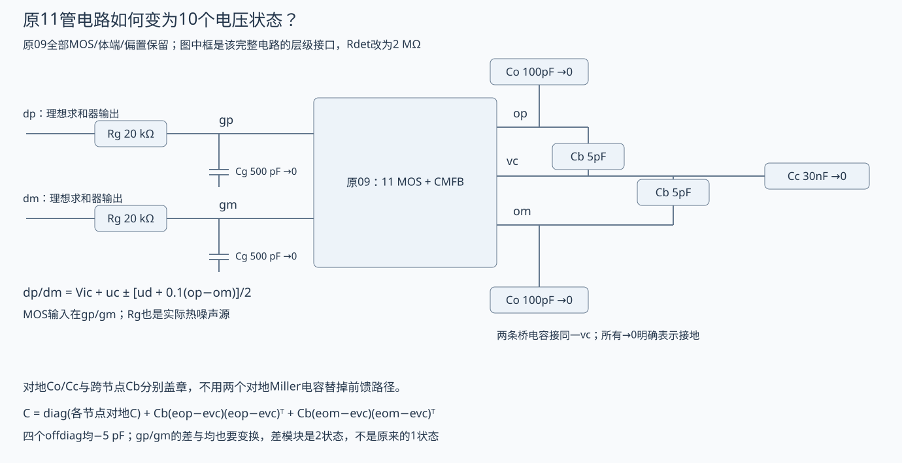
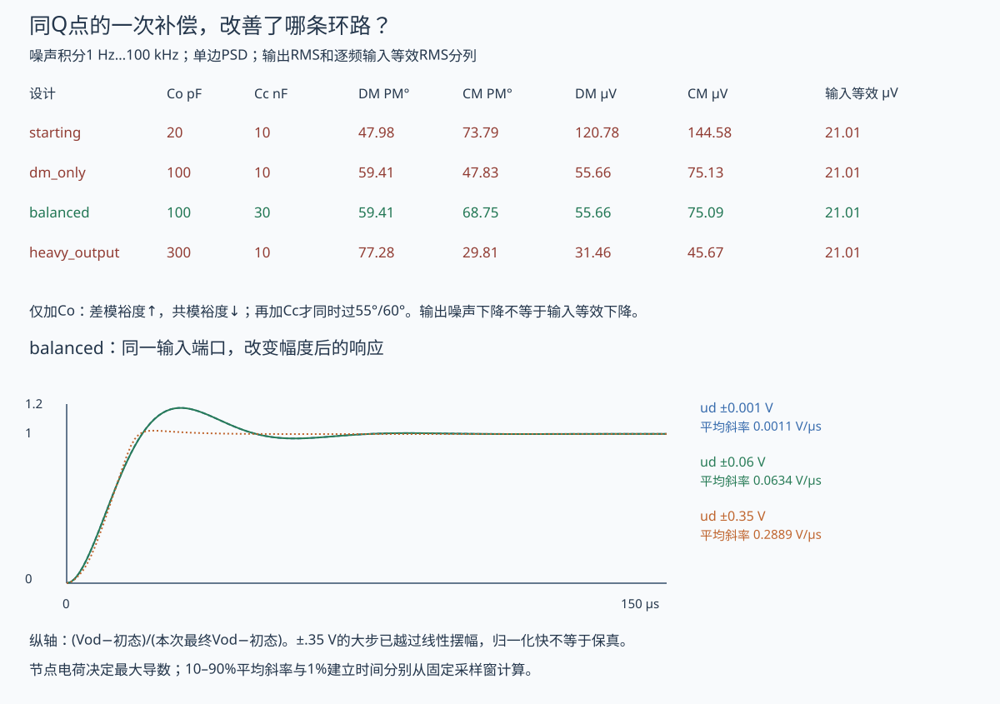
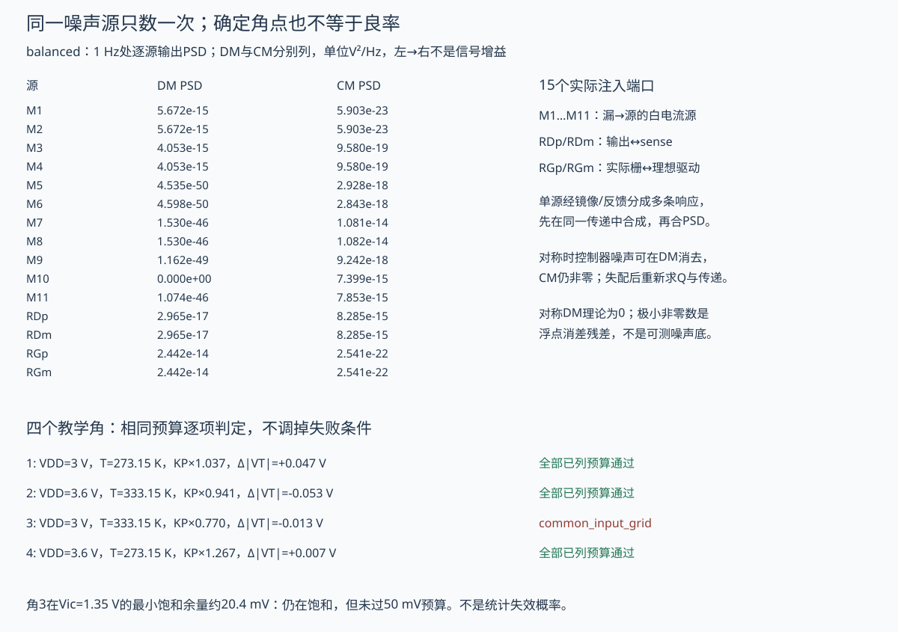

# OTA的噪声、摆幅与双环联合规格

让运放在一个Q点站稳，只是设计的起点。增大电容后，差模相位裕度更好、输出噪声也更低，为什么共模裕度反而不达标，速度还慢了？本课沿用 [[电子电路/26-放大电路/09-完整OTA偏置共模反馈与联合设计|前课11管OTA]]，把新端口、电荷、噪声、摆幅和温度参数放进同一个模型，交出一组符合已列规格和几组违反规格的设计。

先看同Q点的单条件改动，再跟踪15个噪声源。读者最后应能从规格退回节点、电流和偏置，判断失败需要改哪一个器件或连接。所有数值是明确的长沟道教学模型；本机实际运行ngspice47，既没有把Python矩阵冒称SPICE，也没有把LEVEL1冒称工艺PDK。[[电子电路/80-实践/53-OTA联合规格/README|实践53]]保留固定输入、原始网表/输出和不同路线核查；可先独立答 [[电子电路/80-实践/53-OTA联合规格/QUESTIONS|六题题纸]]。

## 从用途指定规格，再承认用途的代价

对象是一只3.3 V全差分低频闭环放大器：输出目标均值1.65 V，主输入共模名义1.5 V，差模负反馈系数.1。不是以增益10为精密目标：有限开环增益导致实际约−8.58 V/V，若应用要求精确10，当前拓扑参数还不合格。这里把它声明为允许有限增益误差的教学规格，避免把一个碰巧得到的数悄悄当目标。

开发预跑用来选择一组能揭露取舍的预算，**不是盲调或全局最优设计**。随后固定输入卡与以下判据，正式组不再按结果放宽：

| 同一设计的要求 | 本课定义/限额 |
| --- | --- |
| 工作区/共模目标 | 名义11管全饱和，最小余量≥50 mV；输出均值距1.65 V≤10 mV |
| DC信号增益 | 声明差模端口的幅值≥8 V/V |
| 输入共模 | 声明候选区间1.35…2.05 V；实际核1.35/1.5/1.7/1.9/2.05 V五点，全管饱和且余量≥50 mV；不将五点冒充连续区间认证 |
| 输出线性摆幅 | ud在−.15/−.1/−.05/0/.05/.1/.15 V七点，全管饱和、相对本Q切线增益误差≤1%，两端差模输出峰值≥1.25 V；不是任意波形保证 |
| 两条声明的返回比 | DM裕度≥55°、CM执行切口裕度≥60°；完整10根另须实部负 |
| 噪声 | 1 Hz…100 kHz，所列15个独立白源；差模输出RMS≤60 µV、共模输出RMS≤80 µV；不是包括未标定闪烁/基准噪声的芯片总噪声 |
| 功耗 | 本模型VDD支路的静态功耗≤.4 mW；不包含理想基准实现或外部求和器的实际功耗 |
| 给定步进 | ud从−.06跳到+.06 V，0…2 ms窗、1 µs输出网格；1%差模建立≤100 µs、10–90%平均斜率≥.05 V/µs，输出均值距目标≤10 mV |

所有角点也按同一预算逐项检查，不删除失败角点。下面的名义设计合格，并不承诺这组参数满足整个PVT连续区域、统计良率或真实器件的所有规格。

## 在原电路增加哪些真实状态

11只MOS、体端、理想50 µA参考与器件尺寸沿前课；检测电阻从各200 kΩ改为各2 MΩ。两路理想求和器的输出现在命名dp/dm，经实际20 kΩ分别接主输入栅gp/gm；两栅各500 pF对地。因此500 pF是显式输入负载，不冒称LEVEL1已提取的本征栅电容。

两个输出各有对地 $C_o$，另各有 $C_b=5$ pF跨到原CM控制节点vc；vc另有对地 $C_c$。其余s/vb/sense/sc/vm各5 pF。原器件内置寄生仍按前课压低，新增电容全画出；30 nF的控制电容是外部教学元件，并非偷偷塞进芯片面积。完整对象由前课器件连接加本图的新增网络共同给定，实际deck列出了全部端口，不是一个无偏置宏模型。

理想驱动仍是

$$v_{dp}=V_{ic}+u_c+\tfrac12[u_d+\beta_f(v_{op}-v_{om})],\quad
v_{dm}=V_{ic}+u_c-\tfrac12[u_d+\beta_f(v_{op}-v_{om})],\quad\beta_f=.1.$$

主MOS真正看到的是gp/gm，不再直接看到dp/dm。固定节点列向量

$$x=(op,om,s,vb,sense,sc,vm,vc,gp,gm)^T\quad[\mathrm V].$$

原八条流出KCL保留，但M1/M2的栅电压改为状态gp/gm；另加

$$F_{gp}=\frac{v_{gp}-v_{dp}}{R_g},\qquad F_{gm}=\frac{v_{gm}-v_{dm}}{R_g}.$$

每条跨节点电容以端口关联向量 $b=e_i-e_j$ 盖章 $C_bbb^T$，故

$$C=C_{\rm ground}+C_b(e_{op}-e_{vc})(e_{op}-e_{vc})^T+C_b(e_{om}-e_{vc})(e_{om}-e_{vc})^T.$$

$C_{op,vc}=C_{vc,op}=C_{om,vc}=C_{vc,om}=-5$ pF；相应对角增加。所有节点还有正对地电容，所以C对称正定。八条旧KCL与两条新KCL共同给 $C\dot x=-F(x,u)$，单位是F×V/s=A。**有非对角C后，不能再逐行除一个电容。**在Q处

$$J=\partial_xF\ [\mathrm S],\quad F_u=\partial_{(u_d,u_c)}F\ [\mathrm S],\quad
A=-C^{-1}J,\quad B=-C^{-1}F_u\ [\mathrm{s^{-1}}].$$

DC时电容开路、MOS栅不吸DC电流，所以gp=gm=1.5 V，左右相等时两个检测R也无DC压降；所有仅改电容的设计共享原Q。op=om=sense≈1.653738 V、s≈.556334 V、vb≈.910621 V、sc≈.568961 V、vm≈1.914930 V、vc≈2.119014 V。输入管各24.658164 µA、gm≈143.500698 µS；最小饱和余量约.245713 V。原49的完整偏置推导直接复用，新组也实际用独立网表核这10个节点。

## gm/ID把偏置、噪声和余量连起来

同一饱和平方律 $I_D=\beta V_{OV}^2(1+\lambda V_{DS})/2$，固定VDS求偏导得

$$\frac{g_m}{|I_D|}=\frac2{V_{OV}}\quad[\mathrm{V^{-1}}].$$

名义输入管约5.81960 V⁻¹。保持几何，把Iref从50降为25 µA，须重求Q；输入管变约12.420407 µA、gm≈101.647949 µS、gm/ID≈8.18395 V⁻¹。静态VDD功耗从.329372降至.165296 mW，但固定频带的输入等效噪声从21.0092升至24.4320 µV，共模输出噪声从75.0904升至89.3458 µV，已越80 µV预算。低偏置不自动等于低输入噪声。

原因可先在局部判断：固定几何时降低电流使Vov和gm下降；漏源白噪声PSD正比gm会下降，而简化输入等效PSD约正比 $1/g_m$ 会升高。充放电可用电流也减小。较小Vov可能改善某些余量，但尾管和控制器都随偏置改变，最终要重算全部11管与两环；不能只用一只输入管的gm/ID当完整设计证书。扩大W也可能提高gm/ID，却会增加实际寄生/输入负载，本教学固定显式C模型没有替真实大W隐藏这项代价。

镜像不是理想“精确乘号”：名义尾管仍约49.316328 µA而非50 µA，VDS差与有限λ一起进入Q。单把M3宽度乘1.02，重求Q后DC端口矩阵（行输出差/均，列输入差/均）约为

$$H(0)=\begin{pmatrix}-8.582444&.000929204\\.00000700469&-.000170053\end{pmatrix}\quad[\mathrm{V/V}].$$

交叉响应和控制噪声泄漏都由同一不对称连接产生；它不是随机Monte Carlo分布，也不能由CMRR高就声称输出共模稳定。

## 多极点补偿必须同时看两种模式

输出仍用差与均 $v_{od}=op-om$、$v_{oc}=(op+om)/2$，**两栅也**用 $v_{gd}=gp-gm$、$v_{gc}=(gp+gm)/2$。新坐标由T乘节点列向量得到；T在0/1和8/9两对位置各用 $\begin{bmatrix}1&-1\\1/2&1/2\end{bmatrix}$。因此 $A_z=TAT^{-1}$，DM为索引(0,8)的二维块，CM含其余八个状态。只转换输出、保留两个物理栅时，第一行与gp/gm的耦合不能误叫“共模泄漏”。

左右完全对称时，记 $G_o=g_{ds,n}+g_{ds,p}+1/R_{det}$、$C_e=C_o+C_b$、$\tau_g=R_gC_g$，可从两个KCL之差直接得到

$$\begin{aligned}
C_e\dot v_{od}&=-G_ov_{od}-g_mv_{gd},\\
\tau_g\dot v_{gd}&=u_d+\beta_fv_{od}-v_{gd}.
\end{aligned}$$

于是差模返回比与闭环分母分别为

$$L_d(s)=\frac{\beta_fg_m}{(G_o+sC_e)(1+s\tau_g)},\qquad
D_d(s)=(G_o+sC_e)(1+s\tau_g)+\beta_fg_m.$$

本Q $G_o≈2.370242$ µS、$\tau_g=10$ µs。$C_o=20$ pF时输出极点约94.8 krad/s，与100 krad/s栅极点挤在一起；增至100 pF时前者降到约22.6 krad/s，形成主极点，DM裕度提高。这里没有把原09单极点输出曲线硬改名多极点设计。

共同运动却使两桥电容都向vc收支电荷：输出两条KCL相加的电容项为 $2(C_o+C_b)\dot v_{oc}-2C_b\dot v_c$，vc行有 $(C_c+2C_b)\dot v_c-2C_b\dot v_{oc}$。加Co也降低共模输出速度，可能让它更接近检测、误差级与控制极点；改善DM不等于改善CM。

实际切口沿前课rank-one定义：DM只去理想求和器中βf的增量动作，其他连接闭合；CM只去vc→M3/M4的gm增量动作，保持同Q及桥电容连接。**后者不是把整根物理控制线及电容一起拔掉。**记 $A=A_{-i}+\Delta_i$、$\operatorname{rank}\Delta_i=1$，用 $L_i(s)=-\operatorname{tr}[(sI-A_{-i})^{-1}\Delta_i]$；行列式恒等式给 $\det(sI-A)=\det(sI-A_{-i})(1+L_i)$。全部10个内部根另直接核对，不以两个PM数字替任意多环系统的内部稳定证书。

| 设计 | Co / Cc | DM PM | CM PM | 最慢根实部 s⁻¹ | 联合失败 |
| --- | --- | ---: | ---: | ---: | --- |
| starting | 20 pF / 10 nF | 47.98° | 73.79° | −16613.8 | DM裕度、两种输出噪声 |
| dm_only | 100 pF / 10 nF | 59.41° | 47.83° | −4383.24 | CM裕度 |
| balanced | 100 pF / 30 nF | 59.41° | 68.75° | −4346.15 | 名义已列预算全过 |
| heavy_output | 300 pF / 10 nF | 77.28° | 29.81° | −1538.56 | CM裕度、给定步进平均斜率 |

第三行比第二行改变Cc，差模保持不变，CM变慢并恢复裕度；这不是免费的面积/速度改善。名义balanced的DM两根约 $-61286.9\pm j110308.8$ s⁻¹，最慢CM两根约 $-4346.15\pm j3598.09$ s⁻¹；全部10根实部负。前两行也稳定，但未满足所要求的裕度/噪声；“稳定”与“满足规格”不能合并成一个布尔词。两条局部返回比、隐藏状态与控制一般边界回 [[电子电路/36-反馈稳定与振荡/06-多环路延迟与鲁棒性#两个局部稳定环节可以联合不稳定|多环互连]] 和 [[信号与系统/40-状态控制与辨识/02-内部稳定与输入输出稳定#三个同G盒子：端口看不到的状态不同|内部稳定主解释]]。

## 每个噪声源只能从自己的端口走到输出

单边频率 $f\ge0$，KCL记每个电流噪声从d流向s为正，其节点关联向量 $b=e_d-e_s$。给定15个彼此独立、零互谱白源：11只MOS沟道源 $S_i=4k_BT(2/3)|g_m|$ A²/Hz，两个检测R与两个栅R各 $4k_BT/R$ A²/Hz。理想VDD、Vref、Iref和求和器自身声明无噪声；不是说实际基准无噪声。没有将同一电阻的串联/并联等效源再各加一遍。

UDel [ECE614 Lecture10 PDF第3–4页](https://www.eecis.udel.edu/~vsaxena/courses/ece614/f12/Lecture%20Notes/lec10_ece614.pdf)给电阻等效及长沟道饱和沟道γ=2/3，并提醒短沟道系数会改变。此处是该明确白噪声近似；KF=0，没有标定1/f、诱导栅噪声或相关通道。实际ngspice47固定NLEV=2，无源漏串联电阻；官方源码 `mos1noi.c` 的NLEV<3支路取(2/3)|gm|，再由热噪声例程乘4kT，支持本例逐源对照。计算取该版本常数 $k_B=1.38064852\times10^{-23}$ J/K；现代SI精确值1.380649×10⁻²³相差约3.48×10⁻⁷相对量，不把这点常数差误诊为端口错误。

令 $Y=J+j2\pi fC$，输出观察行 $q_d^T=(1,-1,0,\ldots)$、$q_c^T=(1/2,1/2,0,\ldots)$。流出噪声写 $Y\delta x=-b_i n_i$，因此

$$H_{d,i}=-q_d^TY^{-1}b_i\ [\Omega],\quad
S_{od}=\sum_i|H_{d,i}|^2S_i\ [\mathrm{V^2/Hz}],\qquad
S_{oc}=\sum_i|H_{c,i}|^2S_i.$$

单个M6或M7噪声在镜像/反馈中分成多条响应，须在 $Y^{-1}b_i$ 内保持同一源的相位关系；不能再加一个“镜像传播相关噪声”当新独立源。若实际源有关联，先给互谱矩阵再用HSHᴴ，不能继续用独立求和。对称时M5…M11的共同扰动在差分输出理论消去，但共模谱仍非零；表中的约10⁻⁴⁶…10⁻⁵⁰是浮点消差残差，不是可物理测量的噪声底。M3失配后重求Q与全部传递，不能借原来消去的零作预算。

指定信号为ud，经真实栅RC进入，$H_{sig}=-q_d^TY^{-1}F_{u_d}$。输入等效是 $S_{eq}(f)=S_{od}(f)/|H_{sig}(f)|^2$，在1 Hz…100 kHz**逐频折回后积分**；不拿输出RMS除一个DC增益冒充它。旧反相例 [[电子电路/38-随机噪声与测量/03-噪声端口传递与输入等效#从原KCL得到七条传递|信号−9/D、电压噪声10/D]]继续保留，不能移植成这15个源的统一增益。

两个栅R的等效电压噪声为 $e_{gp}-e_{gm}$，各单边PSD为4kTR，独立相加给 $S_{eq,Rg}=8k_BTR_g$。它们和ud经过同一差模入口。因此改变输出Co只过滤了共同的输出路径，这部分输入等效不会凭空下降。本例全源逐频积分的输入等效RMS在四个对称电容设计中均为21.0092 µV；输出噪声却从120.781降至55.6622、再到31.4637 µV。这样的“降噪”同时减少信号带宽，不是免费提高输入灵敏度。

积分采用401个对数分布频率点上的 $\int S(f)df$ 梯形近似，频率为Hz，所以没有额外2π；不把单边谱再乘2。SPICE设置 `sqrnoise`，保存总谱、逐MOS与逐R谱以及输入等效，全部为PSD而非ASD；其自身噪声积分另有插值算法，不与本课梯形离散积分逐bit混同。逐点谱和逐源贡献才是独立对照的承重层。

## 摆幅、压摆和建立是三个检查

在名义Q冻结源/栅时，M1饱和要求 $v_{op}\ge v_{gp}-V_{Tn}$，PMOS要求 $v_{op}\le VDD-V_{OV,p}$，尾管也需 $v_s\ge V_{OV,5}$。对称时给输入共模的近似边界：

$$V_{ic,min}\approx V_{Tn}+V_{OV,input}+V_{OV,tail}\approx1.2543\ \mathrm V,
\quad V_{ic,max}\approx v_o+V_{Tn}\approx2.2537\ \mathrm V.$$

这些来自当下Q的饱和不等式；改变Vic会因λ而改变电流、Vov及控制器，所以还要检查其余所有管，不能拿两个近似端点作完整连续区间保证。正式组在声明区间的五点检查全部11管，名义最小余量约97.68 mV；另取Vic=1.2 V时M5进三极，2.3 V时主输入管进三极，构成真实工作区反例。五点与失败点是有限采样核，不是证明区间中没有更坏点。

同理，固定Q的输出上下界不是完整摆幅。本组在ud七个点重解全部Q，±.15 V时 $v_{od}\approx\mp1.287304$ V，仍全饱和，最小余量约99.45 mV；±.2 V时输入管已进三极。摆幅是这组DC网格与1%切线增益误差合同，尚不涵盖任意共模/频率/负载组合。

动态则要写电荷。对称显式C下，两输出KCL之差精确为

$$ (C_o+C_b)\dot v_{od}=-\left[(I_1-I_2)-(P_3-P_4)+\frac{v_{od}}{R_{det}}\right].$$

如果源点近静止且差分对已把尾流转向一侧，$I_{tail}/(C_o+C_b)$给充电速度的量级；源节点本身有电容、负载差流和电阻仍在，不能把它当所有瞬态的严格上界。完整导数由 $-C^{-1}F$ 求，栅RC也可能先限制速度。大信号离开Q后更不能只用Q的gm预测整段。

balanced从ud=−.06跳到+.06 V：差模输出从约+.51494到−.51494 V，10–90%平均斜率约.06338 V/µs，最大采样状态导数约.07174 V/µs，1%建立70 µs。三项不同：平均斜率是80%幅度除两次首次越阈间隔；最大导数是本次轨迹所采状态的最大局部速度；建立时间是本2 ms窗口中最后离开±1%误差带后的首个网格点，不是未来所有时刻的证明。

将输入扩大为±.35 V，输出最终差模峰值仅约1.9865 V，而按DC切线期待约3.0038 V，已明显压缩并进入非饱和。此时平均斜率约.28895 V/µs、归一化建立30 µs，**不能**据更短时间宣布线性放大更快：终点本身已经夹窄。把输入变为±.001 V，平均斜率约.001056 V/µs；它随小信号幅度近似缩放，不是器件固有SR突然变差。实用规格必须同时给激励、摆幅、观察端口、阈值与时间窗。

## 温度、材料近似和失配进入哪里

为实际改变模型而非只写“PVT另验”，固定四组 $(VDD,T,p,\Delta V_T)$ 教学参数：

$$K_P(T)=K_{P0}\,p\left(\frac{T}{300.15\,\mathrm K}\right)^{-3/2},\qquad
|V_T|(T)=|V_{T0}|+\Delta V_T-(.001\ \mathrm{V/K})(T-300.15\,\mathrm K).$$

λ=.04 V⁻¹、GAMMA=0与显式电容维持固定。KP的量纲仍A/V²，p无量纲；上式阈值斜率是教学选择，不是测得的MOS温漂。每角重求Q/gm/gds/所有根、噪声、DC网格和给定步进；热噪声中的T也用该角绝对温度。SPICE卡给已映射的KP/VTO，**同时令TEMP=TNOM为该T**，避免模拟器又从27°C对同一参数变换一次。

有限角1/2/4通过已列预算。角3为VDD=3.0 V、T=333.15 K、p=.9、ΔVT=+.02 V，映射后KP约×.769645、阈值幅值改−.013 V；名义Vic=1.5 V仍正常，但Vic=1.35 V时最小饱和余量只有20.39 mV，没过50 mV预算。它仍在饱和，不能写成已经三极或统计失效概率。四点也不能证明整个PVT域或良率；若用途要求全域，需要重新选偏置/输入范围/器件尺寸，再按同一合同复验，不把失败删掉或事后把范围挪高。

材料和输运不是只改一个库名字。回 [[电子电路/24-MOS与BJT/06-寄生短沟道与紧凑模型层级#短沟道为什么不能靠一个λ修好|器件模型层级]]，本例平方律要求强反型长沟道、恒迁移率近似；速度饱和、体效应、电荷分配与非平衡噪声会改变Q/导数/电荷矩阵和PSD。再去 [[物理/50-半导体物理/10-声子微观散射Boltzmann与Hall因子#从能量依赖寿命推迁移率与 Hall 因子|散射到迁移率]]：该处在等分配、准弹性、非简并单带卡推得T⁻³ᐟ²，带回条件，不能把此指数无条件用于界面反型层。本课只是明确采用该幂律作敏感性族，不从一张能带图认证实际工艺。

控制课程反过来要求保留全部状态：本电路有10个可存电荷的节点，差分观察只看其中一个线性组合。一般稳定证书必须使用正确Q处的完整实现；改变负载/补偿或破坏对称后，不能沿用原来的1+7块、旧根或噪声零点。这样材料近似进入器件参数，器件Q进入状态与噪声，两门课程都返回同一实际模型。

## 先预测，变条件，再核答案

1. 只把Co从20改100 pF，Cc仍10 nF。Q变吗？C的哪些非对角元不为0？为什么不能从DM裕度推CM？
2. 15源都乘信号增益可行吗？M6同源传播经过镜像后，应否额外添加“镜像相关噪声”？
3. 对称时M7能有单端/共模噪声却不产生差模噪声吗？只把M3的W乘1.02后怎样做预算？
4. 从Q推gm/ID。保持几何降Iref，哪几项改善、哪几项可能更坏？
5. 最大导数、10–90%平均斜率、1%建立是否等价？Co增加能否同时认证低噪声与高速度？
6. 已按上式改KP/VTO，却仍把SPICE TNOM固定27°C，有什么风险？4个确定角通过能否推良率？

### 可复算答案

1. 理想电容在DC开路，栅DC不吸流，左右检测压降为0，所以同Q。四个桥C非对角为−5 pF，相关对角增加。差模式看Ce与栅RC，共模式另包含检测/控制八状态，Co使其极点也移动；实际DM47.98→59.41°而CM73.79→47.83°。不能沿用单极点口号。
2. 每源先用 $-q^TY^{-1}b_i$，再按PSD/互谱合成；源端口不同，传递也不同。M6经过两镜影响多个节点，已经在同一个响应里含相关传播，另加一次会重复计数。真实额外相关机制须给新的源/互谱定义，不能用名字补预算。
3. 可以。左右交换对称使M7驱动共同子空间，单端与平均可见，差分相消；不是管子没有噪声。M3变宽后先重求Q/gm/全部J与C、源PSD和传递，再算交叉项及两环。一个不对称例通过不代表统计良率。
4. 对饱和式求偏导后取比，λ因子消去，得2/Vov；不是用线性区或弱反型也套此式。半偏置功耗约减半、输入gm减小，输入等效积分噪声增至24.432 µV，共模输出噪声89.346 µV超预算；较小Vov的余量收益需逐管核，速度/两环不能从单管结论继承。
5. 三者分属轨迹局部速度、特定幅度区间的平均速度和最后误差带进入。重Co使输出噪声减少，却保持输入等效21.009 µV，同时平均斜率降至约.02746 V/µs且CM裕度29.81°。大信号夹窄终点可让归一化建立看似更快；必须同时检查摆幅和非线性。
6. 可能把预先映射参数当27°C名义卡再变一次，得到另一套器件。当前deck令TEMP=TNOM=T以落实一次映射；不是声称模拟器的全部真实温度效应已被这两式覆盖。四个确定参数点没有概率/相关模型，更无器件统计分布，不能给良率；本例角3实际已保留余量失败。

## 从规格返回现实接口

本组独立SPICE9个Q点、4组AC与逐15源谱、完整10节点注流Y、两种幅度瞬态均已实际跑；不同节点/偏导/状态与BDF路线另核，原始入口在实践README。新增一次40 kΩ栅R的非作者ngspice变式还验证输入等效栅R谱翻倍，不能把只查固定数值等同一般证明。旧09偏置/隐藏CM失稳例及原−9/D、10/D噪声主解释继续保留。

本课与前课共同给一条完整有限OTA设计路线：拓扑/偏置→Q→两种模态和多极点→噪声/摆幅/给定压摆及建立→失配/有限参数角→重设计与失败。PDK/版图提取、实际基准启动、电荷非线性、闪烁/相关噪声及硅校准均有具体输入和观察责任，见实践页；它们不被本机LEVEL1代签，也不被泛称“所有硬件未验”来掩盖已可执行而没做的课程计算。回 [[电子电路/26-放大电路/09-完整OTA偏置共模反馈与联合设计|偏置与CMFB起点]]核原11管；进入 [[电子电路/42-转换器与采样时钟/08-开关电容电荷时序与离散传函|开关电容接口]] 时再携带明确端口、带宽和大信号条件，不能把本课的一个带宽或RMS替换另一模型的全部OTA参数。
