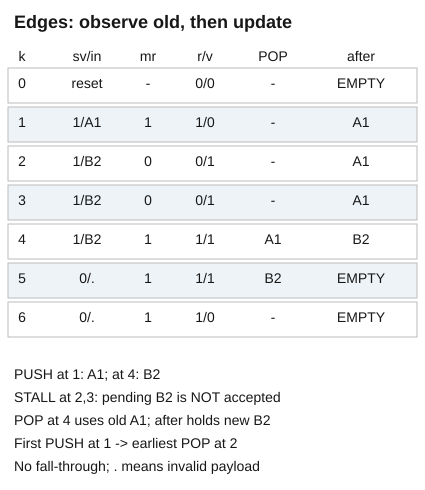
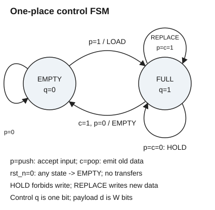

# 一格缓冲怎样从状态图变成按拍交付的电路

读者问题是：下游暂时接不动时，电路怎样保住这一项，同时在下游恢复的那一拍接入下一项？本课固定单时钟、一项、无穿透 ready/valid 缓冲，8 位数据只是实例，位宽 W 为正整数。数据是位向量而非带物理单位的电压；所有控制位在有效采样沿前满足该时钟域的稳定要求。

基础入口先读下面六拍表，在纸上只画一个格子：接收就把字写进去，输出就擦掉，阻塞就别动。停点是能够解释第 4 沿为什么先交 A1 后留下 B2。本科入口直接把占用位 q、数据寄存器 d 与两个握手事件代入转移方程，再证明队列不变量。两条入口汇入同一实现；不另设简化时序。

## 先固定沿前与沿后

`s_valid` 表示上游提供可接收数据，`s_ready` 表示本模块能接收；`m_valid` 表示本模块提供有效数据，`m_ready` 表示下游能接收。只有采样沿的 `valid && ready` 是 transfer。上游一旦提供有效数据且尚未接受，必须保持 valid 和 data 到接受沿；下游可以任意停顿。复位是共同取消本复位区间未交付事务的事件，不是一次正常输出。

第 k 沿的 q、d 与表中 m_data 均指沿前值；q⁺、d⁺ 指沿后值。rst_n=1 时：

$$r=\neg q\lor m\_ready,\quad v=q,\quad p=s\_valid\land r,\quad c=q\land m\_ready,$$
$$q^+=p\lor(q\land\neg c),\qquad d^+=\begin{cases}s\_data&p=1\\d&p=0.\end{cases}$$

q、r、v、p、c 为布尔值，式中的加法只能在下文占用计数里用整数意义。m_data=d；v=0 时这个输出数据不代表事务。RTL 在 rst_n=0 时令 r=v=0，异步清空 q 与 d；因此复位期不会握手。初次上电尚未发生有效复位时不承诺寄存器已知。

| 沿 | 沿前 q | s_valid / s_data | m_ready | r / v | 接入 / 交出 | 沿后内容 |
| --- | --- | --- | --- | --- | --- | --- |
| 0 | 任意 | 任意 | 任意 | 0 / 0（复位） | 无 / 无 | EMPTY，d=0 |
| 1 | 0 | 1 / A1 | 1 | 1 / 0 | A1 / 无 | FULL，A1 |
| 2 | 1 | 1 / B2 | 0 | 0 / 1 | 无 / 无 | FULL，A1 |
| 3 | 1 | 1 / B2 | 0 | 0 / 1 | 无 / 无 | FULL，A1 |
| 4 | 1 | 1 / B2 | 1 | 1 / 1 | B2 / A1 | FULL，B2 |
| 5 | 1 | 0 / 无效 | 1 | 1 / 1 | 无 / B2 | EMPTY，d 仍为 B2 |
| 6 | 0 | 0 / 无效 | 1 | 1 / 0 | 无 / 无 | EMPTY |

[425px 备用图](../80-实践/03-FSM到RTL/assets/cycles-425.png)。图内各列是同一沿的沿前观察与沿后寄存器，实心 PUSH/POP 标签标出事件；无效数据用点号，不能把沿后 A1 当成第 1 沿已输出。首次接入第 k 沿，最早交出第 k+1 沿，延迟至少一个周期；阻塞会延长延迟，饱和连续交旧接新时吞吐是一项/周期。

## 状态表只决定控制，还要保留数据状态

EMPTY 对应 q=0，FULL 对应 q=1。完整状态是 (q,d)，控制 FSM 只有两个状态不代表数据的 2^W 个取值可以删去。rst_n=1 下的互斥、完备转移如下，x 表示不影响该行的输入。

| q | s_valid | m_ready | p | c | q⁺ | d⁺ |
| --- | --- | --- | --- | --- | --- | --- |
| EMPTY | 0 | x | 0 | 0 | EMPTY | 保持 |
| EMPTY | 1 | x | 1 | 0 | FULL | s_data |
| FULL | x | 0 | 0 | 0 | FULL | 保持 |
| FULL | 0 | 1 | 0 | 1 | EMPTY | 保持 |
| FULL | 1 | 1 | 1 | 1 | FULL | s_data |

[425px 备用图](../80-实践/03-FSM到RTL/assets/fsm-425.png)。FULL 的两个自环分别标注 HOLD 与 REPLACE，前者禁止写 d，后者交出的是沿前 d。异步复位从任一状态到 EMPTY，其作用不等待时钟。控制输出 v 只依 q，可看作 Moore 输出；r 依 q 与当前 m_ready，具有 Mealy 组合路径。名称不能替代输出时刻合同。

状态图到寄存器/组合逻辑的映射延续 [[计算机知识/30-计算机系统/10-组成原理系统课程/01-布尔逻辑与时序电路#状态机把历史压缩成有限状态|组成课的状态表步骤]]；带着“哪个量需要记忆、哪条输出对当前输入敏感”去读，再回到 q 与 d 的不同责任。原始依据 [MIT 6.004 FSM 注释课件](https://ocw.mit.edu/courses/6-004-computation-structures-spring-2017/pages/c6/c6s1/) 的 Valid State Diagrams、Truth Table、Now Put It in Hardware 支持互斥完备表与寄存器映射。本缓冲方程、时间表和证明是本课自行定义并推导的设计，不是该课件的实例。

## 为什么“只在ready时更新”恰好成立

若 r=0，必有 q=1 且 m_ready=0，于是 p=c=0，q⁺=q，d⁺=d。若 r=1，分 EMPTY 和 FULL 两种：EMPTY 时没有旧输出，q⁺=s_valid；FULL 时 m_ready=1，旧项已交，q⁺仍等于 s_valid。于是 RTL 可以用 `if (s_ready) full <= s_valid;`。写数据的条件必须是 p，不能仅是 s_valid。

组合连线持续计算 r、v、p；`always_ff` 在上升沿或复位下降沿更新寄存器，非阻塞赋值使右侧按旧状态求值，更新排入仿真的非阻塞赋值区。同沿交旧接新依赖这个旧/新区分。完整真源与逐字镜像见 [[电子电路/80-实践/03-FSM到RTL/04-源码性质与验证#RTL真源镜像|RTL镜像]]，大学的 [UW Lab 5，第5–6页](https://rhlab.ece.uw.edu/wp-content/uploads/sites/26/2022/03/Lab-5_-Sequential-Logic-and-Finite-State-Machines.pdf) 展示状态表、always_comb、always_ff 和非阻塞赋值的教学映射；规范身份见 [IEEE 1800-2023](https://standards.ieee.org/ieee/1800/7743/)。本实现用连续 assign 表达短组合式，功能上不要求出现一个 always_comb 块。非阻塞赋值如何保持旧值依赖，可对照 [MIT 6.205 2026 Sequential Logic 的 `=` vs. `<=` 与 New and Old](https://fpga.mit.edu/6205/F26/assignments/week01/sequential) 中的两个寄存器例子；这是教学映射依据，真正的仿真调度规范由 IEEE 定义。

## 对所有长度的输入序列证明安全

每个无复位区间单独开始计数。令 P 是接入事务的序列，O 是已交出序列，Q 是概念队列；初始 Q=[]，q=0。归纳假设 O 是 P 的前缀，P 去掉 O 后恰为 Q，|Q|=q≤1，且 q=1 时 d=Q[0]。

任一沿先观察旧 Q。若 c=1，则 q=1，输出旧 d=Q[0]，从 Q 移除头部并追加到 O；若 c=0，O 不变。若 p=1，则 r=1，意味着沿前 Q 为空，或此沿已移除唯一头部，因此可以向 Q 追加 s_data 而不超过容量。d 的 p 条件写入保存这个唯一尾部；p=0 时 d 保持，非空队列的头仍匹配。分这四组事件即可关闭归纳：

| p / c | 可达条件 | Q的作用 | q⁺整数式 |
| --- | --- | --- | --- |
| 0 / 0 | 空等待或满阻塞 | 不变 | q |
| 1 / 0 | 只能旧空 | 追加一项 | q+1 |
| 0 / 1 | 只能旧满 | 移除唯一项 | q−1 |
| 1 / 1 | 只能旧满且下游ready | 先移旧、后追加新 | q |

由此 |Q|=P_count−O_count=q 始终为 0 或 1，交出序列是接入序列的前缀，不复制、不重排、已交出的项不丢失，未交出的项准确保存在 Q。复位显式丢弃待交项，不能把跨复位的总计数拿来指控丢失，也不能把复位丢弃隐藏成“永不丢”。安全证明不保证一定交付：若下游永久不 ready，项可以永久停留。加入“每个待交项之后终有采样沿 m_ready=1，期间不复位”的公平性假设才有逐项最终交付；要有延迟上界则还须给有限的最大停顿拍数。

## 反例与迁移

把写使能改成 `if(s_valid) data_q<=s_data`：第 2 沿 r=0，B2 未被接入却覆盖 A1，随后第 4 沿错误交 B2。原合同的两处检查——拒绝写入与输出阻塞保持——都能定位这个错误。

独立迁移题：上游持续送 10、20、30，下游 ready 按 1、0、1、1、1 五拍变化，初态 EMPTY，写出每拍交出的值、剩余队列及上游应保持的数据；再提出一个去掉 `m_ready→s_ready` 组合路径的方案，给出新时间表，比较吞吐与延迟。先自行作答再看下节。

### 迁移答案与合法等价方案

原实现第 1 拍接 10，不交；第 2 拍拒绝 20，保 10；第 3 拍交 10 接 20；第 4 拍交 20 接 30；第 5 拍交 30，空。交出序列 [10,20,30]；第 2 拍上游不能提前改送 30。

保守一格方案令 r=¬q：下游恢复且旧满时只能交旧、不能同沿接新，下一拍再接，饱和吞吐最多每两拍一项，首次最短延迟仍一拍；这是新合同，不能叫本 RTL 的逐拍等价实现。另一方案增加第二个存储槽并重构 ready 注册/容量协议，以面积换组合路径，须重新证明两项队列与冲突处理。穿透方案 EMPTY 时组合输出 s_data，可零拍交付，同样不与这里的时间表逐拍等价。对固定原合同，改变状态编码、用 next-state always_comb 或 mux 表达，只要每拍输出和更新相同，都可成为合法等价解；不能因为文本没照抄而扣分。

下一步去 [[电子电路/30-数字电路与实现/02-RTL性质复位与跨时钟边界|复位、性质与物理边界]]，带着“这个归纳在哪个前提失效”检查未知态、异步释放和 CDC；然后用 [[电子电路/80-实践/03-FSM到RTL/README|U5实验]] 对比独立队列与逐拍实现。
