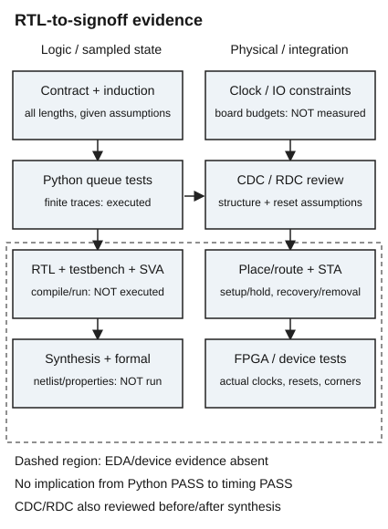

# 状态表正确以后，哪些性质还需要分别验证

本课接续 [[电子电路/30-数字电路与实现/01-状态机寄存器与时序合同|一格缓冲的时序合同]]。基础入口只改坏一次：满格 A1、下游不 ready、上游提出 B2，预测输出数据是否变化；本科入口从队列不变量写出性质、环境假设与复位例外。两条入口都要回答同一问题：哪个证据能证明哪个承诺？

## 性质是可以被反例推翻的句子

缓冲自身要保证：满且阻塞时下一拍仍 valid 且 data 相同；空时沿前不 valid；接受数据只在 p=1；队列容量不超过一项；交出旧头再接新尾。外部要保证：输入控制与数据已属于本时钟域；上游有效但未握手时保持有效与数据；复位期间共同取消事务；释放经过目标域的工程处理。

不要把环境保证写成 DUT 的断言然后误称证明了环境。形式模型中可以 `assume` 上游保持协议，但必须在接口集成中验证这个假设真的成立；无限序列的活性还需要下游最终接收的公平性。随机 5000 拍或 20000 拍仅是有限轨迹抽查，无法替代 [[电子电路/30-数字电路与实现/01-状态机寄存器与时序合同#对所有长度的输入序列证明安全|前课的归纳证明]]，也不能替代对实际 HDL 的形式验证。

本 RTL 的可选 SystemVerilog 断言（仅定义 U5_SVA 时编译）为：

```systemverilog
assert property (@(posedge clk) disable iff (!rst_n)
    (m_valid && !m_ready) |=> (m_valid && $stable(m_data)));
```

它在各上升沿采样，非重叠蕴含 `|=>` 把后件放在下一采样沿；`$stable` 比较采样值，复位取消该待检查实例。`disable iff` 条件按当前仿真值而非沿上采样值计算，因此允许沿间复位抢占；被禁用的评估既非通过也非失败（IEEE 1800-2017 §16.12）。因为输出以旧状态采样，阻塞沿之后不得偷换数据。把 `|=>` 改成 `|->` 就只检查当前采样，不能表达这个下一拍承诺。断言通过还可能是前件从未出现，须增加满阻塞、同沿出入、EMPTY 首次接入与复位清空的 cover/测试激励。源码目前只有阻塞保持与无穿透两条 SVA，容量/顺序用独立队列测试台核对；不宣称完整形式签核。语言性质参考 [IEEE 1800-2017（MIT课程托管副本）§16.12、§16.12.7 与 §16.9.3](https://fpga.mit.edu/6205/_static/F25/documentation/1800-2017.pdf)：前者定义非重叠蕴含的下一时钟tick，后者定义采样值变化函数。原候选仅取得公开索引提取；独立审阅随后实际读取 IEEE2017 原PDF的印刷423、425–426及395–397页文本，核对 disable iff、Implication（§16.12.7）与采样函数。这是相关条文读取，不表示完整标准或新版均已核验。[IEEE 1800-2023](https://standards.ieee.org/ieee/1800/7743/) 另提供现行规范身份，不冒充已逐条比对新版。SVA文本仍需要实际支持该语法的仿真/形式工具编译，尚未执行。

普通测试台在下降沿驱动输入，之后检查沿前输出；到上升沿再等 1 ns 检查寄存器非阻塞更新后的结果。这是 10 ns 教学时钟中的采样安排，避免测试台和 DUT 同一 active 区抢先后，不代表器件延迟。该检查用一个独立的一格队列先 remove 再 append，而不复写 DUT 的 full 方程；可定位交新交旧混淆。完整实现见 [[电子电路/80-实践/03-FSM到RTL/04-源码性质与验证#测试台真源镜像|测试台镜像]]。更多初学者从状态表走到测试台的实例见 [UW Lab 5，第5–7页](https://rhlab.ece.uw.edu/wp-content/uploads/sites/26/2022/03/Lab-5_-Sequential-Logic-and-Finite-State-Machines.pdf)。

## 异步assert和同步release是两件事

这里 rst_n 是本模块的**本地低有效复位**，下降可异步清空寄存器；上升必须由集成层在此 clk 域同步释放，并满足目标器件复位脉宽、recovery/removal 与布局要求。本模块没有内建同步器。因此测试台在下降沿释放只提供远离采样沿的功能场景，不等于实现了真实板级复位同步链。

功能合同规定复位期 r=v=0、q=0、d=0，待交项被取消；有效释放后第一个上升沿可接受新项，最早下一沿交出。若下游属于另一个复位域，它可能还记着复位前 valid，系统必须重新协调事务 epoch/取消语义；仅清空本模块不能证明整个系统 exactly-once。

供应商的 [Altera RES-50001](https://resources.altera.com/quartushelp/24.2/da_rules/res_50001.htm) 给出复位释放同步链建议：外部异步复位驱动至少两个同域寄存器的异步复位引脚，链首喂常量，使用链尾输出；链中避免分叉。这个建议是实现责任的入口，不意味着“两级”在任意频率/工艺/可靠性目标下已经足够。集成还须确认同步器识别、布局、扇出、释放与功能寄存器时序，必要时估计 MTBF 并报告 RDC。若时钟停摆，异步 assertion 仍可生效，但同步 release 要等待时钟恢复；不能承诺停钟时立即退出复位。

RTL 的 0/1/X/Z 是离散仿真语义。没有出现 X，只说明给定仿真模型与激励没观察到未知值，不能证明电路没有亚稳态。反过来，X 也不一定是物理亚稳态，可能来自未复位、多个驱动或非法选择。测试台 `===` 防止 X 被普通二值期望吞掉；Python 模型严格仅接受 bool 与合法无符号整数，完全没有模拟 X、delta cycle、模拟电压或亚稳态。

## ready/valid不能跨域直接当通行证

若两端不是同一个时钟域，`valid&&ready` 可能在不同沿被判成不同事件，本课的 p/c 同沿定义失效。反例：两位数据由 01 变 10，逐位双触发器同步可能在目的域观察到 00 或 11，这不是任何一个完整源字。给每位加两级不会恢复总线原子性。

低速数据可用请求/应答握手并在整个传输窗口保持总线，目的域在控制同步及数据稳定后采样；连续流可用经过审查的异步 FIFO，含 Gray 指针同步、满空判定和复位协议。Gray 适用于受约束的邻接状态转换，也不是任意总线的“编码万能药”。[AMD UG903 Asynchronous Clock Domain Crossings](https://docs.amd.com/r/en-US/ug903-vivado-using-constraints/Asynchronous-Clock-Domain-Crossings) 强调异步域无可预测相位，要求 CDC 结构及相应约束；本文 01→10 是教学反例。回到本课前必须先解决接口同域性，不能给路径加 false_path 就宣称协议正确。

## 从RTL到签核需要不同证据



[425px 备用图](../80-实践/03-FSM到RTL/assets/signoff-425.png)。框图的箭头是证据依赖；虚线边界表示本批未执行的 EDA 与器件层，不能用左边模型通过替代右边报告。

综合应确认 q 与 W 位 d 推断为触发器、data 写使能/选择器正确、无锁存器、多驱动或组合环，给定参数合法。综合后的网表/资源报告是实现结构证据，不能独立证明队列顺序；实际 HDL 形式证明还须指定时钟、复位、假设与不变量、检查 vacuity/cover 及参数范围。状态控制只有 1 位不表示整个有限状态空间只有 2 个状态。

STA 要覆盖 `s_data→data_q`、`s_valid→full`、`m_ready→s_ready→上游寄存器` 等实际路径，以及所有寄存器间和 I/O 路径。组合 ready 向上游传播会随着串接加长，模块内部短路径不代表系统可达所需频率。时钟周期、IO 延迟、时钟不确定度和目标角要有板级/器件依据；时序例外须有功能证明。原 [[计算机知识/30-计算机系统/10-组成原理系统课程/01-布尔逻辑与时序电路#建立时间和保持时间约束不同路径|组成课成对 setup/hold 式]] 已固定 skew 符号，去读目的时钟晚到怎样一面放宽 setup、一面收紧 hold；回到这里定位 ready 链的最大/最短路径。降低频率不自动修 hold。

下面只是一组单位 ns 的 SDC 教学输入，假设外部端点使用同一 10 ns 时钟、输入最小/最大到达为 0.5/2.0 ns、外部输出预算最大 2.0 ns 与保持要求 0.5 ns。未取得板级参数，不能直接用于产品：

```tcl
create_clock -name clk -period 10.0 [get_ports clk]
set_clock_uncertainty -setup 0.2 [get_clocks clk]
set_clock_uncertainty -hold 0.1 [get_clocks clk]
set_input_delay -clock clk -max 2.0 [get_ports {s_valid s_data[*] m_ready}]
set_input_delay -clock clk -min 0.5 [get_ports {s_valid s_data[*] m_ready}]
set_output_delay -clock clk -max 2.0 [get_ports {s_ready m_valid m_data[*]}]
set_output_delay -clock clk -min -0.5 [get_ports {s_ready m_valid m_data[*]}]
```

工具命令的 min/max 语义依据 [AMD UG903 输入延迟选项](https://docs.amd.com/r/en-US/ug903-vivado-using-constraints/Min-and-Max-Input-Delay-Command-Options) 与 [输出延迟选项](https://docs.amd.com/r/en-US/ug903-vivado-using-constraints/Min-and-Max-Output-Delay-Command-Options)：min 用于 hold/removal，max 用于 setup/recovery；负 output min 的板级预算含义见 [AMD UG1387 Defining Output Delays](https://docs.amd.com/r/en-US/ug1387-acap-hardware-ip-platform-dev-methodology/Defining-Output-Delays) 的外部延迟公式及 −0.5 ns 示例。此处教学板级假设使 −0.5 ns 对应外部保持要求0.5 ns，不是负物理传播时间。参数是教学假设；复位同步器、引脚、电气标准和异步控制路径不在这个片段中。尤其没有给 rst_n 随手加全局 false_path；必须另外检查同步链与 recovery/removal、pulse width 及工具对复位路径的建模，报告 unconstrained paths。约束解析成功也不证明值正确。

false_path 表示不按普通 setup/hold 分析指定路径，不能修复电路；multicycle 改变允许的采样关系，需要证明接收使能确实隔相应拍且 hold 关系配套。这里满时允许**每拍**出入，不能为了 slack 好看把 data 路径标成两拍。语义入口 [AMD UG903 About Timing Exceptions](https://docs.amd.com/r/en-US/ug903-vivado-using-constraints/About-Timing-Exceptions) 支持例外改变分析关系，并要求用 report_exceptions 检查例外冲突；本课没有执行任何约束，也没有声称获得 slack。

最终 FPGA 层还要目标型号/速度等级、引脚/IO 电平、板级时钟复位、布局后 STA、CDC/RDC、下载记录和受控 backpressure 测量。逻辑分析仪的采样设置及触发条件也是证据条件；看见几次正确 LED 闪烁不证明高速数据顺序。设备/生产层另外需要温压角、复位脉冲/释放压力、板级信号完整性、错误计数与可靠性目标。没有工具/板卡允许记录未知，不替换成虚假通过。

## 独立迁移题与答案责任

某人报告“100000 随机拍无错，所以异步 rst_n 可直接进来；数据八位每位两级同步就跨域成功；ready 拉低三拍，所有数据路径可设 multicycle=4”。逐条指出失效的前提，并给可以接受的修复与验证证据。

答案：第一条混淆离散功能采样与物理释放，须本地同步释放、recovery/removal 与 RDC；第二条缺字原子性，接受有协议的握手保持或经验证异步 FIFO，并检查真实 CDC；第三条忽略 ready 可随时恢复且满时每拍替换，除非新合同和硬件使能证明四拍采样关系，否则保持单拍约束。可接受等价 CDC 方案，但须说明吞吐、容量、同步延迟、复位丢弃和数据稳定窗口。无法确定板级延迟时应说明需哪些测量/器件数据；编造数值不算答案。
