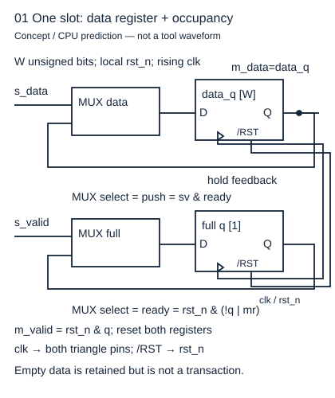
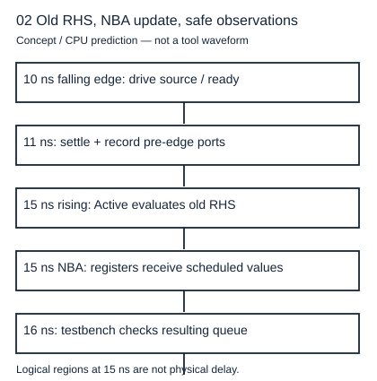

# 两个always为什么不是两段顺序执行的程序

读者问题：把 `q1<=d; q2<=q1;` 写进时钟过程，第二个寄存器会立即收到 d 吗？本章对象是同步数字电路的 RTL 抽象：导线与组合逻辑持续存在，寄存器在规定事件更新。基础入口先画两个格子，同时取走各自沿前看到的纸条，再同时放入新纸条。快入口直接区分求右侧、安排更新、观察更新三个阶段。两条路线在下面的同一数值例汇合，不把仿真中的零时间处理阶段当成真实器件传播时间。

## 模块是同时存在的连线和存储

`module` 的端口定义电路边界，实例之间用信号连接。两个加法器实例同时工作；源文件先后顺序不规定它们的物理先后。连续赋值 `assign y=a&b;` 表示输入改变后由组合关系重新计算 y；它不是 CPU 每循环一次才执行一次的语句。过程内部仍有语句顺序，必须与过程之间的并发分开。

```systemverilog
logic [7:0] q1, q2;
always_ff @(posedge clk) begin
  q1 <= d;
  q2 <= q1;
end
```

在有效上升沿，两个右侧都依据沿前值求出；非阻塞赋值安排左侧稍后更新。本例初态 q1=10、q2=20，d=30，则沿后 q1=30、q2=10。下一个沿若 d=40，则 q1=40、q2=30。第二级确实保存一级旧值，这才是一拍一级的流水线。拆成两个各只写一个寄存器的时钟过程，仍能保持这个依赖；不得再有另一个过程同时写 q1 或 q2。



图中数据 MUX 的反馈输入来自 data_q，选择 push 时才接 s_data；full 有自己的存储。图上 CLK、低有效复位与数据选择责任不同。寄存器本身有建立保持、时钟到 Q 和恢复移除约束；本章 RTL 没有模拟这些模拟量。

## 阻塞和非阻塞怎样改变依赖

阻塞赋值 `=` 在当前过程执行到该句时更新变量，后面的句子看到新值。若改为 `q1=d; q2=q1;`，后一句读到刚更新的 q1，沿后两者都是 30。它描述的依赖已改变。尤其把这两句拆进两个同沿过程后，若用阻塞赋值，一个过程可能先读旧 q1，也可能读新 q1：这是竞争，不能靠本机某次结果定规格。

组合过程通常用阻塞赋值构造中间结果：`t=a+b; y=t^mask;`，y 必须使用同一次计算的 t。时序过程通常用非阻塞赋值提交寄存器新值。这是一条清晰的设计纪律，不能倒推“所有 `=` 都不能综合”或“所有 `<=` 都是触发器”。存储来自事件和保持需求，操作符还决定仿真数据依赖。

[MIT 6.205 Sequential Logic I 的 `= vs. <=`、New and Old](https://fpga.mit.edu/6205/F26/assignments/week01/sequential) 给出教学上的旧值映射。这里将其落实到两个寄存器的有限算例；[IEEE 1800-2017 §4.4、4.6—4.8，印刷60—66页；§10.4.1—2，237—239页](https://fpga.mit.edu/6205/_static/F25/documentation/1800-2017.pdf) 区分当前过程求值与后续NBA提交；具体工具支持仍须实际编译核对，课程中的“同时”不能解释成所有语句右侧都无条件在过程开始时缓存。例如 `tmp=d; q<=tmp;` 的非阻塞右侧是在执行到 q 那句时求值，因此看到刚算出的 tmp。

## 沿前握手和沿后状态不能混用

无直通一格缓冲的输出 valid 来自占用寄存器 q。空格时 d=A1 在输入线上，当前沿只接入 A1；沿前 valid=0，所以该沿没有输出 A1。旧满且下游 ready 时，同沿交出旧 A1 并接入 B2：交出的值来自沿前 data_q，沿后寄存器才是 B2。



图给出一组通用 10 ns 时钟窗口：下降沿驱动，1 ns 后记录沿前端口，上升沿求旧值、提交 NBA，随后 1 ns 观察新状态。图的 NBA 是语言逻辑阶段，并没有花 1 ns；测试平台人为等待 1 ns 是避免在同一调度时隙竞争的观察策略。后面实践的首个事务因初始复位安排落在 25 ns，上述相对关系不变。

## 可综合子集必须给硬件解释

有限位向量、固定范围循环、连续逻辑、明确沿触发的寄存器是本实验采用的子集。参数在 elaboration 时确定尺寸，并非运行时动态改变硬件。仿真的 `$display`、`#5` 时钟源、`$dumpvars`、随机刺激属于测试平台，不能直接要求综合出打印机、文件或任意延时器。`initial` 的可综合支持依 FPGA 工具和资源而变，本实验只把尺寸检查的 initial 当仿真保护；不能将其当通用 ASIC 上电清零保证。

状态未知 X 与高阻 Z 是四值仿真对象。X 可以暴露未复位或多驱动，但普通 0/1 CPU 模型不传播 X，也不评估电气高阻。一次二值测试通过不能消去这些边界。详读 [[电子电路/34-时序状态与协议/03-寄存计数与流水线#两级流水线同时读取旧值|两级旧值例]]，检查“同时取旧状态”如何与吞吐、延迟联系；再去 [[电子电路/35-HDL实现与验证/03-测试平台调度与独立参考#驱动和观察分别占据安全窗口|独立观察窗口]]，落实仿真责任。

## 四题与理由

1. 初态 q1=3、q2=9，输入 d=5，一沿两句 NBA 的结果？答 q1=5、q2=3；第二句读旧 q1。若输入在建立窗口内变化，这个确定答案的物理前提已失效。
2. `tmp=d+1; q<=tmp;` 是否必读旧 tmp？答否；tmp 是本过程立即更新的中间量，q 的右侧执行到该句时求值。不能把 NBA 误说成冻结所有过程内部变量。
3. 空缓冲 s_valid=m_ready=1，输入 7，该沿输出 7 吗？答没有，旧 valid=0，只接入；下一沿才可能输出。增加组合穿透会改变接口合同。
4. 两个过程用 `=` 读写 q，换文件排序后“恢复正常”，算修复吗？答不是。把寄存器更新统一成单写者 NBA 并规定测试观察阶段，才能使旧值依赖稳定；也可重新写明确 next-state 组合计算加单个寄存器过程。
