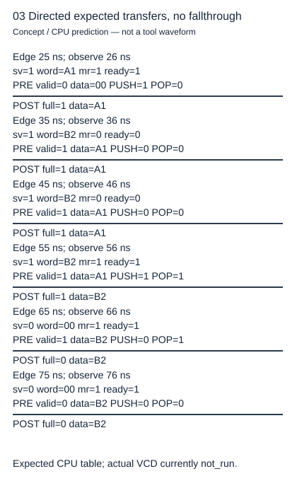
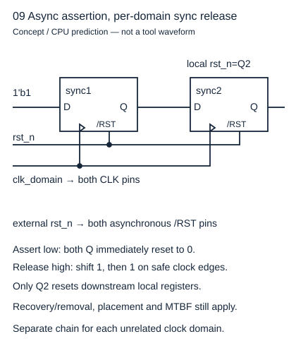

# 改WIDTH前先决定这个字和这一拍是什么意思

读者问题：把 8 位缓冲改成 4 位，除了端口范围还会改变什么？基础入口把 1010 看成四个格子，再分别按无符号与补码解读。快入口先写位向量域、扩展规则、握手时刻、复位取消规则四份合同，再读源码。这里的数据缓冲只搬运无符号位模式，没有加法；算术例用于说明参数化接口为什么不能省略类型。

## 尺寸先于计算

本实验 WIDTH 为 elaboration 参数，范围 1…8。数据属于整数表示的位向量 \(0\le d<2^W\)，硬件端口是 `[WIDTH-1:0]`，W 个 bit。W=0 的负范围不受支持；CPU API 明确拒绝 bool、浮点、复数、字符串和容器，不会先 `int()` 截断。控制输入仅接受整数 0 或 1，非法 X/Z 不在 CPU 域内。该域是教学实验的有界范围，不是 SystemVerilog 对所有可能尺寸的限制。

固定 W=4，7+3 的完整无符号和是 10=01010，低四位 1010=10，进位为 0。若同样的四位结果按补码读，1010=−6，而数学上的 signed 7+3=10 超出 −8…7，signed overflow=1。15+1 的无符号和 10000，低四位 0000、carry=1；signed 操作数却是 −1 与 +1，结果 0，overflow=0。进位与有符号溢出不相等。

为避免上下文尺寸和无尺寸常量引起歧义，先显式扩展再计算：

```systemverilog
logic [3:0] a,b;
logic [4:0] wide;
assign wide = {1'b0,a} + {1'b0,b}; // 明确5位无符号加法
// 补码扩展须复制符号位：{a[3],a}，再明确 signed 类型。
```

[IEEE 1800-2017 §11.6—11.8，282—286页](https://fpga.mit.edu/6205/_static/F25/documentation/1800-2017.pdf) 说明表达式尺寸由操作数及上下文决定、signed转换保留位数。因此不能一律说两个W位数相加只产生W位，也不能一律说自动产生W+1位；先显式扩展能使这个例子的意图可检查。

signed 不是某个 bit 的电气属性；它影响表达式的扩展、比较和右移等语义。`$signed(a)` 改解释不增加尺寸，不能修复已经丢掉的高位。带符号算术移位需要左操作数有符号；单纯把 `>>` 改成 `>>>` 仍不够。先到 [[电子电路/32-组合逻辑/04-选择编码译码与有限位宽算术#同一串 bit 的补码解释改变错误标志|补码与错误标志]] 核对这两组有限例，再把数域写入自己的端口规格。

## 一格接口怎样允许同沿替换

局部 rst_n=1、沿前占用 q 下，定义 ready=¬q∨m_ready、valid=q。push=s_valid∧ready，pop=valid∧m_ready。ready 对下游有组合路径；valid 只依寄存器。旧空时 ready=1、valid=0；旧满且阻塞时 ready=0、valid=1；旧满且下游 ready 时，两者都为1，允许交旧接新。

| 旧格 | sv / mr | push / pop | 沿后格 |
| --- | --- | --- | --- |
| 空 | 1 / 1 | 1 / 0 | 新输入 |
| 满 A1 | 1 / 0 | 0 / 0 | A1保持 |
| 满 A1 | 1 / 1 | 1 / 1 | B2替换A1 |
| 满 B2 | 0 / 1 | 0 / 1 | 空，数据可保留B2 |

数据寄存器只在 push 写入。有效数据未被接收时，上游必须保持 valid 和 data；下游 ready 可以停顿。数据无效时 m_data 仍可能是旧字，不能把每拍 m_data 都加入交付序列。根问题的完整状态方程和归纳在 [[电子电路/30-数字电路与实现/01-状态机寄存器与时序合同#为什么“只在ready时更新”恰好成立|旧格更新推导]]，这里的参数范围与端口解释延续同一功能合同。



## 复位取消责任和跨域责任

本 RTL 的局部低有效复位异步清空占用与数据，并将 ready/valid 门控为0；复位期间没有握手。复位释放必须由集成者按本时钟域同步，源码没有偷偷附加同步器。复位取消尚未交付的旧项，上游未接受的 pending 也在本实验同一 epoch 被取消；统计跨 epoch 的“输入总数−输出总数”不能指控正常 flush 丢失。



图中常数1进入第一级 D，FF1 的 Q 只到 FF2 的 D，外部 rst_n 连到两级异步复位脚，同域时钟连两个 CLK，只有末级 Q 释放下游。此结构与 [Altera RES50001](https://resources.altera.com/quartushelp/24.2/da_rules/res_50001.htm) 的寄存器链要求对应；仍需恢复移除、布局和可靠性分析，不保证任意相位都恰好两周期。

若生产者和消费者时钟无关，原 ready/valid 导线不能原样跨域。同步一个稳定控制位与原子传一整个字是不同任务；图中同步器不是这份单时钟 RTL 已实现的额外功能。读 [[电子电路/34-时序状态与协议/06-复位亚稳态与CDC协议#单bit、脉冲、多bit不是同一个任务|不同跨域对象]]，再选握手或 FIFO，重新定义吞吐和复位责任。

## 四题与理由

1. W=4 接入十进制 17，能默默存1吗？答本 CPU 接口拒绝超域，硬件截断需另立合同；静默截断会把调用方错误隐藏为正常事务。
2. W=4 的15+1和7+3哪一个 carry，哪一个 signed overflow？答前者carry1/overflow0，后者carry0/overflow1，原因是各自数学数域不同。
3. 满 A1 且下游 ready=1，把 ready 改为¬q还逐拍等价吗？答否，该沿不接B2，饱和吞吐变为最多隔拍；可以是新设计，不能叫原合同优化。
4. 各同步一条2-bit数据线能保住字吗？答不能，例如01→10可观察00或11。应稳定整字并用请求/确认控制捕获，或使用有容量和指针协议的异步FIFO；还须物理时序约束。
