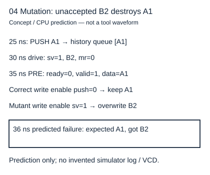

# 波形看起来正确时怎样找出测试平台也犯了同一个错

读者问题：测试平台复制 DUT 的状态更新方程，二者一致就够了吗？基础入口先记账：只在端口真正握手时记“接受”和“交付”，拿交付值与最早未交付输入比较。快入口按输入调度、前沿事件、后沿状态三层组织检查，并说明随机覆盖与有限枚举的范围。共同目标是避免一个错误方程同时出现在 DUT 与“参考”中。

## 驱动和观察分别占据安全窗口

`tb_slot.sv` 的时钟每5 ns翻转，周期10 ns。初态先在1 ns明确拉低复位，让异步复位事件发生；10 ns下降沿释放局部复位。第一次 tick 等待20 ns下降沿驱动 A1，21 ns记录稳定的 ready/valid/data，25 ns上升沿发生接收，26 ns观察提交后的寄存器。因此沿前 valid=0，与沿后 full=1 同时正确。

依据 [IEEE 1800-2017 §4.4.2、4.7—4.8，61—66页](https://fpga.mit.edu/6205/_static/F25/documentation/1800-2017.pdf)，同区活动可交错，#0进入Inactive而非直接越过NBA。测试平台不得在上升沿同一 Active 阶段更改输入后又期待 DUT 一定采到新值。`#0` 通常也只改变逻辑调度阶段，不能当作通用“所有 NBA 已完成”的栅栏。本实验选择驱动下降沿、等待1 ns观察沿前、上升沿后再等1 ns检查。它要求组合稳定时间在这个理想仿真内足够；实际网表延时仿真需另选观察窗口，并不能以这1 ns替代建立保持约束。

## 历史队列与占用寄存器承担不同任务

独立参考记录 Accepted 历史和 Delivered 历史。每个沿先检查旧队列：若输出 valid，则头必须等于 m_data；若 pop，就移除头并追加到 Delivered；若 push，才把该沿源字追加到 Accepted 和队列。先出旧再进新允许同沿替换。检查 Accepted=Delivered 拼接 Queue、0≤|Queue|≤1，而不是复制 `full<=s_valid` 的实现句。

有限算例：沿25 ns接受A1，队列[A1]；35、45 ns下游阻塞，上游保持B2，队列仍[A1]；55 ns交A1接B2，历史 Accepted=[A1,B2]、Delivered=[A1]、队列[B2]；65 ns交B2，三者关系仍成立。若写入条件变成 sv，35 ns已经把寄存器写成B2，但历史从未接受B2，36 ns后沿检查立即失败，无需等待以后输出错误。

这里的图和 JSON 来自 CPU 演算，标签明确是 predicted；真正 HDL 的 `$fatal` 文本、退出码和 VCD 只有工具实际运行才会产生。两个独立参考还可能共享同一错误的规格，例如把无直通误定为穿透；所以沿前合同和人工六拍表必须先固定，再检查代码。

## 随机不是覆盖声明的替身

SV 平台采用固定 LFSR 种子205017，产生1000周期刺激；Python另用标准库 PRNG 同种子记录身份，**两者随机流不同**，不能说一项随机测试逐拍对照同一刺激。平台维护 pending：尚未握手的字不改变，握手后才可选新字。下游可停顿；定向复位取消本 epoch 的 pending，避免复位刚释放时旧刺激偷接一拍。

覆盖计数至少确认接入、输出、满阻塞、同沿替换、非空复位；单纯“运行1000拍”可能全是空等待。定向序列负责稳定触发关键形态，随机负责扩展顺序组合；记录种子、宽度、长度、失败前完整刺激才能复现。不同种子增加样本，不能证明所有未来长度。

CPU 图遍历固定 W=2 的可达 (DUT状态,参考队列) 对，共8个状态和256条转移。它枚举二值复位/控制和4个输入字，预算用尽显式失败。该检查不需要上游保持假设也能证明拒绝输入不会覆盖存储；但合法生产者生成另按协议约束。图遍历覆盖的是这个有界 CPU 模型，不是 SV 解析、调度、四值未知、工具优化或亚稳态。

## 复现接口与可观察边界

可执行命令、明确库外输出与 tool not_run 状态在 [[电子电路/80-实践/26-HDL缓冲器与性质/README#真实HDL运行合同|实践运行合同]]。独立测试的价值是检查历史前缀和反例，而非检查每个实现句存在。若将 DUT 改成额外一级流水线，应先决定是否允许延迟变换，再改参考观察映射；擅自“多等一拍让测试绿”会丢掉原接口。

[官方 Icarus 入门](https://steveicarus.github.io/iverilog/usage/getting_started.html) 区分编译产物与 vvp 执行，支持此处分层记录的工具接口；它不证明本设计正确。当前机器缺工具，源码可交接，但这一层实际编译、正常仿真、故障仿真均未运行。

## 四题与理由

1. 55 ns沿后看到B2，于是认定这一拍交B2？答错，交付来自沿前A1；B2是本沿接入后状态。参考必须在端口事件窗口采旧字。
2. DUT和参考都用sv写入，两者通过说明什么？答只能说明二者一致，不能说明拒绝输入正确；历史队列只接受 push，所以能暴露共享更新错误。
3. 1000拍全空、零失败，能声称覆盖同沿替换？答不能，必须出现push∧pop计数或对应cover见证；设定定向满格替换才能保证触发。
4. 新设计可变延迟但不重排，怎样比较？答用接受/交付历史对照值序列并声明超时/公平条件，不绑定固定后沿；若任务仍要求逐拍原合同，序列一致不足以签逐拍等价。
