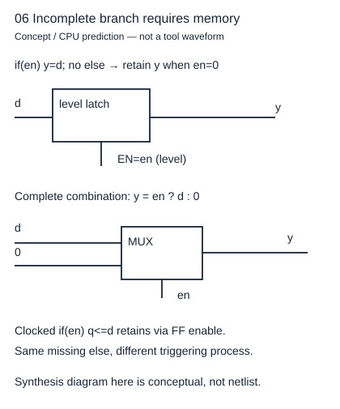
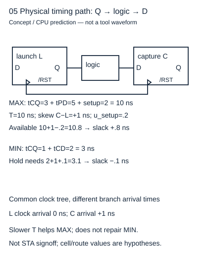

# 一段if怎样变成MUX、锁存器或触发器

读者问题：两个RTL输出样本相同，综合结果就一样且时序正确吗？基础入口看“关门时还要记住吗”：组合输出应由当前输入完全决定；门关时要保存历史就需要存储。快入口从过程触发、分支完备与观察关系推导结构，然后独立检查功能等价和物理路径。以下结构图是根据代码推导的概念电路，尚无真实综合网表。

## 同样缺else可以提出不同硬件要求

组合过程 `always @* if(en) y=d;` 在en=0时没有给y赋新值。为了延续旧y，它需要记忆；综合通常推断电平锁存器，en高时透明，低时保持。改成 `y=0; if(en)y=d;`，每条路径都有赋值，y=en?d:0，是组合MUX。若写 `always @(posedge clk) if(en)q<=d;`，保持来自沿触发寄存器的写使能，不是透明锁存；缺else在这个时钟过程是刻意保持。

`always_comb`表达组合意图并提供特定检查/敏感规则；它不能神奇补全漏掉的赋值。不同工具可能对错误意图报错，或报告锁存推断；必须看实际诊断。组合过程先给所有输出默认值，再按互斥或优先条件覆盖，常能明确完备责任。default='x可能帮助优化，也改变仿真和非法状态语义；不要用它把真实可达错误“变成don't-care”。

## 转移方程到综合网表

一格缓冲的数据新值是push?input:old_data，full新值是ready?sv:old_full。因此推导出两个MUX和两组寄存器，或库中带enable的寄存器单元。优化可以共享布尔项、消去恒定信号、重新编码FSM、替换MUX为等价门网络；内部形状不同不必然改变输出。

[Yosys Converting process blocks](https://yosyshq.readthedocs.io/projects/yosys/en/latest/using_yosys/synthesis/proc.html) 的proc步骤说明决策树转MUX、提取锁存与寄存器、识别异步复位。这里的full/data结构是按本转移式自行推导。真实综合还要固定WIDTH、顶层、宏、时钟/复位解释和库；测试平台不能作为设计顶层综合。

## 等价究竟比较哪些观察

对原无直通合同，要求同一合法输入序列、同复位epoch，每采样沿相同ready/valid，有效时相同data。无效data若合同不承诺可选择不比较，但复位清零若作为明确接口承诺就不能忽略。改变full编码可以允许内部状态映射；增加流水级或改成穿透会改变有效输出时刻，即使最终值序列相同，也不满足逐拍等价。

具体反例：空格sv=mr=1、输入7，原valid=0；穿透valid=1并本沿交7。这一拍端口已分歧，不能只比较最终吞吐。保守ready=¬q方案则在旧满、mr=1、sv=1时拒绝新输入，原方案接受，下一拍状态分歧。

自动等价工具必须有正确的初始状态/复位关系及已知/未知值模型；黑盒假设、undef设置和忽略未匹配单元会影响结论。[Yosys equiv_induct 文档](https://yosyshq.readthedocs.io/projects/yosys/en/latest/cmd/index_passes_equiv.html#equiv-induct-proving-equiv-cells-using-temporal-induction) 还明示其特殊等价定义：不能把任一命令成功当作任意初态完整逐拍证明。最少检查未证明单元数量、reset基例和比较点。本实验交付可执行命令，Yosys缺失时网表与等价状态保持not_run。

## 功能等价不清偿物理时间

图是真实责任连线的概念模型：发射Q经过组合逻辑到捕获D；同一时钟树两支到达时间不同。设周期T=10 ns、偏斜s=C−L=+1 ns、最大tCQ3/tPD5/setup2、setup不确定度0.2，建立裕量为10+1−3−5−2−0.2=0.8 ns。最小tCQ1/tCD2、hold2、不确定度0.1，保持裕量为1+2−2−1−0.1=−0.1 ns。延长周期能改善前者，不能改变同沿后者。

上述数值是清楚的教学假设，不是本RTL的实际延时。真实结论需工艺/器件库、布局布线、时钟约束、IO约束、角点与例外路径核查。ready的下游到上游组合链也可形成关键路径；优化出相同布尔函数，不代表链路延迟允许当前时钟。读 [[电子电路/34-时序状态与协议/02-建立保持时钟偏斜与路径#固定同沿关系再算deadline|deadline推导]]，把功能与物理检查各放回正确对象。

## 四题与理由

1. 组合if漏else，综合得到锁存但有限样本通过，能删警告吗？答不能，样本可能一直en=1未测保持。补完输出责任或明确要锁存并重新定时序。
2. 两种FSM编码内部bit不等，能等价吗？答能，按状态映射证明相同端口序列；若直接逐bit比较内部状态，会错误拒绝合法编码变化。
3. 只比较valid高时data，复位data清零的承诺怎么处理？答另做复位状态检查；功能don't-care的选择必须与接口承诺一致。
4. 上例把T改20 ns修好了什么？答setup裕量加10 ns，hold仍−0.1 ns；短路径、偏斜或专门延时修复须再做物理验证。
