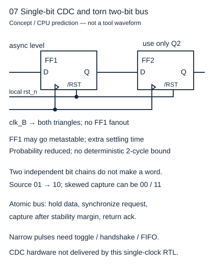
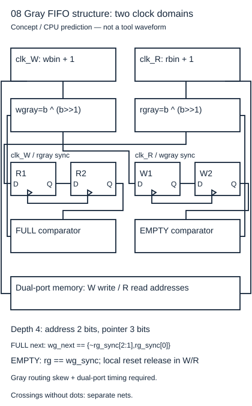

# 从纸上六拍到可复现失败，还缺哪一次真实运行

读者问题：拿到SV源码、CPU测试PASS和波形图，实验完成到哪一层？基础入口按“规定输入→运行什么→在哪里观察→保存什么”逐项核对。快入口直接检查源码身份、编译宏、工具版本、退出码、波形来源和证明假设。本单元承接原U5而新增隔离工具接口；旧源码与学习记录不改。当前没有安装HDL编译/仿真/综合/形式工具，故真实运行层明确未执行，不能用CPU图补成它。

## 六拍合同落到纳秒窗口

先以局部rst_n异步清零，下降沿安全释放，再逐个tick驱动。第一项A1在20 ns驱动、21 ns确认沿前ready=1/valid=0，25 ns接入、26 ns观测full=1/A1。30 ns驱动B2、mr=0，35 ns不接不交，36 ns仍A1；45 ns再阻塞；55 ns交A1接B2；65 ns交B2；75 ns空等待。无直通、阻塞保持、同沿替换都在一个有限例中被观察。

满格后在下降沿后2 ns拉低复位，1 ns后检查r/v/data均清0；下一下降沿释放，下一上升沿后确认空格，没有旧pending重新进入。这里外部复位的低脉冲可在数字仿真精确规定；真实最小脉宽和恢复移除必须按器件资料另查。

## 一条命令不能合并所有证据

[实践README](../80-实践/26-HDL缓冲器与性质/README.md) 提供从库根的相对源码命令与库外新输出。iverilog的 `-g2012`选择语言代、`-s tb_slot`选择顶层、`-o`指定编译产物；vvp再执行并把`+VCD=/absolute/path`交给平台。缺这个plusarg平台直接fatal，不默认污染当前目录。实际输出VCD必须由`$dumpfile/$dumpvars`在仿真执行时写出，Python不创建伪VCD。

[官方 Icarus flags](https://steveicarus.github.io/iverilog/usage/command_line_flags.html) 和 [波形文档](https://steveicarus.github.io/iverilog/usage/waveform_viewer.html) 支持命令和dump接口。工具语言选项不表示它实现了所有SystemVerilog语法，因此normal/mutant编译都要保留实际诊断。run_hdl用显式输出和45秒有限预算保存真正stdout/stderr/returncode；工具缺失只写execution-status.json为not_run，不伪造工具日志或成功VCD。

| 层 | 本单元交付 | 当前实际状态 |
| --- | --- | --- |
| 合同与纸上推导 | 六拍、归纳、反例、复位/CDC边界 | 作者候选，待独审 |
| CPU二值有限模型 | 历史队列、9测试、W2图遍历 | 实际运行通过 |
| SV编译/normal仿真 | RTL、独立tb、指定VCD命令 | not_run：工具缺失 |
| SV故障仿真 | fault宏、预期36 ns错误 | not_run，只有CPU预测 |
| 自动形式 | bmc/prove/cover/mutant harness | not_run：SBY/Yosys/solver缺失 |
| 综合/等价/STA/CDC | 命令与条件、概念结构 | not_run，无真实网表/签核 |
| 硬件 | 不含板卡与测量 | 未执行 |

## 故障注入应当真的失败

宏U26_FAULT_OVERWRITE只将写条件push变sv。第2拍B2没有握手却覆盖A1，CPU预测36 ns检查失败。真正故障仿真应编译宏版到另一输出目录，运行得到非零退出码，并在actual stdout/stderr中看head mismatch及期望/实得值；如果只有编译报错，这证明工具拒语法，不是检测到逻辑故障。若macro未带上，正常PASS也不能当故障检测成功。先固定宏与源码SHA，再关联命令、轨迹和失败时刻。

## 单时钟完成不等于跨域完成

一个稳定单bit可送入同域两级链，FF1只驱动FF2，末级使用；第一级可能亚稳，链提供额外解析时间，成功概率仍依频率、器件和布置。01→10的两bit若各自链延迟不同，可能拼出00/11。窄脉冲可能错过所有采样，不能只加一级宣称解决。

图是新CDC方案的结构解释，**未交付异步FIFO RTL**。以深度4为有限例，地址2bit、读写二进制指针3bit含wrap位，分别在W/R域更新；Gray=b^(b>>1)，011→100映射010→110，一次只改一位。将对方Gray指针经过本域两级同步后比较：读域empty比较本地rg与同步wg；写域next-full比较wg_next与同步rg顶部两bit取反、其余保持。为何深度4会反转顶部两bit？full表示写二进制指针比读指针领先4（模8），故b2翻转而b1/b0相同；Gray的g2=b2、g1=b2⊕b1都翻转，g0=b1⊕b0不变。next-full检测接受本次写后是否刚达到此关系；被full阻止的写不能继续递增。这是本3bit例的自推，不是任意Gray编码的通用口诀。

只有容量2的幂、该编码/指针尺寸/单步增量及正确memory端口语义下可用这个式子；各域reset释放、Gray总线位间skew约束仍须验证，Gray不能消除不受限布线造成的多次跃迁重叠。[AMD UG903 2024.2 的 About Bus Skew Constraints](https://docs.amd.com/r/2024.2-English/ug903-vivado-using-constraints/About-Bus-Skew-Constraints?contentId=kXqymQdxWW597oxcQ4ClQw) 说明Gray总线仍需位间skew控制，并与时钟偏斜区分。结构扩展要重新验证占用与复位epoch，不是给原slot多加两条FF就完成。

## 四题与理由

1. 发现execution-status=not_run，但CPU反例JSON有failure_cycle=2，能说故障仿真成功吗？答不能，后者是模型预期。必须取得实际编译成功和vvp逻辑失败证据。
2. 缺+VCD时fatal，算DUT功能故障吗？答不是，是运行接口缺参；修命令再运行，不能把任何非零码都归因到覆盖错误。
3. 实测RTL PASS后能说频率达100 MHz吗？答不能，零延迟功能仿真不含库和路线。必须STA/IO/时钟及实际硬件条件证明。
4. Gray指针从0直接加2仍只改一位吗？答不保证；例如000→010的Gray000→011两位改变。必须保证每次跨域发布增量符合单步Gray条件并满足物理约束，或改用完整握手捕获方案。
