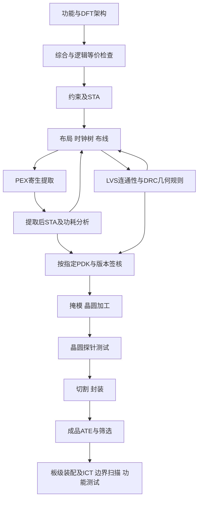

# 晶圆工艺到封装测试

## 两个入口：一颗芯片为什么有这么多版本

初次接触时，从一颗封装芯片倒着追问：引脚接到封装内部的焊盘，焊盘接到片上金属，金属经接触孔连接器件。电路图里的同一个节点，在实物中需要跨越材料与几何边界。读完本节，应能把“画出连接”“制造出连接”“筛出合格产品”三个动作对应到不同证据。

已有电路基础时，直接到“良率必须带分母”计算从晶圆到出货的条件概率，再返回剖面图查清哪些过程可能改变器件和互连。本页不要求先运行布局布线工具。

先读 [[电子电路/37-芯片实现与时序/01-工艺标准单元与PPA#从一根导线到两个器件|已发布的 CMOS 器件与互连对象]]，认出栅介质、源漏和金属连接；随后回到下面的剖面，追踪一条连接跨过哪些层。其后“逻辑、时序与几何是不同视图”用于区分 Liberty、LEF、版图和晶体管网表；这些视图名称不能代替制造合格证明。

## 掩模给平面信息，工序生成纵向结构

想象在纸上画一个孔：二维图告诉我们孔在哪里，却没有告诉我们孔穿过哪种材料、深度如何控制。光刻把图案转移到光刻胶上；显影后留下的胶图案可在后续刻蚀中保护某些区域。刻蚀移除材料，沉积添加薄膜，掺杂改变局部载流子条件。光刻本身不等于已经刻好硅，也不等于已经做好电接触。

热氧化与沉积都能形成某些薄膜，但机制不同；例如硅表面的热氧化会消耗部分硅，CVD 则通过前驱物输运、表面反应及副产物离开来生长膜。选择性、均匀性、应力和界面质量会影响后续步骤。这里解释对象和机制，不提供可在普通场所执行的洁净室配方。[MIT Lecture 2 的掩模与流程示例](https://ocw.mit.edu/courses/6-152j-micro-nano-processing-technology-fall-2005/9878a7acdd9632caa5afb8b4b96a6f39_lecture2.pdf)、[MIT CVD 讲义](https://ocw.mit.edu/courses/6-152j-micro-nano-processing-technology-fall-2005/cad5227ddbdf120be10a0c372f2ccedd_cvd.pdf)给出这些层级的原始教学依据；2005 年课堂工艺不是现代工厂通用配方。

![[电子电路/80-实践/35-良率热网络与追溯/assets/process-section.svg]]

*图：原创平面 NMOS 与两层互连的教学剖面，非比例尺。接触孔连接源漏与 M1；栅与沟道之间有介质，不能把栅画成穿透介质的短路。M1–M2 的通孔位于层间介质中。隔离、体接触、完整 CMOS 阱及真实设计规则未全部画出；本图不是可制造版图。封装与 PCB 是后续对象，不能与片内金属混成同一层。*

金属互连还涉及绝缘隔离、通孔与平坦化。相同逻辑连接可以有不同线宽、长度、寄生与可靠性；片上提取模型不能自动包含封装引线、焊球、板走线和散热条件。封装提供电、机械和热路径，也带来新的接合失效与寄生对象。

## 从设计签核到筛选出货

![[电子电路/80-实践/35-良率热网络与追溯/assets/manufacturing-flow.svg]]

*图：同一制造链的窄屏静态版本；箭头表示输入依赖与修订反馈，不是已经运行的工具日志。DFT 的架构、插入及验证会依工具流程分布在不同阶段。*

回到 [[电子电路/37-芯片实现与时序/04-布局布线时钟树与物理预算#提取把几何变成寄生网络|已有的两段互连与 PEX 算例]]，可检查相同电路的几何怎样改变延迟；再回来分清 PEX 与探针测试。LVS 核连接对应，DRC 核指定规则，STA 核指定模式、角与约束下的时序。三项通过都不证明没有随机制造缺陷，也不证明满足真实 PPA 指标。本链未运行 PDK、综合、STA、PEX、LVS、DRC 或 ATE。开放名称不等于有权复制每套 PDK 文件；使用者必须记录工艺、库、规则版本和许可。

## 良率必须带分母

取同一投入批次，$Y_w=P(W)$ 表示晶圆测试通过，$Y_p=P(P\mid W)$ 表示送入封装的已通过裸片最终通过成品测试，$Y_b=P(B\mid W,P)$ 表示这些器件装板后通过板级测试。按概率乘法

$$Y_{\rm ship}=Y_wY_pY_b.$$

这是嵌套条件比例，无需假设三阶段独立。若把三个不同批次的无条件通过率相乘，就没有这项保证。例：1000 个候选裸片，900 个通过晶圆测试，其中 882 个通过封装成品测试，再有 873 个通过规定板测。得到 $0.9\times0.98\times(873/882)=0.873$。还须记录投入计数规则，不能把晶圆面积利用率、裸片电测良率和封装通过率都叫“90%良率”。

一个简化面积模型是假设致命随机缺陷在面积 $A$ 上均匀独立，计数 $N\sim\operatorname{Poisson}(DA)$，$D$ 为每平方米缺陷密度。因此

$$Y_0=P(N=0)=e^{-DA},\qquad [A]={\rm m^2},\ [D]={\rm m^{-2}}.$$

$A=10^{-4}\,\rm m^2,D=1000\,\rm m^{-2}$ 给 $Y_0=0.904837$。这是声明假设后的推导，不是某工厂的实测良率。系统性短路、聚集缺陷、边缘排除、冗余修复和参数超规格都能破坏这个模型；“没有致命缺陷”也不必然等于参数全合格。实践35同时保留条件计数与这个玩具模型，不把它拟合成公开 PDK。

## 迁移理由题与解答

1. 两层金属的投影在俯视图重叠，能否认定短接？
2. 为何不能将相互独立的两份供应商“封装良率”和本批晶圆通过率直接拼成真实出货良率？
3. 在上述 Poisson 假设下，面积减半时良率是否翻倍？算出本例新值。
4. DRC 与 LVS 都通过，为什么还要做晶圆测试？给出一个不由这两项排除的反例。

> [!question]- 核对理由
> 1. 不能。层间介质会隔离它们；必须看通孔和工艺层连接规则。跨层投影不是连通性证据。
> 2. 需知道封装分母是否是本批已通过裸片、筛选和规格是否相同。可以明确假设作为预测，不能冒充嵌套实测计数；合法答案也可提出同批重新统计。
> 3. $e^{-0.05}=0.951229$，不是 $2\times0.904837$。指数中的无量纲乘积改变，概率不能超过1。
> 4. 随机接触开路、颗粒短路或参数漂移均可。LVS/DRC 对指定设计数据和规则检查，测试观察制造后的器件；它们支持不同结论。

## 返回与下一步

到 [[电子电路/54-制造可靠性与生命周期/02-制造故障与生产测试#覆盖率的分母与漏检的条件概率|生产测试]]，把“通过筛选”的判断拆成故障模型、可观察结果与真实漏检。源码、有限计算和版本参数在 [[电子电路/80-实践/35-良率热网络与追溯/README#运行与输出边界|实践35]]；它只计算教学模型，没有制造、测量或认证。
