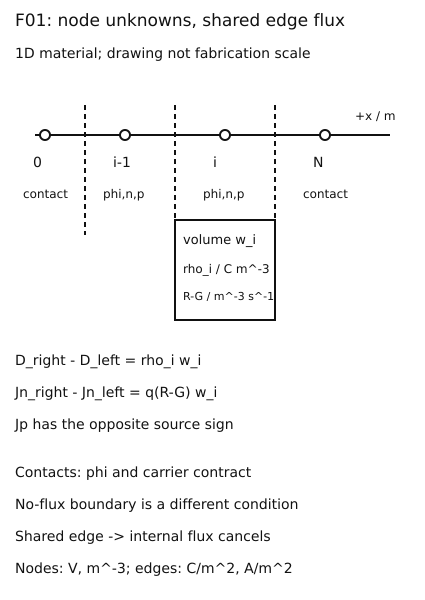

# 漂移扩散、Poisson与接触：从空间材料表到守恒方程

**读者问题：已画出PN结五图，怎样知道这些图共同解了同一个器件，而不是五条各自好看的曲线？** 基础入口从一根长度1μm的条形区域、两个接触和三个网格点开始；快进入口从控制体积方程和指数拟合通量开始。两路汇入同一份节点电势、载流子和边界表。这里推进到离散场问题，不重新讲二极管入门，也不声称小脚本是完整TCAD。

## 先写对象，再写方程

一维位置x向右，截面A恒定。电势φ[V]、电场E=−dφ/dx[V/m]、位移D=εE[C/m²]；n,p和离化掺杂ND⁺、NA⁻均为m⁻³。q>0[C]，ε[F/m]，μ[m²/(V·s)]，载流子产生G、复合R[m⁻³s⁻¹]，传统电流密度Jn,Jp向右为正[A/m²]。材料区、温度和模型选项是输入，不是从网格线自动产生的物理。

$$\rho=q(p-n+N_D^+-N_A^-),\quad -\frac{d}{dx}\left(\epsilon\frac{d\phi}{dx}\right)=\rho,$$
$$J_n=q\mu_n nE+qD_n n',\quad J_p=q\mu_p pE-qD_p p',$$
$$\dot n=J_n'/q+G-R,\qquad \dot p=-J_p'/q+G-R.$$

这里低场、等温、非简并、各载流子局部热化，才用Dn=μnVT、Dp=μpVT，VT=kBT/q。空间变化的ε须留在导数里面；异质结能带偏移、界面电荷、隧穿、速度饱和、载流子能量输运与量子限制都不由这一组常参数式自动解决。有限频率端口还涉及位移电流；稳态Jn+Jp守恒不能直接迁移成任意瞬态传导电流都相等。

去[[电子电路/22-半导体与真实元件/01-能带载流子掺杂与输运#电场和浓度梯度，两种不同的推动|电流方向]]带回电子粒子向左时传统电流向右的符号，再去[[电子电路/22-半导体与真实元件/02-PN结五空间图与端口指数#Poisson积分：边界比公式重要|势参考与两次积分]]带回φ/E/ρ单位。原耗尽图忽略移动电荷；本章把n、p重新放回ρ，所以不是把原近似图直接叫自洽解。

## 接触决定未知量能否被确定

在理想欧姆接触，通常指定端口电化学势及局部平衡浓度，并由掺杂/功函数/势参考得到电势边界。外加端口电压不是“所有接触φ一律等于该电压”：内建电势和参考偏移也在边界合同内。在绝缘边界，载流子法向通量为零；电势边界可能由金属电极、介质连续D或面电荷给出。Schottky接触的注入关系需另一模型。不能同时在同一边界任意给φ、E而不检查兼容性。

纯Poisson若两端只给D而没有势参考，兼容时有整体平移自由度；两端D差必须等于区内总电荷。两个φ的Dirichlet值则固定参考和势差。偏置非平衡下n,p各有自己的准费米势，不能继续强制np=ni²。温度变了还要改ni、μ、离化和接触，不能只改VT。

图是原创网格示意，位置间距不代表制造尺寸。边界节点0、N带规定量；内部节点存φi,ni,pi，边i+1/2保存Di+1/2,Jn,i+1/2,Jp,i+1/2。画在格子中的箭头是正方向，不断言解为正。

## 控制体积把守恒写成相邻通量差

节点xi左右距离h−=xi−xi−1、h+=xi+1−xi，控制长度wi=(h−+h+)/2。常ε、节点采样电荷的Poisson离散为

$$D_{i+1/2}-D_{i-1/2}=\rho_iw_i,\quad D_{i+1/2}=-\epsilon\frac{\phi_{i+1}-\phi_i}{h_+}.$$

即对角ε/h−+ε/h+，左右非对角−ε/h−、−ε/h+，右端ρiwi再加入已知接触电势项。每一行单位C/m²；乘截面A才为C。稳态电子式为Jn,i+1/2−Jn,i−1/2=q(Ri−Gi)wi，空穴式相反。相邻控制体积共用同一个边通量，因此内部边求和抵消；总和只剩接触和体产生/复合。这是守恒的结构依据。

独立手算：L=1μm、ε=11.7ε0≈1.03594×10⁻¹⁰F/m、均匀ρ=1C/m³，φ(0)=0、φ(L)=.1V。解析

$$\phi(x)=.1x/L+\rho x(L-x)/(2\epsilon).$$

三点网格h=.5μm，只一个内部未知量：2εφ1/h=ρh+ε(.1)/h，故φ1=.05+ρh²/(2ε)≈.05120661V。右边D−左边D=ρh=5×10⁻⁷C/m²。把cm⁻³数值不换成m⁻³会产生10⁶倍电荷错误，网格更细也不会修复单位错误。此恒定电荷例是Poisson基准，不宣称已由该ρ反推出非平衡n,p。

## 指数拟合通量保留平衡抵消

直接中心差分漂移加扩散，在一个边电势跨多个VT时可能把两个大数粗糙相减。设一条边φ线性，μ、VT恒定，边内Jn常数，则电子式成为n′−(φ′/VT)n=Jn/(qμVT)。乘exp(−φ/VT)后沿边积分，得到

$$J_{n,LR}=\frac{q\mu_nV_T}{h}\{n_RB(\delta)-n_LB(-\delta)\},\quad\delta=(\phi_R-\phi_L)/V_T,$$
$$B(z)=z/(e^z-1),\quad B(0)=1.$$

空穴对应Jp=qμpVT[pLB(δ)−pRB(−δ)]/h。B(−δ)=e^δB(δ)，所以nR=nLe^δ、pR=pLe^−δ时两电流为零；δ=0时电子回到qDn(nR−nL)/h。这个Scharfetter–Gummel边式在上述边内假设下来自精确积分，不等于真实全器件在任何网格都精确。[TU Wien Klima §2.4 式2.1–2.15](https://www.iue.tuwien.ac.at/phd/klima/node23.html)实际正文给控制体积与边通量；本页沿边积分和数例为自主推导。

300K、VT=.025852V、μ=.135、h=1μm、nL=nR=10²¹m⁻³，φR−φL=VT ln2。B(ln2)=ln2、B(−ln2)=2ln2，故Jn=−qμVTn ln2/h≈−3.876×10⁵A/m²。负号对应E向左。若改成nR=2nL，则同一势边给零电流；这是边界不同导致的另一个解，不是算法随意切换。实践用一个公共J未知量联立每条边，核对所有边电流相等；φ为规定输入，故此运输子问题尚未与Poisson自洽联立。

## 自洽与求解预算

全稳态DD内部每点有φ,n,p三未知量与三条守恒方程。可交替Poisson和两连续式（Gummel类分裂），也可对完整残差Newton。必须缩放V、浓度和通量，保正浓度，记录残差、接触电流差、阻尼和有限预算；收敛到离散根不等于网格误差或模型误差小。实验另实现自洽**平衡Poisson–Boltzmann**，用共同化学势消去n,p；它只覆盖平衡，无需假装提供完整偏置DD。

[DEVSIM 2.11.0 §13.1–13.2](https://devsim.net/examples_short.html)实际示例依次设置网格/材料/接触、初始电势、DD变量与偏压步进。本次只读该文档，没有安装或运行DEVSIM，其网页日志不是我们的运行证据。[[电子电路/80-实践/36-器件场与紧凑模型/README|CPU与专业工具的分层入口]]给当前案例、域、源码和未运行出口。

## 四题及理由

1. 预测：恒ρ例两端φ均加.2V，E、内部电荷与φ1怎样？答：φ1加.2V，所有差分/E不变；固定ρ和Dirichlet整体平移保持同一电场解。自洽载流子若保持化学势不变，则不能照搬此结论。
2. 计算：h=.5μm、ρ=1，两个内部边D差为何不是1？答：应为ρh=5×10⁻⁷C/m²，密度必须乘控制长度；再乘A才是电荷C。
3. 边界迁移：热平衡边nR=2nL改为nR=nL、势差仍VT ln2，可以仍宣布Jn=0吗？答：不能，SG式给负电流，边界化学势已不同；必须解运输并回到电荷耦合。
4. 等价解：纯Neumann Poisson所有φ加常数，为何不能把两条曲线当两个不同物理器件？答：共同参考自由度不改E/D，需固定一个势参考；若总电荷与接触D差不兼容则没有解，不能靠选参考掩盖矛盾。

## 选择半导体消费者，再核场与接触的合同

本页守恒离散的 $\epsilon$[F/m]、$\rho$[C/m³]、$D$[C/m²] 与接触参考可带入 [[物理/50-半导体物理/11-异质结带阶界面电荷与自洽边界#把自洽源带回电磁边值问题|平衡异质结]]：带边材料卡与占据生成 $\rho(\phi)$，片电荷独立入界面跳跃，返回本页保证不将材料带阶塞入普通同材 SG 边。若片电荷也随占据变化，去 [[物理/50-半导体物理/12-界面态占据电荷与平衡自洽#片电荷反馈与端口微分不是同一个电容|自洽界面态]] 带回 $\sigma_s(\phi_0)$ 及其 Jacobian；冻结它是另一种模型，需要时间或误差条件。

去 [[物理/50-半导体物理/06-有限基区通量接触与存储时间#接触速度是边界，不是直接修改体寿命|少子 Robin 端]]，返回区别规定浓度和有限移除通量；它未指定完整 Ohmic/Schottky 接触。需要两个偏置储库时进入 [[物理/50-半导体物理/14-偏置异质结两载流子DD-Poisson与电流收支#稳态传导账怎样回到总电荷守恒|两载流子稳态端流]]，携带 $F_n,F_p$ 的共同参考与接触电压，返回核两连续式、逐边流、体复合和界面跳跃。该有限 CQFL/固定片/SRH 模型是真实明确的教学合同；本页离散方法入口、它的独立求解记录与真实 TCAD/PDK 是不同证据层。

## 从稳态边通量走到守恒时间步

若问题是“电子正在积累时各边电流为何不同”，进入 [[电子电路/60-TCAD与器件场模型/04-阻挡边界瞬态输运守恒正性与耗散#同一条边只存一个通量，两个相邻格子共用|阻挡电子瞬态链]]。带去本页的SG符号与控制体积，那里加入端点半格、全空间密度时间导数和每步Poisson；再带回固定场正性与全耦合Newton收敛的区别。返回本页接触合同时，阻挡边不指定浓度储库；改成Ohmic边需要重新写边界收支。它是单电子/单材料的有限代表，不是将既有异质双载流子稳态所有物理直接升级为动态器件。
