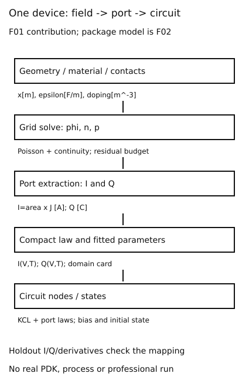

# 从场求解到端口紧凑模型：相同曲线不等于相同内部参数

**读者问题：TCAD算出一片器件的电流曲线，为什么还要提取SPICE模型，拟合得准又能证明多少？** 基础入口从均匀条形电阻的两个端口读起；快进入口从端口映射、偏导和可辨识性进入。两路使用同一根1μm条形体及同一组合参数G。目标是定位模型层级与提取证据，不写另一遍MOS工作区教程。

## 场未知量多，电路未知量少

场模型输入几何、材料、掺杂、接触、物理模型和偏压，求每个网格节点φ,n,p及通量。工艺模拟可给掺杂/形貌，但本次没有工艺流程实跑或真实PDK，不能把手填常数叫工艺校准。场求解先把电流密度在端口面积积分成A，再把电荷积分成C。电路紧凑模型保留端口电压、电流、端口电荷及必要内部状态，用代数/微分本构参与网络求解。

把TCAD端口写为I(V,T,g,θphys)，g为几何、θphys为材料参数；提取紧凑参数θcompact，使F(V,T,g;θcompact)在规定数据域逼近I及Q等目标。映射不是逐个字段复制：某个紧凑参数可能吸收多个场效应，或依赖提取策略。参数名字像迁移率，也不能仅因拟合成功就认定它等于独立材料测量值。

图的空间网格→端口积分→紧凑本构→电路KCL箭头是信息变换，图底部的保留验证要求检查该变换，不表示已经获得真实工艺或软件输出。封装RLC/热/机械是另一个F02贡献，本图只占V41的器件网格部分。

## 同一条形体的精确低场约化

长度L=1μm、面积A=1μm²=10⁻¹²m²，均匀电子浓度n=10²¹m⁻³、μ=.135m²/(V·s)，忽略空穴、产生复合、接触电阻与自热。假设ND⁺=n、ρ=0，两端欧姆接触维持相同浓度；φ线性满足Poisson。定义端口电压V=φL−φR，以进入左端并沿+x的传统电流I为正。E=V/L，n′=0，故

$$I=q\mu n A V/L=GV,\qquad G=q\mu n A/L.$$

G≈21.6293846μS，R≈46.2334kΩ；V=.01,.02,.04V分别I=.216294,.432588,.865175μA。给定φ的SG网格在每条边得到同一均匀漂移电流，密度相等且B(δ)−B(−δ)=−δ，因此此线性势/常密度子问题无需网格极细才恢复该约化。边内精确不保证一般非均匀器件精确。

这是一个可复算的场到端口约化，不是把PN结电流误拟成电阻。低场漂移模型在哪个E范围有效需材料来源；本数例是自设常μ模型，不用它认证真实硅器件高场范围。长度、面积改变时必须保持同一个材料/接触合同，否则不能只按A/L缩放。

## 提取一个组合参数，与提取两个物理参数不同

对已扣零偏置电流、等方差误差、过原点模型，最小二乘目标Σ(Ik−GVk)²。对G求导得到

$$\widehat G=\frac{\sum V_k I_k}{\sum V_k^2},\qquad \sum V_k^2>0.$$

输入为A/V，结果S；分母单位V²。上面三个精确合成点还原G，残差零。这只说明合成数据与自己规定的线性模型一致。若接触电阻使I=V/(Rcontact+L/(qμnA))，拟合G会混入接触；若零偏置有漏电/仪器偏置，应先另设截距并提供足够激励，不能默默当0。

固定A,L后，μ=.135,n=10²¹与μ=.0675,n=2×10²¹给同样G与全部线性I–V点。再增加一千个同一温度的直流点也不能分开μ和n。以对数参数z=(lnμ,lnn)，I的两个灵敏度列都是I：δI/I=δz1+δz2。Jacobian只有秩1，δz1=−δz2沿不可见方向。需独立浓度/几何测量、不同温度/机理数据等增加有区别的信息；不能把较低拟合残差当参数已唯一。

去[[电子电路/22-半导体与真实元件/06-数据手册测试条件与模型来源#从测试点建模型，需要额外假设|一个测试点与多种参数]]带回(V,I,T)与参数自由度，返回后检查本章整条直线仍不能分解μn的更强反例。去[[电子电路/14-网络建模与仿真/05-SPICE分析输入输出与模型层级#非线性器件让AC与tran分开|偏置后的AC与携带状态的tran]]带回Q点、偏导、初值；返回后避免把DC提取的G自动当包含全部动态模型。

## I–V吻合还缺端口电荷与状态

局部线性化δI=gδV，g=∂I/∂V[S]；端口电荷Q(V)给C=∂Q/∂V[F]和电流dQ/dt。多端口必须约定进入器件的电流、参考和Q的分配；内部总电荷变化与各端电流相容。DC中无电荷变化，两组不同C的模型可以给同一I–V；AC/瞬态却不同。若条形端口另并一个明确假设C=.1pF，Y=G+jωC，在1MHz电容导纳幅值.628319μS；C=1pF则6.28319μS，同一DC曲线不能选其中一个。

热模型、滞回、陷阱或非准静态状态还需各自测量与时间尺度。静态导数适用于偏置附近小扰动，不能由此认证大偏置切换与任意高频。模型卡须写工艺/尺寸、温度、偏压、频带和端口顺序，范围未知就保留未知，不虚构PVT角落。

## 真实模型提取为什么分组

[UC Berkeley BSIM4v4.8.0手册§16.1–16.3，印刷123–128页](https://ngspice.sourceforge.io/external-documents/models/BSIM480_Manual.pdf)实际正文区分全局拟合与按机理局部提取，使用多种几何/偏压和先验工艺输入。它支撑提取策略；上面的条形式、LS与秩1反例为本章自主计算，未提取BSIM卡。[官方BSIM4入口](https://www.bsim.berkeley.edu/models/bsim4/)本次实际读取4.8.3发布说明，说明存在代码/手册/测试包；未下载、安装或运行该包，固定4.8.0手册也不冒称最新执行版本。

实际流程可先在场求解的数值误差预算内生成偏压/温度/几何数据，保留接触定义；选紧凑本构及目标量，按测量误差加权；划分提取点与保留验证点；核电流/电荷、局部导数、外推失败及电路残差。只有每层都保存输入与版本，拟合和电路结果才可比较。[[电子电路/80-实践/36-器件场与紧凑模型/README|有限提取实验]]当前仅执行合成条形G提取，不执行专业TCAD/SPICE。

## 四题及理由

1. 预测：n翻倍、μ减半，三个I点和G怎样？答：全部不变，μn保持不变；模型内端口等价，不证明材料微观相同。
2. 计算：V=.02V、I=.432588μA，G为何不是.021629S？答：I是微安，应为21.6294μS；A/V单位先统一。
3. 边界迁移：把300K提取卡拿到低温，只改VT足够吗？答：不够，μ、载流子/离化、接触与物理模型可能改变，需新的温度数据或有效温度模型；本脚本没有这种卡。
4. 等价解：两个模型DC相同、C分别.1和1pF，能否称全频等价？答：不能，1MHz下jωC相差5.65487μS；DC只约束静态端口，不约束电荷/动态状态。

## 跨学科往返：X16从场到封装再到生命周期

先沿 [[电子电路/60-TCAD与器件场模型/01-漂移扩散Poisson与接触网格#控制体积把守恒写成相邻通量差]] 核对边缘通量与控制体积电荷，再回本页积分成端口 I（A）、Q（C）。本页的低场条形例只提取 G（S）；I–V吻合不能识别 Q(V)（C）、储能状态、封装回流路径或温度系数。[[电子电路/60-TCAD与器件场模型/03-网格收敛材料敏感度与校准复现#把校准设计成可复查实验]] 返回补的是固定几何、材料、接触与holdout后的校准证据，不是给不同器件自动转移参数。

下一步读 [[电子电路/62-Chiplet与异构封装/01-封装互连与异构集成#局部被动RLC由两个状态推出]]：端口外还有 i_L（A）、v_C（V）与回流闭合；然后读 [[电子电路/62-Chiplet与异构封装/02-热电机械协同#从热通量到两节点能量守恒]] 的功率W、温差K和热容量J/K；再由 [[电子电路/54-制造可靠性与生命周期/04-热可靠性与失效机理#跨学科往返：寿命概率需要自己的条件]] 区分工作温升、循环幅度、损伤及寿命分布。条形体与封装例是分别指定的合成对象，**不是同一颗芯片的场求解、提参、寿命闭环**。连接它们还需独立几何/材料/动态端口/热机械校准与版本记录，见 [[计算机知识/75-软件工程与人机交互/03-验证测试发布与维护闭环#电子电路往返：X16场封装与生命周期组合证据]]。

V41的现有原创图按这个责任顺序读：[[电子电路/80-实践/36-器件场与紧凑模型/assets/mesh-flux.svg]] 显示Poisson/输运网格及通量单位；[[电子电路/80-实践/36-器件场与紧凑模型/assets/model-levels.svg]] 显示场→端口→KCL及校准缺口；[[电子电路/80-实践/37-封装耦合与接口/assets/02-rlc.svg]] 显示实际R–L–C回路；[[电子电路/80-实践/37-封装耦合与接口/assets/03-thermal.svg]] 显示两热节点与环境；[[电子电路/80-实践/37-封装耦合与接口/assets/04-mechanical.svg]] 显示自由热膨胀失配。[[电子电路/80-实践/37-封装耦合与接口/assets/01-package.svg]] 只给各尺度的结构关系，示意坐标不是制造尺寸。网格图是方程离散责任示意，不声称已运行完整偏置漂移扩散工具或真实工艺提参。

**迁移任务：** 两模型都测得G=21.6293846µS，分别假设并联C=0.1pF与1pF；1MHz时能否互换？答案：DC都相同，但虚导纳ωC分别0.628319µS与6.28319µS，相差十倍；至少补动态端口电荷/阻抗证据。这两个假设电容不是F02的0.5pF提取结果，也不能凭DC拟合选出哪一个。
