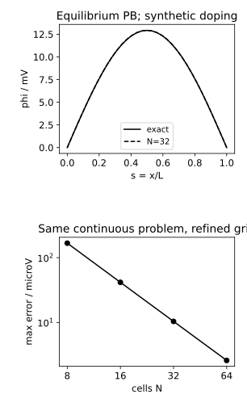
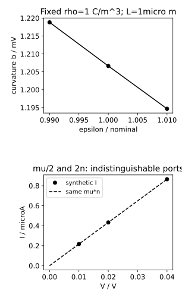

# 网格、材料与校准：怎样使“模型吻合”成为可复现的限定结论

**读者问题：残差已经10⁻¹³、曲线也平滑，为什么器件预测仍可能错？** 基础入口比较8/16/32/64个单元的同一曲线；快进入口核制造解、缩放残差、敏感度与可辨识方向。两入口使用同一平衡场问题和前章条形端口，分别问算法、离散、材料和数据四层，不能把它们合成一个“精度”。

## 用有已知答案的自洽问题检查网格

取L=1μm、T=300K、ε=11.7ε0、ni=10¹⁶m⁻³，只作为教学常参数。平衡共同化学势与势参考定义n=ni exp(u)、p=ni exp(−u)，u=φ/VT，s=x/L。两端u=0，n=p=ni；这是规定平衡接触的数学基准，不是额外施加一个非零端口偏压的二极管扫描。

由Poisson可得

$$-u''+\gamma[2\sinh u-d(s)]=0,\qquad\gamma=\frac{q n_i L^2}{\epsilon V_T},\quad d=(N_D^+-N_A^-)/n_i,$$

撇号现在对无量纲s。为有独立答案，选u*(s)=a sin(πs)、a=.5，并**制造**固定掺杂函数

$$d(s)=2\sinh[u^*(s)]+\frac{\pi^2}{\gamma}u^*(s).$$

代回式子：−u*″=π²u*，与γ(2sinh u*−d)=−π²u*恰好抵消，故u*是连续方程精确解。n/p正且np=ni²，ρ由移动与固定电荷共同决定；这是自洽平衡PB，而非耗尽图混合残差。掺杂为自设光滑正净施主，不是实测工艺分布。接触化学势固定让SG边电流为零，源不是照光或偏置注入。

等距h=1/N，内部残差

$$F_i(u)=\frac{2u_i-u_{i-1}-u_{i+1}}{h^2}+\gamma[2\sinh u_i-d(s_i)].$$

Jacobian对角2/h²+2γcosh ui，邻项−1/h²，给定边界下正定。由单调sinh和正定差分算子，若两离散解之差为w，内积wᵀ(F(u)−F(v))中每项非负且差分项严格正，故本离散边值问题至多一根。它是这个模型的唯一性论证，不给任意DD、热耦合或击穿模型全局保证。用Newton求JΔu=−F，最多30次，每次最多20个二分阻尼候选，u限|u|≤4；残差不降、预算耗尽、输入域外均明确失败。γ数值约5.98×10⁻⁴，无量纲，不把C/m²与载流子守恒残差直接混作同一容差。

## 小残差为什么仍有可见网格误差

CPU实际数据，误差是节点max|φh−φ*|，单位V：

|单元数N|最大电势误差|无量纲离散残差∞范数|
|---|---|---|
|8|167.3787μV|8.88×10⁻¹⁵|
|16|41.6028μV|1.51×10⁻¹⁴|
|32|10.3857μV|4.44×10⁻¹⁴|
|64|2.59548μV|3.42×10⁻¹³|

N翻倍，误差比约4，显示本光滑均匀网格案例二阶趋势；残差在每个网格早已远小于离散误差。细网格相同解曲线很平滑也不证明没有材料或边界误差。若没有精确解，可在共同节点/插值约定下比较Qh,Qh/2,Qh/4，用p≈log2(|Qh−Qh/2|/|Qh/2−Qh/4|)估观察阶；须先进入渐近区，差值不能为0/舍入噪声或换了模型。真正尖锐结、界面、强非线性下不能从此表认定全部指标二阶，应同时检验端口电流、电荷、场峰与局部网格质量。

不要用重算后的制造d来证明材料敏感度：该d含γ，改变ε又按公式重造d，会把待比较的物理输入一并改掉。网格系列保持连续d、材料和接触不变，仅重采样；材料系列应固定原物理掺杂、电荷和接触。

## 敏感度必须说明固定了哪些条件

回到第一章固定ρ=1C/m³、L=1μm、两端0/.1V的Poisson基准，中点相对线性插值的增量b=ρL²/(8ε)=1.20663362mV。固定ρ,L和两端φ，

$$\frac{\partial b}{\partial\epsilon}=-\frac b\epsilon,\quad \frac{\partial\ln b}{\partial\ln\epsilon}=-1.$$

ε增加1%时b除1.01，为1.19468675mV，下降约11.94687μV；不是总φ中点下降1%，因为.05V端点线性项没有变。若ρ=q(p−n+ND−NA)也随材料改变，完整自洽导数需从F(u,θ)=0得J du/dθ=−∂F/∂θ，不能只用固定ρ导数。前章G=qμnA/L的对数敏感度对μ,n,A为+1、L为−1，但μ/n两列相同，敏感不等于可辨识。

该图使用固定ρ的ε±1%数据和合成I–V，不是材料批次测量。不加无来源的“真实工艺误差百分比”。去[[电子电路/14-网络建模与仿真/04-非线性工作点Newton阻尼与多根#缩放、停止与失败|缩放与误差界]]带回残差单位、迭代预算和J的条件；返回后区分本PB无量纲容差与Poisson的C/m²守恒量。Newton停止不会自动提供一个电势物理误差界。

## 把校准设计成可复查实验

先写待预测量，例如300K、指定低场偏压域的G，还是跨温度/偏置的I、Q、恢复时间；写实际器件/工艺批次与几何、接触方向、源/仪表负载、温度稳定方式及校准版本。没有设备时只写计划，不伪造型号和记录。真实测量数据保留原文件、单位、重复数、零点/漂移、误差模型和异常点理由；合成数据明确synthetic。

然后核参数是否有不同响应方向。本组只有三个正V点，G可提取，μ与n不可分。若要估μ和n，需有独立浓度观测或确有区分信息的实验；给一个先验固定n会使μ数值唯一，但这是条件估计，不是从I–V独自识别。残差来自测量噪声、模型遗漏和参数误差的混合；不能把残差RMS直接叫物理参数置信区间。高斯独立同方差且模型正确时才可从设计矩阵和估计方差构造常规区间，相关/异方差/输入误差应换模型。

将一部分偏压、温度和几何**预先**留作验证；提取点权重/损失、参数初值/边界、算法版本、有限预算保存。若验证失败，先分数值未收敛、网格未收敛、单位/接触错误、域外物理、拟合不可辨识；不得通过悄悄删验证点、增加无记录的辅助电导或夹住指数来制造成功。最终模型卡记录有效域、已知失效及生产使用前需补的测试。生产预算需按目标电流/电荷/电路指标安排测量误差、离散误差与模型差，误差有关联时不用RSS；本次没有生产容差认证。

[BSIM4v4.8.0 §16.1–16.3](https://ngspice.sourceforge.io/external-documents/models/BSIM480_Manual.pdf)的实际正文说明局部机理和多几何提取；本章校准流程是据本有限反例设计的计划，不假称执行BSIM提取。[DEVSIM 2.11.0 §13.2](https://devsim.net/examples_short.html)给专业示例初始化/偏压流程，本次专业工具仍未运行。[[电子电路/80-实践/36-器件场与紧凑模型/README|唯一源码与复现命令]]保存数值、版本与域；TCAD/SPICE/真实PDK、工艺、硬件、UI及真人学习各自未验证。

## 四题及理由

1. 预测：残差10⁻¹⁴而N=8误差167μV是否矛盾？答：不矛盾，残差针对离散方程，误差对连续精确解；解得准不代表网格够细。
2. 计算：误差41.6028μV变10.3857μV，观察阶约多少？答：log2(41.6028/10.3857)≈2.002，符合本光滑案例二阶趋势，但不是全器件通用定理。
3. 边界迁移：ε改1%，保持ρ和端点，整个中点φ下降1%吗？答：不；只有曲率增量按1/ε变化，中点固定线性项.05V不变。重新制造d还会换物理问题。
4. 等价解：沿lnμ增加t、lnn减少t，损失为何不变？答：G只依赖μn，这个方向不可观测；再收集同一种DC直线点不能解决，需改变信息而非仅增加点数。

## 用 Hall 增加信息，同时保留换向与模型误差

本页校准计划可用 [[物理/50-半导体物理/04-弛豫时间Hall符号与可辨识测量#由完整例走向可复查测量|同一样品的 Hall 换向接口]] 具体化：固定几何/厚度、温度、接触编号及纵向电流，记录 $B=0$ 电阻、$\pm B$ 的横向原始读数，再换电流方向。回来将 $U_y$[V] 经宽度、电流密度和 $B$[T] 转为 $R_H$[m³/C]，与 $G$[S] 分别传播几何/负载/零点不确定度；奇部消除与 $B$ 无关的偏置，却不自动消除全部热磁或接触误差。

再去该课 [[物理/50-半导体物理/04-弛豫时间Hall符号与可辨识测量#把力、观测与校准分开带回|两参数满秩与三参数核]]，回到本页决定究竟校准 $G$、条件已知 $r_H$ 下的 $n,\mu$，还是更广模型。未知 $r_H$ 时数据仍有等价方向；由微观理论或独立数据固定它是新增输入，应在模型卡披露。网格收敛检验离散场问题，Hall 换向检验观测，材料/双载流子检验模型；三层不能互相替代，本段是可执行测量计划，未声称取得真实读数。

## 用时间信息补一个平衡看不见的方向

[[电子电路/60-TCAD与器件场模型/04-阻挡边界瞬态输运守恒正性与耗散#固定连续输入，分开检验根、网格、时间和模型|阻挡单电子瞬态链]] 将同一连续施主和电子总量固定，独立比较平衡网格误差与有限时间步误差。带回本页时先区分残差、空间误差和时间尚未弛豫；其平衡对常迁移率零敏感，增加平衡像素也不能识别μ。去该课 [[电子电路/60-TCAD与器件场模型/04-阻挡边界瞬态输运守恒正性与耗散#先撤掉提示，再检查所用条件|迁移率与时钟题]]，再回到本页选择有已知几何/真实时钟的动态观测，披露仪器、寄生和遗漏反应；教学时间重标不是材料标定。
